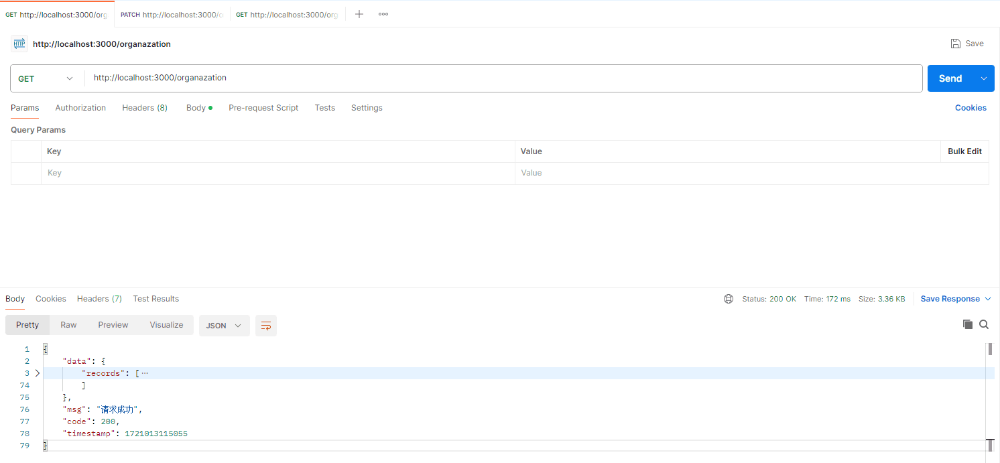
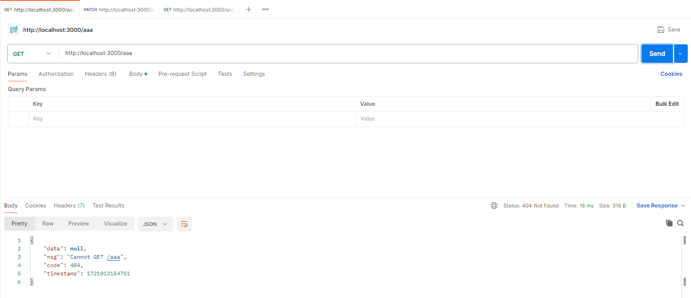

## 前言

在我们实际的业务开发中，我们可以看到后端接口返回格式都有一定的要求，假如我们统一规定接口的统一返回格式为：

```json
{
  data: any; // 业务数据
  code: number; // 状态码
  msg: string; // 响应信息
  timestamp: number; // 时间戳
}
```

那么在 [Nest.js](https://nestjs.com/) 中，我们应该如何处理呢？

## 定义响应状态码枚举和类型

1.  在 **src** 目录中新建 **/enums/index.ts** 文件：

```ts
/**
 * @description: 响应码
 */
export enum RESPONSE_CODE {
  NOSUCCESS = -1, // 表示请求成功，但操作未成功
  SUCCESS = 200, // 请求成功
  BAD_REQUEST = 400, // 请求错误
  UNAUTHORIZED = 401, // 未授权
  FORBIDDEN = 403, // 禁止访问
  NOT_FOUND = 404, // 资源未找到
  INTERNAL_SERVER_ERROR = 500, // 服务器错误
}

/**
 * @description: 请求提示语
 */
export enum RESPONSE_MSG {
  SUCCESS = "请求成功",
  FAILURE = "请求失败",
}
```

2.  在 **src** 目录中新建 **/typings/index.d.ts** 文件：

```ts
declare namespace Api {
  namespace Common {
    /**
     * @description: 全局响应体
     */
    type Response<T = any> = {
      code: number; // 状态码
      data?: T; // 业务数据
      msg: string; // 响应信息
      timestamp: number; // 时间戳
    };
    /**
     * @description: 分页数据
     */
    type PageResponse<T = any> = {
      current?: number; // 页码
      size?: number; // 当前页条数
      total?: number; // 总条数
      records: T[]; // 业务数据
    };
  }
}
```

3.  我们可以编写一个公共方法，专门处理接口的返回结果：

```ts
import dayjs from "dayjs";

import { RESPONSE_CODE, RESPONSE_MSG } from "@/enums";
import type { Response } from "@/types";

/**
 * @description: 统一返回体
 */
export const responseMessage = <T = any>(
  data,
  msg: string = RESPONSE_MSG.SUCCESS,
  code: number = RESPONSE_CODE.SUCCESS
): Response<T> => ({ data, msg, code, timestamp: dayjs().valueOf() });
```

> 这里大家可以根据自己的实际业务需求修改。

## 定义响应体 DTO

首先，定义一个统一的响应数据传输对象（DTO），这将作为所有 **API** 响应的基本结构。

在 **src** 目录中新建 **/dto/response.dto.ts** 文件：

```ts
import { ApiProperty } from "@nestjs/swagger";

import { RESPONSE_CODE, RESPONSE_MSG } from "@/enums";

export class ResponseDto {
  @ApiProperty({
    type: Number,
    description: "业务状态码",
    default: RESPONSE_CODE.SUCCESS,
  })
  code: number;

  @ApiProperty({
    type: String,
    description: "业务信息",
    default: RESPONSE_MSG.SUCCESS,
  })
  msg: string;

  @ApiProperty({ description: "业务数据" })
  data?: any;

  @ApiProperty({ type: Number, description: "时间戳", default: 1720685424078 })
  timestamp: number;
}
```

## HttpException 异常过滤器

创建一个异常过滤器，它负责捕获作为 **HttpException** 类实例的异常，并为它们设置自定义响应逻辑。

在 **src** 目录中新建 **/filter/http-exception.filter.ts** 文件：

```ts
import {
  ArgumentsHost,
  Catch,
  ExceptionFilter,
  HttpException,
} from "@nestjs/common";
import { Response } from "express";

import { responseMessage } from "@/utils";

// @Catch() 装饰器绑定所需的元数据到异常过滤器上。它告诉 Nest这个特定的过滤器正在寻找
@Catch(HttpException)
export class HttpExceptionsFilter implements ExceptionFilter {
  catch(exception: HttpException, host: ArgumentsHost) {
    // 获取上下文
    const ctx = host.switchToHttp();
    // 获取响应体
    const response = ctx.getResponse<Response>();
    // 获取状态码
    const statusCode = exception.getStatus();

    // 自定义异常返回体
    response
      .status(statusCode)
      .json(responseMessage(null, exception.message, statusCode));
  }
}
```

## 全局异常过滤器

创建一个全局异常过滤器来处理所有的异常，并将其转换为统一的响应格式。

在 **src** 目录中新建 **/filter/all-exception.filter.ts** 文件：

```ts
import {
  ArgumentsHost,
  Catch,
  ExceptionFilter,
  HttpException,
  HttpStatus,
} from "@nestjs/common";
import { Response } from "express";

import { responseMessage } from "@/utils";

// @Catch() 装饰器绑定所需的元数据到异常过滤器上。它告诉 Nest这个特定的过滤器正在寻找
@Catch()
export class AllExceptionsFilter implements ExceptionFilter {
  catch(exception: unknown, host: ArgumentsHost) {
    // 获取上下文
    const ctx = host.switchToHttp();
    // 获取响应体
    const response = ctx.getResponse<Response>();
    // 获取状态码，判断是HTTP异常还是服务器异常
    const statusCode =
      exception instanceof HttpException
        ? exception.getStatus()
        : HttpStatus.INTERNAL_SERVER_ERROR;

    // 自定义异常返回体
    response
      .status(statusCode)
      .json(responseMessage(null, "服务器内部错误!", statusCode));
  }
}
```

## 全局配置

在 **main.ts** 中注册全局的异常过滤器。

```ts
import { NestFactory } from "@nestjs/core";
import { AppModule } from "./app.module";
import { AllExceptionsFilter } from "@/filter/all-exception.filter"; // 全局异常过滤器
import { HttpExceptionsFilter } from "@/filter/http-exception.filter"; // http 异常过滤器

async function bootstrap() {
  const app = await NestFactory.create(AppModule);

  // 错误异常捕获 和 过滤处理
  app.useGlobalFilters(new AllExceptionsFilter());
  app.useGlobalFilters(new HttpExceptionsFilter());

  await app.listen(3000);
}
bootstrap();
```

## 效果预览

1.  正常请求成功



2.  当我们访问一个不存在的接口时


