## 前言

在当今的互联网环境中，HTTPS 已经成为网站安全的标配，而SSL/TLS证书则是实现HTTPS的基础。然而，对于个人开发者和小型项目来说，管理SSL证书的续签往往是一个容易被忽视却极其繁琐的任务。

### 手动续签SSL证书的痛点

1.  **频繁操作，容易遗忘**

    - 免费的SSL证书（如Let’s Encrypt）有效期仅有**90天**，这意味着每年至少需要手动续签4次。

    - 一旦忘记续签，网站将面临**安全警告**，甚至被浏览器标记为“不安全”，严重影响用户体验和SEO排名。

2.  **操作复杂，容易出错**

    - 手动续签涉及生成CSR、提交CA、域名验证、证书部署等多个步骤，稍有不慎就会导致配置错误或服务中断。

    - 对于多服务器或分布式架构，手动管理证书更是耗时耗力。

3.  **服务中断风险**

    - 证书过期后，HTTPS服务会立即失效，可能导致用户无法访问，甚至触发安全警报。

    - 紧急修复时，可能因操作仓促而引入新的问题。

### 自动化续签：解放开发者，保障业务连续性

为了避免这些问题，越来越多的开发者转向**自动化SSL证书管理工具**（如Certbot、Certimate、acme.sh）。这些工具能够：

- ✅ **自动监控证书有效期**，提前续签，避免过期风险。

- ✅ **一键部署**，支持Nginx、Apache、云服务等多种环境。

- ✅ **支持多域名和通配符证书**，简化批量管理。

在本文中，我们将对比几款主流的SSL自动化工具（Certbot、Certimate、acme.sh），帮助你选择最适合的解决方案，彻底告别手动续签的烦恼。

## SSL 证书续签工具对比

|   功能/特性    |      **Certbot**       |                     **Certimate**                     |                      **acme.sh**                       |
| :------------: | :--------------------: | :---------------------------------------------------: | :----------------------------------------------------: |
|  **是否开源**  |           ✅           |                          ✅                           |                           ✅                           |
|   **开发方**   | Let's Encrypt 官方推荐 | [开源社区](https://github.com/certimate-go/certimate) | [开源社区](https://github.com/acmesh-official/acme.sh) |
| **自动化续签** |           ✅           |                          ✅                           |                           ✅                           |
|  **支持的CA**  |     Let's Encrypt      |              Let's Encrypt, 其他ACME CA               |            Let's Encrypt, ZeroSSL, Buypass             |
|  **部署目标**  |  Nginx, Apache, 手动   |           自动部署（Nginx, Apache, 云服务）           |                      需自定义脚本                      |
| **日志与监控** |        基础日志        |                  详细日志 + 告警通知                  |                        基础日志                        |
|  **操作方式**  |     命令行 + cron      |                   Web UI + 后台服务                   |                     纯 shell 脚本                      |

## 为什么选择 Certimate ？

`Certimate` 就是为了解决上述问题而产生的，它具有以下优势：

- **本地部署**：一键安装，只需要下载二进制文件，然后直接运行即可。同时也支持 Docker 部署、源代码部署等方式。​

- **数据安全**：由于是私有部署，所有数据均存储在自己的服务器上，不会经过第三方，确保数据的隐私和安全。​

- **操作简单**：简单配置即可轻松申请 SSL 证书并部署到指定的目标上，在证书即将过期前自动续期，从申请证书到使用证书完全自动化，无需人工操作。​

> `Certimate` **旨在为用户提供一个安全、简便的 SSL 证书管理解决方案。**

## 特性

- 灵活的工作流编排方式，证书从申请到部署完全自动化；

- 支持单域名、多域名、泛域名证书，可选 RSA、ECC 签名算法；

- 支持 PEM、PFX、JKS 等多种格式输出证书；

- 支持 30+ 域名托管商（如阿里云、腾讯云、Cloudflare 等）；

- 支持 100+ 部署目标（如 Kubernetes、CDN、WAF、负载均衡等）；

- 支持邮件、钉钉、飞书、企业微信、Webhook 等多种通知渠道；

- 支持 Let's Encrypt、Buypass、Google Trust Services、SSL.com、ZeroSSL 等多种 ACME 证书颁发机构；

- 更多特性等待探索。

## 安装部署

1.  在 1Panel 面板的应用商店搜索 `certimate` ，点击安装：

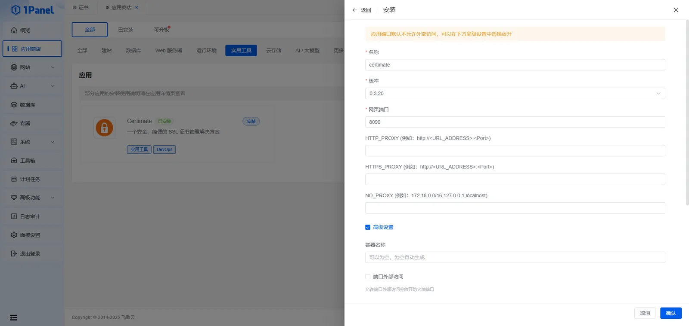

2.  打开 Web 页面，初始账号： `admin@certimate.fun`，密码： `1234567890` ：

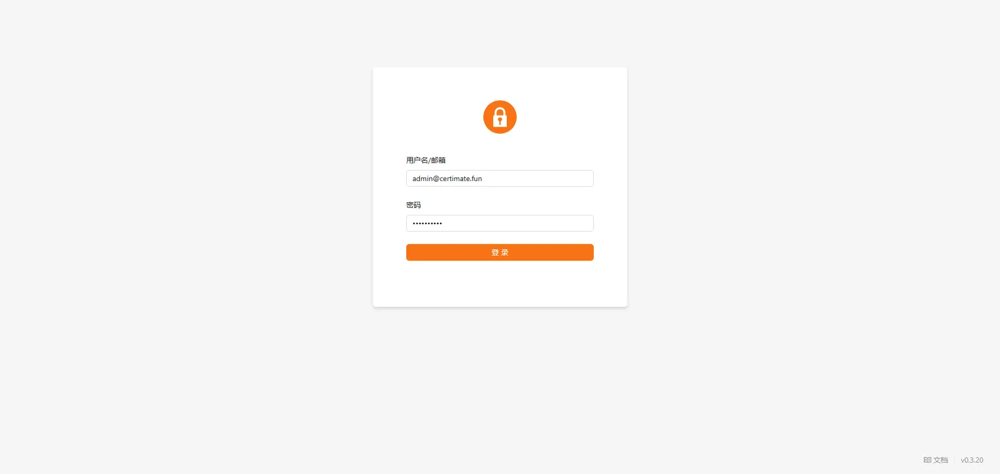

## 授权管理

1.  点击左侧的 `授权管理` ，新建授权，添加 **添加主机提供商——1Panel**：

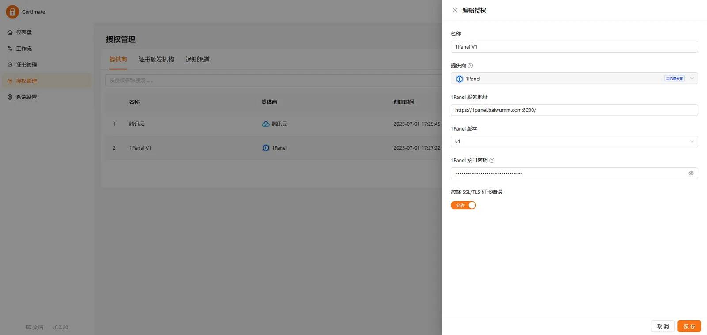

2.  获取 1Panel 接口密钥，`面板设置` - `API接口` - `详情` ：

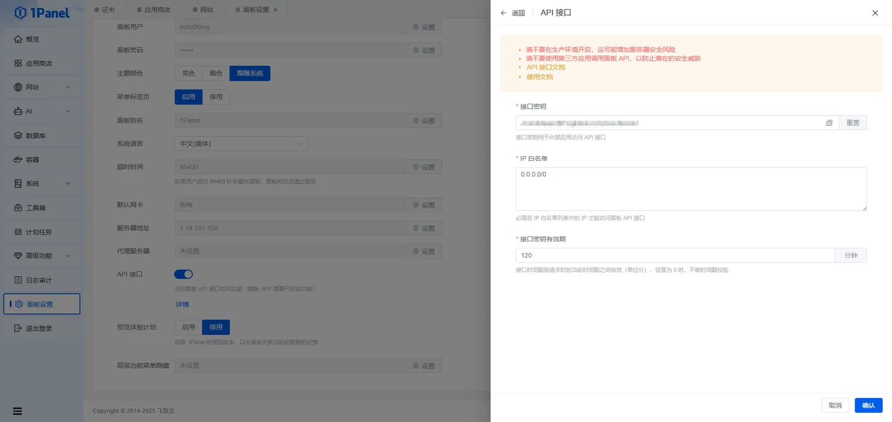

3.  添加 DNS 提供商，这里以腾讯云为例：

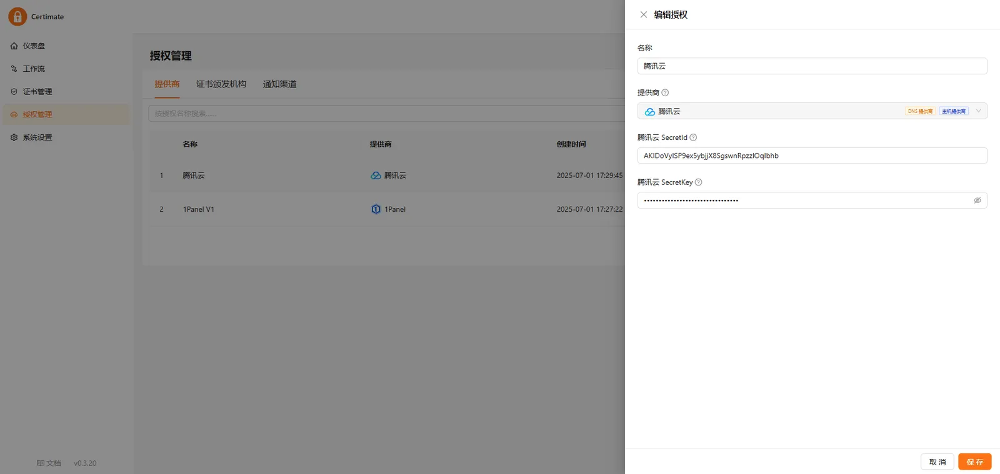

`SecretId` 和 `SecretKey` 获取方式：[主账号访问密钥管理](https://cloud.tencent.com/document/product/598/40488)

4.  这里的 `证书颁发机构` ，我们使用内置的 `Let's Encrypt` 即可，也可以添加其他机构：

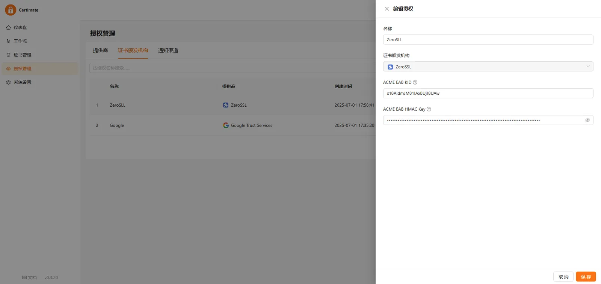

5.  添加通知渠道，这里我们添加邮件通知，用于接收 SSL 证书续签的通知：

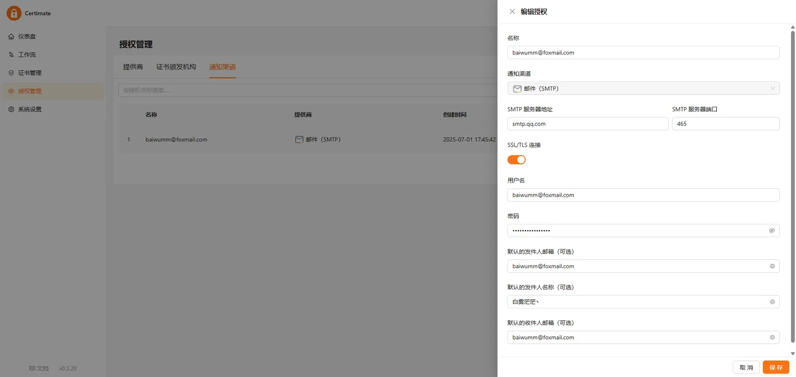

**注意事项：**

> 亲测证书的颁发机构 ZeroSLL 和 Google 申请时会超时，应该是需要外网访问，国内用户建议使用内置的 `Let's Encrypt`

## 创建工作流

1.  点击左侧的 `工作流` ，点击 `新建工作流` ，选择 `标准模板` ：

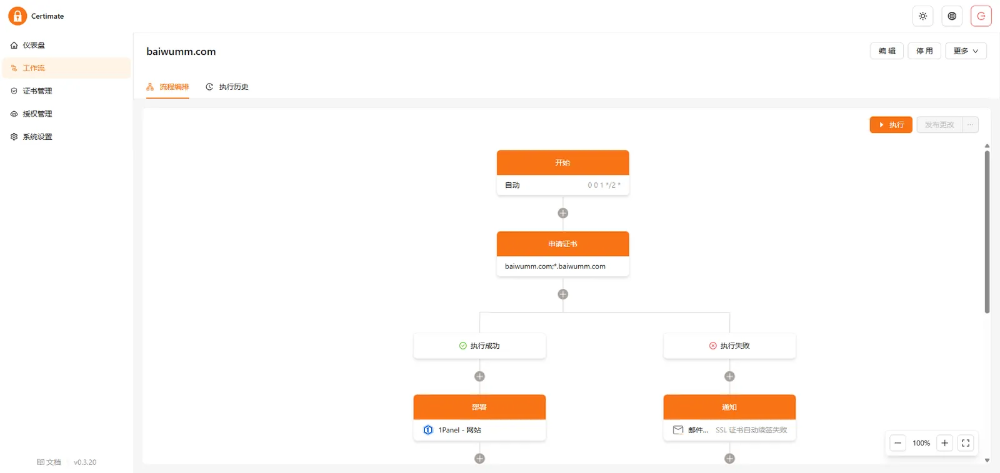

2.  点击 `开始` ，设置触发方式：

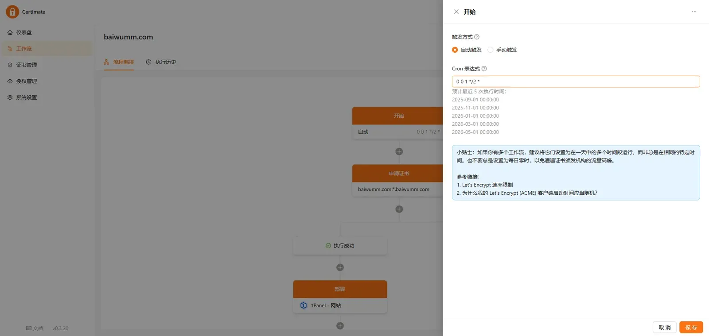

3.  点击 `申请` ，根据要求设置证书：

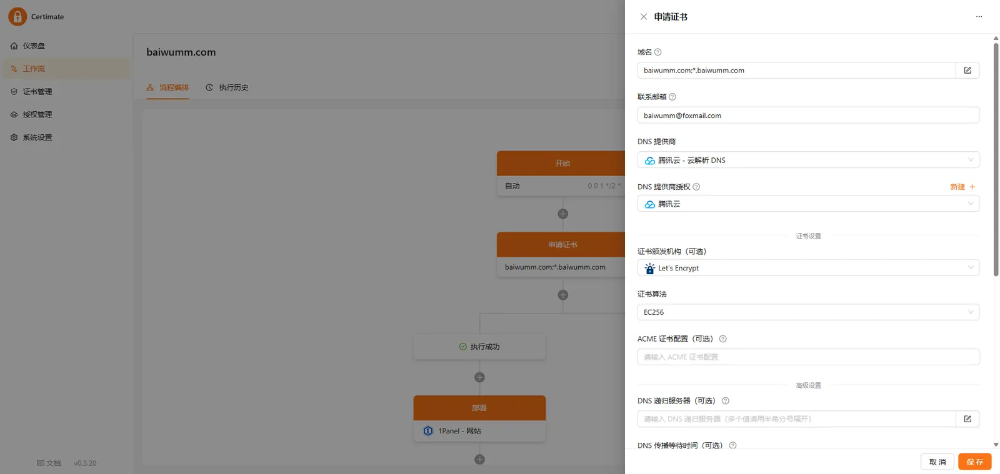

4.  点击 `部署` ，设置部署目标：

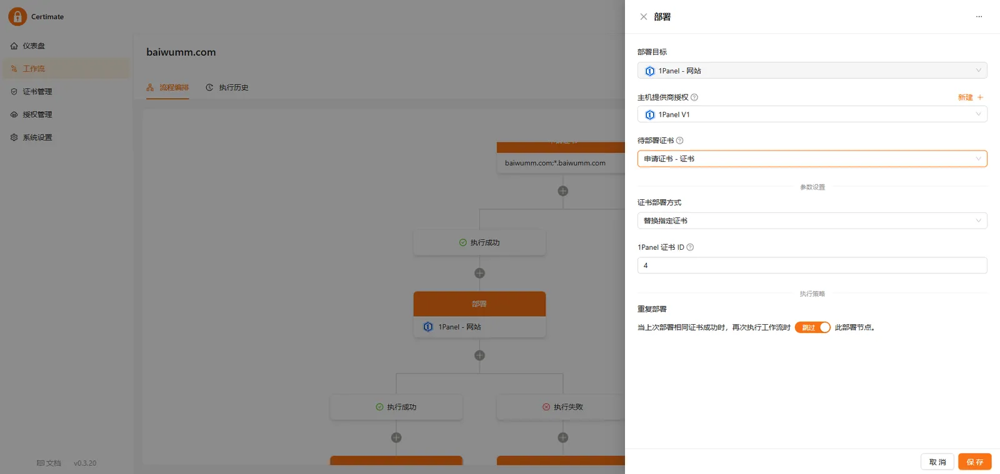

5.  这里的 `1Panel 证书 ID` 后续可能会更新为直接选择，现阶段只能通过开发者工具抓取：

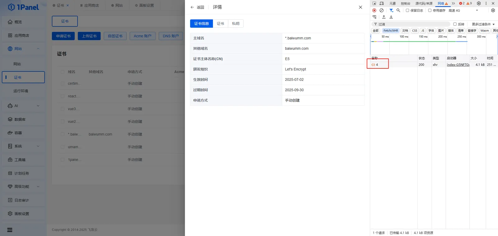

6.  点击 `通知` ，创建推送通知：

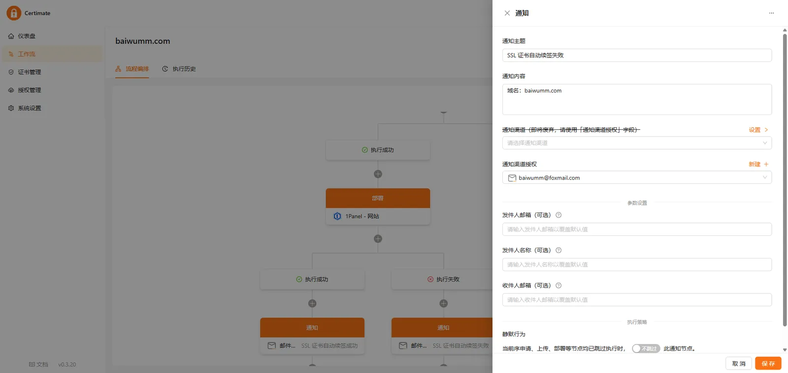

## 申请测试

点击 `发布更改` ，点击 `执行` ，在执行历史里面查看执行结果：

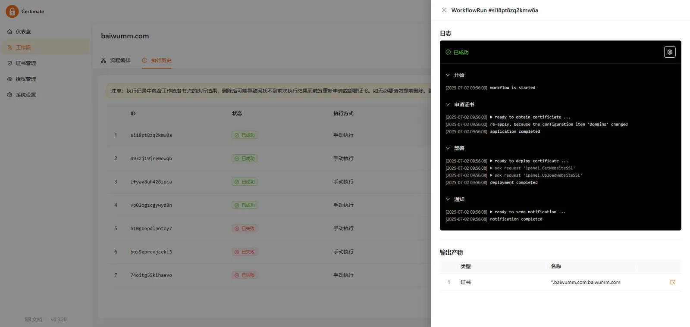

> 顺利的话，恭喜你，你的证书续签成功了，可以返回 1Panel 面板证书面板查看过期时间！

## 界面预览

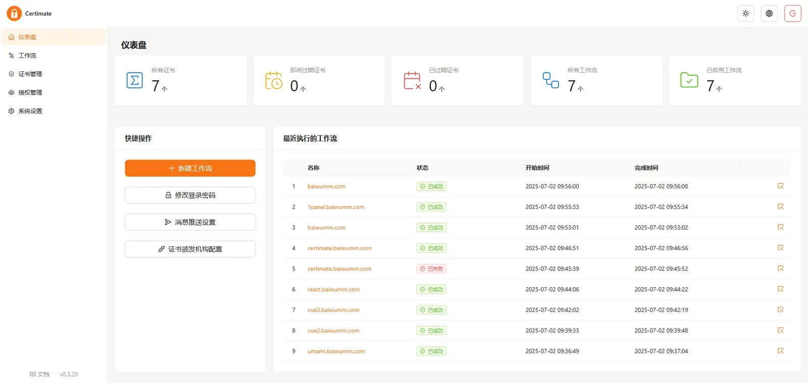

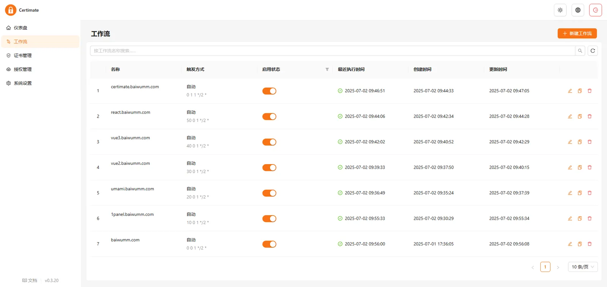

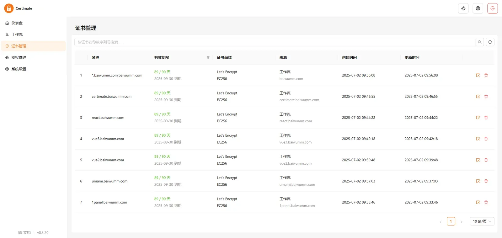

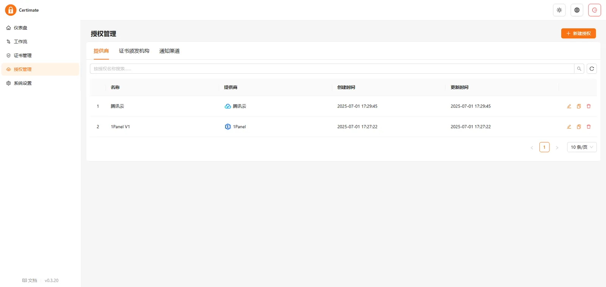

## 注意事项

如果你使用的是 `1Panel` ，并且有多个网站多个证书，你需要创建多个工作流，因为目前的 `Certimate` 一个工作流只支持一个证书，如果你介意这点，就要换一个工具！

目前尚不清楚其他的提供商是不是也会这样，参考：[1Panel证书更新功能建议切换API调用实现](https://github.com/certimate-go/certimate/issues/614)

## 总结

SSL/TLS 证书是保障网站安全的核心，但手动管理的繁琐流程和高风险让开发者疲于应对。 `Certimate` 作为一款**开源、轻量且功能强大**的自动化工具，完美解决了这一痛点。

**无论你是个人开发者还是企业团队**， `Certimate` 都能以 **零维护成本** 实现 HTTPS 永续保障。与其在手动续签中重复“**救火**”，不如花 5 分钟配置，换取永久安心。

**让证书管理回归本质——本该如此简单。**

**Github 地址：**[certimate](https://github.com/certimate-go/certimate)

**官方文档：**[Certimate Docs](https://docs.certimate.me/)
