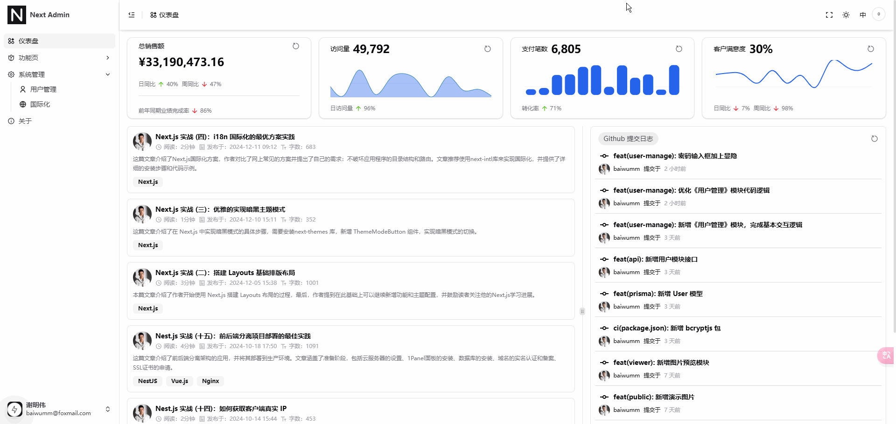

## 什么是 Framer Motion

[Framer Motion](https://www.framer.com/) 是一个专门为 [React](https://www.reactjs.cn/) 设计的、功能强大且易于使用的动画库。它允许开发者轻松地为他们的应用添加流畅的交互和动画效果，而不需要深入理解复杂的动画原理。[Framer Motion](https://www.framer.com/) 提供了声明式的 **API** 来处理动画、手势以及页面转换，非常适合用来创建响应式用户界面。

## 首屏加载动画

如果你使用 [next.js](https://nextjs.org/) 构建单页面应用程序，页面一开始资源加载会导致页面空白，一般我们的做法都是在首屏添加加载动画，等资源加载完成再把动画取消。

1.  新建 **components/FullLoading/index.tsx** 文件：

```ts
'use client';

import { useEffect, useState } from 'react';

const FullLoading = () => {
  const [mounted, setMounted] = useState(false);

  useEffect(() => {
    setMounted(true);
  }, []);

  // 判断组件是否挂载
  if (!mounted) {
    return (
      <div className="fixed flex w-screen h-screen justify-center items-center flex-col z-[99] overflow-hidden bg-white dark:bg-slate-900">
        <div className="relative w-12 h-12 rotate-[165deg] before:content-[''] after:content-[''] before:absolute after:absolute before:top-2/4 after:top-2/4 before:left-2/4 after:left-2/4 before:block after:block before:w-[.5em] after:w-[.5em] before:h-[.5em] after:h-[.5em] before:rounded after:rounded before:-translate-x-1/2 after:-translate-x-1/2 before:-translate-y-2/4 after:-translate-y-2/4 before:animate-[loaderBefore_2s_infinite] after:animate-[loaderAfter_2s_infinite]"></div>
      </div>
    );
  }
  return null;
};
export default FullLoading;
```

2.  **app/globals.scss** 中加入代码：

```ts
@keyframes loaderBefore {
  0% {
   width: 0.5em;
   box-shadow: 1em -0.5em rgba(225, 20, 98, 0.75), -1em 0.5em rgba(111, 202, 220, 0.75);
  }

  35% {
   width: 2.5em;
   box-shadow: 0 -0.5em rgba(225, 20, 98, 0.75), 0 0.5em rgba(111, 202, 220, 0.75);
  }

  70% {
   width: 0.5em;
   box-shadow: -1em -0.5em rgba(225, 20, 98, 0.75), 1em 0.5em rgba(111, 202, 220, 0.75);
  }

  100% {
   box-shadow: 1em -0.5em rgba(225, 20, 98, 0.75), -1em 0.5em rgba(111, 202, 220, 0.75);
  }
 }

 @keyframes loaderAfter {
  0% {
   height: 0.5em;
   box-shadow: 0.5em 1em rgba(61, 184, 143, 0.75), -0.5em -1em rgba(233, 169, 32, 0.75);
  }

  35% {
   height: 2.5em;
   box-shadow: 0.5em 0 rgba(61, 184, 143, 0.75), -0.5em 0 rgba(233, 169, 32, 0.75);
  }

  70% {
   height: 0.5em;
   box-shadow: 0.5em -1em rgba(61, 184, 143, 0.75), -0.5em 1em rgba(233, 169, 32, 0.75);
  }

  100% {
   box-shadow: 0.5em 1em rgba(61, 184, 143, 0.75), -0.5em -1em rgba(233, 169, 32, 0.75);
  }
 }
```

3.  **layout.tsx** 中引用组件：

```ts
export default async function RootLayout({
  children,
}: Readonly<{
  children: React.ReactNode;
}>) {
  return (
    <html suppressHydrationWarning>
      <body>
        <NextUIProvider>
            <ThemeProvider attribute="class" defaultTheme="light">
              {/* 全局 Loading */}
              <FullLoading />
              {children}
            </ThemeProvider>
        </NextUIProvider>
      </body>
    </html>
  );
}
```

实际效果可参考网站：

::link-card[https://hot.baiwumm.com]

## 路由加载 Loading

[next.js](https://nextjs.org/) 提供了现成的方案，官方文档参考：[loading.js](https://nextjs.org/docs/app/api-reference/file-conventions/loading)

新建 **app/loading.tsx** 文件：

```ts
import { Spinner } from '@nextui-org/react';

export default function Loading() {
  return (
    <div className="flex justify-center items-center min-h-60">
      <Spinner label="页面正在加载中..." />
    </div>
  );
}
```

## 路由进场动画

新建 **app/template.tsx** 文件：

```ts
"use client";

import { motion } from "framer-motion";

export default function Template({ children }: { children: React.ReactNode }) {
  const variants = {
    hidden: { opacity: 0, x: 100 },
    enter: { opacity: 1, x: 0 },
  };

  return (
    <motion.main
      data-scroll
      className="mb-auto p-4"
      initial="hidden"
      animate="enter"
      variants={variants}
      transition={{ duration: 0.5, ease: 'easeOut' }}
    >
      {children}
    </motion.main>
  );
}
```

## 路由退场动画

1.  新建 **components/PageAnimatePresence/index.tsx** 文件

```ts
"use client";

import { AnimatePresence, motion } from "framer-motion";
import { LayoutRouterContext } from "next/dist/shared/lib/app-router-context.shared-runtime";
import { usePathname } from "next/navigation";
import { useContext, useRef } from "react";

// 阻止页面立即打开，先让退场动画走完，再显示新的页面内容
function FrozenRouter(props: { children: React.ReactNode }) {
  const context = useContext(LayoutRouterContext ?? {});
  const frozen = useRef(context).current;

  return (
    <LayoutRouterContext.Provider value={frozen}>
      {props.children}
    </LayoutRouterContext.Provider>
  );
}

const PageAnimatePresence = ({ children }: { children: React.ReactNode }) => {
  const pathname = usePathname();

  return (
    <AnimatePresence mode="wait">
      <motion.div
        key={pathname}
        initial="initialState"
        animate="animateState"
        exit="exitState"
        transition={{
          duration: 0.5,
          ease: 'easeOut'
        }}
        variants={{
          exitState: { opacity: 0, x: 100 }
        }}
        className="w-full min-h-screen"
      >
        <FrozenRouter>{children}</FrozenRouter>
      </motion.div>
    </AnimatePresence>
  );
};

export default PageAnimatePresence;
```

2.  **layout.tsx** 文件中引入组件包裹 **children**:

```ts
import PageAnimatePresence from '@/components/PageAnimatePresence'

export default async function RootLayout({
  children,
}: Readonly<{
  children: React.ReactNode;
}>) {
  return (
    <html suppressHydrationWarning>
      <body>
        <NextUIProvider>
            <ThemeProvider attribute="class" defaultTheme="light">
              {/* 全局 Loading */}
              <FullLoading />
              <PageAnimatePresence>
                 {children}
              </PageAnimatePresence>
            </ThemeProvider>
        </NextUIProvider>
      </body>
    </html>
  );
}
```

## 效果演示



## 总结

大家如果有更好的实现方案，可以一起探讨一下。

本文部分效果参考了文章：

::link-card[https://juejin.cn/post/7394993393125310464]
