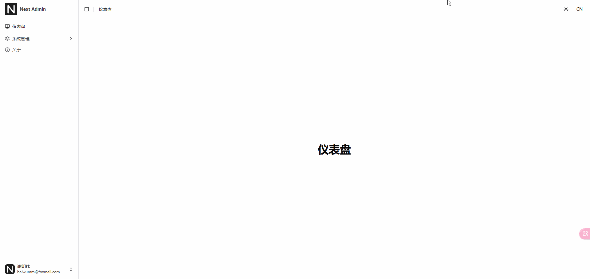

## 前言

在 [Next.js](https://nextjs.org/) 中要实现暗黑模式，需要用到一个库：[next-themes](https://github.com/pacocoursey/next-themes)，它可以帮助我们很轻易地实现暗黑模式切换。

::link-card[https://github.com/pacocoursey/next-themes]

## 具体步骤

1.  安装 **next-themes** 依赖：

```bash
pnpm add next-themes
```

2.  新增 **/components/ThemeProvider/index.tsx** 文件：

```ts
'use client';

import { ThemeProvider as NextThemesProvider } from 'next-themes';
import * as React from 'react';

export default function ThemeProvider({ children, ...props }: React.ComponentProps<typeof NextThemesProvider>) {
  return <NextThemesProvider {...props}>{children}</NextThemesProvider>;
}
```

3.  **/app/layout.tsx** 文件中注入 **ThemeProvider** :

```ts
import { ThemeProvider } from "@/components/theme-provider"

export default function RootLayout({ children }: RootLayoutProps) {
  return (
    <>
      <html lang="en" suppressHydrationWarning>
        <head />
        <body>
          <ThemeProvider
            attribute="class"
            defaultTheme="system"
            enableSystem
            disableTransitionOnChange
          >
            {children}
          </ThemeProvider>
        </body>
      </html>
    </>
  )
}
```

4.  新增 **/components/ThemeModeButton/index.tsx** 主题切换组件：

```ts
'use client';

import { Moon, Sun } from 'lucide-react';
import { useTheme } from 'next-themes';

import { Button } from '@/components/ui/button';

export default function ThemeModeButton() {
  const { theme, setTheme } = useTheme();

  return (
    <Button variant="ghost" size="icon" onClick={() => setTheme(theme === 'light' ? 'dark' : 'light')}>
      <Sun className="h-[1.2rem] w-[1.2rem] rotate-0 scale-100 transition-all dark:-rotate-90 dark:scale-0" />
      <Moon className="absolute h-[1.2rem] w-[1.2rem] rotate-90 scale-0 transition-all dark:rotate-0 dark:scale-100" />
      <span className="sr-only">Toggle theme</span>
    </Button>
  );
}
```

## 过渡动画

1.  如果你想加入过渡动画，可以把代码改成这样：

```ts
'use client';

import { Moon, Sun } from 'lucide-react';
import { useTheme } from 'next-themes';

import { Button } from '@/components/ui/button';

export default function ThemeModeButton() {
  const { theme, setTheme } = useTheme();

  // 判断是否支持 startViewTransition API
  const enableTransitions = () =>
    'startViewTransition' in document && window.matchMedia('(prefers-reduced-motion: no-preference)').matches;

  // 切换动画
  async function toggleDark({ clientX: x, clientY: y }: MouseEvent) {
    const isDark = theme === 'dark';

    if (!enableTransitions()) {
      setTheme(theme === 'light' ? 'dark' : 'light');
      return;
    }

    const clipPath = [
      `circle(0px at ${x}px ${y}px)`,
      `circle(${Math.hypot(Math.max(x, innerWidth - x), Math.max(y, innerHeight - y))}px at ${x}px ${y}px)`,
    ];

    await document.startViewTransition(async () => {
      setTheme(theme === 'light' ? 'dark' : 'light');
    }).ready;

    document.documentElement.animate(
      { clipPath: !isDark ? clipPath.reverse() : clipPath },
      {
        duration: 300,
        easing: 'ease-in',
        pseudoElement: `::view-transition-${!isDark ? 'old' : 'new'}(root)`,
      },
    );
  }

  return (
    <Button variant="ghost" size="icon" onClick={toggleDark}>
      <Sun className="h-[1.2rem] w-[1.2rem] rotate-0 scale-100 transition-all dark:-rotate-90 dark:scale-0" />
      <Moon className="absolute h-[1.2rem] w-[1.2rem] rotate-90 scale-0 transition-all dark:rotate-0 dark:scale-100" />
      <span className="sr-only">Toggle theme</span>
    </Button>
  );
}
```

2.  **/app/glocals.css** 文件中加入过渡样式：

```scss
::view-transition-old(root),
::view-transition-new(root) {
  animation: none;
  mix-blend-mode: normal;
}

::view-transition-old(root),
.dark::view-transition-new(root) {
  z-index: 1;
}

::view-transition-new(root),
.dark::view-transition-old(root) {
  z-index: 9999;
}
```

## 使用方法

在需要的位置引入组件：

```ts
import ThemeModeButton from '@/components/ThemeModeButton';

<ThemeModeButton />
```

## 最终效果


