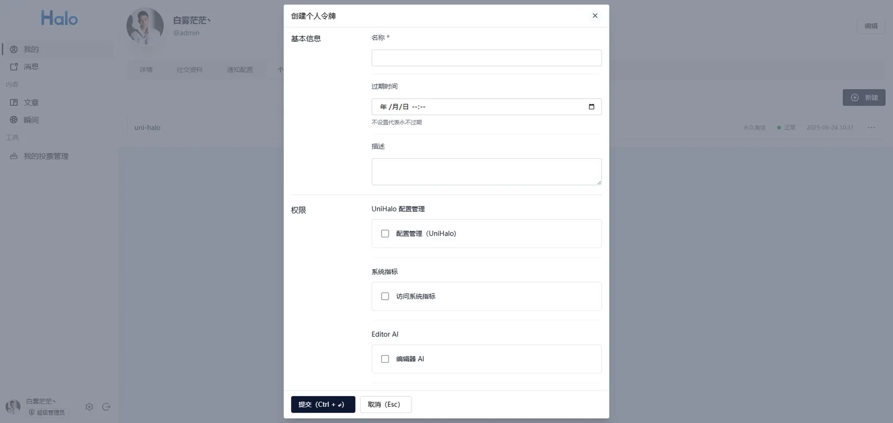
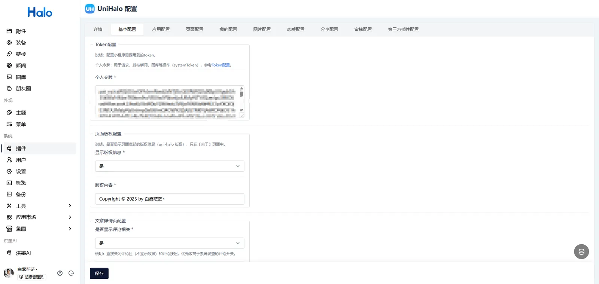
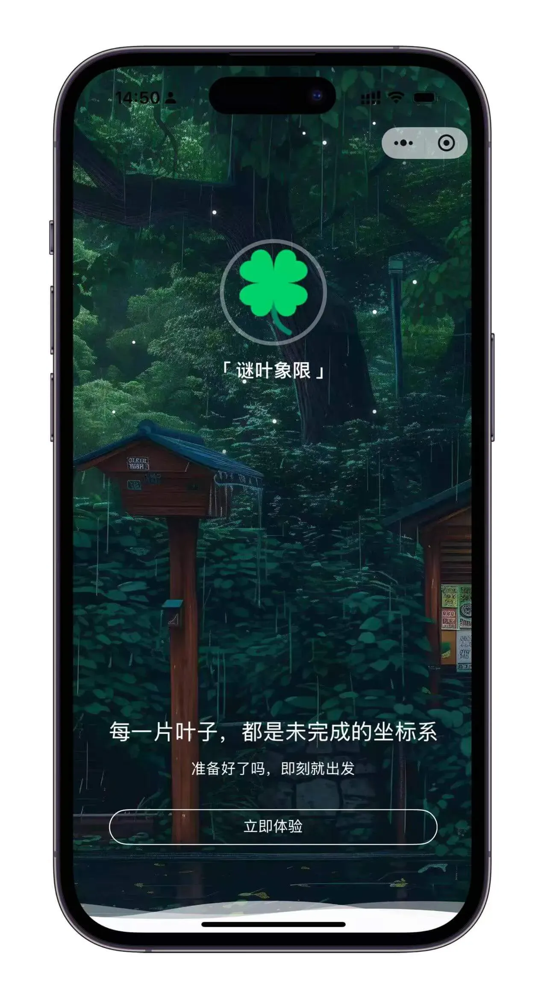
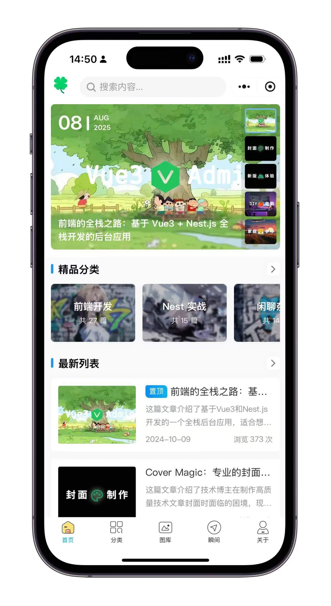
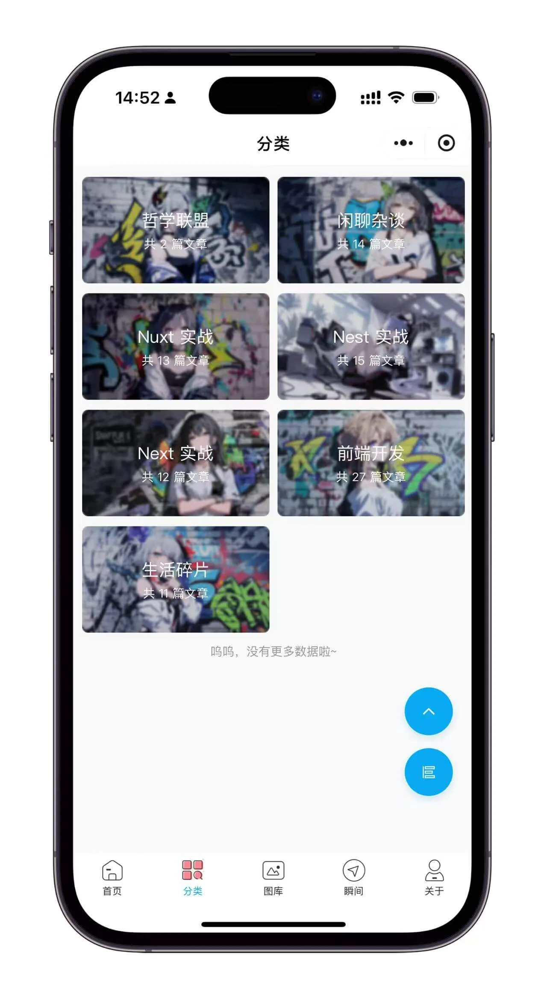
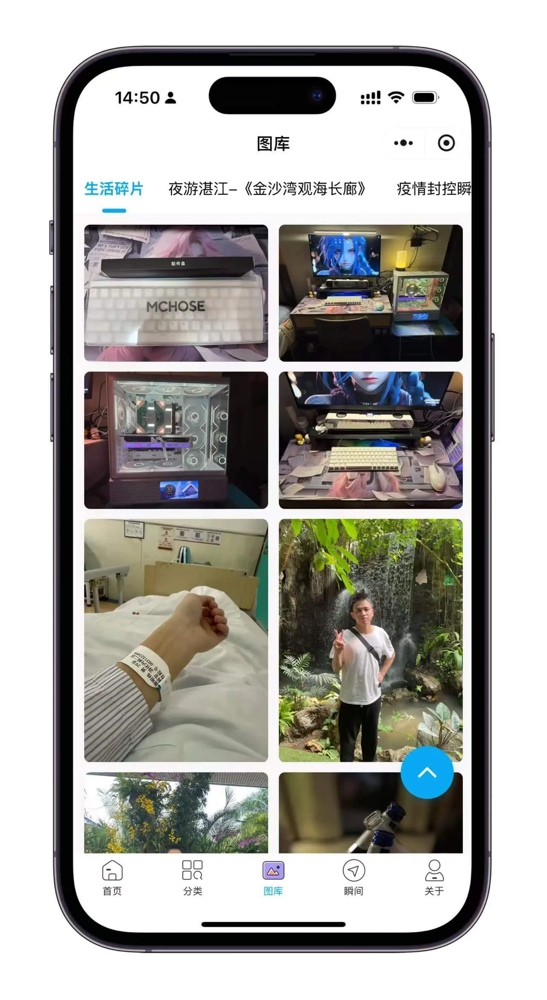
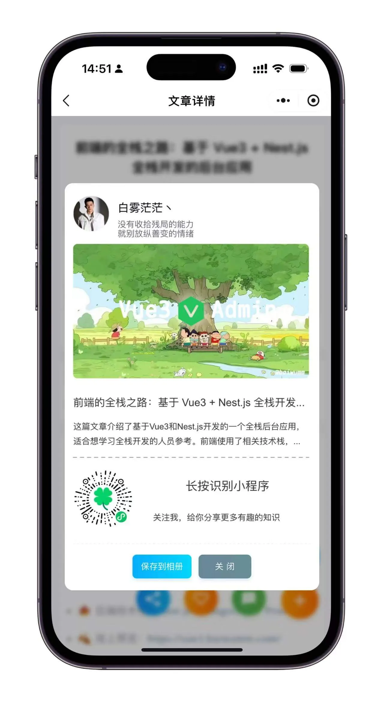
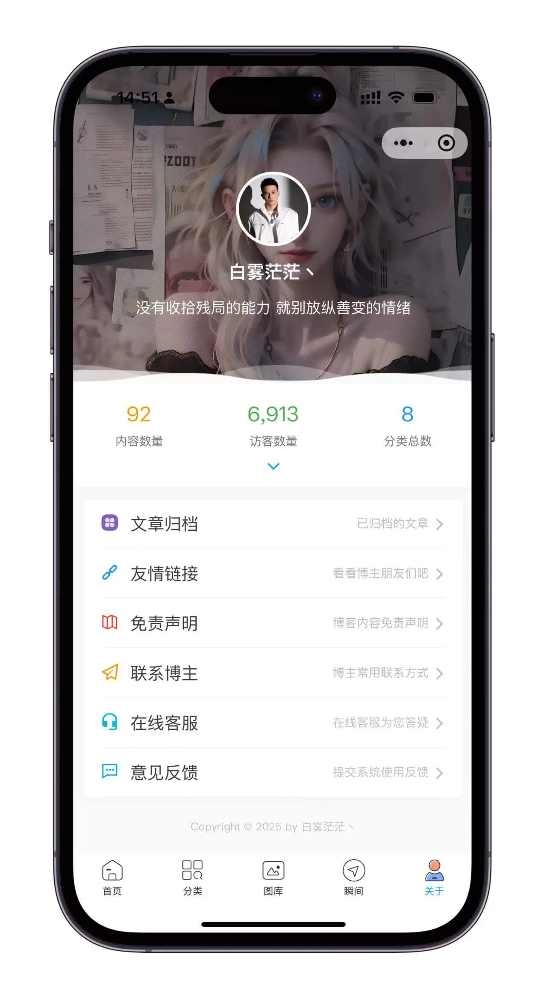

## 前言

作为一个独立开发者（或技术爱好者），我在选择微信小程序开发框架时，主要考虑了以下几个因素：

1.  **开发效率**：
    
    -   我不想从零开始搭建项目，希望有一个**开箱即用**的解决方案，快速实现想法。
        
    -   uni-halo 基于 Vue.js，语法友好，学习曲线平缓，适合个人快速迭代。
        
    -   配置方便，可在 Halo 控制台配置相关信息
        
2.  **跨平台能力**：
    
    -   虽然目前目标是微信小程序，但未来可能会扩展到其他平台（如H5、App）。
        
    -   uni-halo 的跨端编译能力，让代码复用成为可能，减少后续适配成本。
        
3.  **轻量化和社区支持**：
    
    -   相比完整版 uni-app，uni-halo 更轻量，适合个人项目，避免冗余配置。
        
    -   尽管生态不如原生微信开发完善，但足够满足基础需求，且社区教程逐渐增多。
        

**最终目标**：用最低的学习成本，快速上线一个功能完整、界面美观的个人小程序！

## 关于 uni-halo

[uni-halo](https://uni-halo.925i.cn/) 是一个基于 Halo 2.x 提供的 API 接口，开发的一套开源的博客应用。

-   完全免费开源，包括程序源码、插件源码
    
-   页面支持插件配置
    
-   使用最新流行的技术栈
    
-   支持特色功能，恋爱日记
    
-   支持编译为：`小程序（推荐）`、 `APP`、 `H5`
    

> `uni-halo` 项目依赖于 `Halo 2.x` 版本程序的项目 API 接口，如果您没有使用 `Halo 2.x` 或者使用的是其他的博客程序，您无需再继续往下看

## 环境准备

-  [**DCloud 账号**](https://dev.dcloud.net.cn/)（该账号用于登录 `HBuilder X` 开发工具和编译 `uni-halo` 项目）

-  [**微信小程序账号**](https://mp.weixin.qq.com/)（该账号用于发布和上线微信小程序）
    
-  [**HBuilderX**](https://www.dcloud.io/hbuilderx.html)（官方IDE，支持 uni-halo 开发，用于将 `uni-halo` 编译或上传到 `微信小程序开发工具`）
    
-   [**微信开发者工具**](https://developers.weixin.qq.com/miniprogram/dev/devtools/stable.html)（用于调试和发布 `uni-halo` 小程序到微信开放平台上线发布）
    
-   推荐 [Node.js](https://nodejs.org/zh-cn) 版本：`14/16/18`

## 运行项目

1.  克隆源码
    

```bash
git clone https://github.com/ialley-workshop-open/uni-halo.git
```

2.  打开开发工具 `HBuilder X` 工具，点击左上角 `文件-导入-从本地导入` ，找到下载好的 `uni-halo` 源码
    
3.  修改配置，配置是一个非常重要的步骤，在配置完成后，才能正常使用小程序，配置分为 源码配置和 插件配置。
    
    -   源码配置：在 `uni-halo` 源码的 `config` 目录中，找到 `token.config.json` 文件，按照提示进行配置。
        
    -   插件配置：在 Halo 后台的 `插件管理` 中，找到 `UniHalo配置` 插件，按照提示进行配置。
        

> _先将仓库_ `fork` _到自己的仓库中，然后再_ `clone` _到本地，使用_ `main` 分支。

## uni-halo 配置

1.  **生成 Token**
    

登录后台，点击左下角的用户头像，进入个人中心 选择 `我的-个人令牌`，新建令牌，如图：



2\. **Token 配置**

在项目根目录下找到 `token.config.template.js` 修改为 `token.config.js` 文件：

```js
import {getAppConfigs} from "@/config/index";

/** 配置博客的内容 */
const UniHaloConfig = Object.freeze({

	/** 基础请求域名：你的Halo博客基础域名 */
	BASE_API: "https://baiwumm.com",
    /** Halo 插件后台配置 */
	systemToken: getAppConfigs()?.basicConfig?.tokenConfig?.personalToken,
})

export default UniHaloConfig;
```

3.  **插件配置**
    



> UniHalo 的具体配置，可以去插件中查看！

## 相关链接

1.  [**调试预览**](https://uni-halo.925i.cn/deploy/preview.html)

2.  [**小程序发布**](https://uni-halo.925i.cn/deploy/wx-release.html)

3.  [**官方文档**](https://uni-halo.925i.cn/)

4.  [**代码仓库**](https://github.com/ialley-workshop-open/uni-halo)

## 界面预览

<div class="grid grid-cols-3 gap-4 [&>p]:my-0 [&>p>img]:my-0">













</div>

## 线上预览

使用微信扫描下方二维码，即可在线预览小程序


## 开发体验总结

**"学习成本低，上手快，成就感满满！"**

使用 `uni-halo` 开发微信小程序的体验非常流畅，整个过程几乎没有遇到太大的阻碍。相比原生开发，它的**开箱即用特性**让我节省了大量配置时间——只需克隆模板项目，简单修改配置，就能快速预览效果，这种"低代码"的体验让开发变得轻松愉快。

虽然过程中遇到了一些小问题（比如微信 API 的适配），但通过查阅文档和社区讨论都能很快解决。每完成一个功能，看到小程序在手机上流畅运行，那种**我真的做出来了**的成就感，正是独立开发者最享受的时刻。

如果你也想快速实现一个小程序创意，`uni-halo` 会是个让人惊喜的选择。它既保留了 Vue.js 的优雅，又提供了微信生态的完整支持，让个人开发者能专注于产品本身，而不是繁琐的环境搭建。

**一句话总结：**  
"从零到上线的过程出乎意料的顺利—— `uni-halo` 让个人开发者也能轻松做出专业级小程序！"
