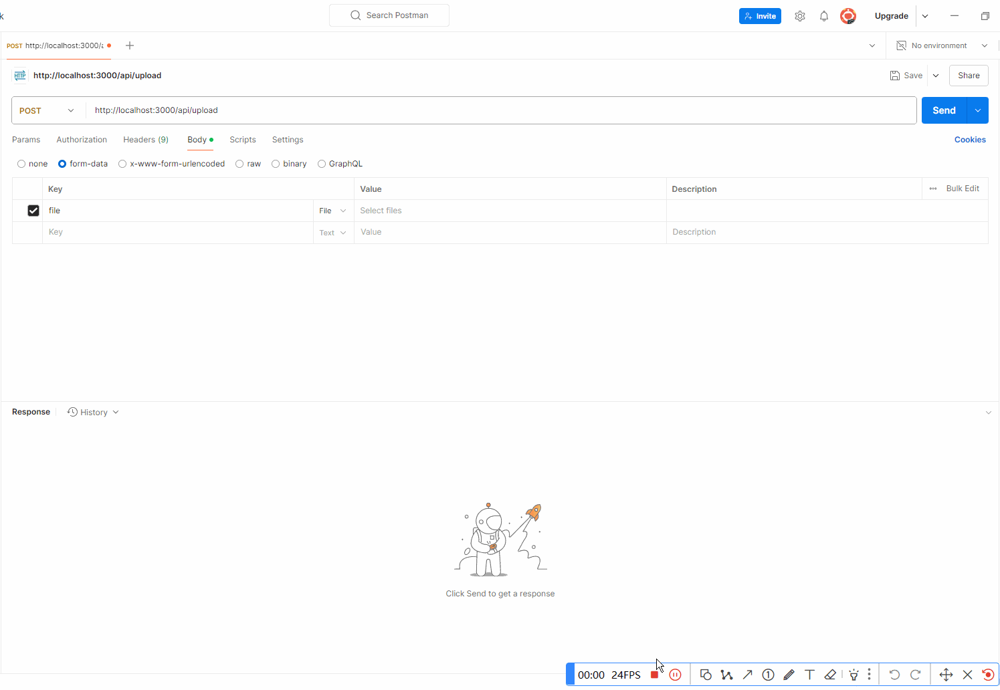

## 前言

在我们的日常工作中，上传文件、导入 Excel 表格数据这些是不可避免的，那在 [Next.js](https://nextjs.org/docs) 该如何实现上传文件到本地呢？

[Next.js](https://nextjs.org/docs) 的官方文档并没有相应的实例代码，需要开发者自行实现，一般来说有两种思路：

1.  使用 [Node.js](https://nodejs.org/) 原生上传

2.  使用第三方插件，如：[multer](https://github.com/expressjs/multer)

本文将以第一种方式实现：使用 [Node.js](https://nodejs.org/) 原生上传

## 业务设计

1.  上传的文件使用哈希值命名，也可自己拼接上原文件名

2.  文件上传到指定目录，这里我们指令上传的目录为：**public/uploads**，因为上传到这个目录，我们就能直接通过 **/uploads/xxx.jpg** 访问文件

3.  上传目录的文件夹将以 **YYYYMM** 年月的格式分类，可以自定义

## 具体步骤

新建 **app/api/upload/route.ts** 文件，写入代码：

```ts
import crypto from "crypto";
import dayjs from "dayjs";
import { existsSync } from "fs";
import fs from "fs/promises";
import { NextRequest, NextResponse } from "next/server";
import path from "path";

import { RESPONSE_MSG } from "@/enums";
import { responseMessage } from "@/lib/utils";

export async function POST(req: NextRequest) {
  try {
    // 获取二进制文件数据
    const formData = await req.formData();

    const f = formData.get("file");

    if (!f) {
      return NextResponse.json({}, { status: 400 });
    }

    const file = f as File;

    const yearMonth = dayjs().format("YYYYMM");

    // 获取当前年月并创建对应的文件夹
    const uploadDir = path.join(process.cwd(), "public/uploads", yearMonth);

    // 如果文件夹不存在，则创建
    if (!existsSync(uploadDir)) {
      await fs.mkdir(uploadDir, { recursive: true });
    }

    // 将文件保存到服务器的文件系统中
    const fileArrayBuffer = await file.arrayBuffer();

    // 生成哈希值作为文件名
    const hash = crypto.randomBytes(16).toString("hex");

    // 生成文件名
    const fileName = `${hash}.${file.name.split(".")[1]}`;

    // 将文件上传到 uploads 文件夹
    await fs.writeFile(
      path.join(uploadDir, fileName),
      Buffer.from(fileArrayBuffer)
    );

    return NextResponse.json(
      responseMessage({
        fileName,
        size: file.size,
        url: `/uploads/${yearMonth}/${fileName}`,
      })
    );
  } catch (error) {
    return NextResponse.json(responseMessage(error, RESPONSE_MSG.ERROR, -1));
  }
}
```

> 代码都有注释，我感觉还是比较好容易理解的

## 前端使用

前端可以通过 [FormData](https://developer.mozilla.org/zh-CN/docs/Web/API/XMLHttpRequest_API/Using_FormData_Objects) 格式提交数据：

```ts
// 上传头像
  const { loading: uploadLoading, run: runUploadAvatar } = useRequest(uploadFile, {
    manual: true,
    onSuccess: ({ code, data }) => {
      if (isSuccess(code)) {
        setAvatar(data.url);
      }
    },
  });

  // 图片上传回调
  const handleFileChange: ChangeEventHandler<HTMLInputElement> = (event) => {
    const file = event.target.files?.[0];
    if (file) {
      // 创建一个 FormData 对象
      const formData = new FormData();
      formData.append('file', file);
      runUploadAvatar(formData);
    }
  };

<Input
  name="avatar"
  type="file"
  accept="image/*"
  className="w-20"
  onChange={handleFileChange}
  size="sm"
  />
```

## 效果演示

我们通过 [postman](https://www.postman.com/) 模拟上传：



上传后的文件夹结构：


## 总结

这里只实现了单个文件上传，批量上传或者文件数组的需要自行实现

现在很多公司文件存储业务都已经使用第三方平台，比如：

1.  [阿里云 OSS](https://www.aliyun.com/product/oss)

::link-card[https://www.aliyun.com/product/oss]

2.  [腾讯云 COS](https://cloud.tencent.com/product/cos)

::link-card[https://cloud.tencent.com/product/cos]

3.  [七牛云 KODO](https://www.qiniu.com/products/kodo)

::link-card[https://www.qiniu.com/products/kodo]

4.  [又拍云 USS](https://www.upyun.com/products/file-storage)

::link-card[https://www.upyun.com/products/file-storage]

很少用上传到服务器本地的，业务量大的话会对服务器造成压力，一般这种适合个人站点、博客使用，这里我们当做学习就行。