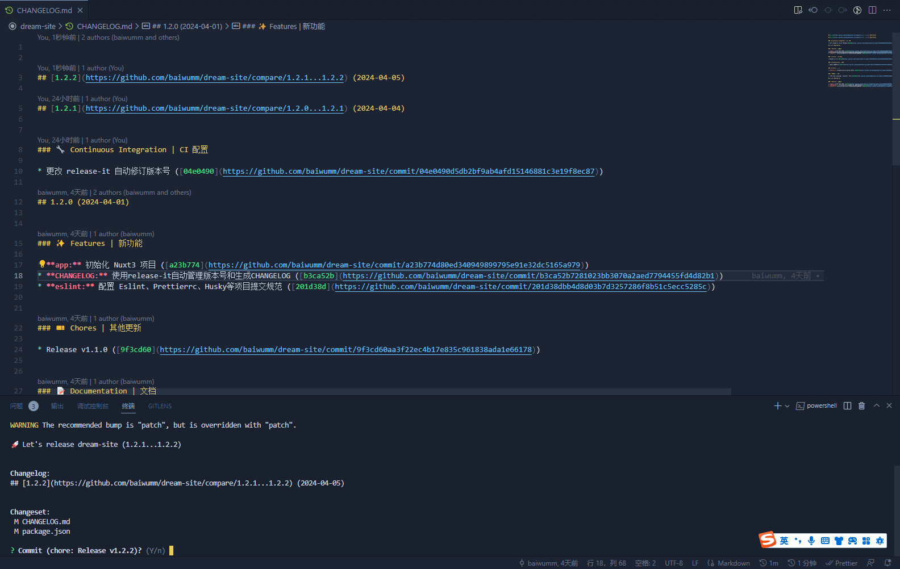
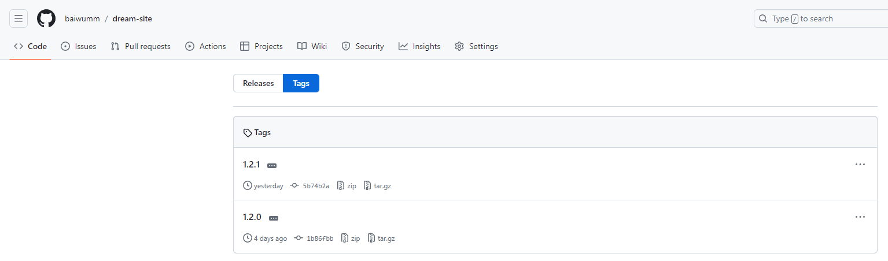
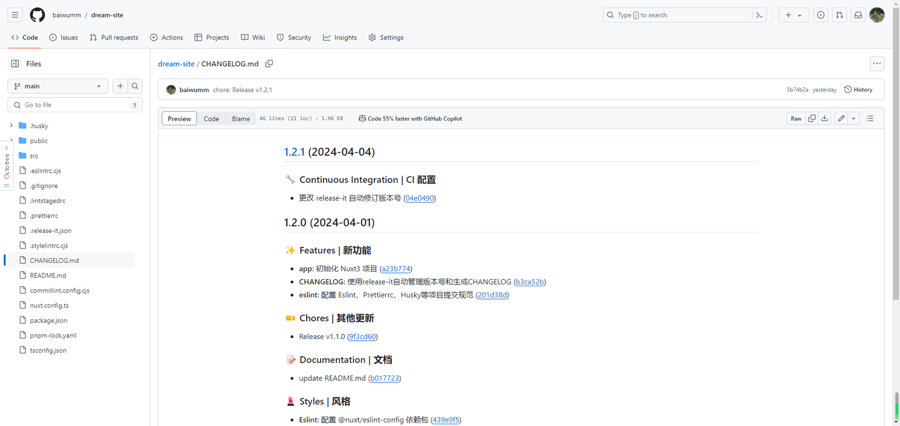

## release-it 能做什么？

1.  增加版本号并提交 **Git**
    
2.  生成变更日志（**Changelog**）并提交到 **Git**
    
3.  创建 **Git** 标签并推送到远程仓库
    
4.  发布到 **npm** 等软件仓库
    
5.  在 **GitHub**、**GitLab** 等平台创建发行版
    

## 前置知识

在看这篇文章之前，我们有必要了解一下

[语义化版本](https://semver.org/lang/zh-CN/)

## 安装依赖

1.  执行命令
```bash
pnpm add release-it @release-it/conventional-changelog -D
```


2.  根目录添加 **.release-it.json** 配置文件，具体配置请参考：[conventional-changelog](https://github.com/release-it/conventional-changelog)
```json
{
  "plugins": {
    "@release-it/conventional-changelog": {
      "preset": {
        "name": "conventionalcommits",
        "types": [
          { "type": "feat", "section": "✨ Features | 新功能" },
          { "type": "fix", "section": "🐛 Bug Fixes | Bug 修复" },
          { "type": "chore", "section": "🎫 Chores | 其他更新" },
          { "type": "docs", "section": "📝 Documentation | 文档" },
          { "type": "style", "section": "💄 Styles | 风格" },
          { "type": "refactor", "section": "♻ Code Refactoring | 代码重构" },
          { "type": "perf", "section": "⚡ Performance Improvements | 性能优化" },
          { "type": "test", "section": "✅ Tests | 测试" },
          { "type": "revert", "section": "⏪ Reverts | 回退" },
          { "type": "build", "section": "👷‍ Build System | 构建" },
          { "type": "ci", "section": "🔧 Continuous Integration | CI 配置" },
          { "type": "config", "section": "🔨 CONFIG | 配置" }
        ]
      },
      "infile": "CHANGELOG.md",
      "ignoreRecommendedBump": true,
      "strictSemVer": true
    }
  },
  "git": {
    "commitMessage": "chore: Release v${version}"
  },
  "github": {
    "release": true,
    "draft": false
  }
}
```


配置说明：

-   **git**：配置 **Git** 相关的任务，如自动提交代码、打标签等
    
-   **github**：配置 **GitHub** 相关的任务，如创建发行版
    
-   **npm**：配置 **npm** 相关的任务，如发布到 **npm** 仓库
    
-   **plugins**：配置使用的插件
    

> 本文并没有发布到 **npm** ，需要的朋友可自己配置

3.  向 **package.json** 的 **scripts** 中添加命令：
```text
"release": "release-it"
```


上面命令默认更新次版本号，如果想每次更新修订号，可执行 **pnpm release patch**
```text
# 更新主版本号
 pnpm release major

 # 更新次版本号
 pnpm release minor

 # 更新修订号
 pnpm release patch
```


4.  在我们开发完代码后，执行 **pnpm release** 命令，控制台会自动帮我们打包版本号并生成 **CHANGELOG**：
    



## 效果预览

**git** 打的标签 **Tag**



**CHANGELOG**


