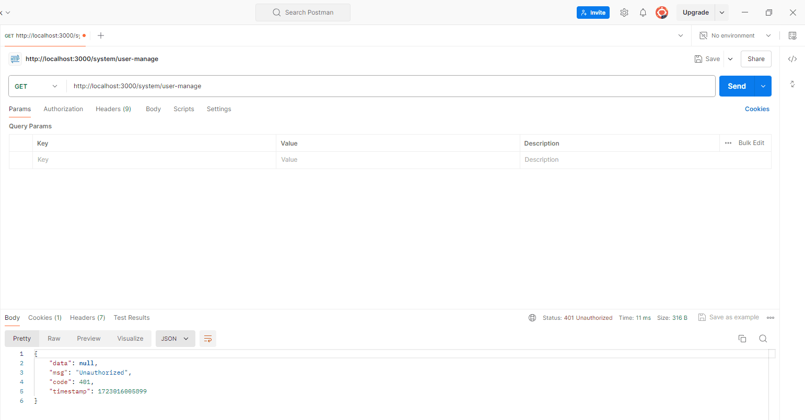

## 身份验证

身份认证是大多数应用程序的重要组成部分，有很多不同的方法和策略来处理身份认证。

当前比较流程的是[JWT 认证](https://docs.nestjs.com/security/authentication)，也叫**令牌认证**，今天我们探讨一下在 [Nest.js](https://nestjs.com/) 中如何实现。

## 认证流程

1.  客户端将首先使用用户名和密码进行身份认证

2.  认证成功，服务端会签发一个 **JWT** 返回给客户端

3.  该 **JWT** 在后续请求的授权头中作为 [Bearer Token](https://zhuanlan.zhihu.com/p/703895640) 发送，以实现身份认证

## JWT 认证策略

1.  安装依赖

```bash
pnpm add @nestjs/passport passport-jwt @nestjs/jwt
```

2.  在 **auth** 模块中新建 **jwt.strategy.ts** 文件，用来处理认证流程

```ts
import { Injectable, UnauthorizedException } from "@nestjs/common";
import { PassportStrategy } from "@nestjs/passport";
import { Request } from "express";
import { ExtractJwt, Strategy } from "passport-jwt";

import { PrismaService } from "@/modules/prisma/prisma.service";

@Injectable()
export class JwtStrategy extends PassportStrategy(Strategy) {
  constructor(private prisma: PrismaService) {
    super({
      // 提供从请求中提取 JWT 的方法。我们将使用在 API 请求的授权头中提供token的标准方法
      jwtFromRequest: ExtractJwt.fromAuthHeaderAsBearerToken(),
      // 为了明确起见，我们选择默认的 false 设置，
      // 它将确保 JWT 没有过期的责任委托给 Passport 模块。
      // 这意味着，如果我们的路由提供了一个过期的 JWT ，请求将被拒绝，并发送 401 未经授权的响应。Passport 会自动为我们办理
      ignoreExpiration: false,
      // 使用权宜的选项来提供对称的秘密来签署令牌
      secretOrKey: process.env.JWT_SECRET,
      passReqToCallback: true,
    });
  }

  async validate(req: Request, payload: Api.Common.TokenPayload) {
    // 获取当前 token
    const token = ExtractJwt.fromAuthHeaderAsBearerToken()(req);
    // 缺少令牌
    if (!token) {
      throw new UnauthorizedException("未登录");
    }
    const user = await this.prisma.user.findUnique({
      where: {
        id: payload.sub,
      },
    });
    if (!user) {
      throw new UnauthorizedException("token令牌非法，请重新登录");
    }
    return payload;
  }
}
```

3.  全局注册

```ts
import { Module } from "@nestjs/common";
import { JwtModule } from "@nestjs/jwt";
import { PassportModule } from "@nestjs/passport";

import { PrismaModule } from "@/modules/prisma/prisma.module";
import { OperationLogModule } from "@/modules/system-manage/operation-log/operation-log.module";

import { AuthController } from "./auth.controller";
import { AuthService } from "./auth.service";
import { JwtStrategy } from "./jwt.strategy";

@Module({
  imports: [
    PrismaModule,
    PassportModule.register({ defaultStrategy: "jwt" }),
    JwtModule.register({
      secret: process.env.JWT_SECRET,
      signOptions: { expiresIn: "15m" }, // 这里设置访问 token 的过期时间
    }),
    OperationLogModule,
  ],
  controllers: [AuthController],
  providers: [AuthService, JwtStrategy],
  exports: [AuthService],
})
export class AuthModule {}
```

## JWT 签发

在客户端认证成功后，服务器将签发一个 **JWT** 返回给客户端

```ts
/**
 * @description: 用户登录
 */
async login(params: LoginParamsDto, session: Api.Common.SessionInfo, ip: string) {
  // 省略认证流程
  // 生成 token
  const tokens = await this.generateTokens(user);

  // 验证成功，返回 token
  return responseMessage(tokens);
}

/**
 * @description: 生成 token
 */
async generateTokens(userInfo: Api.SystemManage.User) {
  const payload: Api.Common.TokenPayload = { userName: userInfo.userName, sub: userInfo.id };

  const token = this.jwtService.sign(payload, {
    expiresIn: '3d', // 设置访问 token 的过期时间为 3 天
  });

  return { token };
}
```

## JWT 认证守卫

我们已经实现了 **JWT** 的认证策略及签发，接下来要做的就是携带有效的 **JWT** 来保护接口

[@nestjs/passport](https://github.com/nestjs/passport) 中已经内置 **AuthGuard** 守卫，我们直接用就行。

在需要鉴权的 **Controller** 控制器中使用：

```ts
import { Controller, UseGuards } from "@nestjs/common";
import { AuthGuard } from "@nestjs/passport";

@Controller("system/user-manage")
@UseGuards(AuthGuard("jwt"))
export class UserManageController {}
```

也许一些接口我们不需要登录就能访问，可以单独给接口绑定守卫

```ts
/**
 * @description: 获取用户信息
 */
@UseGuards(AuthGuard('jwt'))
@Get('/getUserInfo')
getUserInfo(@Session() session: Api.Common.SessionInfo) {
  return this.authService.getUserInfo(session);
}
```

这样在未登录的情况下访问接口，**HttpException** 过滤器就会捕获并返回 **401** 状态码：



客户端就能根据接口返回的信息处理相应的逻辑。

## 总结

关注我，我们一起领略 [Nest.js](https://nestjs.com/) 的魅力
