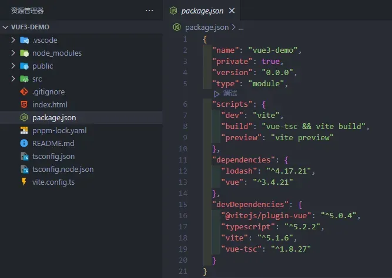
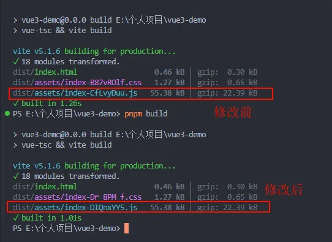
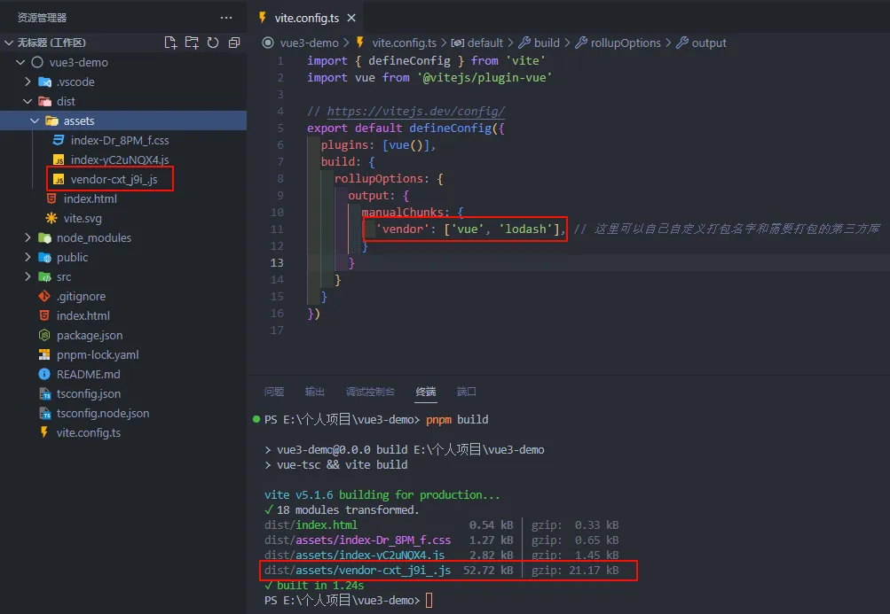
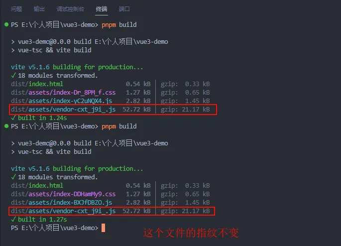
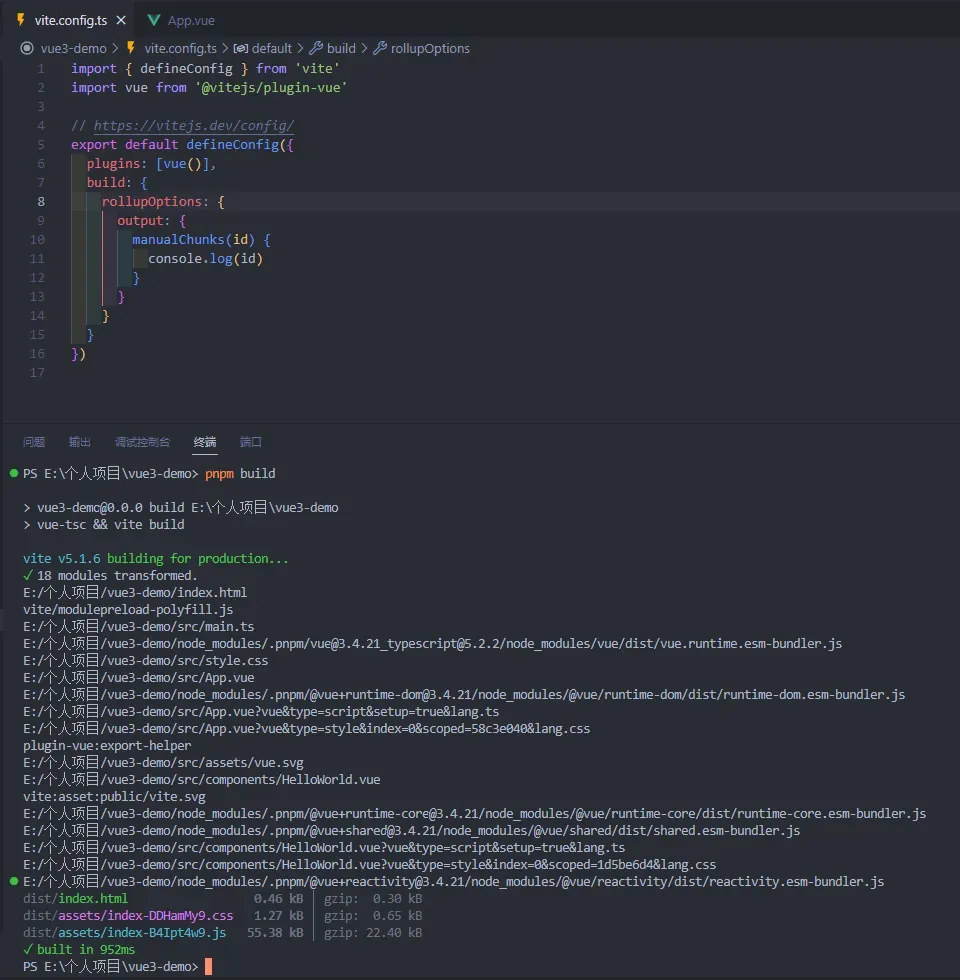
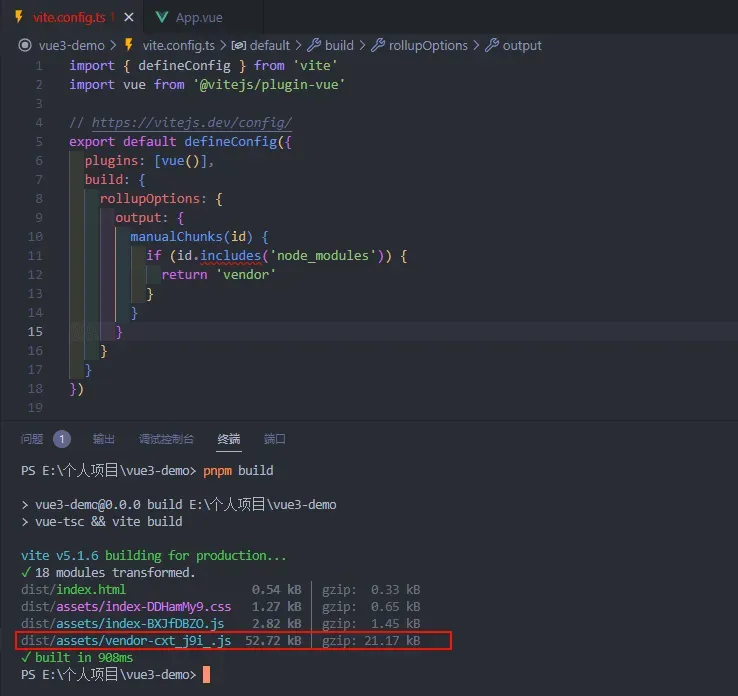

## 项目搭建

1.  我们使用 [vite](https://cn.vitejs.dev/) 搭建一个 **vue3** 工程，执行命令：

```bash
pnpm create vite vue3-demo --template vue-ts
```

2.  安装 **lodash** 依赖包，下载依赖：

```bash
pnpm add lodash

pnpm install
```

3.  完成后的工程目录结构是这样的：



## 业务场景

我们先首次构建打包，然后修改一下代码再打包，对比一下前后打包差异：



可以看到，代码改动后，**index-\[hash\].js** 的文件指纹发生了变化，这意味着每次打包后，用户就要重新下载新的 **js**，而这个文件里面包含了这些东西：**vue**、**lodash**、**业务代码**，其中像 **vue**、**lodash** 这些依赖包是固定不变的，有变动的只是我们的业务代码，基于这个点我们就可以在其基础上打包优化。

## 打包优化

我们需要在打包上优化两个点：

1.  把第三方依赖库单独打包成一个 **js** 文件

2.  把我们的业务代码单独打包成一个 **js** 文件

这块需要我们对 [vite](https://cn.vitejs.dev/) 工程化知识有一定的了解，它使用 [Rollup](https://rollupjs.org/) 打包你的代码，并且它是预配置的，可输出用于生产环境的高度优化过的静态资源，可以通过配置 [build.rollupOptions.output.manualChunks](https://cn.vitejs.dev/guide/build.html#chunking-strategy) 来自定义 **chunk** 分割策略。

## 更改 vite 配置

1.  打开 **vite.config.ts**，加入配置项：

```ts
import { defineConfig } from "vite";
import vue from "@vitejs/plugin-vue";

// https://vitejs.dev/config/
export default defineConfig({
  plugins: [vue()],
  build: {
    rollupOptions: {
      output: {
        manualChunks: {
          vendor: ["vue", "lodash"], // 这里可以自己自定义打包名字和需要打包的第三方库
        },
      },
    },
  },
});
```

2.  执行打包命令，我们可以看到打包文件中多了一个 **verdor-\[hash\].js** 的文件，这个就是刚才配置分包的文件：



3.  这样的好处就是，将来如果我们的业务代码有改动，打包的第三方库的文件指纹就不会变，用户就会直接读取浏览器缓存，这是一种比较优的解决办法：



4.  但这样需要我们每次都手动填写第三方库，那也显得太呆了，我们可以把 **manualChunks** 配置成一个函数，每次去加载这个模块的时候，它就会运行这个函数，打印看下输出什么：



5.  我们会发现依赖包都是在 **node\_modules** 目录下，接下来我们就修改一下配置：

```ts
import { defineConfig } from "vite";
import vue from "@vitejs/plugin-vue";

// https://vitejs.dev/config/
export default defineConfig({
  plugins: [vue()],
  build: {
    rollupOptions: {
      output: {
        manualChunks(id) {
          if (id.includes("node_modules")) {
            return "vendor";
          }
        },
      },
    },
  },
});
```

6.  我们再看下打包结果：



## 总结

分包（**Code Splitting**）是一种将应用程序代码拆分为不同的块或包的技术，从而在需要时按需加载这些包。这种技术带来了许多优势，特别是在构建大型单页应用（**Single Page Application，SPA**）时。

1.  **减小初始加载时间**： 将应用程序分成多个小块，可以减少初始加载时需要下载的数据量。这意味着用户可以更快地看到初始内容，提高了用户体验。

2.  **优化资源利用**： 分包可以根据用户的操作行为和需要进行按需加载。这样，在用户访问特定页面或功能时，只会加载与之相关的代码，而不会加载整个应用程序的所有代码，从而减少了不必要的资源消耗。

3.  **并行加载**： 分包允许浏览器并行加载多个包。这可以加速页面加载，因为浏览器可以同时请求多个资源，而不是等待一个大文件下载完成。

4.  **缓存优化**： 分包使得缓存管理更加灵活。如果应用程序的一部分发生变化，只需重新加载受影响的分包，而不必重新加载整个应用程序。

5.  **减少内存占用**： 当用户访问某个页面时，只有该页面所需的代码被加载和执行。这有助于减少浏览器内存的使用，尤其是在应用程序变得复杂时。

6.  **按需更新**： 当应用程序的某个部分需要更新时，只需要重新发布相应的分包，而不必重新发布整个应用程序。这可以减少发布和部署的复杂性。

7.  **代码复用和维护**： 分包可以按功能或模块来划分，从而鼓励代码的模块化和复用。这样，不同页面之间可以共享相同的代码块，减少了重复编写和维护代码的工作量。
