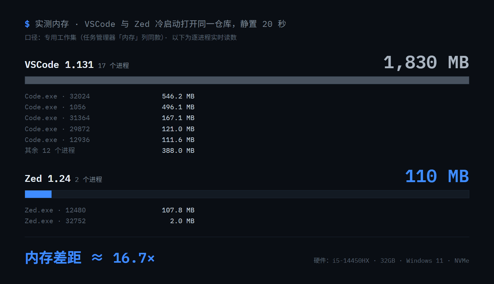
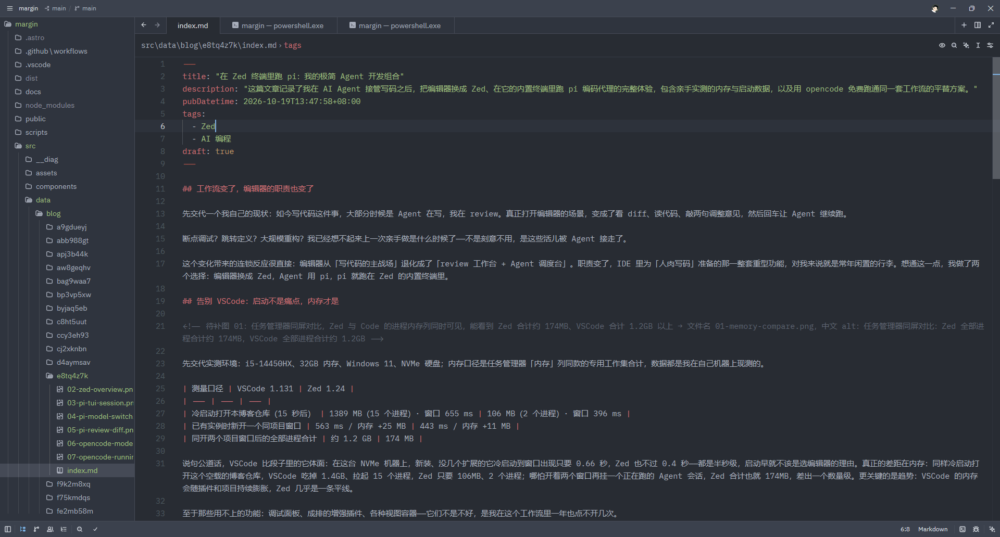
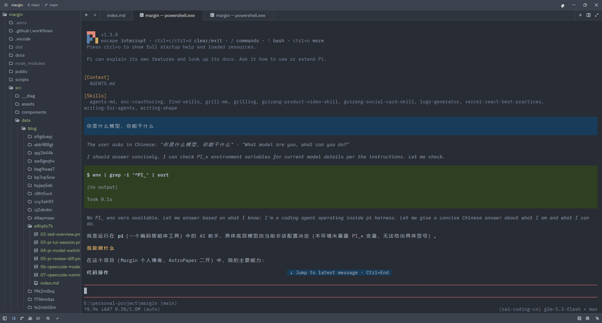
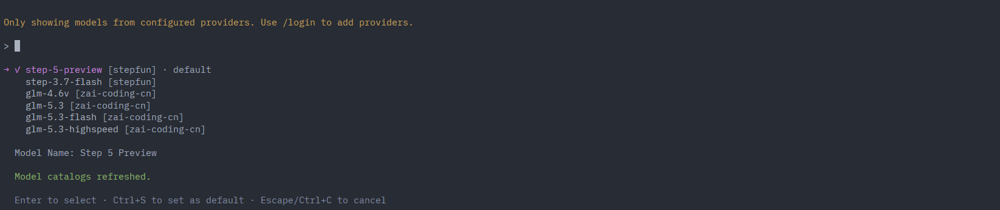
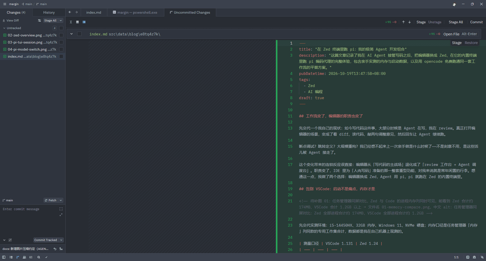
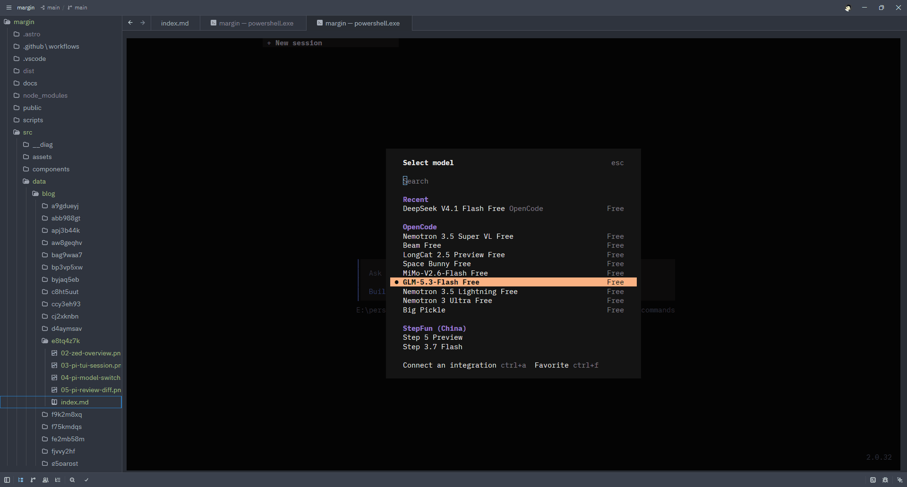
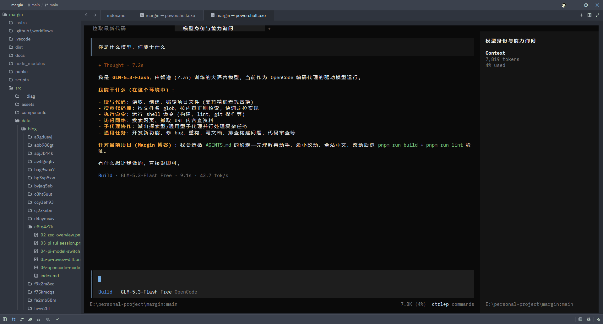

## 工作流变了，编辑器的职责也变了

先交代我的现状：如今写代码这件事，大部分时候是 Agent 在写，我在 review。真正打开编辑器的场景，变成了看 diff、读代码、敲两句调整意见，然后回车让 Agent 继续跑。

断点调试？跳转定义？大规模重构？我已经想不起来上一次亲手做是什么时候了——不是刻意不用，是这些活儿被 Agent 接走了。

编辑器从「写代码的主战场」退化成了「review 工作台 + Agent 调度台」。IDE 里为「人肉写码」准备的那一整套重型功能，对我来说就是常年闲置的行李。想通这一点，我做了两个选择：编辑器换成 Zed，Agent 用 pi，pi 就跑在 Zed 的内置终端里。

## 告别 VSCode：启动不是痛点，内存才是



先交代实测环境：i5-14450HX、32GB 内存、Windows 11、NVMe 硬盘；内存口径是任务管理器「内存」列同款的专用工作集合计，数据都是我在自己机器上现测的。

| 测量口径 | VSCode 1.131 | Zed 1.24 |
| --- | --- | --- |
| 冷启动打开本博客仓库（15 秒后） | 1389 MB（15 个进程）· 窗口 655 ms | 106 MB（2 个进程）· 窗口 396 ms |
| 已有实例时新开一个同项目窗口 | 563 ms / 内存 +25 MB | 443 ms / 内存 +11 MB |
| 同开两个项目窗口后的全部进程合计 | 约 1.2 GB | 174 MB |

说句公道话，VSCode 比段子里的它体面：在这台 NVMe 机器上，新装、没几个扩展的它冷启动到窗口出现只要 0.66 秒，Zed 也不过 0.4 秒——都是半秒级，启动早就不该是选编辑器的理由。真正的差距在内存：同样冷启动打开这个空载的博客仓库，VSCode 吃掉 1.4GB、拉起 15 个进程，Zed 只要 106MB、2 个进程；哪怕开着两个窗口再挂一个正在跑的 Agent 会话，Zed 合计也就 174MB，差出一个数量级。更关键的是趋势：VSCode 的内存会随插件和项目持续膨胀，Zed 几乎是一条平线。附图是另一轮同口径复测（静置 20 秒），数字比表格更高，结论一致。

至于那些用不上的功能：调试面板、成排的增强插件、各种视图容器——它们不是不好，是我在这个工作流里一年也点不开几次。

## 为什么是 Zed



选 Zed 的理由说出来非常朴素：快、轻、内置终端够用。GPU 渲染带来的输入跟手是体感层面的，「轻」则是上面那张表里的数字。而对我这个「review 台 + 调度台」的定位来说，内置终端才是灵魂——Agent 就该在编辑器旁边跑，而不是切到另一个窗口。

劣势也得如实说。第一，全英文，没有官方中文界面，设置项、命令面板全靠硬啃；第二，插件生态薄，VSCode 里顺手的那些扩展，在 Zed 要么没有对应物，要么功能打折。这两条对我都成立，但我能接受：一个只用来 review 的编辑器，要装的东西本来就不多。

把话说在前面：如果你重度依赖某几个 VSCode 专属插件，或者断点调试是日常，Zed 现在还替代不了 VSCode。这篇文章的工作流，是给「和我一样把活儿交给 Agent」的人准备的。

## 在 Zed 终端里跑 pi



Agent 这一半，我用的是 pi——Mario Zechner 写的开源编码代理（仓库 earendil-works/pi）。它给自己的定位是一句话：一个极简、可扩展的 agent harness。

选它的理由只有一个：极简透明。它刻意不做 sub-agents、不做 plan mode，功能少到源码真的读得完；session 是本地的 JSONL 文件，树形结构，随便 fork、回放。它不猜你想干什么，你也一直知道它在干什么——这份透明感，和 Zed 是同一种哲学。



模型层面 pi 走 BYO key，支持的 provider 很全，智谱 GLM 就在官方列表里，配好即用，这也是我日常的组合。

日常的样子就是标题那句话：Zed 底部拉出内置终端，敲 `pi`，会话就在编辑器底下跑。Agent 改完文件，我抬眼在 Zed 的 diff 视图里 review，敲一句调整意见，回车，继续。整个回路不离开一个窗口。



这篇文章，就是在 Zed + pi 里写完的。

## 想零成本先跑起来？zed + opencode



如果暂时不想配 key，同样的思路有个免费组合：Zed + opencode（SST 团队的开源编码代理）。

opencode 的 TUI 和桌面端无需注册，装完打开，模型选择器里 OpenCode 分组下的一排免费模型直接选、直接用，GLM、DeepSeek、MiMo 都在列，代价是可能限额和限速，先跑起来体验完全够。



三步走：装好、选免费模型、跑起来。和 pi 相比它功能更多、界面更热闹，极简程度不如 pi，但「零门槛先跑起来」这件事，它做得最好。

## 极简上手框

三样东西，每个一行装完：

```bash
# Zed：官网 zed.dev 下载安装包（Windows / macOS / Linux）
# macOS / Linux 也可一条命令：
curl -f https://zed.dev/install.sh | sh

# pi：需要 Node.js 22+，装完进任意项目目录敲 pi
npm install -g --ignore-scripts @earendil-works/pi-coding-agent

# opencode：装完直接输 opencode
npm install -g @opencode/cli
```

pi 首次进入后 `/login` 选 provider（智谱 GLM 在列表里），`/model` 切模型；opencode 打开后在模型选择器里挑 OpenCode 分组下的 Free 模型即可。

## 写在最后

Agent 接管写码之后，我对编辑器的全部要求浓缩下来就是：开得快、待得轻、终端就在旁边。Zed + pi 是我对这套要求给出的答案，Zed + opencode 是它的免费版。如果你也整天待在 review 台上，值得一试。
