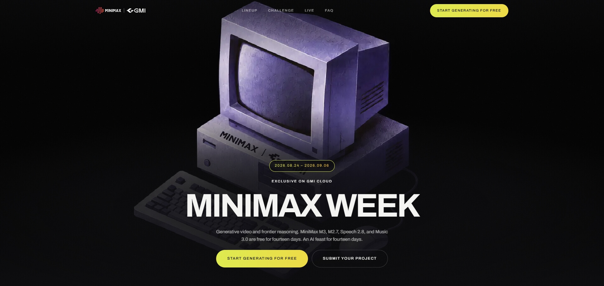
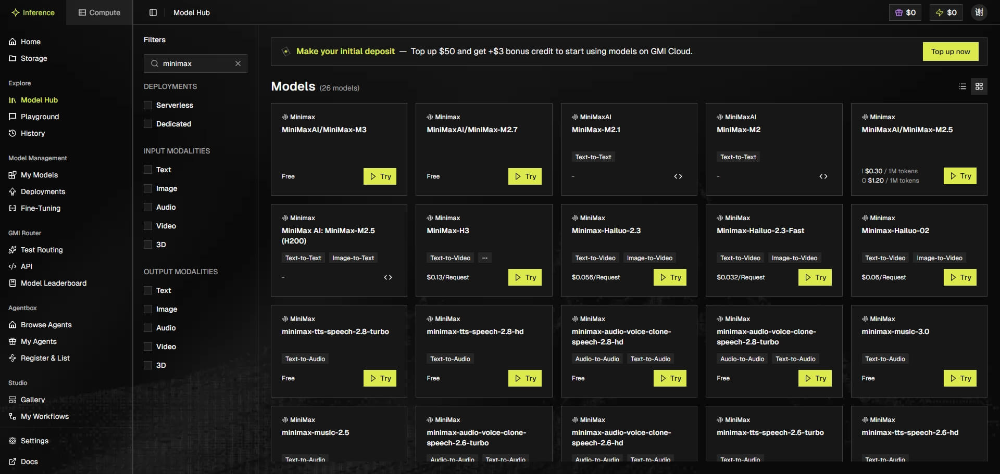
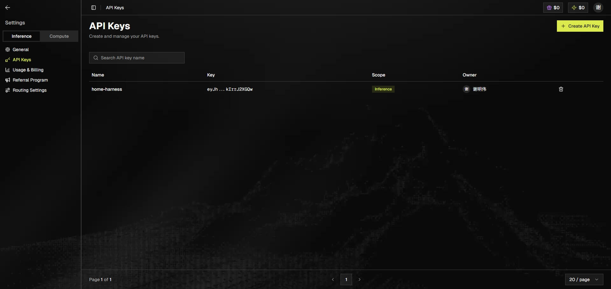
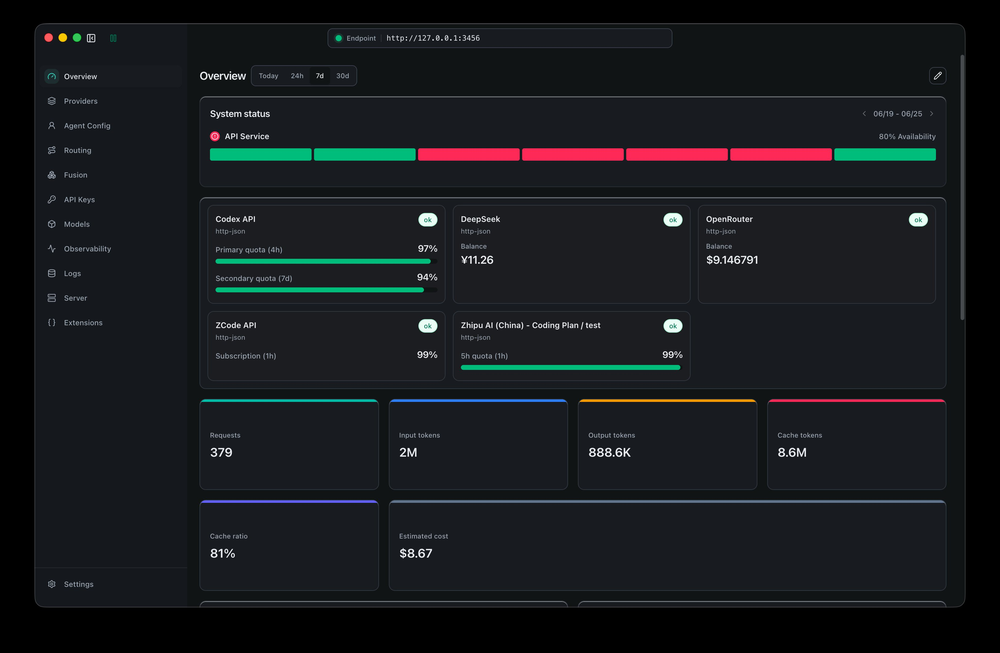
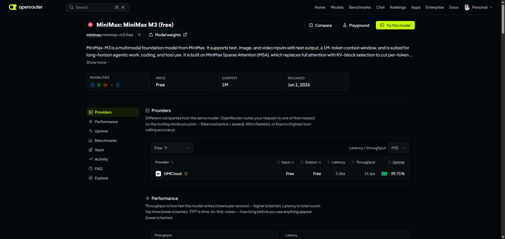
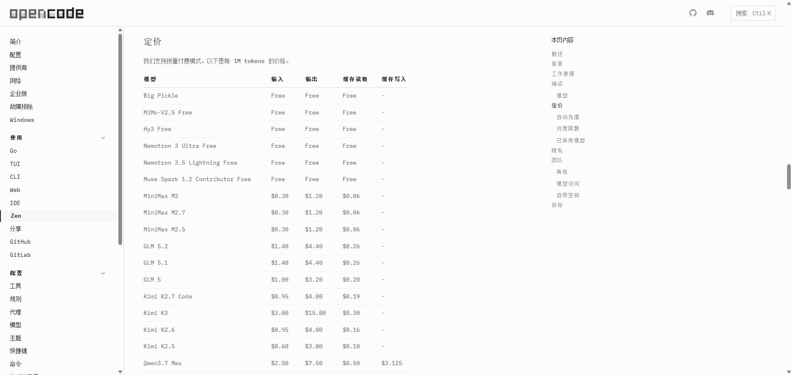
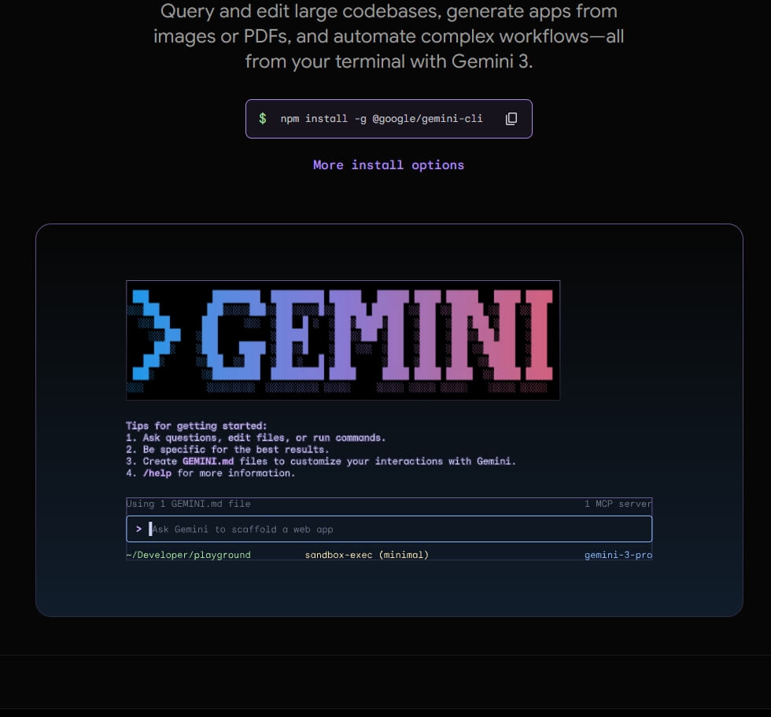

把 Claude Code、opencode 这类编码 Agent 玩起来之后，账单往往比模型本身更劝退。其实只要肯花点时间配置，现阶段能免费接入 Agent 的模型并不少——有正在进行的限时活动，有官方常驻的免费层，也有适合当兜底的免费 API。

这篇文章整理一下我目前（2026 年 8 月底）确认过的白嫖渠道，每条都附上接入教程和官方链接。先说清楚时效性：**免费额度随时会变**，本文数据以发文当天为准，动手前建议去官方控制台再核对一遍。

## MiniMax Week × GMI Cloud：正在进行的限免

最有性价比的是这个正在进行的活动：MiniMax 和 GMI Cloud 合作，从 2026 年 8 月 24 日到 9 月 6 日，14 天内免费开放四款模型：

| 模型 | 类型 | 说明 |
| --- | --- | --- |
| MiniMax M3 | 文本 / 推理 | 面向长周期 agentic 任务的前沿推理模型 |
| MiniMax M2.7 | 文本 / Agent | 面向 Agent 和编程工具的快速推理 |
| MiniMax Speech 2.8 | 语音 | 文本转语音与声音克隆 |
| MiniMax Music 3.0 | 音乐 | 单个提示词生成完整曲目 |

注意视频模型 H3 **不在免费范围内**，仍按标准价格计费。



### 白嫖步骤

1. 打开[活动页](https://www.gmicloud.ai/minimax-week)，点击「Start Generating for Free」注册 GMI Cloud 账户，无需绑卡，活动模型自动解锁。
2. 登录[控制台](https://console.gmicloud.ai/)，进入 Model Hub，搜索 `minimax` 就能看到四款限免模型。
3. 在 Settings → API Keys 里生成 API Key（是一串 JWT 字符串）。
4. 用 OpenAI 兼容方式调用，base_url 和模型名见下面的踩坑说明；也可以直接走 [OpenRouter 的免费通道](https://openrouter.ai/minimax/minimax-m3:free)，不用改 base_url。





### 接入 Claude Code 的实测坑

Claude Code 只认 Anthropic Messages API 格式，而 GMI Cloud 是 OpenAI 兼容格式，用 Claude Code Router（CCR）做格式转换即可。三个关键配置：

```yaml
# Claude Code Router 供应商配置要点
provider:
  api_base_url: https://api.gmi-serving.com/v1 # 不是 api.gmicloud.ai，这个域名不存在
  model: MiniMaxAI/MiniMax-M3 # 必须带命名空间前缀，不能只写 MiniMax-M3
  api_key: <GMI 控制台生成的 JWT Key>
```



::link-card[https://github.com/musistudio/claude-code-router Claude Code Router 官方仓库]

免费档有反滥用限流，但正常写代码够用。活动 9 月 6 日结束，到期转付费，想体验要趁早。活动期间还有配套的 [MiniMaxathon 挑战赛](https://www.gmicloud.ai/minimax-week#challenge)，截止日期同样是 9 月 6 日。

顺带一提，OpenRouter 上 M3 的免费模型页信息很全：1M 上下文、价格 Free、由 GMICloud 提供推理，33 tps 的吞吐和 99.71% 的可用率对免费通道来说相当能打。



::link-card[https://www.gmicloud.ai/minimax-week MiniMax Week 活动入口]

::link-card[https://openrouter.ai/minimax/minimax-m3:free OpenRouter 免费调用 M3]

## OpenCode Zen 的免费模型

opencode 自家的模型网关 [Zen](https://opencode.ai/docs/zen/) 有专门的免费区，官方标注「收集反馈期间免费」，目前有 6 个：Big Pickle（隐身 stealth 模型）、MiMo-V2.5 Free（小米系）、Hy3 Free（MiniMax H3）、Nemotron 3 Ultra Free 和 Nemotron 3.5 Lightning Free（NVIDIA）、Muse Spark 1.2 Contributor Free（用提示词数据换免费）。



### 白嫖步骤

1. 打开 [opencode.ai](https://opencode.ai/)，按文档安装 opencode。
2. 登录 [Zen 控制台](https://opencode.ai/zen)获取 API 密钥（Zen 完全可选，不用它也不影响 opencode 本身）。
3. 在 opencode 的 TUI 里运行 `/connect`，选择 OpenCode Zen 并粘贴密钥。
4. 运行 `/models`，选择名字带 `Free` 的模型即可，输入输出缓存全部免费。

有一条值得注意的隐私提示：**免费期模型的数据可能被用于模型训练**——NVIDIA 的免费端点会记录试用日志，Muse Spark 的 Contributor 档更是明码标价地拿你的 prompt 和补全数据换折扣。拿来跑个人项目和玩具代码无所谓，公司代码就别往里贴了。

## CLI Agent 的官方免费额度

如果不想折腾 API Key，两个主流 CLI 工具自带的免费额度反而是最省心的：

### Gemini CLI

- 用个人 Google 账号 OAuth 登录即得 **60 次/分钟、1000 次/天**，用的是 Gemini 3 系列模型、1M token 上下文
- 首次运行选择「Sign in with Google」即可，无需管理 API Key
- 这应该是目前个人白嫖编码 Agent 的天花板，缺点是需要代理

::link-card[https://github.com/google-gemini/gemini-cli Gemini CLI 官方仓库]



### Qwen Code

- 支持 Qwen 账号 OAuth 登录，早前 README 标注过每天 2000 次的免费额度；当前官方文档已经不再公开写明具体数字，以实际登录后的配额为准
- 国内直连，速度很快

::link-card[https://github.com/QwenLM/qwen-code Qwen Code 官方仓库]

## 常驻免费 API：当兜底

以上渠道之外，还有一批长期存在的免费 API 层。它们都是 OpenAI 兼容格式，配到 CCR、opencode 的 provider 或 Cline 里就能当模型后端用：

| 渠道 | 免费额度 | 可用模型 | 官方链接 |
| --- | --- | --- | --- |
| OpenRouter `:free` | 20 RPM；50 次/天（充值满 $10 升到 1000 次/天） | 免费模型只剩 7 个左右，大幅缩水 | [openrouter.ai/models](https://openrouter.ai/models?max_price=0) |
| Groq | 永久免费层，30 RPM / 6000 TPM | Llama 4 系列、Llama 3.3 70B、DeepSeek R1 Distill | [console.groq.com](https://console.groq.com/) |
| Google AI Studio | 免费层无需信用卡 | Gemini 3.1 Flash（15 RPM）、Flash-Lite（30 RPM） | [aistudio.google.com](https://aistudio.google.com/) |
| NVIDIA NIM | 约 1000 credits，可在个人资料页申请追加 | Kimi、GLM、Llama 等 100+ 模型 | [build.nvidia.com](https://build.nvidia.com/) |
| Cloudflare Workers AI | 每天 10,000 neurons | gpt-oss-120b、DeepSeek 蒸馏版、Llama 3.3 70B | [developers.cloudflare.com/workers-ai](https://developers.cloudflare.com/workers-ai/) |
| Cerebras | 注册送 $5 credits | 主打极速推理 | [cloud.cerebras.ai](https://cloud.cerebras.ai/) |
| Mistral | 免费层 1 RPM，全模型可用 | 欧洲阵营代表 | [console.mistral.ai](https://console.mistral.ai/) |
| 智谱 | GLM-4-Flash 永久免费 | 国内直连 | [open.bigmodel.cn](https://open.bigmodel.cn/) |
| 硅基流动 | 十余个小模型免费 + ¥14 注册金 | 国内直连，Qwen / DeepSeek 系 | [siliconflow.cn](https://siliconflow.cn/) |
| DeepSeek | 注册赠送额度；V3 / R1 有 50 次/天免费档 | 国内直连，价格便宜适合兜底 | [platform.deepseek.com](https://platform.deepseek.com/) |

国内渠道的优势是直连稳定，海外渠道的优势是模型阵容更强。CCR 的好处这时候就体现出来了：换免费源只需要在网关里加一个供应商，Claude Code 本身一行都不用改。

## 这些渠道已经不能白嫖了

写盘点不带避坑等于白写，下面几个是旧教程里的常客，现在都不行了：

- **GitHub Models**：2026 年 7 月 30 日已完全下线，playground、模型目录和推理 API 都没了，官方指引用户转向 Azure AI Foundry。
- **Chutes.ai**：已转订阅制（Plus $10/月起），免费档取消。
- **xAI Grok**：老帖流传的每月 $25 免费额度是过时传闻，官方目前没有确认的免费 API 额度。

另外 OpenRouter 的 `:free` 模型也从早期的 25+ 个缩水到现在只剩个位数，每天 50 次的限制也偏紧，只能当应急用。

## 怎么选

简单给个结论：

1. **活动期内优先 MiniMax M3**：GMI Cloud 这波限免是当前最强的一个免费档，M3 的 agentic 能力对得起旗舰定位，9 月 6 日前值得薅。
2. **日常挂着 Gemini CLI**：登录就能用，1000 次/天对个人项目绰绰有余。
3. **opencode 用户顺手用 Zen 免费区**，但注意数据隐私。
4. **国内网络环境选智谱 GLM-4-Flash 和硅基流动**直连兜底。

白嫖的本质是用时效性换钱，渠道会过期，但「关注官方活动 + 保留一个兜底免费层」这个思路不会。
