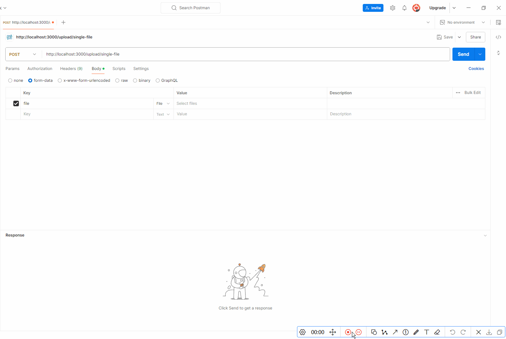
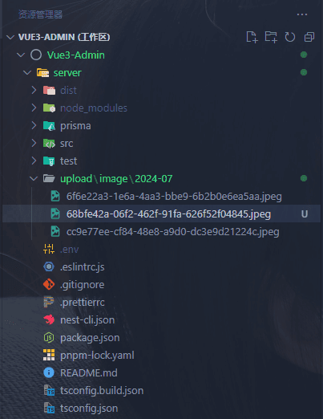

## 前言

最近在开发用户管理模块，需要上传用户头像，正好顺便把文件上传这块的功能开发了。

为了处理文件上传，[Nest](https://nestjs.com/) 提供了一个内置的基于 [multer](https://github.com/expressjs/multer) 中间件包的 **Express** 模块。**Multer** 处理以 **multipart/form-data** 格式发送的数据，该格式主要用于通过 **HTTP POST** 请求上传文件。

## 安装依赖

```bash
pnpm add @nestjs/platform-express multer uuid
```

> 我们需要安装三个包，前面两个是文件上传必须的，后面的 [uuid](https://github.com/uuidjs/uuid) 是生成文件名的，如果不需要可以不安装。

## 单个文件

当我们要上传单个文件时, 我们只需将 **FileInterceptor()** 与处理程序绑定在一起, 然后使用 **@UploadedFile()** 装饰器从 **request** 中取出 **file**。

```ts
@Post('upload')
@UseInterceptors(FileInterceptor('file'))
uploadFile(@UploadedFile() file: Express.Multer.File) {
  console.log(file);
}
```

> **FileInterceptor()** 装饰器是 **@nestjs/platform-express** 包提供的， **@UploadedFile()** 装饰器是 **@nestjs/common** 包提供的。

**FileInterceptor()** 接收两个参数：

1.  `fieldName`：指向包含文件的 HTML 表单的字段

2.  `options`：类型为 **MulterOptions** 。这个和被传入 **multer** 构造函数 ([此处](https://github.com/expressjs/multer#multeropts)有更多详细信息) 的对象是同一个对象。

## 文件数组

文件数组使用 **FilesInterceptor()** 装饰器，这个装饰器有三个参数:

1.  `fieldName`：同上

2.  `maxCount`：可选的数字，定义要接受的最大文件数

3.  `options`：同上

```ts
@Post('upload')
@UseInterceptors(FilesInterceptor('files'))
uploadFile(@UploadedFiles() files: Array<Express.Multer.File>) {
  console.log(files);
}
```

## 多个文件

要上传多个文件（全部使用不同的键），请使用 **FileFieldsInterceptor()** 装饰器。这个装饰器有两个参数:

1.  `uploadedFields`：对象数组，其中每个对象指定一个必需的 **name** 属性和一个指定字段名的字符串值

2.  `options`：同上

```ts
@Post('upload')
@UseInterceptors(FileFieldsInterceptor([
  { name: 'avatar', maxCount: 1 },
  { name: 'background', maxCount: 1 },
]))
uploadFile(@UploadedFiles() files: { avatar?: Express.Multer.File[], background?: Express.Multer.File[] }) {
  console.log(files);
}
```

## 新建模块 module

1.  使用生成器创建模块，也可以自己手动创建

```text
nest g resource file-upload
```

2.  **file-upload.service.ts**，服务层为空即可

```ts
import { Injectable } from "@nestjs/common";

@Injectable()
export class FileUploadService {}
```

3.  **file-upload.controller.ts**，当我们要上传单个文件时, 我们只需将 **FileInterceptor()** 与处理程序绑定在一起, 然后使用 **@UploadedFile()** 装饰器从 **request** 中取出 **file**

```ts
import {
  Controller,
  Post,
  Req,
  UploadedFile,
  UseInterceptors,
} from "@nestjs/common";
import { FileInterceptor } from "@nestjs/platform-express";
import { ApiBody, ApiConsumes } from "@nestjs/swagger";
import { Request } from "express";

import { responseMessage } from "@/utils";

import { FileUploadDto } from "./dto";

@Controller("upload")
export class FileUploadController {
  /**
   * @description: 上传单个文件
   */
  @UseInterceptors(FileInterceptor("file"))
  @Post("single-file")
  @ApiConsumes("multipart/form-data")
  @ApiBody({
    description: "单个文件上传",
    type: FileUploadDto,
  })
  uploadFile(
    @UploadedFile() file: Express.Multer.File,
    @Req() req: Request
  ): Api.Common.Response<Express.Multer.File> {
    // 获取客户端域名端口
    const hostname = req.headers["x-forwarded-host"] || req.hostname;
    const port = req.headers["x-forwarded-port"] || req.socket.localPort;
    const protocol = req.headers["x-forwarded-proto"] || req.protocol;
    file.path = `${protocol}://${hostname}:${port}/static${file.path.replace(/\\/g, "/").replace(/upload/g, "")}`;
    return responseMessage(file);
  }
}
```

4.  **file-upload.module.ts**，我们在 **module** 层注册并根据实际情况配置文件上传路径

```ts
import { Module } from "@nestjs/common";
import { MulterModule } from "@nestjs/platform-express";
import dayjs from "dayjs";
import { diskStorage } from "multer";
import { v4 as uuidv4 } from "uuid";

import { checkDirAndCreate } from "@/utils";

import { FileUploadController } from "./file-upload.controller";
import { FileUploadService } from "./file-upload.service";

@Module({
  imports: [
    MulterModule.registerAsync({
      useFactory: async () => ({
        limits: {
          fileSize: 1024 * 1024 * 5, // 限制文件大小为 5MB
        },
        storage: diskStorage({
          // 配置文件上传后的文件夹路径
          destination: (_, file, cb) => {
            // 定义文件上传格式
            const allowedImageTypes = [
              "gif",
              "png",
              "jpg",
              "jpeg",
              "bmp",
              "webp",
              "svg",
              "tiff",
            ]; // 图片
            const allowedOfficeTypes = [
              "xls",
              "xlsx",
              "doc",
              "docx",
              "ppt",
              "pptx",
              "pdf",
              "txt",
              "md",
              "csv",
            ]; // office
            const allowedVideoTypes = ["mp4", "avi", "wmv"]; // 视频
            const allowedAudioTypes = ["mp3", "wav", "ogg"]; // 音频
            // 根据上传的文件类型将图片视频音频和其他类型文件分别存到对应英文文件夹
            const fileExtension = file.originalname
              .split(".")
              .pop()
              .toLowerCase();
            let temp = "other";
            if (allowedImageTypes.includes(fileExtension)) {
              temp = "image";
            } else if (allowedOfficeTypes.includes(fileExtension)) {
              temp = "office";
            } else if (allowedVideoTypes.includes(fileExtension)) {
              temp = "video";
            } else if (allowedAudioTypes.includes(fileExtension)) {
              temp = "audio";
            }
            // 文件以年月命名文件夹
            const filePath = `upload/${temp}/${dayjs().format("YYYY-MM")}`;
            checkDirAndCreate(filePath); // 判断文件夹是否存在，不存在则自动生成
            return cb(null, `./${filePath}`);
          },
          filename: (_, file, cb) => {
            // 使用随机 uuid 生成文件名
            const filename = `${uuidv4()}.${file.mimetype.split("/")[1]}`;
            return cb(null, filename);
          },
        }),
      }),
    }),
  ],
  controllers: [FileUploadController],
  providers: [FileUploadService],
})
export class FileUploadModule {}
```

## 效果演示

我们使用 [postman](https://www.postman.com/) 模拟上传：



上传后的文件夹结构：



## 配置文件访问

我们上传完成后的地址，比如：**http://localhost:3000/static/image/2024-07/68bfe42a-06f2-462f-91fa-626f52f04845.jpeg** 是不能直接访问的，我们还需要在 **main.ts** 里面配置：

```ts
import { NestFactory } from "@nestjs/core";
import { NestExpressApplication } from "@nestjs/platform-express";
import * as express from "express";
import { join } from "path";

import { AppModule } from "./app.module";
async function bootstrap() {
  const app = await NestFactory.create<NestExpressApplication>(AppModule);

  // 配置文件访问  文件夹为静态目录，以达到可直接访问下面文件的目的
  const rootDir = join(__dirname, "..");
  app.use("/static", express.static(join(rootDir, "/upload")));

  await app.listen(3000);
}
bootstrap();
```

配置完成就能正常访问文件了。

## 总结

我只能了单个文件上传，文件数组和多个文件上传也是一样的道理，大家可自行实现。

现在很多公司文件存储业务都已经使用第三方平台，比如：

1.  [阿里云 OSS](https://www.aliyun.com/product/oss)

::link-card[https://www.aliyun.com/product/oss]

2.  [腾讯云 COS](https://cloud.tencent.com/product/cos)

::link-card[https://cloud.tencent.com/product/cos]

3.  [七牛云 KODO](https://www.qiniu.com/products/kodo)

::link-card[https://www.qiniu.com/products/kodo]

4.  [又拍云 USS](https://www.upyun.com/products/file-storage)

::link-card[https://www.upyun.com/products/file-storage]

很少用上传到服务器本地的，业务量大的话会对服务器造成压力，一般这种适合个人站点、博客使用，这里我们当做学习就行。
