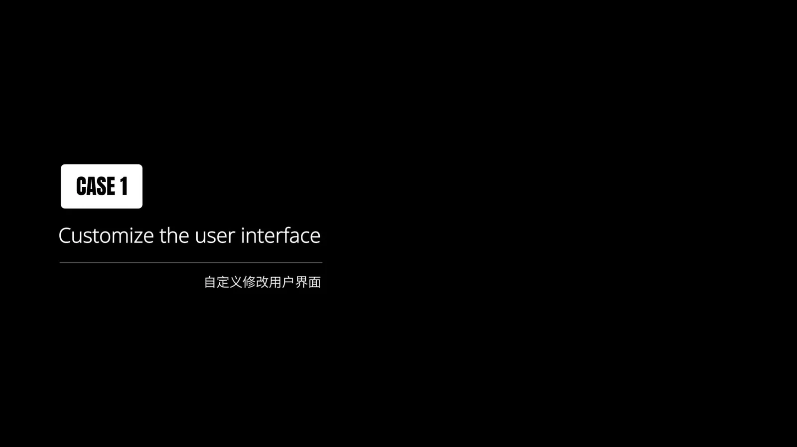
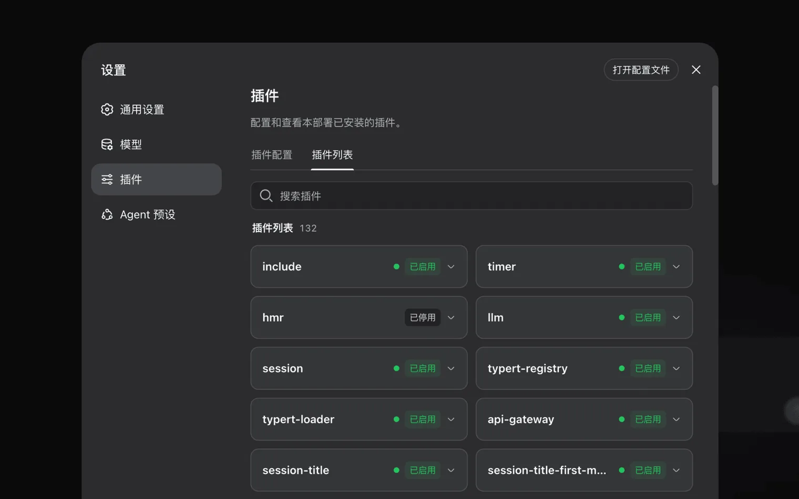
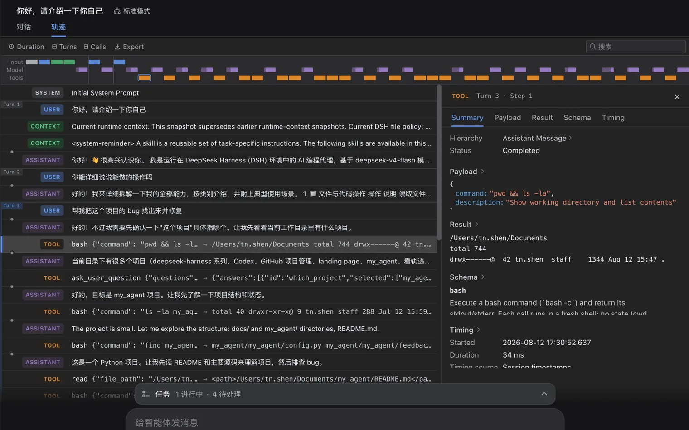

## 一、初识 Harness：它到底是什么，能帮你做什么？

如果你用过 ChatGPT、DeepSeek 这类 AI 聊天工具，大概会有一种感觉：**它很聪明，但只会"说"，不会"做"**。

让它帮你改个 bug，它给你贴一段代码；让它总结仓库，它让你自己复制粘贴。你想的是"帮我把这个项目跑起来、找出问题、修好它"，但聊天工具只能停在"给建议"这一步。

DeepSeek Harness（简称 `dsh`）就是为了解决这个问题而生的。它是 DeepSeek AI 开源的 **agent harness（智能体框架）**，一个能让 AI 真正"上手干活"的开发工具。

### 🧠 模型是"大脑"，Harness 是"手脚"

官方有一句很精辟的概括：**Agent = Model + Harness**（智能体 = 模型 + 框架）。

- **模型（Model）** 是"大脑"：负责思考——理解你的需求、规划步骤、决定下一步做什么。
- **Harness** 是"手脚"：负责执行——读写文件、运行命令、调用工具、拆分任务。

光有大脑，AI 只是个"键盘侠"；配上手脚，它才是一个能干活的下属。Harness 要做的，就是让智能体理解它所处的真实环境（你的电脑、你的项目），用工具动手操作，并且能长时间持续工作，而不是答完一句就完事。

### 🔧 它和普通 AI 聊天有什么区别？

一句话：**聊天只给答案，Harness 直接干活。** 具体来说，它可以：

- **读写工作区文件**：读取你的代码、按需编辑、创建新文件；
- **执行 shell 命令**：跑测试、装依赖、查日志、启动服务；
- **委派子任务**：把大任务拆成小任务，交给子 Agent 并行推进；
- **维护计划**：面对复杂的多步任务，自己列出执行计划并逐步落实。

想象一下，你只需要说一句"帮我把这个仓库的测试跑通，再修掉失败的用例"，剩下的读代码、查日志、改 bug、跑测试，它自己一步步完成——这就是 Harness 与普通聊天的本质区别。

### 👥 适合谁用？解决什么痛点？

- **独立开发者 / 个人项目**：一个人也能"指挥"一个 AI 团队，重复性、探索性的编码任务直接甩给它；
- **团队协作**：内置**权限策略与审批机制**，AI 执行敏感操作前会先问你，配合完整的会话记录，协作可控、可追溯；
- **环境搭建**：沙箱、会话、模型路由等基础设施都由 Harness 管理，你不用自己折腾一套复杂的 Agent 运行环境；
- **API Key 管理**：模型、工具、存储都可以在配置里统一管理，不用把 Key 散落在各个脚本里。

这个项目开源后迅速在开发者社区走红，目前 GitHub 上已经收获了 **16 万+ Star**。更夸张的是，在 Harness 里**连用户界面本身都是插件**——不喜欢默认的界面？你可以自己改：



好，心动了的话，接下来就跟着我一步步把它跑起来。

## 二、环境准备：5 分钟完成起步配置

起步只需要装好一个东西：**Node.js**。没接触过 Node.js 也没关系，跟着做就行。

### 📦 第一步：检查 Node.js 版本

打开终端（Windows 上是 PowerShell 或 CMD，macOS/Linux 上是 Terminal），输入：

```bash
node -v
```

- 如果输出了版本号（例如 `v22.14.0`），说明已经装好了；
- 如果提示"node 不是内部或外部命令"，说明还没装。

**版本要求：Node.js ≥ 22**（官方要求 22.19 及以上，或 24 及以上）。版本太老（比如 v18、v20）会导致启动失败。

- 还没装 Node.js：去 [nodejs.org](https://nodejs.org/) 下载 LTS 版本（目前是 22.x），一路"下一步"即可；
- 想方便地管理多个版本：Windows 推荐 [nvm-windows](https://github.com/coreybutler/nvm-windows)，macOS/Linux 推荐 nvm。

### 🚀 第二步：一条命令启动

装好 Node.js 后，在终端里执行：

```bash
npx @deepseek-ai/dsh web
```

就这一条命令。第一次运行需要从 npm 下载安装包，稍等片刻，服务启动后终端会打印出访问地址。

### ⚠️ Windows 用户的常见坑

1. **装完 Node.js 后命令还是找不到**：安装 Node.js 后，**一定要重新打开一个终端窗口**（或重启 VS Code），让环境变量刷新。很多新手都是卡在这一步——不是没装好，而是终端没重开。
2. **PowerShell 提示"禁止运行脚本"**：如果执行 `npx` 时报错，用管理员身份打开 PowerShell，执行一次：

   ```powershell
   Set-ExecutionPolicy -ExecutionPolicy RemoteSigned
   ```

   然后重开终端再试。

### 💡 其他安装方式（供参考）

新手推荐上面的 npx 方式，但如果你有特殊需求，也可以：

- **源码安装**：适合想读源码、参与开发的读者——

  ```bash
  git clone https://github.com/deepseek-ai/deepseek-harness.git
  cd deepseek-harness
  pnpm install
  pnpm run build
  pnpm dsh web
  ```

- **社区桌面版**：有社区维护的桌面客户端（[deepseek-harness-desktop](https://github.com/sdkwork-ai/deepseek-harness-desktop)），喜欢图形化安装体验的可以试试；
- **Docker 部署**：社区提供了 Docker 镜像，适合部署在服务器或 NAS 上，想了解多种部署方式可以看看这篇 [《在本地部署 DeepSeek Harness 的 6 种方法》](https://www.cometapi.com/zh-TW/how-to-install-and-deploy-deepseek-harness-locally/)。

> ⚠️ 注意：桌面版和 Docker 镜像均为**社区方案**，并非官方发布渠道。新手请优先使用 `npx` 官方方式，踩坑更少。

## 三、启动与配置 API Key

### 🌐 启动 Web UI

执行 `npx @deepseek-ai/dsh web` 后，浏览器打开终端打印的地址。**默认地址是 http\://127.0.0.1\:3080**（`127.0.0.1` 就是你本机）。

- 💡 小技巧：想换个端口，加 `--port` 参数即可，例如 `npx @deepseek-ai/dsh web --port 8080`；
- 想停止服务，在终端按 `Ctrl + C`。

### 🔑 获取 DeepSeek API Key

AI 的"大脑"需要调用 DeepSeek 的模型接口，所以要先申请一个 API Key：

1. 打开 [platform.deepseek.com](https://platform.deepseek.com/)，注册并登录；
2. 左侧菜单找到 **API Keys**，点击**创建 API Key**；
3. 复制生成的一串密钥，保存好。

> ⚠️ 注意：API Key **只在创建时完整显示一次**，务必立即复制保存。它相当于你账户的"钥匙"，**千万不要提交到 GitHub、发到群里**，泄露了立刻去平台删除重建。
>
> 💡 小技巧：DeepSeek API 是付费的，新账户需要先去"充值"（费用很低，几块钱够玩很久），否则调用模型时会报错。

### ⚙️ 在 Web UI 中配置

1. 打开 Web UI，点击左侧的**设置**；
2. 进入**模型**页面；
3. 粘贴刚才保存的 DeepSeek API Key，点击保存。

保存后模型立即可用，**不需要重启服务**。这是 Harness 很贴心的一点——配置完马上就能用。

> ⚠️ 注意：DeepSeek Harness 目前是 **v0.1 开发者预览版**（npm 上最新版本为 `0.1.0-rc.x`），正在快速迭代中，**界面和接口都可能有破坏性变化**。如果哪天发现命令不对、配置项找不到，先去[官方仓库](https://github.com/deepseek-ai/deepseek-harness)看看最新文档，大概率是版本更新了。
>
> 💡 小技巧：强制使用最新版本，可以执行 `npx @deepseek-ai/dsh@latest web`。

## 四、核心功能与四种 Agent 模式

### 🧩 一切皆插件

DeepSeek Harness 最核心的设计理念，也是它的官方标语：**Everything is a Plugin（一切皆插件）**。

它基于 Cordis 插件内核构建，**模型、工具、技能、会话、沙箱、存储、循环、调度，甚至 UI**——所有能力都是插件，可以自由替换、重新组合。不喜欢默认的某个工具？换掉它。想要新能力？装个插件就行。开发者甚至可以不改源码，只通过配置就组合出自己想要的 Agent。

在 Web UI 的**设置 → 插件**页面，可以看到本地已安装的所有插件，以及它们的启用状态：



### 🎛️ 四种 Agent 模式

新建会话时，可以选择不同的运行模式。目前有四种：

| 模式         | 定位                                                                                                      | 适合场景                                   |
| ------------ | --------------------------------------------------------------------------------------------------------- | ------------------------------------------ |
| **标准模式** | 功能完整的编码 Agent，包含文件编辑、Shell、文件与网页搜索、Skills、计划、目标、子代理和工作流             | 日常开发任务，**新手首选**                 |
| **PTC 模式** | 具备标准模式全部能力，并通过 Code Mode SDK 把工具暴露给模型，让模型用一个 TypeScript 程序组合多步工具调用 | 批量、结构化、需要复现的任务               |
| **极简模式** | 只保留持久 bash 与文件编辑器两个工具                                                                      | 在最小化环境下对比、基准测试不同模型的能力 |
| **创造模式** | 具备标准模式全部能力，外加运行时检查、插件实验与自定义 Agent 预设编写引导                                 | 打造专属 Agent、做插件实验的进阶玩家       |

简单理解：

- 平时干活用**标准模式**就够了；
- 任务重复、流程固定（比如"遍历 10 个目录各做一遍同样的事"），用 **PTC 模式**让模型写一段程序统一执行，效率更高；
- 想评估"哪个模型更会写代码"，用**极简模式**做公平对比；
- 想定制一个只属于自己的 Agent，或者尝试开发插件，用**创造模式**。

### 📜 Trajectory（轨迹）：每一步都看得见

这是 Harness 一个非常有特色的功能：**每次会话的完整过程都会被记录下来**——系统提示词、模型的思维链、每一次工具调用及结果、子 Agent 的调度、每一次上下文注入，全部存进一份追加式会话日志。

在 **Trajectory（轨迹）** 视图中，你可以按来源逐条查看这些记录；**恢复、分叉、搜索、回放**都基于同一份事件流：



> 💡 小技巧：AI 干完活后，不要只看它的结论。打开轨迹视图，看看它每一步做了什么、读了哪些文件、执行了什么命令——这能帮你判断结果是否可靠，也是排查"它为什么这么改"的最好方式。

## 五、第一个实战任务

理论讲完了，现在真正上手。我们拿一个项目目录来练手，让 AI 帮我们"读懂"一个仓库。

### 📂 第一步：选择工作区

1. 打开 Web UI，点击**选择工作区**；
2. **添加**你启动 `dsh` 时所在的项目目录（`dsh` 进程会把启动时所在的目录作为默认文件系统位置）；
3. 在列表里**选中**它。

> ⚠️ 注意：**不选中工作区，会话输入框是不可用的**。很多新手打开页面发现发不了消息，就是忘了这一步。

### 💬 第二步：新建会话并下达任务

点击新建会话，模式保持**标准模式**，在输入框里发送：

> 帮我总结一下这个仓库的主要模块

### 👀 第三步：看它怎么干活

接下来你会看到它自己动起来，大致过程是这样的：

1. **先侦察环境**：执行 `ls` 之类的命令，看看仓库里有什么；
2. **再读关键文件**：打开 README、项目配置、入口文件；
3. **深入源码**：逐个模块读核心实现；
4. **汇总输出**：最后给你一份结构清晰的模块总结，通常还会带上每个模块的职责说明。

整个过程中，如果它打算执行一些敏感操作（比如删文件、改全局配置），**Web UI 会弹出窗口向你确认**——这是权限策略在起作用，放心点允许或拒绝。

### 🔁 第四步：追问与迭代

AI 的总结不满意？直接在同一个会话里追问，比如：

> xx 模块具体依赖了哪些文件？画一个依赖关系说明

它会基于之前的上下文继续深入分析，不用重新交代背景。任务完成后，记得去 **Trajectory 视图**回看一下它是怎么一步步得出结论的。

> 💡 小技巧：任务描述越具体，结果质量越高。告诉它"用表格输出""整理成文档放进 docs/ 目录"这类**产物格式**要求，输出的可用性会大幅提升。

## 六、避坑指南与后续学习建议

### 🕳️ 常见坑一览

| 现象                         | 原因                     | 解决办法                                       |
| ---------------------------- | ------------------------ | ---------------------------------------------- |
| 发消息后一直转圈或报模型错误 | API Key 未配置或填错     | 回到**设置 → 模型**重新粘贴正确的 Key          |
| 启动时提示 Node 版本不支持   | Node.js 版本过低         | 升级到 **≥ 22**，再重开终端                    |
| 默认端口 3080 起不来         | 端口被占用               | 换端口：`npx @deepseek-ai/dsh web --port 8080` |
| Windows 上 `node` 命令找不到 | 装完 Node 没刷新环境变量 | **重新打开终端**再试                           |
| 会话输入框是灰色的           | 没有选择工作区           | 点击**选择工作区**，添加并选中项目目录         |

### 🧩 进阶：安装你的第一个插件

Harness 的灵魂在插件生态，安装插件用这一条命令：

```bash
dsh plugin --profile web add <插件名>
```

这条命令会在 `web` profile 的目录里调用 pnpm，把插件安装进去。装完后回到 Web UI，在**设置 → 插件**里就能看到它，可以随时启用或停用（还记得前面截图里的开关吗？）。

去哪里找插件？

- GitHub 上搜索 **dsh-plugin** 话题（官方推荐插件仓库打这个标签，方便被发现）；
- 逛社区整理的插件合集，例如 [awesome-dsh-plugin](https://github.com/awesome-dsh-plugin/awesome-dsh-plugin)（含中文说明）；
- 在 npm 上搜索 `dsh-plugin` 相关包。

> ⚠️ 注意：插件能读写文件、执行命令，**安装第三方插件前务必先看它的源码和权限**，不要安装来路不明的插件。

### 📚 学习资源推荐

- **官方文档**：[DeepSeek Harness 官方仓库](https://github.com/deepseek-ai/deepseek-harness) 里的 `docs` 目录有 Web UI 指南、模型配置、插件开发等完整文档，中文版本齐全；
- **官方开发者预览页**：[deepseek.com/harness](https://deepseek.com/harness/) 可以快速了解产品理念与最新动态；
- **社区实战手册**：GitHub 上的 [awesome-dsh-plugin](https://github.com/awesome-dsh-plugin/awesome-dsh-plugin)、[社区教程合集](https://chihhung.github.io/Blog/posts/%E6%95%99%E5%AD%B8/ai%E9%96%8B%E7%99%BC/deepseek-harness-%E6%95%99%E5%AD%B8%E6%89%8B%E5%86%8A/) 等，都是不错的进阶读物。

### 🏠 加入社区

- 微信公众号：**DeepSeek Harness 团队**（官方公众号，关注产品动态与公告）；
- 企微群：通过官方企微小助手扫码填写问卷入群，和开发者们一起交流；
- 官方讨论区：[GitHub Discussions](https://github.com/deepseek-ai/deepseek-harness/discussions) 与 [Discord 社区](https://discord.gg/Ycq5dCaS4)。

---

到这里，你已经完成了从零到一的全部路程：装好了环境、配好了 Key、跑通了第一个任务。但这只是开始——**插件生态才是 Harness 真正的宝藏**。接下来，去插件列表里逛逛，装上第一个你需要的插件，看看它能帮你长出什么样的新"手脚"吧！
