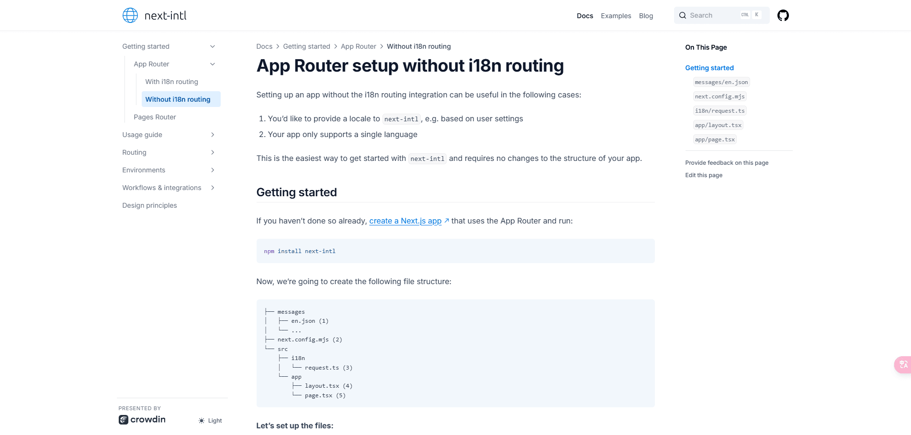
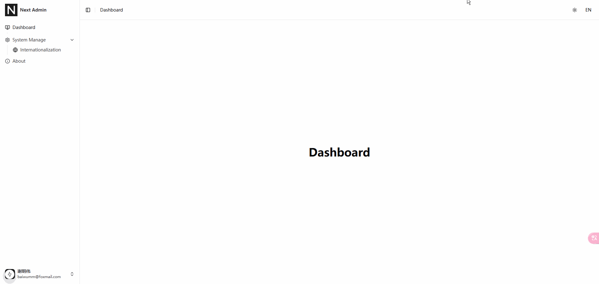

## 前言

有关 [Next.js](https://nextjs.org/) 国际化的方案网上很多，而且各部相同，但大部分的方案都是在 **/app** 目录下添加动态路由 **\[lang\]** 这样的形式，这不是我想要的效果。

我希望国际化的实现不能破坏应用程序的目录结构和路由，在经过一段时间摸索后，发现

::link-card[https://github.com/amannn/next-intl]

有提供现成的方案：



更多详细文档：[next-intl](https://next-intl-docs.vercel.app/)

如果官方文档打不开的伙伴，可以到 [Github](https://github.com/amannn/next-intl) 上克隆代码，本地运行根目录的 **docs** 文件夹

## 具体步骤

1.  安装依赖

```bash
pnpm add next-intl
```

2.  根目录新建 **messages** 文件夹，并写入对应的国际化文件：

```text
// en.json
{
  "Route":{
    "about":"About",
    "dashboard":"Dashboard",
    "system-manage":"System Manage",
    "internationalization":"Internationalization"
  }
}

// zh.json
{
  "Route":{
    "about":"关于",
    "dashboard":"仪表盘",
    "system-manage":"系统管理",
    "internationalization":"国际化"
  }
}
```

3.  根目录的 **next.config.ts** 文件设置插件：

```ts
import type { NextConfig } from "next";
import createNextIntlPlugin from "next-intl/plugin";

const withNextIntl = createNextIntlPlugin();

const nextConfig: NextConfig = {};

export default withNextIntl(nextConfig);
```

4.  新建 **src/i18n/config.ts** 文件，写入配置：

```ts
export type Locale = (typeof locales)[number];

export const locales = ["zh", "en"] as const;
export const defaultLocale: Locale = "zh";
```

5.  新建 **src/i18n/request.ts** 文件，创建一个请求范围的配置对象：

```ts
import { getRequestConfig } from "next-intl/server";

import { getLocale } from "@/i18n";

export default getRequestConfig(async () => {
  const locale = await getLocale();

  return {
    locale,
    messages: (await import(`../../messages/${locale}.json`)).default,
  };
});
```

6.  新建 **src/i18n/index.ts** 文件，用于服务端获取和设置语言

```ts
"use server";

import { cookies } from "next/headers";

import { defaultLocale, Locale } from "@/i18n/config";

// In this example the locale is read from a cookie. You could alternatively
// also read it from a database, backend service, or any other source.
const COOKIE_NAME = "NEXT_LOCALE";

export async function getLocale() {
  return (await cookies()).get(COOKIE_NAME)?.value || defaultLocale;
}

export async function setLocale(locale: Locale) {
  (await cookies()).set(COOKIE_NAME, locale);
}
```

7.  **app/layout.tsx** 文件配置 **NextIntlClientProvider**：

```ts
import {NextIntlClientProvider} from 'next-intl';
import {getLocale, getMessages} from 'next-intl/server';

export default async function RootLayout({
  children
}: {
  children: React.ReactNode;
}) {
  const locale = await getLocale();

  // Providing all messages to the client
  // side is the easiest way to get started
  const messages = await getMessages();

  return (
    <html lang={locale}>
      <body>
        <NextIntlClientProvider messages={messages}>
          {children}
        </NextIntlClientProvider>
      </body>
    </html>
  );
}
```

8.  在文件中使用：

```ts
import { useTranslations } from 'next-intl';
export default function Dashboard() {
  const t = useTranslations('Route');
  return (
    <h1>
      {t('dashboard')}
    </h1>
  );
}
```

## 切换语言

1.  新建 **src/components/LangSwitch/index.tsx** 文件：

```ts
'use client';

import { useLocale } from 'next-intl';

import { Button } from '@/components/ui/button';
import { setLocale } from '@/i18n';
import { type Locale, locales } from '@/i18n/config';

export default function LangSwitch() {
  const [ZH, EN] = locales;
  const locale = useLocale();

  // 切换语言
  function onChangeLang(value: Locale) {
    const locale = value as Locale;
    setLocale(locale);
  }
  return (
    <Button variant="ghost" size="icon" onClick={() => onChangeLang(locale === ZH ? EN : ZH)}>
      {locale === ZH ? '中' : 'EN'}
      <span className="sr-only">Toggle Lang</span>
    </Button>
  );
}
```

2.  在需要的位置引入组件：

```ts
import LangSwitch from '@/components/LangSwitch';

<LangSwitch />
```

## 最终效果



## 总结

这样的国际化方案切换语言的时候，路由就不会发生变化，更好地保留应用程序的原样，并且将当前语言的 **key** 存储到浏览器 **cookie** 中，刷新浏览器当前语言并不会失效，可以达到我们想要的效果。
