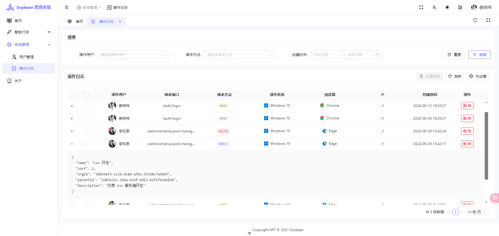

## 前言

有一天，公司的产品经理提了一个需求：系统需要记录每个用户的 [CURD](https://baike.baidu.com/item/CURD/3031761) 操作，也就是说用户新增、编辑或者删除了什么数据，都需要记录下来，这个在 [Nest.js](https://nestjs.com/) 中如何实现呢？

这时候我们可以考虑使用 [拦截器](https://docs.nestjs.cn/10/interceptors) 来实现。

## 什么是拦截器？

[拦截器](https://docs.nestjs.cn/10/interceptors) 是使用 **@Injectable()** 装饰器注解的类。拦截器应该实现 **NestInterceptor** 接口。

[拦截器](https://docs.nestjs.cn/10/interceptors) 具有一系列有用的功能，这些功能受**面向切面编程（AOP）**技术的启发。它们可以：

- 在函数执行之前/之后绑定额外的逻辑

- 转换从函数返回的结果

- 转换从函数抛出的异常

- 扩展基本函数行为

- 根据所选条件完全重写函数 (例如, 缓存目的)

## 创建 Prisma 模型

在 **schema.prisma** 文件中添加 **Log** 模型：

```prisma
// Log - method
enum Method {
  GET
  POST
  PATCH
  DELETE
}

// 系统管理 - 操作日志
model Log {
  id            String          @id @default(uuid()) // 主键
  userId        String          // 关联的用户 id
  user          User            @relation(fields: [userId], references: [id])
  ip            String          // ip
  action        String          // 请求地址
  method        Method          // 请求方法
  params        Json            // 请求参数（JSON 对象）
  os            String          // 系统
  browser       String          // 浏览器
  createdAt     DateTime        @default(now()) // 创建时间
}
```

这里可以根据自己实际需求调整。

## 创建 Module 模块

这里我们需要用到 **Session** 保存的用户数据，但 **Service** 中是不能直接获取 **Session** 的，我们需要[注入作用域](https://docs.nestjs.cn/10/fundamentals?id=%e6%b3%a8%e5%85%a5%e4%bd%9c%e7%94%a8%e5%9f%9f)，以此来获取请求中的上下文。

新建 **operation-log.service.ts** 文件：

```ts
import { Inject, Injectable, Scope } from "@nestjs/common";
import { REQUEST } from "@nestjs/core";
import { Request } from "express";
import UAParser from "ua-parser-js";

import { PrismaService } from "@/modules/prisma/prisma.service";

@Injectable({ scope: Scope.REQUEST })
export class OperationLogService {
  constructor(
    @Inject(REQUEST)
    private readonly request: Request & { session: Api.Common.SessionInfo },
    private prisma: PrismaService
  ) {}

  /**
   * @description: 录入日志
   */
  async logAction() {
    const { originalUrl, method, headers, ip, body, query } = this.request;
    const userAgent = headers["user-agent"];
    const parser = new UAParser(userAgent);
    let { userInfo } = this.request.session;
    // 登录接口需要单独处理
    const isLogin = originalUrl === "/auth/login";
    if ((userInfo && method.toUpperCase() !== "GET") || isLogin) {
      if (isLogin) {
        // 查询数据库中对应的用户
        userInfo = await this.prisma.user.findUnique({
          where: { userName: body.userName },
        });
      }
      const data: any = {
        userId: userInfo.id,
        action: originalUrl,
        method: method.toUpperCase(),
        ip,
        params: { ...body, ...query },
        os: Object.values(parser.getOS()).join(" "),
        browser: parser.getBrowser().name,
      };
      // 插入数据到表
      await this.prisma.log.create({
        data,
      });
    }
  }
}
```

因为登录接口此时 **Session** 还没有保存用户数据，我们需要单独处理一下，这里我们只记录非 **GET** 请求的路由。

## 创建 LoggerInterceptor 拦截器

新建 **interceptor/logger.interceptor.ts** 文件，写入：

```ts
import {
  CallHandler,
  ExecutionContext,
  Injectable,
  NestInterceptor,
} from "@nestjs/common";
import { Observable } from "rxjs";
import { map } from "rxjs/operators";

import { OperationLogService } from "@/modules/system-manage/operation-log/operation-log.service";

@Injectable()
export class LoggerInterceptor implements NestInterceptor {
  constructor(private readonly operationLogService: OperationLogService) {}

  intercept(context: ExecutionContext, next: CallHandler): Observable<any> {
    this.operationLogService.logAction();
    return next.handle().pipe(map(data => data));
  }
}
```

## 绑定拦截器

在需要绑定的 **Controller** 中使用 **@UseInterceptors()** 装饰器，与守卫一样, 拦截器可以是控制器范围内的, 方法范围内的或者全局范围内的。

```ts
import { UseInterceptors } from "@nestjs/common";
import { LoggerInterceptor } from "@/interceptor/logger.interceptor";

@UseInterceptors(LoggingInterceptor)
export class UserManageController {}
```

在绑定拦截器后，用户每次调用 **Controller** 中的路由处理程序都将使用 **LoggingInterceptor**，也就是说会把用户的操作等信息记录到表中。

## 效果演示



## 总结

这个功能本来一开始我是想使用 [中间件](https://docs.nestjs.cn/10/middlewares) 来开发的，后来不管怎么折腾，[中间件](https://docs.nestjs.cn/10/middlewares) 的 **Request** 上下文始终获取不到 **Session**，但 [](https://docs.nestjs.cn/10/interceptors)[拦截器](https://docs.nestjs.cn/10/interceptors) 也不失是一种好方法。
