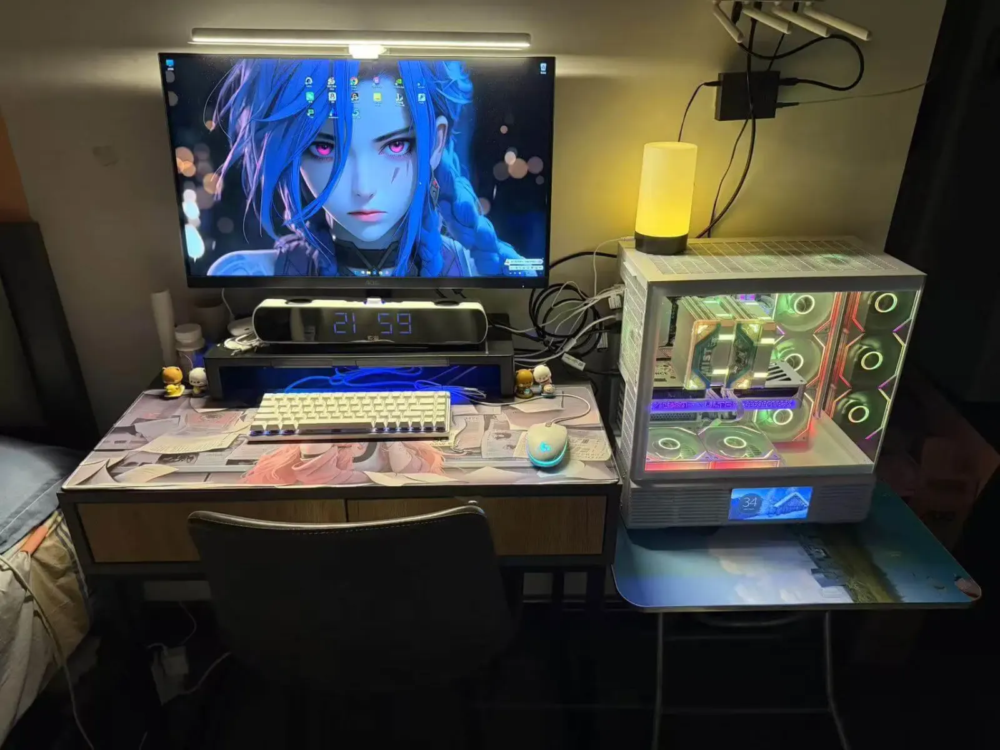
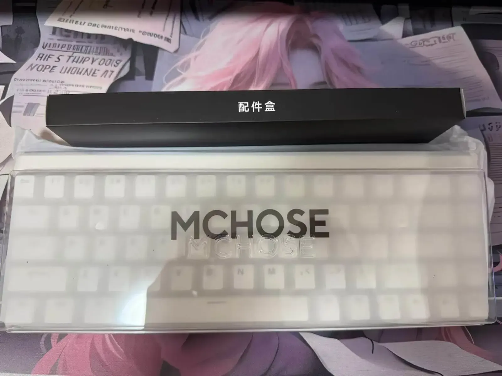
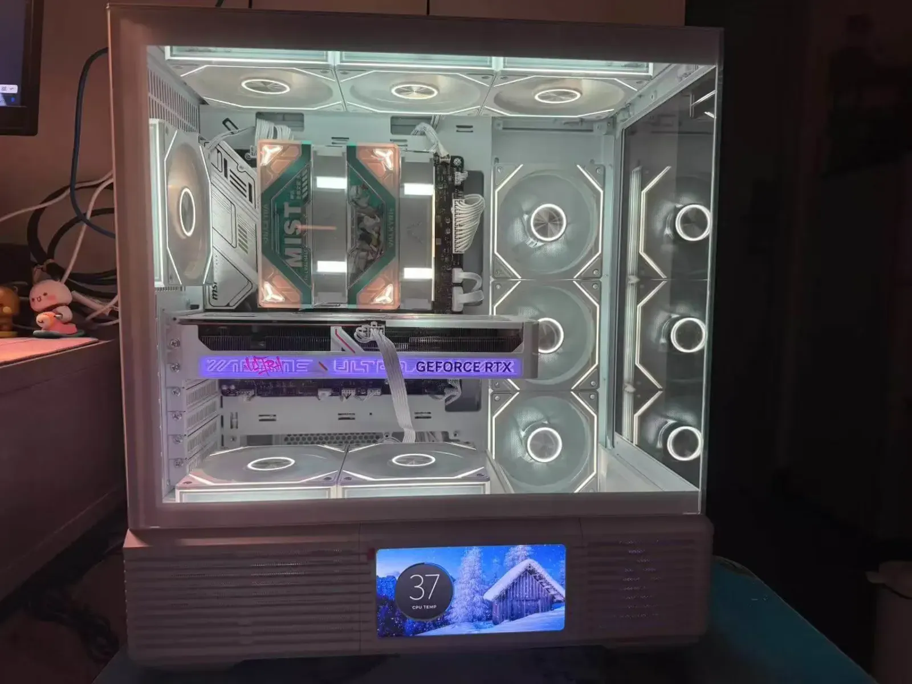
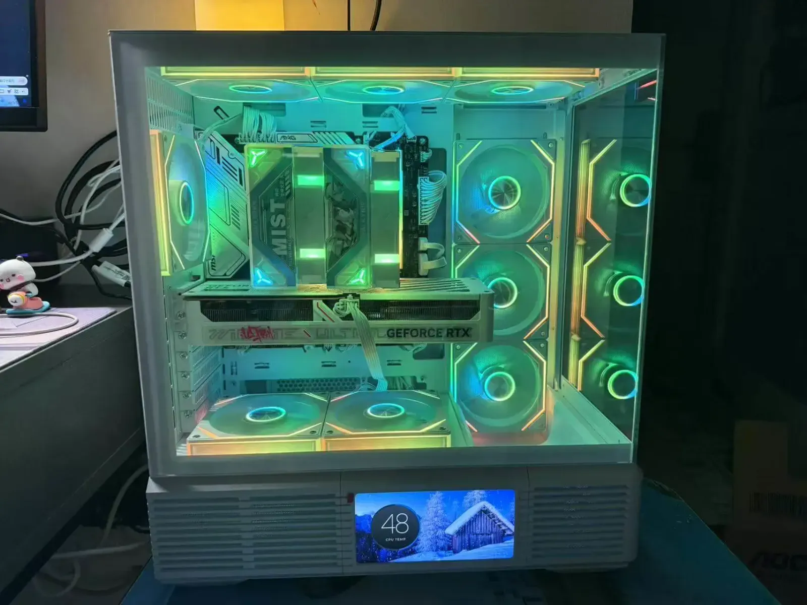
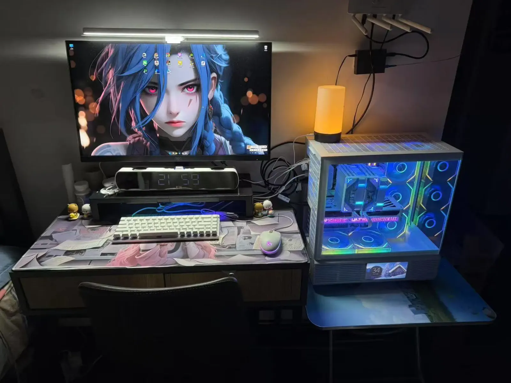
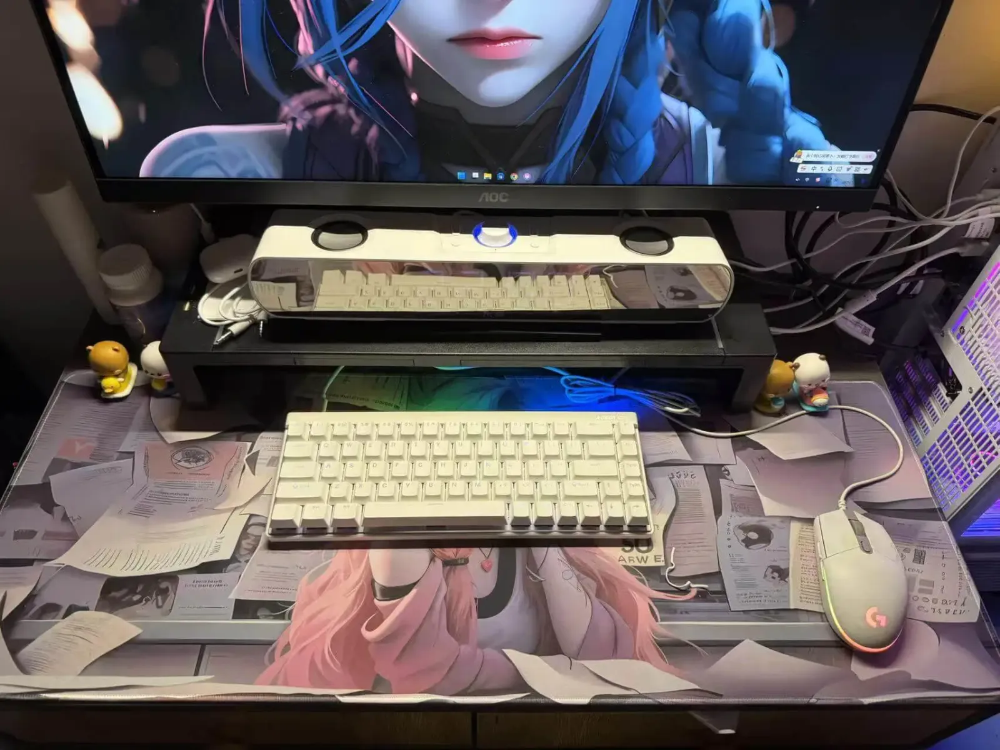

## 一台电脑的“中年危机”

没记错的话（虽然记忆已经模糊），这台电脑是2019年入手的。那时候，我还是个刚入行的职场小白，对代码的理解还停留在 `Hello World` 的浪漫幻想里。它陪着我熬夜打游戏、写bug、刷剧，像青春期一样肆无忌惮地挥霍性能。

后来，我从广州搬到深圳，它成了我行李中最重的“家当”。四年过去，它的风扇开始像哮喘病人一样喘息，开机时间足够我冲一杯手冲咖啡，显卡在游戏里跳帧的样子，像极了PPT动画。最致命的是，当我试图用AI生成代码时，它卡顿的样子仿佛在说：“求求了，让我退休吧。”

> **六年陪伴，它见证我从** `jQuery` **的怀抱，到敢对** `React Hooks` **说'不过如此'的膨胀。**
> 
> **当** `npm install` **的时间从‘等一杯咖啡’变成‘等一壶茶’时，我意识到——我和我的电脑，总得有一个要先升级。**

## 硬件参数暴击

**「当我决定换电脑时，才发现自己是个"硬件文盲"」**

六年没关注硬件，现在的电脑配置单看起来像天书：

-   **CPU** 不是"i7"就完事了，还得纠结：  
✓ 核心线程是跑分还是实战  
✓ 带K还是带F
    
-   **内存条** 突然讲究起玄学：  
✓ 时序CL值越小越好？  
✓ DDR5比DDR4快多少？  
✓ 我怀疑自己之前用的是上古U盘
    
-   **散热器** 进化成精密工程：  
✓ 风冷像电风扇  
✓ 水冷像装空调  
✓ 还得考虑机箱风道
    
-   **显示器** 离谱到能"超频"：  
✓ 144Hz还不够？  
✓ 现在流行"超"到180Hz？
    
-   **主板** 参数表堪比：  
✓ 线性代数考题  
✓ 每个接口都要对号入座  
✓ BIOS设置像在破解密码
    

**「前端工程师的“参数PTSD”」**  
曾经的我：“电脑？能跑VSCode不卡就行。”  
现在的我：（对着电商页面喃喃自语）“这个时序CL36的DDR5-6000，搭配i7-14700KF会不会被散热拖后腿……”

> “曾经以为`JavaScript`的版本迭代够快了，直到我看见了英特尔和AMD的更新日志……”

## DIY 电脑

**预算逐渐失控：从5K理智到8K真香的心路历程**

经过一周的硬件知识恶补，我的装机方案经历了以下进化：

**初始计划（理智版）**  
"5K预算够用了，i5+16G+512G，又不是不能用！"

**中期动摇（加钱版）**  
"CPU要不要上i7？显卡好像也得升级...加1K不过分吧？"

**最终方案（放飞版）**  
"都看到8K了，不如直接上海景房机箱+RGB全家桶！"

最终**敲定的配置清单：**

| 硬件  | 型号  | 参数  |
| --- | --- | --- |
| CPU | [英特尔（Intel）i5-14600KF](https://item.jd.com/100069427196.html) | 14核 \| 20线程 \| 5.3GHZ |
| 主板  | [微星（MSI）MAG B760M MORTAR WIFI II DDR5迫击炮主板](https://item.jd.com/100065608702.html) | LGA1700 \| B769 \| DDR5 |
| 显卡  | [七彩虹（Colorful）iGame GeForce RTX 5060 Ultra W OC](https://item.jd.com/100172853659.html) | 8GB \| GDDR7 \| 128bit |
| 内存  | [金百达（KINGBANK）DDR5内存 白刃 RGB灯条](https://item.jd.com/10130997070447.html) | DDR5 \| 32GB \| 6000MHz |
| 硬盘  | [宏碁掠夺者（PREDATOR）GM7系列](https://item.jd.com/100049404381.html) | 7000MB/s \| 1TB \| 6300MB/s |
| 电源  | [长城（Great Wall）额定750W G7白色金牌全模组电源](https://item.jd.com/100082810703.html#switch-sku) | 全模组化 \| 750W \| ATX 电源 |
| 散热  | [瓦尔基里(VALKYRIE）](https://item.jd.com/100043267539.html) | 风冷 \| 158mm \| 6热管 |
| 机箱  | [先马（SAMA）境界Magic 白色 ATX海景房](https://item.jd.com/100159861694.html) | 中型机箱 \| 8-12kg |
| 风扇  | [棱镜四代 PRO 正向](https://item.jd.com/10094033922949.html#switch-sku) | ARGB |
| 键盘  | [迈从（MCHOSE）Ace 68](https://item.jd.com/10149527480951.html) | 泰山磁轴 \| 有线 \| 热拔插 |
| 显示器 | [AOC](https://item.jd.com/100158004158.html) | 27英寸 \| 2K \| 低蓝光 |

## 开箱的仪式感

p]:my-0 [&>p>img]:my-0">

## 总结

装机和写代码其实一样：

1.  开始只想写个Hello World
    
2.  中途觉得加个界面更好
    
3.  最后做成了全家桶
    
4.  永远会超预算（时间/金钱）
    
5.  永远会后悔某个选择
    
6.  但下次还是会热情满满地再来一次
    

> 现在开机秒进系统，终于不用借泡咖啡的时间等IDE加载
