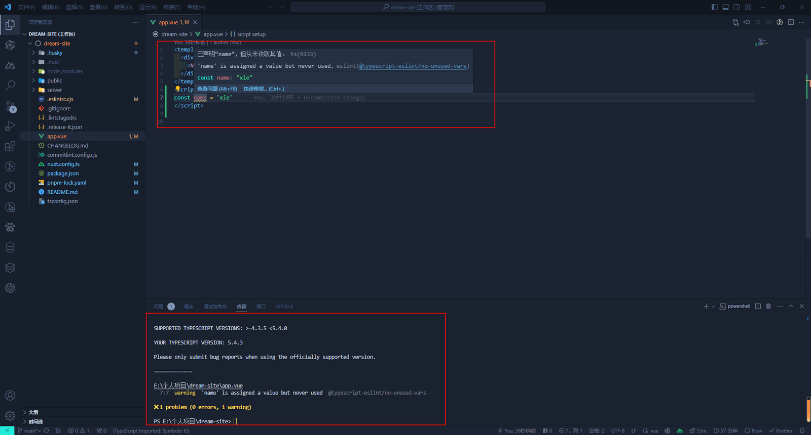

## 为什么要做项目规范

1.  `提高代码质量`：项目开发规范能确保代码的一致性和可读性，使其他程序员能够更容易地理解和维护代码。同时，规范也能减少代码中的错误和缺陷，提高软件的整体质量。
    
2.  `加强团队协作`：在团队开发项目中，不同的程序员可能采用不同的编程风格和习惯。通过遵循统一的开发规范，团队成员可以更加高效地协作，减少沟通成本和误解，从而加快项目进度。
    
3.  `降低维护成本`：项目开发规范有助于建立清晰的代码结构和文档，使得软件系统的维护和升级变得更加容易。规范化的代码结构还便于进行代码审查和测试，进一步降低维护成本。
    
4.  `提升软件可靠性`：遵循项目开发规范可以减少代码中的潜在问题，提高软件的稳定性和可靠性。例如，规范中的错误处理机制、代码复用和模块化等原则都有助于提升软件的整体性能。
    
5.  `促进项目管理`：项目开发规范有助于项目经理更好地管理项目进度和资源。通过制定明确的任务划分、版本控制和文档要求等规范，项目经理可以更加有效地监控项目进度，确保项目按时按质完成。
    

## 工具介绍

-   [Eslint](https://eslint.nodejs.cn/)：一个静态代码分析工具，可以帮助开发者检查代码存在的语法问题，编码风格和潜在问题，并提供修复方式。
    
-   [Prettier](https://prettier.nodejs.cn/)：一个代码格式化工具，可以通过自定义规则来重新规范项目中的代码，去掉原始的代码风格，确保团队的代码使用统一相同的格式。
    
-   [Stylelint](https://stylelint.io/)：一个用于检测 **CSS** 代码中潜在问题和风格错误的工具。它可以帮助我们规避 **CSS** 上的一些错误和风格的统一。
    
-   [Husky](https://github.com/typicode/husky)：一个 Git Hook 工具，自动检测提交消息、代码，并在提交或推送时运行测试。
    
-   [Lint-staged](https://github.com/lint-staged/lint-staged)：一个基于Node.js的库,它可以对Git仓库中的暂存区(staged)代码进行线性检测,从而确保代码质量。
    
-   [Commitlint](https://github.com/conventional-changelog/commitlint)：项目 **commit** 提交风格规范。
    

## 安装 Eslint

1.  **Nuxt3** 中是使用 [@nuxt/eslint-config](https://github.com/nuxt/eslint) 进行代码检查和格式化，执行安装命令：
```bash
pnpm add -D eslint @nuxt/eslint-config
```


2.  配置 **.eslintrc.cjs** 文件，具体配置请参考[Eslint 配置规则](https://eslint.nodejs.cn/docs/latest/use/configure/configuration-files)：
```js
module.exports = {
  root: true,
  env: {
    browser: true, // 支持浏览器环境的检测
    es2021: true, // 支持es2021语法的检测
    node: true // 支持node环境的检测
  },
  extends: ['@nuxt/eslint-config'],
  overrides: [],
  parserOptions: {
    ecmaVersion: 'latest', // 解析文件的时候使用最新的ecmaVersion
    sourceType: 'module' // 文件是ES6模块规范
  },
  plugins: ['vue'],
  rules: {
    camelcase: 2, // 驼峰
    indent: [2, 2], // 缩进2个空格
    semi: [2, 'never'], // 要求或禁止使用分号代替 ASI,即禁用行尾使用分号
    quotes: ['error', 'single'], // 强制使用一致的反勾号、双引号或单引号
    'no-debugger': 2, // 不能debugg
    'no-empty': 2, // 块语句中的内容不能为空
    'no-extra-parens': 2, // 禁止非必要的括号
    'no-extra-semi': 2, // 禁止多余的冒号
    'comma-dangle': [2, 'never'], // 键值对最后一个不能有,
    'spaced-comment': ['error', 'always'] // 注释必须空格
  }
}
```


3.  建议使用 [VS Code](https://code.visualstudio.com/) 与 [ESLint](https://marketplace.visualstudio.com/items?itemName=dbaeumer.vscode-eslint) 扩展一起使用。如果愿意，你可以在保存代码时启用自动修复和格式化：
```json
{
  "editor.codeActionsOnSave": {
    "source.fixAll": false,
    "source.fixAll.eslint": true
  }
 }
```


4.  效果
    



由于 **ESLint** 已经配置了代码格式化，所以没有必要使用 **Prettier** 来重复这个功能。要格式化代码，你可以运行 **yarn lint --fix**、**pnpm lint --fix** 或 **bun run lint --fix**，或者参考 **ESLint** 部分中的 **IDE** 设置。

如果你的编辑器中安装了 **Prettier**，请在项目中工作时禁用它，以避免冲突。

注意：[我们正在讨论](https://github.com/nuxt/eslint/issues/224)在将来启用 **Prettier**。

## 配置 Stylelint

1.  执行安装命令
```bash
pnpm add stylelint @nuxtjs/stylelint-module stylelint-config-standard stylelint-order stylelint-config-recommended-vue -D
```


2.  配置 **nuxt.config.ts**：
```text
modules: [
  // Simple usage
  '@nuxtjs/stylelint-module',

  // With options
  ['@nuxtjs/stylelint-module', { /* module options */ }]
]
```


3.  新增 **.stylelintrc.cjs** 文件，具体配置请参考[Stylelint 配置](https://stylelint.io/user-guide/configure)：
```js
module.exports = {
  extends: ['stylelint-config-standard','stylelint-config-recommended-vue'], // 这里保证 stylelint-config-recommended-vue 放在最后，不然 vue 文件会报错
  plugins: ['stylelint-order'],
  rules: {
    // 颜色指定大写
    'color-hex-case': 'upper',
    // 禁止空块
    'block-no-empty': true,
    // 颜色6位长度
    'color-hex-length': 'long',
    // 兼容自定义标签名
    'selector-type-no-unknown': [
      true,
      {
        ignoreTypes: []
      }
    ],
    // 忽略伪类选择器 ::v-deep
    'selector-pseudo-element-no-unknown': [
      true,
      {
        ignorePseudoElements: ['v-deep']
      }
    ],
    // 禁止低优先级的选择器出现在高优先级的选择器之后。
    'no-descending-specificity': null,
    // 不验证@未知的名字，为了兼容scss的函数
    'at-rule-no-unknown': null,
    // 禁止空注释
    'comment-no-empty': true,
    // 禁止简写属性的冗余值
    'shorthand-property-no-redundant-values': true,
    // 禁止值的浏览器引擎前缀
    'value-no-vendor-prefix': true,
    // property-no-vendor-prefix
    'property-no-vendor-prefix': true,
    // 禁止小于 1 的小数有一个前导零
    'number-leading-zero': 'never',
    // 禁止空第一行
    'no-empty-first-line': true,
    // 属性的排序
    'order/properties-order': [
      'position',
      'top',
      'right',
      'bottom',
      'left',
      'z-index',
      'display',
      'justify-content',
      'align-items',
      'float',
      'clear',
      'overflow',
      'overflow-x',
      'overflow-y',
      'margin',
      'margin-top',
      'margin-right',
      'margin-bottom',
      'margin-left',
      'border',
      'border-style',
      'border-width',
      'border-color',
      'border-top',
      'border-top-style',
      'border-top-width',
      'border-top-color',
      'border-right',
      'border-right-style',
      'border-right-width',
      'border-right-color',
      'border-bottom',
      'border-bottom-style',
      'border-bottom-width',
      'border-bottom-color',
      'border-left',
      'border-left-style',
      'border-left-width',
      'border-left-color',
      'border-radius',
      'padding',
      'padding-top',
      'padding-right',
      'padding-bottom',
      'padding-left',
      'width',
      'min-width',
      'max-width',
      'height',
      'min-height',
      'max-height',
      'font-size',
      'font-family',
      'font-weight',
      'text-align',
      'text-justify',
      'text-indent',
      'text-overflow',
      'text-decoration',
      'white-space',
      'color',
      'background',
      'background-position',
      'background-repeat',
      'background-size',
      'background-color',
      'background-clip',
      'opacity',
      'filter',
      'list-style',
      'outline',
      'visibility',
      'box-shadow',
      'text-shadow',
      'resize',
      'transition'
    ]
  }
 }
```


4.  向 **package.json** 的 **scripts** 中添加命令：
```text
"lint:style": "stylelint src/**/*.{css,less,vue} --fix", // 这里记得修改 nuxt.config.ts 的 srcDir 值为 'src/'
```


> **stylelint** 的坑比较多，如果大家在配置后发现不生效，可以自行百度解决一下。

## 配置 Husky

1.  执行安装命令
```bash
pnpm add husky -D
```


2.  初始化脚本
```bash
pnpm exec husky init
```


> 完成之后会在根目录生成一个 **.husky** 文件夹。

## 配置 Lint-staged

1.  执行安装命令
```bash
pnpm add lint-staged -D
```


2.  向 **package.json** 的 **scripts** 中添加命令：
```text
"pre-commit": "lint-staged"
```


3.  可以根据项目需要在 **package.json** 中添加配置，或者根目录新建 **.lintstagedrc** 配置文件：
```json
{
  "lint-staged": {
    "*.{js,jsx,vue,ts,tsx}": [
      "eslint --fix",
      "prettier --write"
    ]
  }
 }
```


4.  将 **.husky/pre-commit** 脚本的内容改为：
```bash
npm run pre-commit
```


配置完成后，这样当我们每次执行 **git** 命令的时候就会去检查暂存区的文件，有语法错误就会提示。

## 配置 Commitlint

1.  执行安装命令
```bash
pnpm add @commitlint/config-conventional @commitlint/cli -D
```


2.  根目录添加 **commitlint.config.cjs** 配置文件：
```js
module.exports = {
  extends: ['@commitlint/config-conventional'],
  rules: {
    'type-enum': [
      // type枚举
      2,
      'always',
      [
        'build', // 编译相关的修改，例如发布版本、对项目构建或者依赖的改动
        'feat', // 新功能
        'fix', // 修补bug
        'docs', // 文档修改
        'style', // 代码格式修改, 注意不是 css 修改
        'refactor', // 重构
        'perf', // 优化相关，比如提升性能、体验
        'test', // 测试用例修改
        'revert', // 代码回滚
        'ci', // 持续集成修改
        'config', // 配置修改
        'chore' // 其他改动
      ]
    ],
    'type-empty': [2, 'never'], // never: type不能为空; always: type必须为空
    'type-case': [0, 'always', 'lower-case'], // type必须小写，upper-case大写，camel-case小驼峰，kebab-case短横线，pascal-case大驼峰，等等
    'scope-empty': [0],
    'scope-case': [0],
    'subject-empty': [2, 'never'], // subject不能为空
    'subject-case': [0],
    'subject-full-stop': [0, 'never', '.'], // subject以.为结束标记
    'header-max-length': [2, 'always', 72], // header最长72
    'body-leading-blank': [0], // body换行
    'footer-leading-blank': [0, 'always'] // footer以空行开头
  }
}
```


3.  向 **package.json** 的 **scripts** 中添加命令：
```json
{ 
  "scripts": { 
    "commitlint": "commitlint --config commitlint.config.cjs -e -V" 
  }
 }
```


4.  新增 **.husky/commit-msg** 配置文件：
```bash
npx husky add .husky/commit-msg
```


加入配置：
```bash
npm run commitlint
```


在我们每次提交 **commit** 的时候，就会帮我们检查提交风格是否符合规范。
