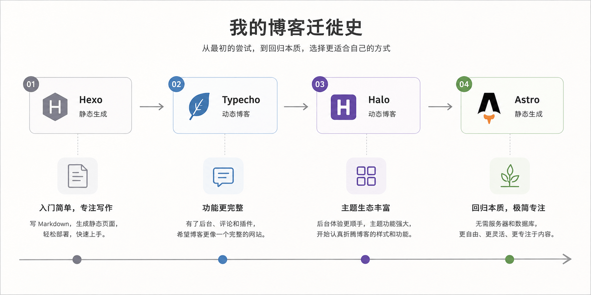
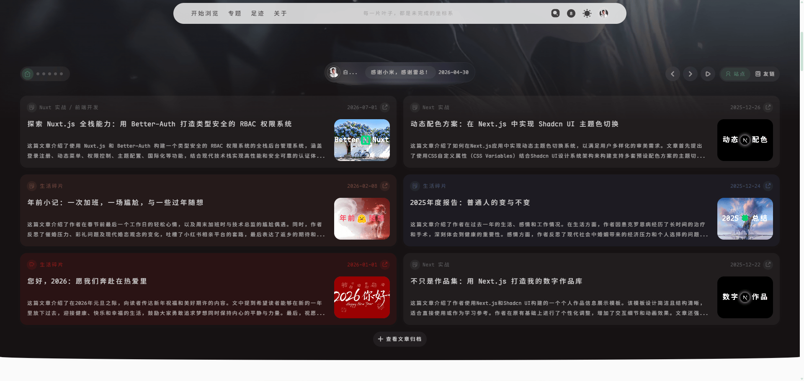
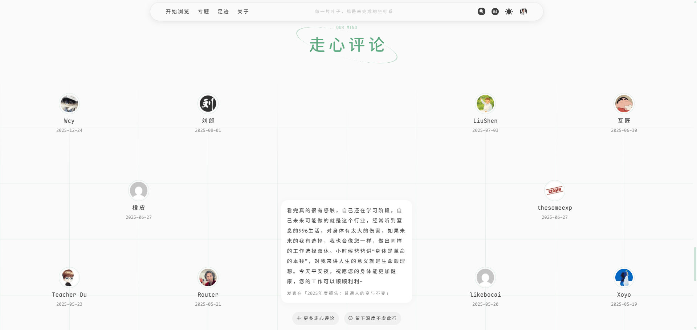
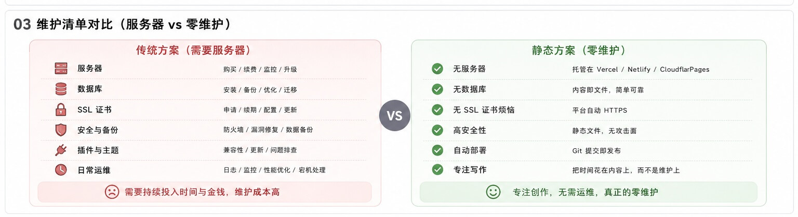
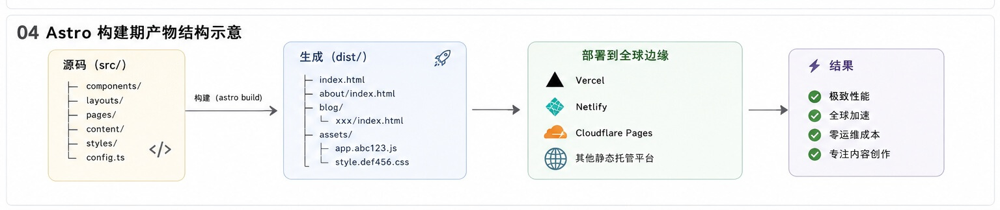
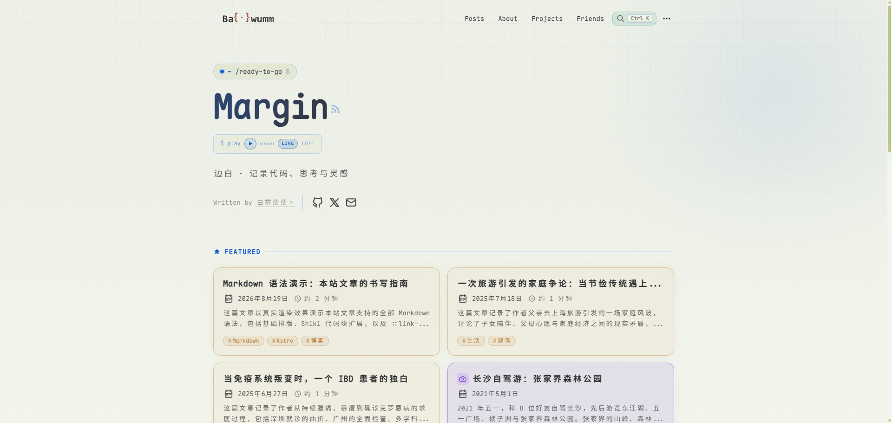
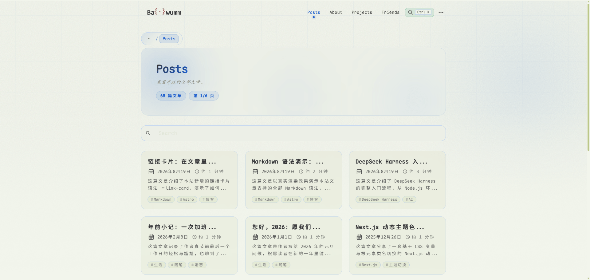

算上这次，我把博客搬了四次。

Hexo → Typecho → Halo → Astro

表面上看是在折腾，其实每次搬家，我都在想同一件事：我到底要一个什么样的博客？

这次我的答案比之前都简单。

不需要后台，不需要服务器，也不需要为了写一篇文章先考虑数据库有没有备份。

能让我安静坐下来写点东西，就够了。

## 一、绕了一圈，还是回到了静态

最早用 [Hexo](https://hexo.io)，就是看中它简单。写 Markdown，生成页面，传上去就行。

后来换 [Typecho](https://typecho.org)，是因为想试试 **「有后台」** 的感觉，在线写、在线改，像个真正的网站。

再到 [Halo](https://www.halo.run)，被它的后台设计和主题生态吸引，也确实花了不少时间折腾样式和功能。

现在又回到静态博客，用的是 [Astro](https://astro.build)。

表面看是绕了一圈。但我觉得和最初那个用 Hexo 的自己不太一样了。

那时候选静态，是因为我只会用静态。

现在选静态，是因为我试过动态，知道那些东西对我有没有用。

| 阶段 | 框架      | 形态   | 当时的诉求                 |
| -- | ------- | ---- | --------------------- |
| 1  | Hexo    | 静态生成 | 简单、轻量，写 Markdown 就能发布 |
| 2  | Typecho | 动态博客 | 希望有后台、评论等完整功能         |
| 3  | Halo    | 动态博客 | 更好的后台体验和丰富的主题生态       |
| 4  | Astro   | 静态生成 | 极简、低维护、高度可定制          |

## 二、主题很好，只是不适合我

在 Halo 时期我用的是 [Thyuu](https://theme.thyuu.com) 主题。

::link-card[https://theme.thyuu.com]

老实说，它做得很精致。首页有很多模块，卡片、专栏、信息展示，交互也很舒服。如果是一个更新频繁、内容丰富的站点，这套主题会很加分。

但我的博客没什么内容。

不是谦虚，是真的不多。文章零零散散，没有完整的知识体系，也没有固定的更新节奏。

于是每次打开后台，看到那些精心设计但空荡荡的模块，我总有一种被提醒的感觉：

* **这个地方是不是该放点东西？**  
* **那个专栏要不要补几篇？**
* **这篇文章怎么没有封面图？**

慢慢地，写博客就变成了「经营」博客。

问题不在 Thyuu。问题是**功能太丰富的东西，对内容稀少的站点反而是一种负担**。

我想要的不是一块需要我不断填平的空地，而是一个刚好放得下我现有东西的小架子。

p]:my-0 [&>p>img]:my-0">

## 三、不想再维护一套和写作无关的东西

还有一层现实原因：动态博客的维护成本。

用 Typecho 和 Halo 的时候，我实际上在维护一整套基础设施：

- 一台每月付费的服务器
- 一个需要定时备份的数据库
- 系统和运行环境的更新
- SSL 证书、域名解析、DNS 配置
- 以及各种记不清什么时候冒出来的小毛病

每件单独拎出来都不算大事。但凑在一起，它们和「写博客」这件事本身毫无关系，却一直挂在那里。

有时候我只是想写一篇几百字的文章，心里却要先过一遍：服务器还稳不稳，数据库上次备份是什么时候，要不要升级一下环境。

写博客慢慢带上了一点运维项目的味道。

静态博客把这些问题绕过去了。

文章构建完就是一堆 HTML、CSS、JS 和图片，部署交给 Vercel 或 Cloudflare Pages，CDN、HTTPS、自动部署这些都不用自己操心。

我当然还得维护博客本身——更新依赖、改改样式、整理内容。

但至少我不用再管服务器了。

## 四、Astro 不会替我做决定

选 Astro 还有一个更具体的原因。

它不像那些一体化的博客系统，给你一套已经装修好的房子，你只能往里搬家具。

Astro 更像一套工具。我需要评论，就接 Giscus。需要搜索，就在构建时生成索引。需要 RSS、Sitemap、OG 图，也可以按需添加。

它不强迫我接受任何预先设计好的博客形态。

用主题的时候，我经常在适应主题的设计——它有什么模块，我就得考虑往里面放什么。

用 Astro 之后，反过来，是我来决定：

- 这个页面要不要保留？
- 这个组件有没有必要？
- 这个功能真的需要吗？

不需要就删。

这种「主动权在自己手里」的感觉，对我来说比任何功能都重要。

::link-card[https://astro.build]

## 五、AI 也让我重新想了想要写什么

还有一件事让我重新考虑博客的方向，就是 AI。

以前技术博客里大量内容是在解决这类问题：

- 某个框架怎么装
- 某个 API 怎么调
- 某个报错什么意思
- 某个配置怎么写

这些内容当然还有用。但有了 AI 之后，获取答案的方式变了。以前要搜好几篇文章、翻一堆文档、再看 Github Issue 才能拼出答案，现在直接问 AI 就能拿到一个相对完整的方案。

于是我开始想：个人博客还值得写什么？

我不想把博客做成文档的二次整理。相比「这个东西怎么用」，我更想记录：

- 为什么我选了 A 而不是 B
- 实际用下来遇到了什么文档里没写的问题
- 某个看起来不错的方案，最后为什么放弃了
- AI 给了答案之后，我自己怎么判断的

知识本身越来越容易获得，但**一个人真实的经历和判断**，反而更难被替代。

所以之后我的博客可能会多一些这类内容，不只是工具介绍，而是 AI 真正进入工作流之后，我看到的、用到的、踩过的。

## 六、说得简单点，我想要的其实就两件事

所以这次从 Halo 到 Astro，说白了就两个目的。

**第一，减少维护。**  
不用管服务器，不用管数据库，不用管环境。写完文章，提交，构建，发布。完了。

**第二，让内容自己决定页面长什么样。**  
不是为了填满一个模块去写东西，也不用为了让博客看起来热闹一些去凑内容。页面简单一点没关系，文章短一点也没关系。

博客不一定要做成一个内容平台。

它完全可以只是一个小角落。

p]:my-0 [&>p>img]:my-0">

## 最后

从 Hexo 到 Astro，看起来是绕了一圈，又回到静态。

但我确实不觉得自己回到了原点。

Hexo 让我知道了静态博客的简单。

Typecho 和 Halo 让我体验了动态博客的便利，也让我知道自己不需要那些便利。

现在选 Astro，只是因为清楚了自己需要什么、不需要什么。

我不需要大后台，不需要多功能主题，也不需要为写博客单独养一台服务器。

我只想留下文章、图片、几行代码，以及一些偶尔冒出来的想法。

所以这次我想做得简单一点。

简单到愿意一直写下去。