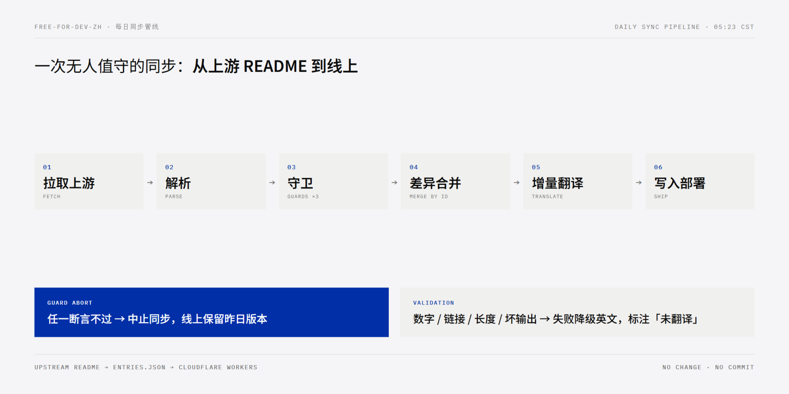
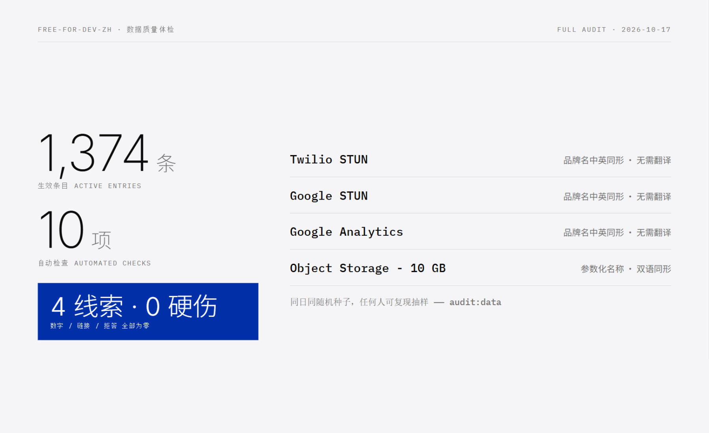
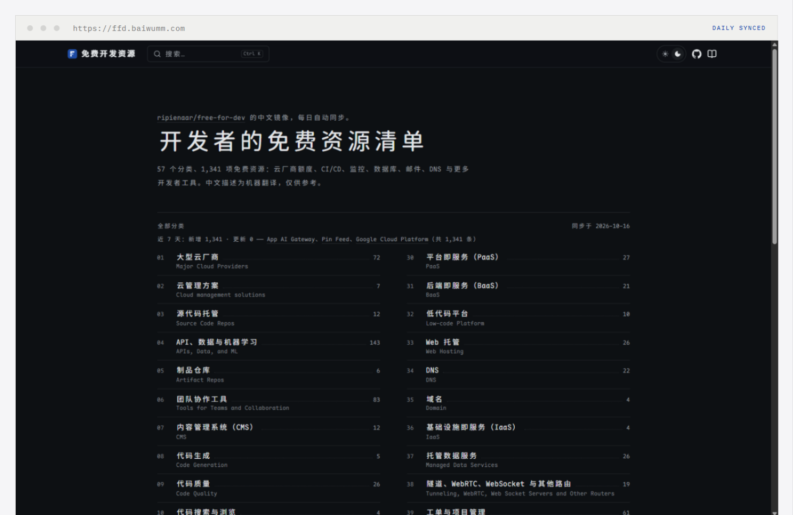
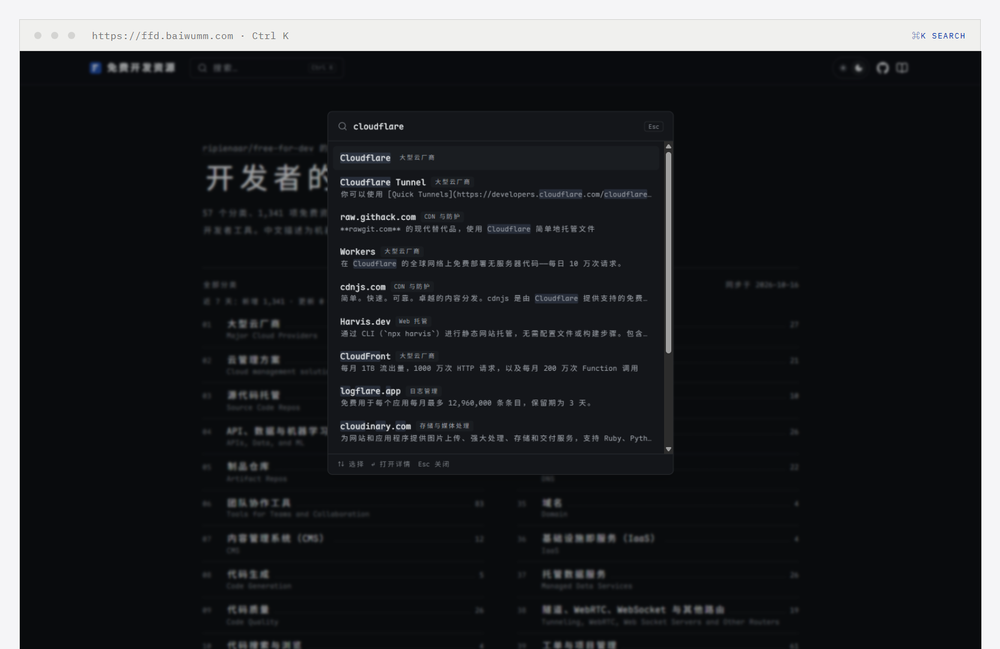
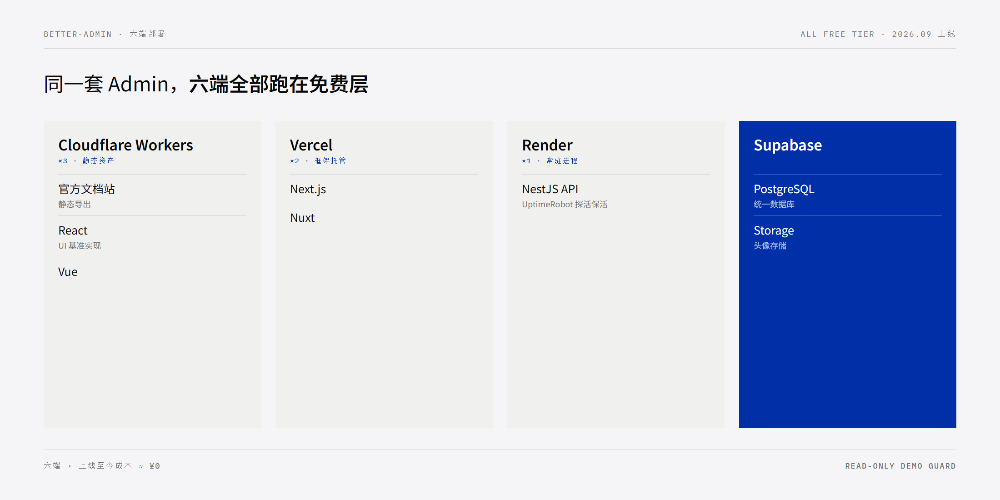

每个写过 side project 的人大概都经历过同一个下午：想给新项目找个免费的数据库、免费的 CI、免费的监控，于是开十几个标签页，逐个读定价页，分辨哪些是真免费、哪些是「14 天试用」的获客钩子，最后耗掉一晚上，项目代码一行没写。

这件事早有人替你做了系统性整理。[ripienaar/free-for-dev](https://github.com/ripienaar/free-for-dev) 是 GitHub 上一份老牌清单，大约 14 万 star、一千六百多位贡献者，收录了 1,300 多条对开发者真正免费的云服务与工具。问题是：它是英文的，而且每天都在变。

十月中旬，我给这份清单做了一个中文版——[free-for-dev 中文版](https://ffd.baiwumm.com)，57 个分类、1,341 条条目全部译成中文，可搜索、可订阅，每天自动跟着上游更新。这篇文章记录它的做法，以及一个更根本的问题：一个免费资源索引站，要怎么才能一直活着。

## 上游：它凭什么值得抄作业

「免费资源清单」并不稀缺，稀缺的是收录纪律。free-for-dev 的收录标准有三条：只收 as-a-Service，不收需要自己架的自托管软件；只收真正的免费层，不收试用期；按时间计的额度，至少要能撑一年。这三条把市面上大多数「白嫖清单」里名不副实的条目挡在了外面，也是它能沉淀七千四百多次提交、到现在每天仍有 PR 合入的原因。

但它是英文的。1,341 条条目，每条一个英文描述加一堆参数，中文开发者要么硬着头皮读，要么查词典读到失去耐心。翻译这件事本身不难，难的是后文要讲的那个问题：上游每天都在变，一份静态的翻译会在几天内开始腐烂。

所以这个项目真正要回答的不是「怎么翻译」，而是「怎么让它一直活着」——我认为后者才是这类镜像站普遍死掉的原因，也更值得写下来。

## 管线：把「活着」变成默认状态

上游的变化频率可以用真实数据说明：从首版数据基线到第二天，清单新增 2 条、移除 0 条、原文变更 0 条——单日增量是个位数，但每天都有。人肉跟进必死，唯一的活法是把整条链路变成默认状态。每天北京时间 05:23，GitHub Actions 定时触发一次同步：

> 拉取上游 README → 解析成结构化数据 → 守卫校验 → 与本地数据做差异合并 → 只把新增与变更的条目送去翻译 → 原子写回 entries.json → 提交 → 直调部署

几个关键取舍分别说说。

**数据层是唯一事实源。** entries.json 不只是条目列表，还带着上游 commit、同步时间与各类计数——任何时刻都能回答「这个站现在是上游哪个 commit 的镜子」。站点渲染只读这份数据，构建期把 1,400 多个页面全部静态生成，运行期没有任何数据请求。

**差异合并靠稳定 ID，不靠文本比对。** 每个条目的 ID 是「归一化 URL + 分类」的哈希前 12 位——带上分类，是因为同一个 URL 可能出现在多个分类里。有了稳定 ID，「上游变了什么」可以被精确回答：合并时描述未变的条目直接沿用旧译文，变了的重译，消失的条目降级为 removed 留档不展示。翻译永远只吃增量清单，没有变更的条目不会被碰第二次。写回是原子的：先写临时文件再重命名，要么整份新数据落盘，要么保持旧数据，不存在写了一半的中间态。

**守卫比解析更重要。** 自动化管线最怕的不是失败，而是「成功地把坏数据写进去」。上游格式一旦漂移——比如 Markdown 结构变了——解析器可能把 1,374 条解析成 800 条还自认为成功。所以解析之后有三道断言：总量跌幅、分类级跌幅、译文覆盖率，任何一道不过，整次同步中止，线上保持昨天的版本。宁可今天不更新，不接受静默腐烂。上游出现全新分类时，同步也会停下来，等我把中英对照补进人工维护的对照表——流水线知道自己哪些事不能擅自做主。

**没有变化就什么都不做。** 上线初期它曾经每天空提交、空部署，后来加了一个判断：解析结果与本地数据一致时，跳过提交与部署。现在上游没变化的日子，这条管线安静地空转一次，不留任何痕迹。

整条流水线的脚本全部是纯 Node.js，零第三方依赖，用内置的 node:test 给解析边界、守卫、差异合并、翻译校验都写了单测。理由很功利：同步管线是每天无人值守要跑的东西，依赖越少，半夜三点坏掉的可能性越小。

## 机翻一定会翻错，所以校验是管线的一部分

中文描述由大模型增量翻译，用的是 GLM 的免费 flash 模型，费用是零。增量是整个设计的关键：每天只有几条新条目要译，免费额度绰绰有余；一千多条的首翻是手动触发一次性跑完的，同样没有花钱。工程上还有一圈加固：同一批里重复出现的原文先去重，一段英文不花两次额度；请求按批拆分，失败了只重试失败的那几条，而不是整批推翻重来；模型限流时自动切到备用模型兜底。首翻那天的一千多条，就是靠这套机制在免费额度里跑完的。

但机翻一定会翻错，这件事不需要回避。所以每一批译文都要过四项自动校验：数字、链接、长度、坏输出——数字对不上、链接变了、长度比例异常、模型拒答或输出空洞的条目，一律降级展示英文原文并标注「未翻译」。翻译质量是概率问题，工程上能做的是把「错了却不自知」变成「错了必然被拦下」。

这不是理论设计。上线当天它就抓到过真实事故：某条目的「Ten thousand」被机翻成「十万」，十倍的数字失真，顺着体检工具定位修掉之后，顺手给校验器补上了汉字数字的比对。品牌名的判定也收紧过两轮：先从「全大写即品牌名」收紧为「连续三个以上大写字母」，豁免 IP、DB、UI 这类通用缩写；后来又补充了数字、符号与驼峰特征。品牌名的中英同形比想象中普遍——Twilio STUN、Google Analytics 这类条目本来就不需要翻译。

机翻之上还有一层薄薄的人工覆盖：overrides.json 按条目 ID 覆盖机翻结果，目前只有 3 条。仓库里另有一个全量体检脚本，十项检查随时可复跑，抽样用同一天的随机种子可以复现。截至 2026-10-17 的体检结果：1,374 条生效条目，十项检查共 4 条线索、0 条硬伤——那 4 条就是上面说的双语同形品牌名。这个数字本身不重要，重要的是它随时可以被任何人重新验证。

## 站点与成本

站点是 Next.js 16 静态导出 + Fumadocs，Tailwind CSS 4，1,400 多个页面全部构建期生成——除了 57 个分类页与固定页，其余全是条目详情页，每条资源一个稳定 URL，搜索与分享都落在具体条目上。交互上有 ⌘K 全站搜索（cmdk + Fuse.js 自建索引）、分类页内筛选与深色模式；订阅有 RSS；首页有近 7 天新增与更新速览——「这个站活着」这件事本身是可见的，不需要读者自己猜。字体是 Maple Mono CN 的自托管子集，按站点实际用字重新生成，体积砍掉了 84%——中文站点做自托管字体，这是最便宜的一刀。响应头则在 public/_headers 里统一配置缓存与安全策略，Cloudflare 侧零代码。

然后是成本账。静态资产托管在 Cloudflare Workers 的免费额度上，同步跑在 GitHub Actions 的公共仓库上，翻译用的是免费模型，域名挂在本来就有的一级域名下。这条管线的月账单是设计出来的零，不是补贴出来的零——所有环节都在免费层的范围之内，所以它不会因为「下个月没钱了」而停。

## 穷鬼套餐的全栈拼图

这套免费层组合不是只会喂一个索引站。九月我做 [better-admin](https://better-admin.baiwumm.com)——把同一套 Admin 系统分别用 React、Vue、Next.js、Nuxt、NestJS 各实现一遍——六端全部跑在免费层上：文档站与 React、Vue 三端在 Cloudflare Workers，Next.js 与 Nuxt 在 Vercel，NestJS API 在 Render 上，用 UptimeRobot 定时探活保活（免费实例会休眠，探活让它假装常驻），数据库统一用 Supabase 免费层的 Postgres 与 Storage。九月底上线到现在，没花过一分钱。六端全是线上环境，但 better-admin 用只读演示模式兜底：登录页可以一键进入管理员或随机用户视角，写操作被只读守卫拦截并提示——免费层上敢把演示环境直接开给所有人，靠的是这层守卫而不是运气。

把两个项目摆在一起，穷鬼套餐的全栈拼图大致就清楚了：静态站点与静态资产 → Cloudflare Workers；SSR 与框架托管 → Vercel；常驻进程 → Render 加保活；数据库与对象存储 → Supabase；定时任务 → GitHub Actions；大模型 → 免费 flash 档。每一格都有真实项目验证过，不是纸面推演。

这些服务在 free-for-dev 中文版里都能搜到，免费额度的细节以各家官网为准——清单负责让你知道它们存在，判断还是你自己下。

## 免费的最贵

把免费层说到这个份上，该泼冷水了。免费的真实价格，至少有五种，每一种都建议在采用之前想清楚。

**Lock-in。** 免费层的目标是让你进来，不是让你走。外部服务与你的代码咬合得越深，迁移成本就越高，届时付费往往比迁移便宜——这不是阴谋，是定价策略的正常部分。

**条款与额度会变。** 免费层是获客预算，预算会随公司境况变化。今天慷慨的额度，明天可能缩水，后天可能取消。把业务的关键路径压在上面，等于把一份随时可能变更的合同当成基石。

**信用卡验证。** 不少「免费」要求先绑卡，美其名曰防滥用。验证流程本身合法，但「绑了卡就忘了、忘了就被扣费」是高频事故，值得当成默认假设来防。

**休眠与限速。** 免费实例通常伴随冷启动、限流与带宽限制，Render 需要外挂探活就是典型的例子。能接受再上，不能接受就换方案。

**备份不是它的义务。** 免费层通常不承诺备份与恢复，数据库得自己定期导出。数据是项目里唯一补不回来的东西，别让它只活在一个免费层里。

我的结论不是「别用免费层」，而是换个用法：把免费层当「可随时重建的部署目标」，而不是「家」。数据能导出、配置在代码里、随时能在另一家重新跑起来——满足这三条，免费层才真正免费。free-for-dev-zh 自己就是这么设计的：数据在仓库里、上游在 GitHub 上、站点可以在任何静态托管上重建，Workers 只是目前恰好最省心的那一个。

## 边界，先说清楚

三件事在文章里说清楚，好过在评论区被指出来。

第一，上游 free-for-dev 没有声明开源许可证。这个站因此把定位收得很克制：个人整理的中文镜像，原始内容版权归上游作者与贡献者所有，站点显著署名并链接上游；站点代码本身以 MIT 开源，但该许可不覆盖数据。

第二，中文描述是机翻，仅供快速浏览，免费额度等关键信息请以官网为准——这句话印在站点页脚，也是本文的口径。

第三，维护承诺：同步、翻译、部署是全自动的；但人工层——新分类的中英对照、人工翻译覆盖——会在需要时停下来等我，响应是尽力而为。这句话写在这里，算是一种如实的承诺。

## 写在最后

站点：<https://ffd.baiwumm.com>，57 个分类、1,341 条条目（截至 2026-10-17），支持 ⌘K 搜索与 RSS 订阅；仓库 [baiwumm/free-for-dev-zh](https://github.com/baiwumm/free-for-dev-zh) 开源，哪条译文翻坏了，欢迎提 issue，或者直接提一个人工覆盖。

从 10 月 15 日下午写下 Initial commit，到 16 日中午第一次部署成功，中间隔了二十个小时——同步、翻译、部署从此不需要我。清单是别人的，判断得自己长；愿你下次搭项目的时候，穷鬼套餐点得又快又稳。
