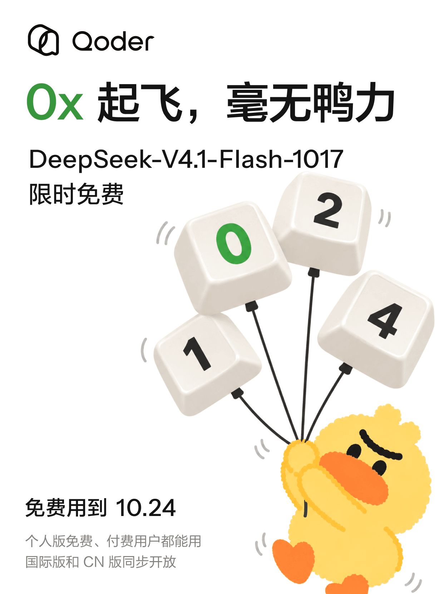
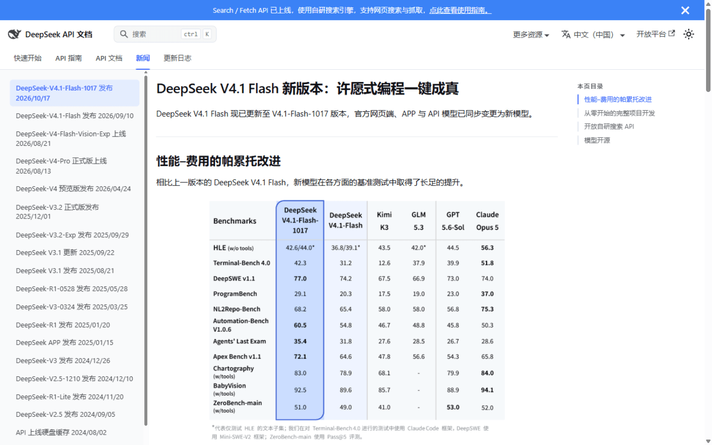
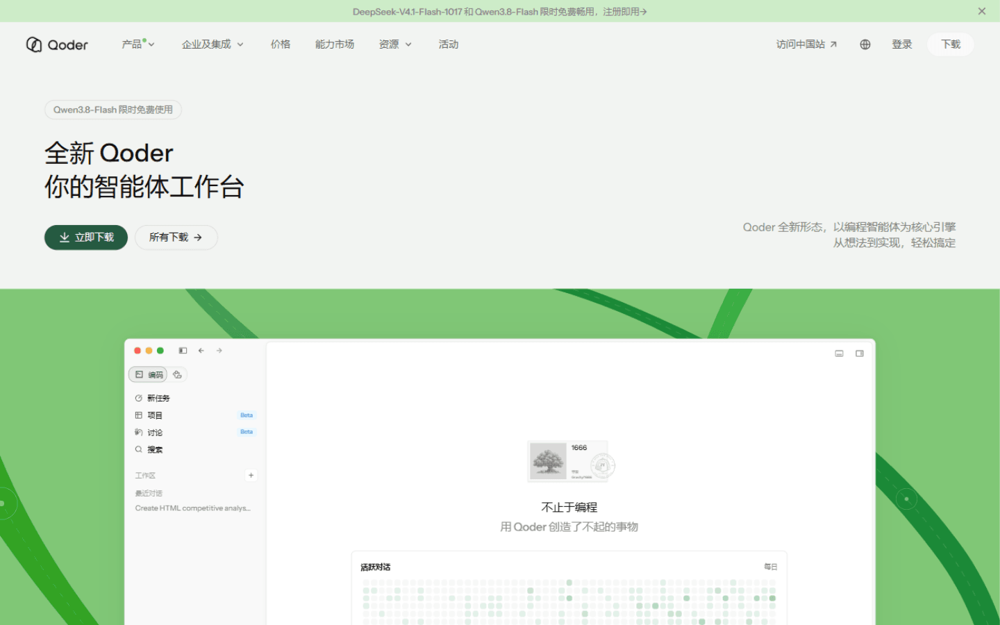
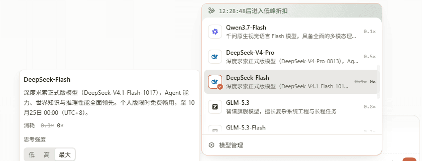

上周六（10 月 17 日），DeepSeek 把 Flash 系列更新到了 V4.1-Flash-1017，模型名里的 1017 就是发布日期。Qoder 当天跟进接入，而且比往常大方：到 10 月 24 日之前，这个模型在 Qoder 里的计费系数降到 0x——不是打折，是直接不计费。

范围也给得很宽：个人版免费用户、付费用户都能用，国际版和 CN 版同步开放。

## 1017 版更新了什么

DeepSeek 官方给这版起的标题是「许愿式编程一键成真」，定位是性能-费用的帕累托改进：模型全面变强，价格不变。公告页里最直观的是这组基准数据，编码和 Agent 任务是这轮提升的重点：

| 基准 | 上一版 V4.1-Flash | V4.1-Flash-1017 |
| --- | --- | --- |
| Terminal-Bench 4.0 | 31.2 | **42.3** |
| ProgramBench | 20.3 | **29.1** |
| Apex Bench v1.1 | 64.6 | **72.1** |
| Automation-Bench v1.0.6 | 54.8 | **60.5** |
| DeepSWE v1.1 | 74.2 | **77.0** |
| Agents' Last Exam | 31.8 | **35.4** |

Terminal-Bench 从 31.2 到 42.3，ProgramBench 从 20.3 到 29.1，这两项的跨度不算小修小补。同页对比里，1017 版在大多数基准上压过 GPT-5.6-Sol；Claude Opus 5 还占着约一半的领先项。

规格上，这版支持 1M 上下文窗口和 384K 的最大输出，长文档、整个仓库级别的输入扛得住；思考模式下支持 reasoning_effort 参数，思考强度能拉到 max。权重照例开源在 Hugging Face。API 侧模型名不变，还是 `deepseek-flash`，「1017」只是网页端和文档里的日期版本号。

## 免费的口径

Qoder 这次的活动规则很干净：

- 系数 0x，不扣 Credits；
- 个人版免费用户、付费用户都覆盖；
- 国际版和 CN 版同步，官网横幅直接写着「注册即用」；
- 同一期限时免费的还有 Qwen3.8-Flash。

和别的免费渠道比一下，这次的空间是真的宽。OpenCode 也把 V4.1-Flash-1017 挂过免费，但免费档上下文砍到 200K，付费档才给 1M；阿里云侧则是夜间时段半价。想正经试试 1M 上下文能干什么，Qoder 这几天是我看到的免费渠道里给得最完整的窗口。

## 怎么用上

1. 从 [Qoder 官网](https://qoder.com/zh)下载安装，新用户注册带专业版试用；
2. 模型选择器里选 DeepSeek-Flash；
3. 想测极限就把上下文给满，思考强度拉到 max。

模型详情里写得直白：DeepSeek-Flash 平时的系数就是 0.1x，活动期间直接归零，个人版免费畅用至 10 月 25 日 00:00（UTC+8）——比公众号那句「免费用到 10.24」更精确了一步。

补充一句：Qoder 也支持自定义模型，接自己的 DeepSeek API Key，费用走 API 结算、不占 Credits。但活动期间内置模型本身就是 0x 计费，直接用内置的更划算。

## 最后

活动到 10 月 24 日截止，这篇发出来时还剩四天。官方在公众号里预告 1024 当天还有大活动，先不剧透。

来源：

- [Qoder 公众号原文《DeepSeek-V4.1-Flash-1017 免费用》](https://mp.weixin.qq.com/s/ejQ3QP7WhuWcoZswlZlSag)
- [DeepSeek 官方公告：DeepSeek V4.1 Flash 新版本](https://api-docs.deepseek.com/zh-cn/news/news261017)
- [Hugging Face：DeepSeek-V4.1-Flash](https://huggingface.co/deepseek-ai/DeepSeek-V4.1-Flash)
- [Qoder 官网](https://qoder.com/zh)
