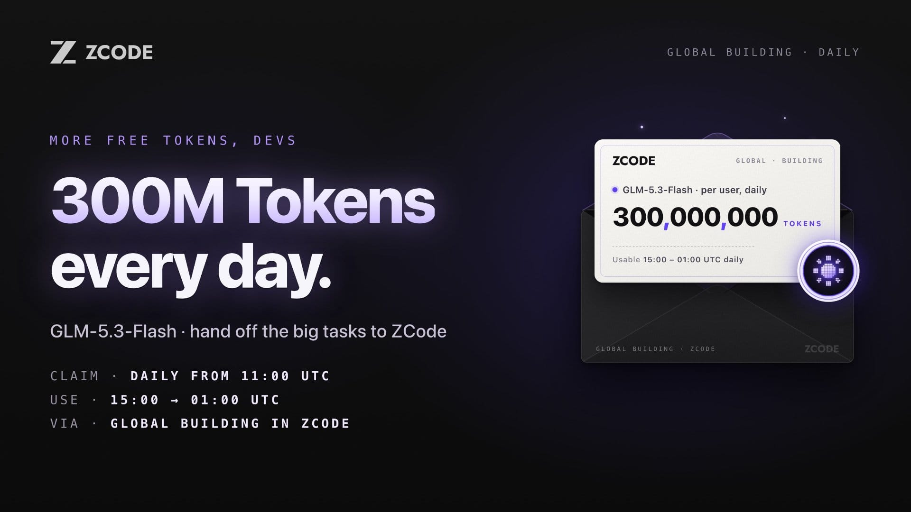
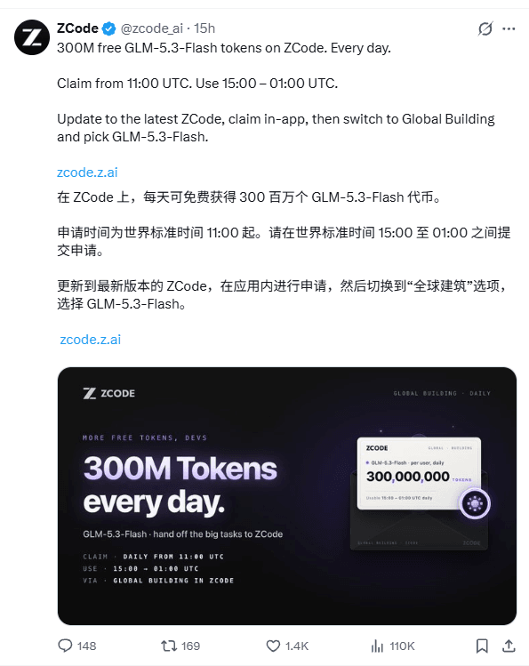

## 前言

8 月底那轮「周末 3 亿」不少人上过车，一周一次，周日晚清零。10 月 27 日 ZCode 把规则改成了每天发放：每人每天 3 亿 GLM-5.3-Flash Token，天天可领。

## 规则

| 项目 | 说明 |
| --- | --- |
| 额度 | 每人每天 3 亿 Token（300,000,000） |
| 模型 | GLM-5.3-Flash（仅此一个） |
| 领取开放 | 每天 11:00 UTC / 北京时间 19:00 |
| 可用窗口 | 15:00 – 次日 01:00 UTC / 北京时间 23:00 – 次日 09:00 |
| 使用入口 | ZCode 客户端内，切到 Global Building 后选模型 |
| 费用 | 全免，不消耗 Coding Plan 额度 |

有两处容易踩。11:00 UTC 开的是领取入口，15:00 UTC 才进可用窗口，中间空 4 小时，19 点领完发现跑不起来别急着报 bug。另外窗口只有 10 小时，过了 01:00 UTC 当天额度就作废，第二天重新领，不累积。

还有一份容易混淆的：新用户连上 BigModel 或 Z.ai 账号后，头 5 天每天另有 300 万 GLM-5.3 加 500 万 Flash 的体验额度。那和这里每天 3 亿是两套，别当成同一笔。

## 领取

更新客户端、应用内领取、切模型，三步。

版本太老看不到活动入口，据官方说法 3.10 以下都没有，装完顺手重启一次。卡片在左下角，点一下到账；没弹出来先重启，再不行回来看版本号。

最后一步最容易漏：切到 Global Building，模型选 GLM-5.3-Flash。额度领了但模型停在别处，跑起来照样扣套餐额度。有人以为没领到，其实是没切，去 Settings → Usage stats 看计量停没停就清楚了。

国内账号从 BigModel 登录，海外账号从 Z.ai 登录，入口是一回事。

## 3 亿够干什么

官网那个五子棋 demo，五步任务、多文件改动，跑完统计 89K tokens。一次中型改动，读代码改代码跑测试，通常落在几十万。按这个量级算，3 亿够跑一千多次，整晚开多窗口并行也烧不完。

所以**额度不是瓶颈**。

## 真正的限制

时间窗口先卡一道。北京时间 23 点到次日 9 点，正好是睡觉那段，白天的活派不进去。这个设计就是冲着「睡前扔任务、早上收结果」去的。如果你的习惯是边聊边改、随时要看中间输出，这 10 小时对你用处不大。

客户端也不太稳。任务跑一阵弹 `Reconnecting...`，重连堆到 10/10 直接断，或者甩一句 `The action failed`。付费用户一样中招，免费额度再一放开，晚 11 点之后只会更挤。我的办法是把活拆短、开多窗口并行，重要改动先在 Git 上留好分叉，崩了能重来。

领到的额度也出不了这个客户端。不能当 API Key，接不进自己的脚本，也喂不进别的 IDE。所以它的定位很窄：夜里一段免费算力，白天该用 API 还得用 API。

## 派给什么活

挑活的标准只有一条：不需要人盯。批量重构、补单测、补文档、梳理老项目的模块依赖都合适，改完看 diff 或看通过率就能验收。GLM-5.3-Flash 支持图像输入，把截图丢进去让它还原布局，比纯文字描述靠谱。

反过来，方向还没定的探索性别丢进去。跑一夜出一堆你看不上的东西，第二天还得自己重来。

早上记得验收。看它到底动了哪些文件，测试过没过，有没有顺手改了不该改的地方。

## 最后

官方没给截止日期，「每天」听着像长期安排。但翻一下时间线：8 月底是周末限定，中途延到 9 月 20 日，10 月中搞邀请活动，到 27 日才变成每天。免费换留存这套打法能撑多久看数据，随时可能停。

能领就领，别写进预算。

入口还是那个：[zcode.z.ai](https://zcode.z.ai)。
