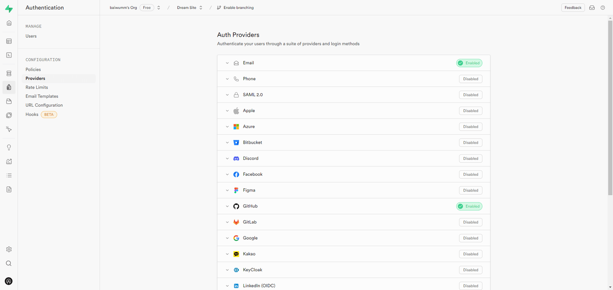
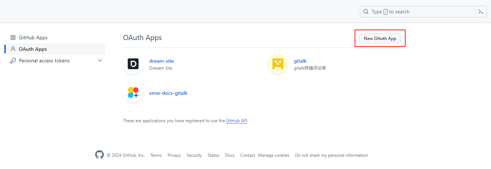
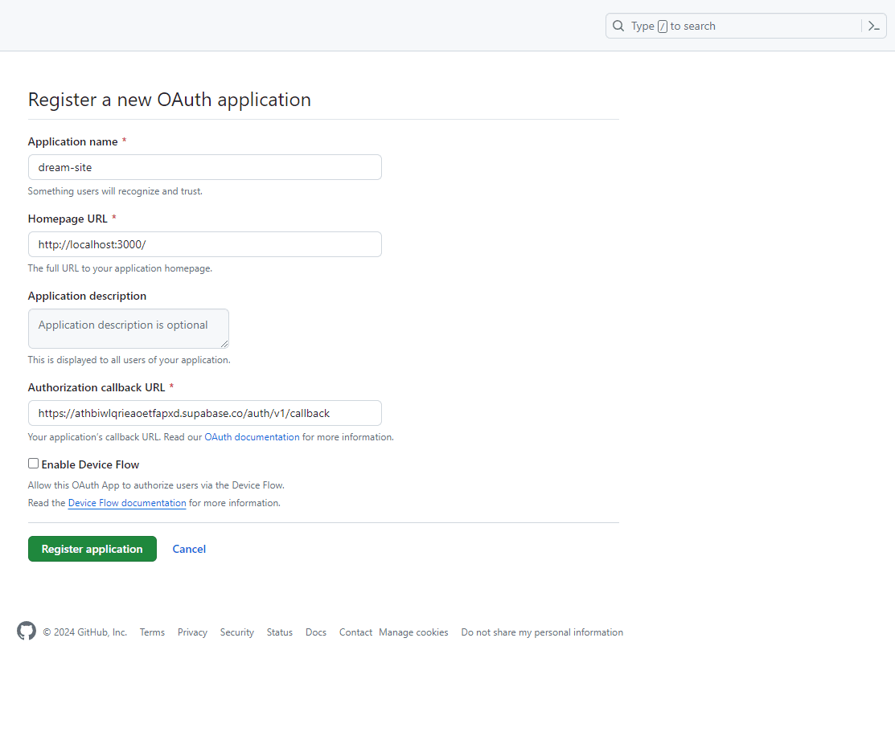
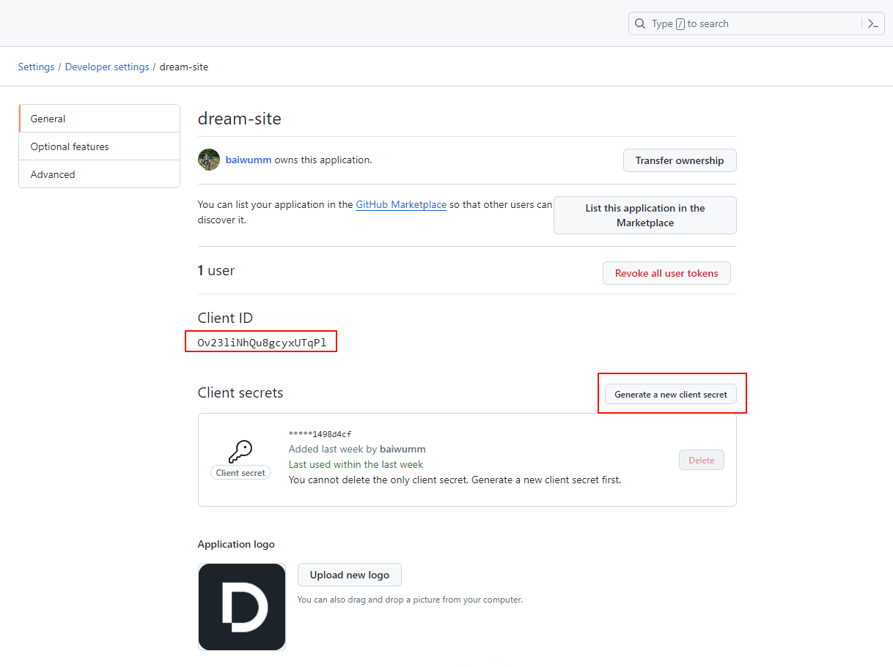
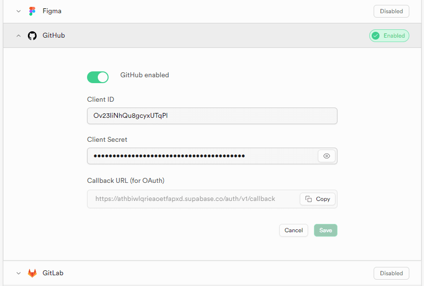
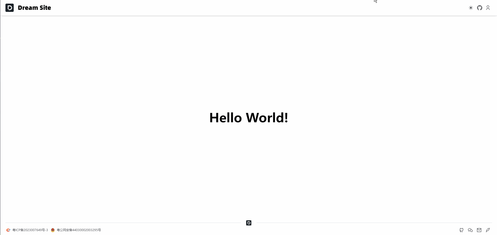

## 前言

[Supabase](https://supabase.com/) 使用的是 [postgresql](https://www.postgresql.org/) 的 [Row Level Security (RLS)](https://www.postgresql.org/docs/current/ddl-rowsecurity.html)，可以限制不同用户对同一张表的不同数据行的访问权限。这种安全机制可以确保只有授权用户才能访问其所需要的数据行，保护敏感数据免受未授权的访问和操作。

## Auth Providers

打开 [Supabase Providers](https://supabase.com/dashboard/project/athbiwlqrieaoetfapxd/auth/providers) 页面，这里我们可以看到 [Supabase](https://supabase.com/) 提供了 **20** 多种验证方式：



我们可以根据自己项目的实际情况选择适合的第三方登录，这里我们以 **Github** 为例。

## 配置 Github OAuth Apps

1.  打开 OAuth Apps 页面，点击 **New Oauth App**
    



2.  填入项目的信息，这里的 **Homepage URL** 我们可以先填本地开发的地址，等部署上线再改成线上地址，**Authorization callback URL** 填入 [Supabase](https://supabase.com/) 提供的 **Callback URL (for OAuth)**，然后点击 **Register Application**
    



3.  打开刚创建的 **Oauth App**，这里可以根据需要设置 **Oauth App** 信息，点击 **Generate a new client secret** 复制密钥
    



4.  打开 [Supabase Providers](https://supabase.com/dashboard/project/athbiwlqrieaoetfapxd/auth/providers) 页面，找到 **Github**，将 **Client ID** 和 **Client Secret** 分别填入，点击 **Save**。
    



## Nuxt3 登录鉴权

[Nuxt3](https://nuxt.com/) 中集成了 [@nuxtjs/supabase](https://supabase.nuxtjs.org/)，我们只需要准备两个文件即可：**login.vue**、**confirm.vue**。

1.  新建 **/pages/login/index.vue** 文件：
```vue
<script setup lang="ts">
const colorMode = useColorMode()
const user = useSupabaseUser()
const { auth } = useSupabaseClient()

const redirectTo = `${useRuntimeConfig().public.baseUrl}/confirm`

watchEffect(() => {
  if (user.value) {
    navigateTo('/')
  }
})
</script>

<template>
  <div class="min-h-full flex flex-col justify-center py-12 sm:px-6 lg:px-8">
    <h2 class="my-6 text-center text-3xl font-extrabold u-text-white">登录您的账户</h2>
    <el-card class="sm:mx-auto sm:w-full sm:max-w-md">
      <el-divider>请选择</el-divider>
      <el-button
        type="primary"
        size="large"
        :dark="colorMode.value === 'dark'"
        class="w-full"
        @click="auth.signInWithOAuth({ provider: 'github', options: { redirectTo } })"
      >
        <Icon name="i-simple-icons-github" class="h-5 w-5 mr-2" />
        Github
      </el-button>
    </el-card>
  </div>
</template>
```


2.  新建 **/pages/confirm/index.vue** 文件：
```vue
<script setup lang="ts">
const user = useSupabaseUser()

watch(
  user,
  () => {
    if (user.value) {
      return navigateTo('/')
    }
  },
  { immediate: true }
)
</script>

<template>
  <div>
    <p class="u-text-black">正在登录...</p>
  </div>
</template>
```


## 最终效果



## 总结

通过本篇文章你可以学到如何在 [Supabase](https://supabase.com/) 中使用 [Github](https://github.com/) 授权登录，通过身份认证后我们就可以在 [Supabase](https://supabase.com/) 中进行数据库相应操作。

下篇文章我们将学习如何在 [Nuxt3](https://nuxt.com/) 中创建 [RESTful 风格 API](https://blog.csdn.net/huxiaodong1994/article/details/84784861)，并结合 [Supabase](https://supabase.com/) 数据库完成网站分类的 [CURD](https://baike.baidu.com/item/CURD/3031761?fr=ge_ala) 操作。
