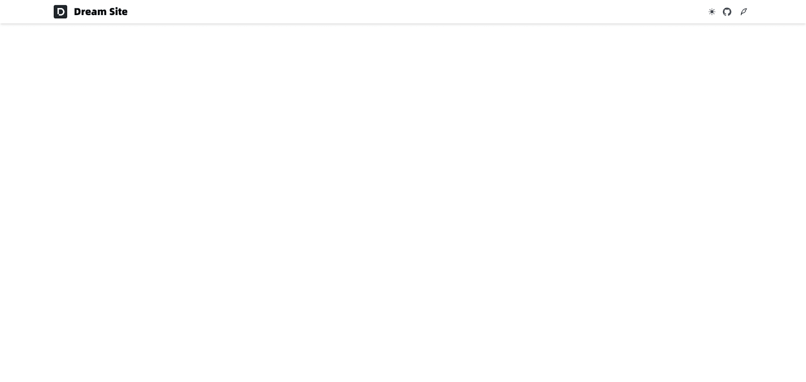
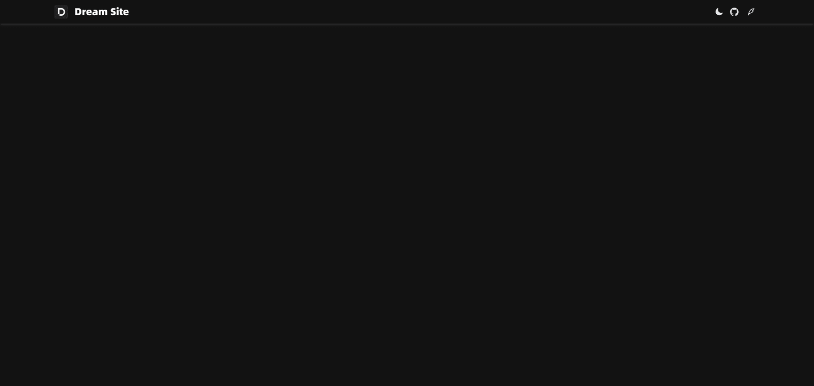
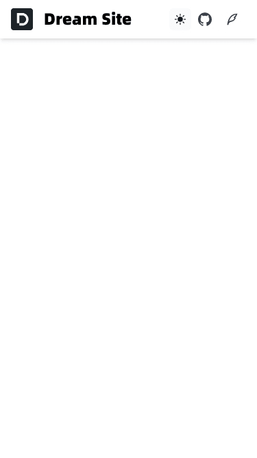
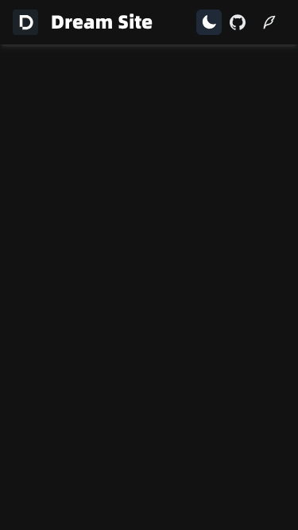

## 前言

这两周一直忙公司系统的迭代需求，没啥时间捣鼓自己的小项目，趁着项目进入测试收尾阶段，抽空把 **Layout** 布局的 **Header** 部分先搞好。

## 需求拆分

1.  顶部左侧放 **Logo**，右边放社交图标，暗黑模式切换
    
2.  提前准备好 **Logo** 和网站 **favicon.ico** 图标
    
3.  布局组件拆分
    

先简单这样布局，后期会考虑加一个 **搜索输入框**。

## Layouts 布局

**Nuxt** 提供了一个布局框架，用于将常见的 **UI** 模式提取为可重用的布局。

1.  在 **app.vue** 中添加 **<NuxtLayout>**，可以启用布局：
```vue
<template>
   <NuxtLayout>
     <NuxtPage />
   </NuxtLayout>
 </template>
```


2.  安装 [@nuxt/image](https://nuxt.com.cn/modules/image) 和 [nuxt-icons](https://nuxt.com.cn/modules/icons)
```bash
pnpm add @nuxt/image nuxt-icons -D
```


**nuxt.config.ts** 文件中启用：
```text
modules: ['@nuxt/image', 'nuxt-icons'],
```


3.  新建 **components/AppColorMode.vue** 白天暗黑模式切换组件：
```vue
<script setup lang="ts">
const colorMode = useColorMode()

function toggleDark() {
  colorMode.value = colorMode.value === 'dark' ? 'light' : 'dark'
}

</script>

<template>
  <UTooltip :text="`切换${$colorMode.value === 'dark' ? '白天' : '黑夜'}模式`">
    <UButton
      :icon="$colorMode.value === 'dark' ? 'i-heroicons-moon-solid' : ' i-heroicons-sun-solid'"
      size="sm"
      variant="ghost"
      class="text-gray-700 dark:text-gray-200 hover:text-gray-900 dark:hover:text-white hover:bg-gray-50 dark:hover:bg-gray-800"
      @click="toggleDark"
    />
  </UTooltip>
</template>
```


4.  新建 **components/UColorModeSVG.vue** 组件，**SVG** 跟随白天暗黑模式：
```vue
<script setup lang="ts">
const colorMode = useColorMode()

defineProps<{
  name:string; // svg 路径
  lightFill?:string; // 亮色模式填充
  darkFill?:string; // 暗色模式填充
  className?:string; // 图片样式
}>()

// 判断是否暗色模式
const isDark = colorMode.preference === 'dark'
</script>

<template>
  <nuxt-icon
    :name="name"
    :fill="isDark ? darkFill : lightFill"
    :class="className"
  />
</template>

<style>
.nuxt-icon svg{
  width:auto;
  height:auto;
  margin-bottom: 0;
}
</style>
```


5.  新建 **components/AppHeader** 头部组件：
```vue
<template>
  <header class="static top-0 h-14 shadow-md dark:shadow-white-500/50 backdrop-blur dark:bg-transparent transition-all py-3 px-4 md:px-8 lg:px-32">
    <nav class="flex gap-4 justify-between items-center">
      <!-- 左侧 logo -->
      <HeaderLogo />
      <!-- 右侧 社交图标 -->
      <HeaderSocial />
    </nav>
  </header>
</template>

<style scoped>
.dark header{
  box-shadow: 0 4px 6px -1px rgb(255 255 255 / 0.1), 0 2px 4px -2px rgb(255 255 255 / 0.1);
}
</style>
```


6.  新建 **layouts/default.vue** 默认布局组件：
```vue
<template>
  <div>
    <AppHeader />
    <slot />
  </div>
</template>
```


## 最终效果

1.  PC端
    
<div class="grid grid-cols-2 gap-4 [&>p]:my-0 [&>p>img]:my-0">





</div>

2.  移动端
    
<div class="grid grid-cols-2 gap-4 [&>p]:my-0 [&>p>img]:my-0">





</div>

## 总结

目前实现的效果比较简单，先把基本布局和功能实现，后期再具体调整。

好了，今天就到这吧！

**Github 仓库**：[Better Nav](https://github.com/baiwumm/better-nav)

**线上预览**：[一个把常用网址收拾得干干净净的小站](https://nav.baiwumm.com/)
