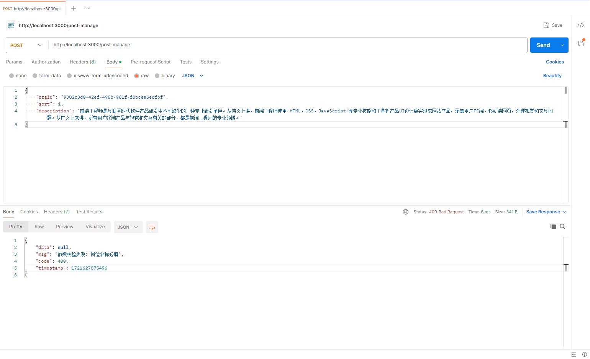
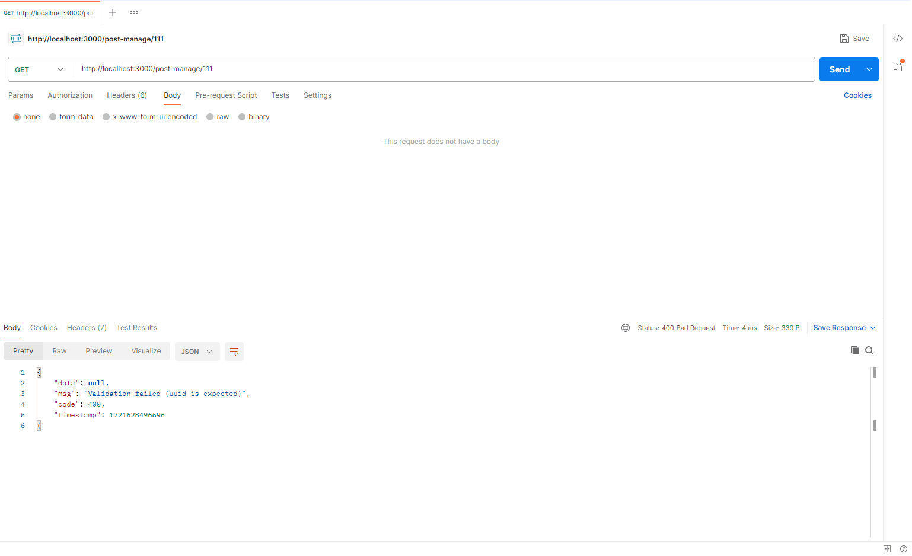

## 什么是管道（Pipe）？

在 [Nest.js](https://nestjs.com/) 中，[管道（Pipelines）](https://docs.nestjs.com/pipes) 是一种强大的功能，用于预处理进入控制器方法的请求数据，如请求体、查询参数、路径参数等。管道允许开发者在数据到达控制器方法之前对数据进行转换、验证、清理或执行其他预处理任务。这使得 [Nest.js](https://nestjs.com/) 应用更加健壮、可维护和一致。

以下是 [Nest.js](https://nestjs.com/) 中管道的一些主要用途：

- `数据转换`：管道如 **ParseIntPipe**、**ParseFloatPipe**、**ParseArrayPipe** 等可以将原始输入数据转换为应用内部所需的类型，如将字符串转换为整数或浮点数，或将字符串表示的数组转换为数组，保证了数据的一致性和可用性

- `数据验证`：管道可以确保传入的数据符合预期的格式和规则。例如，使用 **ValidationPipe** 结合 [class-validator](https://github.com/typestack/class-validator)，可以自动验证请求体或查询参数是否满足特定的 **DTO**（数据传输对象）定义，从而预防因数据格式错误引起的运行时异常

- `错误处理`：如果数据不符合管道的规则，管道可以抛出异常，从而阻止请求的进一步处理，并向客户端返回适当的错误信息

- `一致性`：管道有助于在整个应用中保持一致性，避免在不同的控制器或方法中重复相同的预处理逻辑

- `可插拔性和重用性`：管道是可插拔的组件，可以很容易地在多个控制器或方法之间共享和重用

## 内置管道

[Nest.js](https://nestjs.com/) 自带九个开箱即用的管道：

1.  **ValidationPipe**：验证和转换传入的数据。它使用 [class-validator](https://github.com/typestack/class-validator) 库来检查数据是否符合定义在 **DTOs** 或请求模型上的验证规则

2.  **ParseIntPipe**：将字符串类型的参数转换为整数

3.  **ParseFloatPipe**：将字符串类型的参数转换为浮点数

4.  **ParseBoolPipe**：将字符串类型的参数转换为布尔值

5.  **ParseArrayPipe**：将字符串形式的数组转换为数组

6.  **ParseUUIDPipe**：解析字符串并验证是否为 **UUID**

7.  **ParseEnumPipe**：将传入的值转换为枚举类型中的成员

8.  **DefaultValuePipe**：如果传入的参数是 **undefined** 或 **null**，则使用默认值替换它

9.  **ParseFilePipe**：用于处理上传的文件，它可以验证文件的类型、大小等，确保上传的文件符合预期

## 自定义管道

1.  安装依赖

```bash
pnpm add class-validator class-transformer
```

2.  新建 **/pipe/validation.pipe.ts** 文件：

```ts
import {
  ArgumentMetadata,
  BadRequestException,
  Injectable,
  PipeTransform,
} from "@nestjs/common";
import { plainToClass } from "class-transformer";
import { validate } from "class-validator";

@Injectable()
export class ValidationPipe implements PipeTransform {
  async transform(value: any, { metatype }: ArgumentMetadata) {
    if (!metatype || !this.toValidate(metatype)) {
      // 如果没有传入验证规则，则不验证，直接返回数据
      return value;
    }
    // 将对象转换为 Class 来验证
    const object = plainToClass(metatype, value);
    const errors = await validate(object);
    if (errors.length > 0) {
      const msg = Object.values(errors[0].constraints)[0]; // 只需要取第一个错误信息并返回即可
      // 自定义校验返回格式
      throw new BadRequestException(`参数校验失败: ${msg}`);
    }
    return value;
  }
  private toValidate(metatype: any): boolean {
    const types: any[] = [String, Boolean, Number, Array, Object];
    return !types.includes(metatype);
  }
}
```

3.  **main.ts** 中全局注册：

```ts
import { NestFactory } from "@nestjs/core";
import { ValidationPipe } from "@/pipe/validation.pipe"; // 全局管道

import { AppModule } from "./app.module";
async function bootstrap() {
  const app = await NestFactory.create(AppModule);

  // 全局参数校验
  app.useGlobalPipes(new ValidationPipe());

  await app.listen(3000);
}
bootstrap();
```

## 管道测试

1.  假如我们现在有一个添加岗位的接口，它的 **DTO** 如下：

```ts
import { ApiProperty } from "@nestjs/swagger";
import { IsNotEmpty, IsNumber, IsOptional, IsUUID } from "class-validator";

export class SavePostDto {
  @ApiProperty({
    type: String,
    description: "父级id",
    default: "0c01ef7d-2f6f-440a-b642-62564d41f473",
    required: false,
  })
  @IsOptional()
  @IsUUID("all", { message: "parentId 参数不正确" })
  parentId?: string;

  @ApiProperty({
    type: String,
    description: "岗位名称",
    default: "前端工程师",
  })
  @IsNotEmpty({ message: "岗位名称必填" })
  name: string;

  @ApiProperty({
    type: String,
    description: "组织id",
    default: "f45cd48b-e703-49db-91be-ae7f594e73e0",
  })
  @IsUUID("all", { message: "orgId 参数不正确" })
  orgId: string;

  @ApiProperty({
    type: Number,
    description: "排序",
    default: 1,
  })
  @IsNumber(
    {},
    {
      message: "排序必须为数字",
    }
  )
  sort: number;

  @ApiProperty({
    type: String,
    description: "岗位描述",
    default:
      "前端工程师是互联网时代软件产品研发中不可缺少的一种专业研发角色。从狭义上讲，前端工程师使用 HTML、CSS、JavaScript 等专业技能和工具将产品UI设计稿实现成网站产品，涵盖用户PC端、移动端网页，处理视觉和交互问题。",
    required: false,
  })
  describe?: string;
}
```

如果我们提交的请求体中缺少了参数，它就会提示：



2.  假如我们有一个查询岗位详情的接口如下：

```ts
import { Body, Controller, Get, ParseUUIDPipe } from "@nestjs/common";
import { ApiOkResponse, ApiOperation, ApiTags } from "@nestjs/swagger"; // swagger 接口文档

import { ResponseSavePostDto } from "./dto/response-post.dto";
import { PostManageService } from "./post-manage.service";

@ApiTags("智能行政-岗位管理")
@Controller("post-manage")
export class PostManageController {
  constructor(private readonly postManageService: PostManageService) {}

  /**
   * @description: 查询岗位详情
   */
  @Get(":id")
  @ApiOkResponse({ type: ResponseSavePostDto })
  @ApiOperation({ summary: "查询岗位详情" })
  findOne(@Param("id", new ParseUUIDPipe()) id: string) {
    return this.postManageService.findOne(id);
  }
}
```

我们要保证 **id** 是 **UUID**，我们就可以使用 **ParseUUIDPipe** 内置管道，如果参数不对，管道就会给出报错信息：



> 这里我们演示了自定义管道和 **ParseUUIDPipe** 管道的用法，其它内置管道用法也一样，大家可以根据自己的实际情况选择合适的管道。

## 总结

[Nest.js](https://nestjs.com/) 中的 [管道（Pipelines）](https://docs.nestjs.com/pipes) 不仅简化了数据处理流程，还提升了应用的健壮性和安全性，是现代 **Web** 开发中不可或缺的工具。通过合理利用管道，开发者可以专注于业务逻辑的实现，而不必过多担忧底层数据处理的细节，从而加速开发周期，提高软件质量
