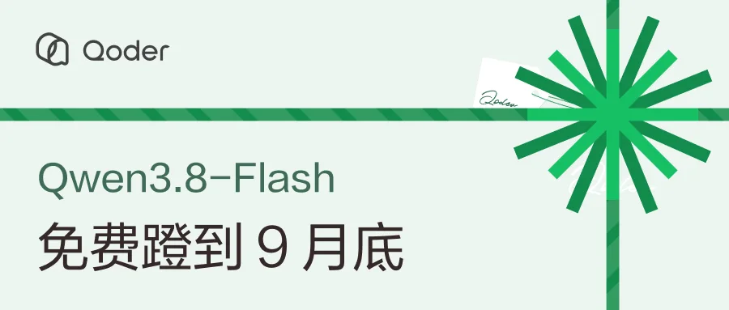
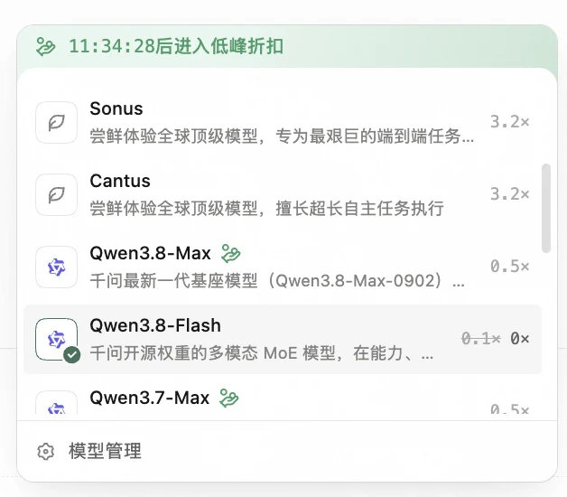
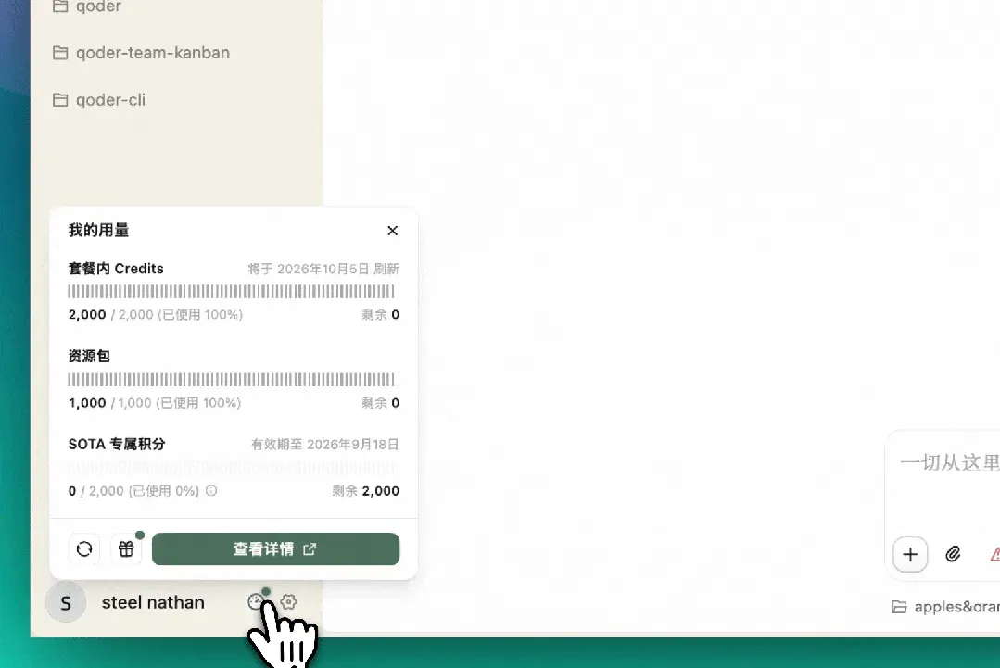
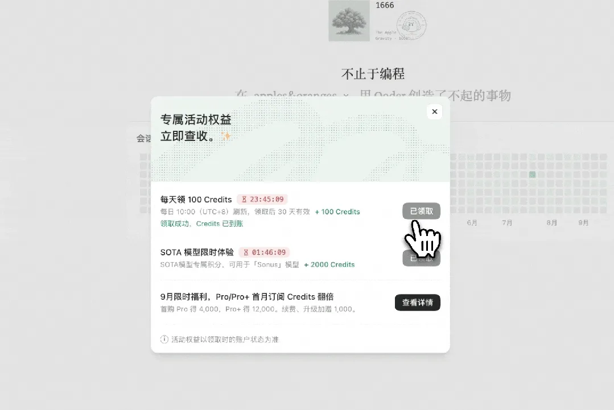

## 前言

Qoder 今天（9 月 18 日）发了个活动公告：**Qwen3.8-Flash 限时免费**，从今天上午 10:00 起一直到 9 月 30 日 23:59:59，在 Qoder 里调用这个模型不扣 Credits，计费系数直接从 0.1× 降到 0.0×。

顺手还有一份能天天领的福利：**每天登录 Qoder 送 100 通用 Credits**，每笔自领取之日起 30 天有效，没用完的可以攒着。

两项福利国际版和 Qoder CN 都有，新老个人用户都能参加。把活动规则、领取入口和自己的一些使用思路整理在这里。

## 活动规则一览

先看最关键的信息：

| 项目             | 说明                                                                                              |
| ---------------- | ------------------------------------------------------------------------------------------------- |
| 免费模型         | Qwen3.8-Flash                                                                                     |
| 免费时间         | 2026-09-18 10:00 至 2026-09-30 23:59:59                                                           |
| 计费变化         | 系数由 0.1× 降至 0.0×，调用不扣 Credits                                                           |
| 参与资格         | 国际版体验版（免费）、Pro 试用期、Pro、Pro+、Ultra；CN 体验版、专业版、高级版、旗舰版及会员卡用户 |
| 是否需要领取     | 不需要，模型选择器里选中即用                                                                      |
| 每日登录奖励     | 100 通用 Credits，每笔 30 天有效，可累积                                                          |
| 每日奖励结束时间 | 暂无                                                                                              |

几个点值得单独说：

- **不用抢名额、没有兑换码**，也没有「先领资格再使用」这一步，活动期内选中 Qwen3.8-Flash 就是 0 计费；
- 免费只针对 Qwen3.8-Flash 这一个模型，其他模型和档位仍按各自规则扣减，套餐额度和每天领的 Credits 可以留给它们；
- 9 月 30 日结束后按届时公示的系数计费，所以想把大任务塞进免费期的话，窗口只剩十来天；
- 官方那句「没额度了也可以用 Qwen3.8-Flash 续上」是这活动最实用的地方——套餐 Credits 见底又还没到刷新日的同学，这半个月相当于有了不断档的兜底。

## 怎么用上免费的 Qwen3.8-Flash

打开 Qoder 桌面端，在对话输入框下方的模型选择器里选中 **Qwen3.8-Flash** 就能开始，无需先领取那 100 Credits。

选择器里给它的简介是「千问开源权重的多模态 MoE 模型」，官方能力描述是擅长**代码编写、长文档处理、图像理解和工具调用**，定位在响应速度与使用成本之间取平衡——属于「日常主力」而不是「压箱底旗舰」。同列还有 Qwen3.8-Max（0.5×）等档位，遇到复杂推理时手动切过去就行。

## 每天登录领 100 Credits

第二份福利的入口在桌面端**左下角的用量面板**，点开后面板底部有 🎁 礼物图标，点它领取。

领取规则：

- 每轮 **100 通用 Credits**，每天 10:00（UTC+8）开放新一轮，到次日 10:00 之前都可领取；
- **每个账号每轮限领一次，错过不补**；
- 每笔奖励从领取之日起 **30 天有效**，未到期的额度可以累积，天天领满 30 天大概是 3000；
- 奖励计入 Add-on Credits（资源包），领取不会改变订阅等级、会员卡权益或功能权限；
- 通用 Credits 可以用在其他模型上，按对应模型的系数扣减，所以它和 Qwen3.8-Flash 免费是两份可以同时享受的福利。

领完的面板长这样，除了每日 100 Credits，还能看到同期在跑的其他权益条目（具体以你账号面板实际显示为准）。

奖励到账后，同一账号可以在 Qoder 桌面端、Qoder IDE、JetBrains 插件、Qoder CLI、QoderWake、Cloud Agents、移动端和网页版通用。

## 这半个月可以拿它干点什么

官方给了四个方向，按我自己的习惯翻译一下：

1. **给现有项目做一次完整的功能升级**。把新需求和已有代码一起交给 Qoder，让它梳理实现方案、修改页面与接口、补测试、排查报错，最后把新功能接进原有流程跑起来。这类多文件改动最怕中途断额度，免费期正好。
2. **把想法做成能运行的网站或应用**。活动报名页、个人作品集、团队内部小工具，从页面设计、交互到功能实现先出第一版，再按自己的想法继续改。
3. **把一批原始数据做成可视化分析报告**。合并多张表格，处理重复、缺失和格式不一致，分析趋势与异常，再用图表呈现结论，活动复盘和业务分析都能从手头的数据开始。
4. **围绕一个课题做一份有依据的研究**。行业报告、产品白皮书、访谈记录丢进去，让它提炼关键信息、比较不同观点、保留资料出处，整理成能带进讨论会的研究报告。

我这边会更倾向拿它跑前两类：多文件改动加长上下文的任务，最能吃出「不心疼额度」和「心疼额度」的差别。至于日常改两行代码，Flash 档本来消耗就低，免费与否感知不强。

我之前整理过一份跨工具的免费模型渠道盘点，可以对照着看：[Agent 免费模型盘点：现在还能白嫖什么](/posts/f9k2m8xq/)。

::link-card[/posts/f9k2m8xq/ Agent 免费模型盘点：现在还能白嫖什么]

## 几点提醒

1. **每天记得领**。10:00 刷新，错过那一轮不补；攒上一段时间，就能把通用额度留给 3.2× 那类高系数模型。
2. **别把 100 Credits 囤过期**。每笔 30 天有效，攒太多反而会从中途开始失效。
3. **重活安排在月底之前**。10 月 1 日起按届时公示的系数计费，现在这段 0 扣费的窗口过完就没了。
4. **对新模型的能力保持预期**。Flash 档主打速度和成本，复杂推理该切更强的模型还是得切，免费不是降低判断标准的理由。

## 参考资料

- [Qoder 请客！长假还要等，Qwen3.8-Flash 免费蹬（官方公告原文）](https://mp.weixin.qq.com/s/8hl-9hfkyLmnBuQOKGE5zQ)
- [Qoder 官网](https://qoder.cn/)
- [Qoder 下载页](https://qoder.cn/download)

::link-card[https://qoder.cn/ Qoder 官网]
