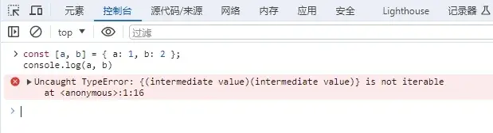
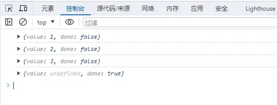

## 前言

变量的解构赋值是前端开发中经常用到的一个技巧，比如：

```js
// 对象解构
const obj = { a: 1, b: 2 };
const { a, b } = obj;
console.log(a, b)

// 数组解构
const arr = [1, 2, 3];
const [a, b] = arr;
console.log(a, b)
```

工作中我们最经常用的就是类似上面的对象和数组解构，好多同学就不禁问了，这个不是很简单吗。

那好，我们再来看一个：

```js
// 不改动下面代码，如何使等式成立
const [a, b] = { a: 1, b: 2 };
console.log(a, b)
```

你觉得这个打印出来什么呢？



直接报错：`{(intermediate value)(intermediate value)} is not iterable`

翻译过来就是值是不可迭代的，这是为什么呢？**因为右边的值是不可迭代对象**

## 可迭代对象

什么是可迭代对象？

可迭代对象就是满足 [可迭代协议](https://developer.mozilla.org/zh-CN/docs/Web/JavaScript/Reference/Iteration_protocols) 的对象。

[可迭代协议](https://developer.mozilla.org/zh-CN/docs/Web/JavaScript/Reference/Iteration_protocols) 中必须有这么一个属性：[Symbol.iterator](https://developer.mozilla.org/zh-CN/docs/Web/JavaScript/Reference/Global_Objects/Symbol/iterator)，一个无参数的函数，其返回值为一个符合 [可迭代协议](https://developer.mozilla.org/zh-CN/docs/Web/JavaScript/Reference/Iteration_protocols) 的对象，即[迭代器](https://es6.ruanyifeng.com/#docs/iterator)。

## 数组解构

数组可以解构，因为数组是一个可迭代对象。

```js
const arr = [1, 2, 3];
const iter = arr[Symbol.iterator]();
console.log(iter.next())
console.log(iter.next())
console.log(iter.next())
console.log(iter.next())
```

我们看一下打印结果：



**value** 代表的是这次迭代的值，**done** 代表迭代是否完成。

这就是 [可迭代协议](https://developer.mozilla.org/zh-CN/docs/Web/JavaScript/Reference/Iteration_protocols) 的规则。

数组解构就相当于下面这种写法：

```js
const arr = [1, 2, 3];
// const [a,b] = arr;
const iter = arr[Symbol.iterator]();
const a = iter.next().value;
const b = iter.next().value;
console.log(a, b)
```

## 对象解构

那么问题来了，对象身上没有 [Symbol.iterator](https://developer.mozilla.org/zh-CN/docs/Web/JavaScript/Reference/Global_Objects/Symbol/iterator)，为什么还能解构？

因为对象的解构过程是这样的：**创建对象 -> 枚举属性（OwnPropertyKeys） -> 复制属性**，跟迭代器没关系。

对象解构就相当于下面这种写法：

```js
const obj = { a: 1, b: 2 };
// const { a, b } = obj;
const a = obj.a;
const b = obj.b;
```

## 问题解决

我们捋清楚问题的起因，问题就好解决了，我们只需要在对象的原型上也添加一个 [Symbol.iterator](https://developer.mozilla.org/zh-CN/docs/Web/JavaScript/Reference/Global_Objects/Symbol/iterator) 属性就可以了：

```js
Object.prototype[Symbol.iterator] = function () {
  return Object.values(this)[Symbol.iterator]();
}
const [a, b] = { a: 1, b: 2 };
console.log(a, b)
```

这样就能使等式成立，而且如果你的 **ES6** 功底足够的扎实，还知道什么叫 [生成器Generator](https://es6.ruanyifeng.com/#docs/generator)，那你还可以这样写：

```js
Object.prototype[Symbol.iterator] = function* () {
  yield* Object.values(this);
}
const [a, b] = { a: 1, b: 2 };
console.log(a, b)
```

最终效果是一样的。

如果你对这些还不是很熟悉，建议你看一下 **ES6** 的文档：[ECMAScript 6 入门教程](https://es6.ruanyifeng.com/)
