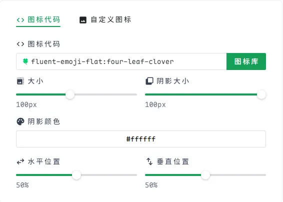
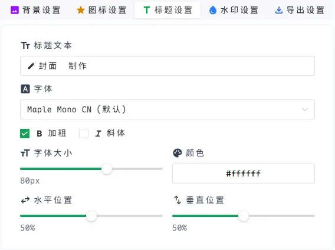
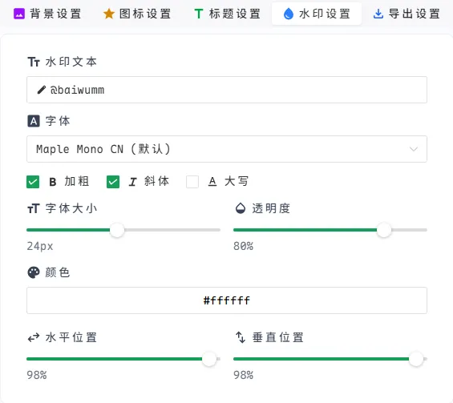
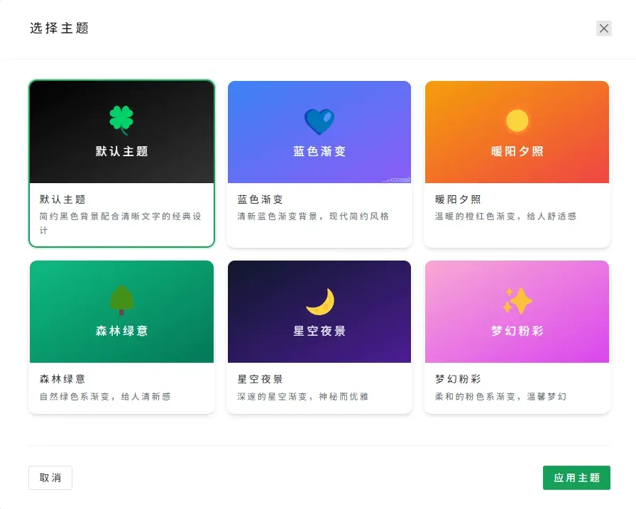

## 📛 技术博主的封面困境

作为一名博主，我深知写一篇高质量的技术文章有多难——但更难的，是给它配一张**像样的封面**。

- **设计师 vs 普通博主**：设计师可以轻松搞定封面，但大部分博主（尤其是程序员）对设计一窍不通。

- **现状：要么将就，要么随便**：

  - 直接截图代码/终端当封面（太丑）

  - 用纯色背景+文字（太单调）

  - 随便找张图凑合（不专业）

- **现有工具的不足**：

- **Github 开源工具**（如 [CoverView](https://github.com/rutikwankhade/CoverView)）功能简单，自定义弱

- **在线生成器**（如 [Mini Cover](https://github.com/JLinMr/Mini-Cover)）模板固定，风格单一

**结果**：90% 的技术博客封面，要么千篇一律，要么毫无设计感。

## 🤔 为什么我要做 Cover Magic？

既然市面上的工具都无法满足需求，我决定自己开发一个真正适合**技术博主、内容创作者**的封面工具。

**Cover Magic 的目标**：

- ✅ **零设计基础也能用**：程序员友好，不折腾
- ✅ **实时可视化编辑**：调整字体、配色、布局，所见即所得
- ✅ **一键导出高清图**：支持 PNG/JPG/WebP，支持自定义不同尺寸

> 以前：花 1 小时找图 + 调尺寸 + 加文字 → 结果还是丑
>
> 现在：5 分钟选模板 + 微调 → **专业级封面**

## ✨ 功能亮点

### 🎨 背景设计

✅ **自定义纯色背景**

✅ **多方向渐变背景**

✅ **上传自定义图片**

### ✏️ 内容编辑

✅ **丰富的图标库**

✅ **自定义标题文本**

✅ **水印保护功能**

### 🖥️ 主题模式

✅ **多种精美主题**

✅ **一键主题切换**

✅ **个性化主题定制**

### 📤 导出选项

✅ **多种格式导出**

✅ **自定义尺寸**

✅ **高质量图像**

### 🌘 暗黑模式

## 🚀 立即体验

如果你也受够了丑陋的博客封面，试试 [Cover Magic](https://github.com/baiwumm/cover-magic)

**或者，你希望 Cover Magic 加入什么功能？** 欢迎在评论区告诉我！
