后台管理系统的需求几乎不需要解释：登录、用户、角色、菜单、字典、日志、组织、Dashboard，谁家做的都差不多。正因为需求高度同质，它成了一个理想的对照实验场——**同一份需求、同一套数据库、同一份接口契约，用五种技术栈各写一遍，差异会出现在哪里？**

于是有了 [Better Admin](https://github.com/baiwumm/better-admin)：六个可独立运行、独立部署的应用，34 天全部上线。线上即演示环境，登录页有「管理员 / 随机用户」两个快捷入口，写操作由服务端只读守卫拦下。

| 端      | 地址                                                         | 技术栈                                             | 数据访问 / 部署                  |
| ------- | ------------------------------------------------------------ | -------------------------------------------------- | -------------------------------- |
| React   | [react.baiwumm.com](https://react.baiwumm.com)               | React 19 + Vite 8 + TanStack + Zustand / HeroUI v3 | → NestJS API，Cloudflare Workers |
| Vue     | [vue.baiwumm.com](https://vue.baiwumm.com)                   | Vue 3.5 + Vite 8 + Pinia + vue-query / Nuxt UI v4  | → NestJS API，Cloudflare Workers |
| Next.js | [next.baiwumm.com](https://next.baiwumm.com)                 | Next 16 App Router（独立全栈）                     | → PostgreSQL 直连，Vercel        |
| Nuxt    | [nuxt.baiwumm.com](https://nuxt.baiwumm.com)                 | Nuxt 4 + Nitro（独立全栈）                         | → PostgreSQL 直连，Vercel        |
| NestJS  | [nest.baiwumm.com](https://nest.baiwumm.com)                 | Nest 11 + Drizzle + PostgreSQL                     | → PostgreSQL，Render             |
| 文档站  | [better-admin.baiwumm.com](https://better-admin.baiwumm.com) | Next 16 静态导出 + fumadocs                        | —，Cloudflare Workers            |

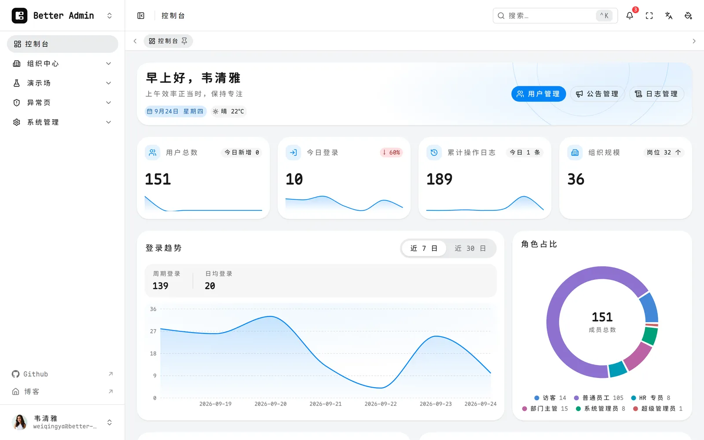

本文不给「谁更好」的结论，讲四件事：**动手前锁死了什么、一致性对齐在哪一层、AI Agent 在这个项目里干了哪些活，以及你要怎么把它跑起来、怎么把这套 VibeCoding 的工程配置抄到自己项目里。**

## 三条锁死的约定

多端同构项目里最先崩掉的一定是「同一份东西有五个版本」，所以动手前先锁三件事。

**① OpenAPI 是唯一真源。** 先定契约再实现。真源是 `apps/nest/openapi/openapi.yaml`，当前 v1.14.0，**48 条路径 / 77 个操作**，五个应用的路径、方法、响应信封、错误码、分页参数逐字一致。校验不靠自觉：线上跑 `contract-diff`，**31 步逐接口比对** Next / Nuxt 与 Nest 的响应，不一致就非零退出。

**② 一个数据库，四端共用。** 统一 Drizzle ORM + **17 张表**，PostgreSQL 由 Supabase 托管但只当数据库用——不用 Auth、不用 RLS、不用 Edge Functions（唯一豁免是头像 Storage）。浏览器端禁止直连数据库，连接串只存在于服务端环境变量。

**③ 权限由服务端强制校验。** 前端路由守卫只是体验层，后端必须独立再校验一次，这条下面展开。

顺带一句线上环境：六个端都是**只读演示模式**，`DemoReadonlyGuard` 注册为全局 `APP_GUARD`，先于路由级守卫执行，所以未登录的写请求也是直接 403，而不是先给个 401 让人猜为什么。

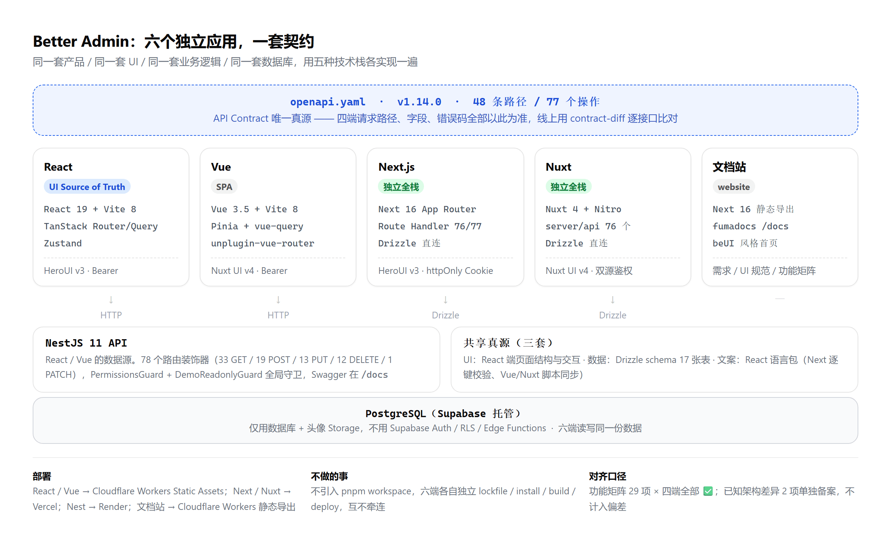

让 Next 和 Nuxt 各自带服务端是刻意的：如果四端都只是 Nest 的客户端，「Next vs Nuxt」就退化成渲染模式的比较，因为两边调的是同一套 API。各写一遍服务端后差异才真的浮出来——Next 用 httpOnly Cookie，Nuxt 用 Bearer 优先 + Cookie 回退的双源鉴权，鉴权插在哪一层、缓存语义、错误处理全都不一样。另一个决策是**不引入 pnpm workspace**：六端独立 lockfile、独立构建、独立部署，不因为放在同一目录就产生耦合。

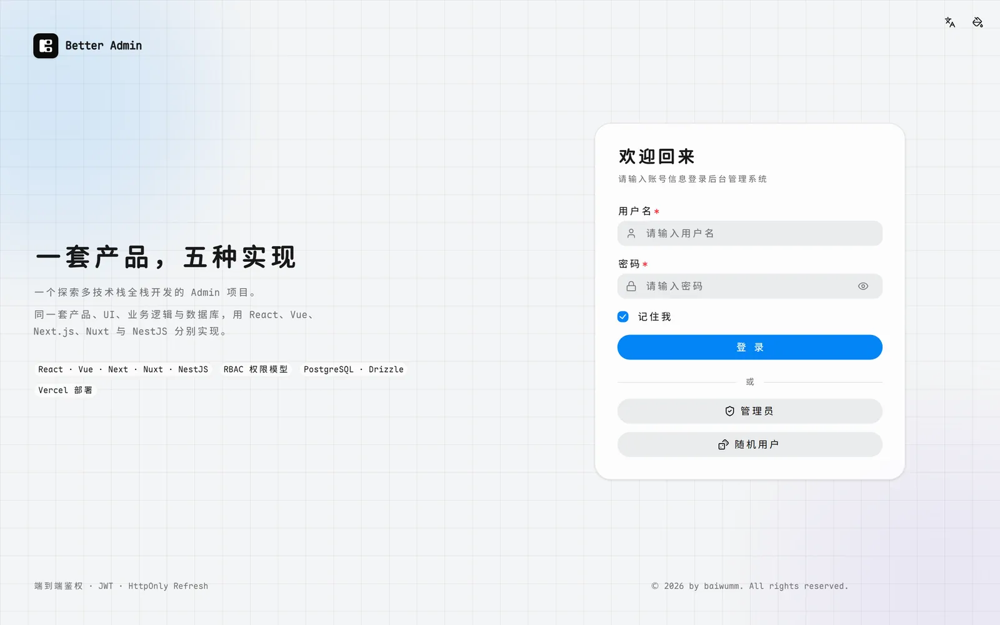

## 一致性对齐的是行为，不是数值

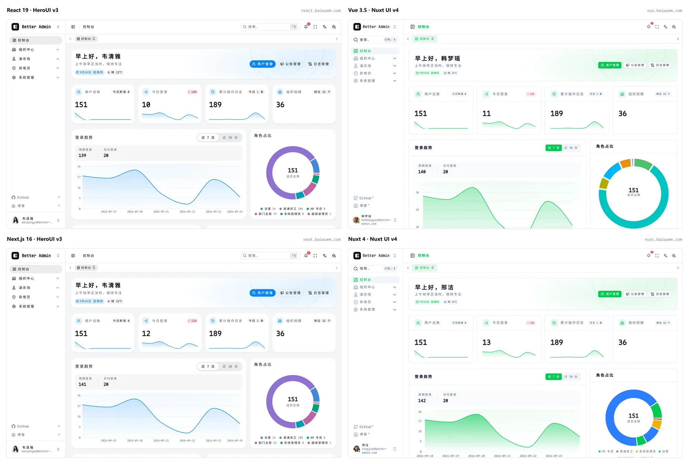

四张图是同一个页面的四次实现。主色不同、圆角数值不同、图表引擎不同——**这些是允许不同的部分**。强制一致的是页面结构、API 契约、认证权限行为、i18n 键值、DataTable 首屏 6 行骨架。

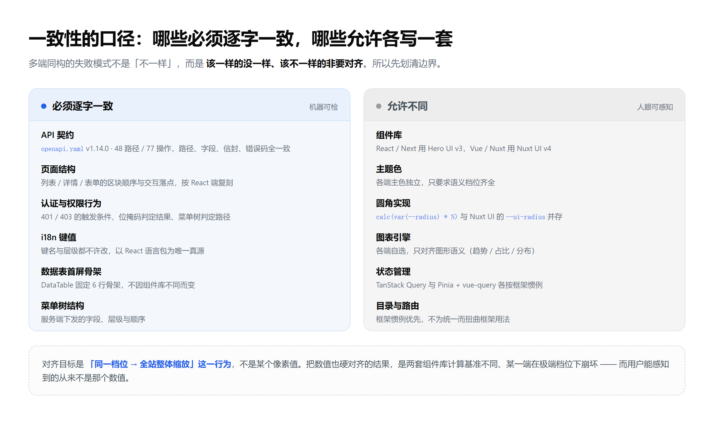

圆角是最好的例子：React / Next 走 HeroUI 的 `calc(var(--radius) * N)`，Vue / Nuxt 走 Nuxt UI 自己的 `--ui-radius`，规范明确禁止移植 `theme.css` 或自建 `--ui-*` 映射层。原话是——**不要求与 React 端数值一致，只对齐「同一档位 → 全站整体缩放」这一行为。**

一开始想把数值也一起对齐，很快发现是自找麻烦：两套组件库的计算基准不同，硬对齐的结果是某一端在极端档位下崩坏；而用户能感知到的从来不是某个像素值。

语言包同理，只是强度更高：React 是唯一真源，Next 靠 `check-locales` 逐键 diff、不一致就 CI 红灯；Vue / Nuxt 用脚本挂在 `predev` / `prebuild` 上自动同步。

## 权限：两套判据，各管一段

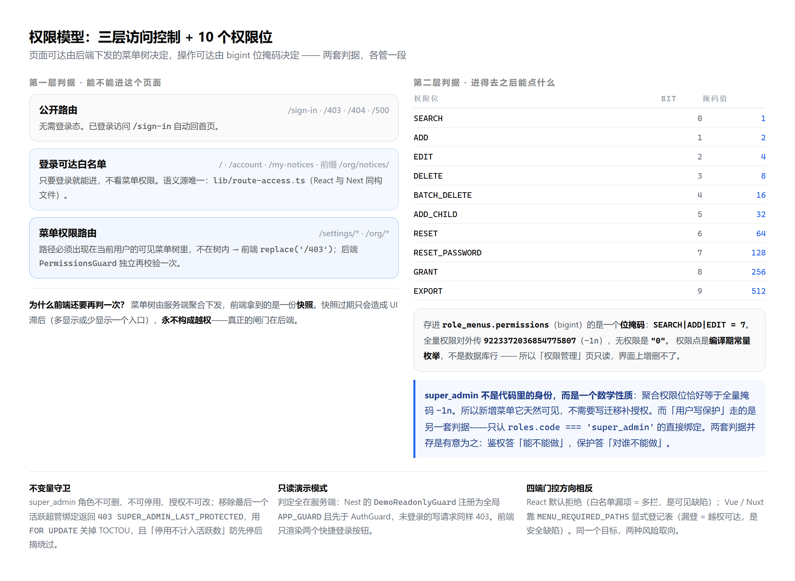

**第一层管「能不能进这个页面」**：公开路由 → 登录可达白名单 → 菜单权限路由。判据是路径必须出现在服务端下发的可见菜单树里，不在树内直接 `replace('/403')`。前端拿到的是快照、会过期，但过期只造成 UI 滞后，真正的闸门在后端。

**第二层管「进得去之后能点什么」**：10 个权限点，编译期常量 + bigint 位掩码。

```ts file=apps/nest/src/db/schema/permissions.enum.ts
export const Permissions = {
  SEARCH: { bits: 1n, label: "search" },
  ADD: { bits: 2n, label: "add" },
  EDIT: { bits: 4n, label: "edit" },
  DELETE: { bits: 8n, label: "delete" },
  // ……共 10 个权限点，末位 EXPORT: 512n
} as const satisfies Record<string, PermissionMeta>;

/** 超级管理员全量位：bigint 全 1 掩码，内部表示采用 -1n */
export const SUPER_ADMIN_BITS = -1n;
```

链路是「装饰器声明 → 守卫读取 → 按位校验」，无声明即放行：`@Permissions("SEARCH") @Get("users")` → `PermissionsGuard` 取元数据 → `hasPermission(userBits, meta.bits)` 做位与，失败抛 403。

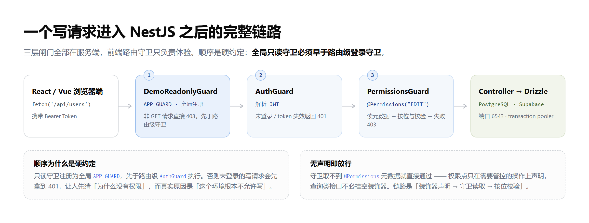

两个推论：权限点是常量而不是数据库行，所以「权限管理」页是**只读**的——权限语义属于代码，改它应该走发版。super_admin 也不是身份，而是「聚合权限位恰好等于全量掩码」这个数学性质，推论是新增菜单天然可见、不需要补授权；而「用户写保护」另有一套判据、只认 `super_admin` 的直接绑定——鉴权答「能不能做」，保护答「对谁不能做」。

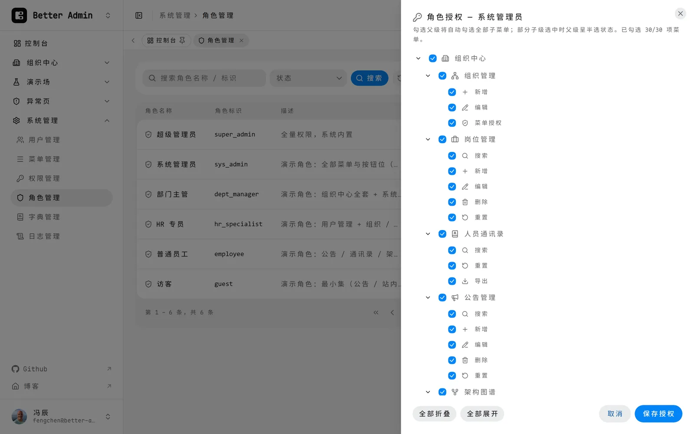

四端实现里最有意思的分歧是**门控方向相反**：React / Next 维护「不需要菜单权限」的白名单、默认拒绝，漏一项的后果是多拦（用户当场报修）；Vue / Nuxt 维护 `MENU_REQUIRED_PATHS` 登记表，登记过的才检查，漏一项的后果是越权可达（没人会报修）。同一个目标、两种失败模式，两边都留在仓库里。

## 一个坑，和它的根因

**React Query 的「重置闪回」。** 点重置后输入框清空了，表格却先闪回旧结果。根因是 React Query 对「新 key 已有缓存」是 stale-while-revalidate，会同步回放旧数据，而 `keepPreviousData` 只在无缓存时才兜底。解法是在 queryKey 里插一个单调递增的 epoch：

```ts file=apps/react/src/hooks/use-list-query.ts
export function buildListQueryKey(options: ListQueryOptions) {
  return [
    ...options.queryKeyPrefix,
    "list",
    options.epoch, // 硬约定：必须在 prefix 之后、其余字段之前
    options.page,
    options.pageSize,
    options.search,
    options.sortField,
    options.sortOrder,
    options.filters,
    options.extraParams ?? null,
  ];
}
```

搜索提交、筛选变更、重置都会让 epoch +1，条件重构因此必然产生全新 key、无缓存可回放；而翻页和排序不变 epoch，目标 key 仍能命中缓存加速。

同类的坑还有两个，各一句话：**View Transitions** 里给 `::view-transition-old/new()` 加 `overflow: clip`，在 Chromium 上压根不参与绘制裁剪，位移多少快照就越界多少——不是 z-index 问题，只能把幅度压小再加组盒兜底。**Nuxt** 的缺省布局在首帧挂载时会立刻发请求，401 后 `location.assign('/sign-in')` 触发整页重载、再挂载、再 401，死循环，治本是改成纯路径判定。

## AI Agent 开发：让「写五遍」变成可行

这个项目 645 个提交、六个应用、293 个测试用例。靠的不是我写得快，而是**重复的部分交给 AI，不重复的部分留给人**。

多端同构恰好是 AI 最擅长的形状：第一遍（React）要设计，第二到第五遍是**有明确真源的翻译**——契约、schema、UI 基准、语言包全是现成的，剩下的活是「按这套规范在另一种框架里再写一遍」。所以 Nuxt 端从 M0 骨架到 M5 文档收尾只用了两天，因为需要决策的东西在前面几端已经决策完了。

| 谁       | 干什么                                                                  |
| -------- | ----------------------------------------------------------------------- |
| 人       | 定范围与优先级、拍板、浏览器 GUI 走查、平台后台与密钥配置               |
| AI Agent | 编码、lint / typecheck / test / build 四绿、HTTP 层冒烟、文档与台账回写 |

**VibeCoding 真正的优势不在于「写得快」，而在于它让「把同一件事做五遍」这种传统排期里最不划算的决策变得可行。** 一份后台写两遍已经算奢侈，五遍基本不会立项；而重复劳动恰好是 AI 成本最低的部分，五份实现提供的横向对照信息又远比一份多。

代价是规则必须前置。这个仓库有 21 章 `AGENTS.md`，其中专门一章是写给 AI 的硬性规则（下面单开一节讲）。一句话概括就是——**先把真源定死，再让 Agent 按真源翻译；冲突时停下来问，而不是自己挑一个方案继续写。**

规则的价值不是约束 AI 的智力，而是**把「一致性」变成可机器检查的目标**：语言包逐键 diff 不过就红灯，契约对不上 `contract-diff` 就非零退出，六端的 lint / typecheck / test / build 在 CI 里跑满 17 步矩阵。AI 写得快，而快带来的偏差也只有机器检查追得上。

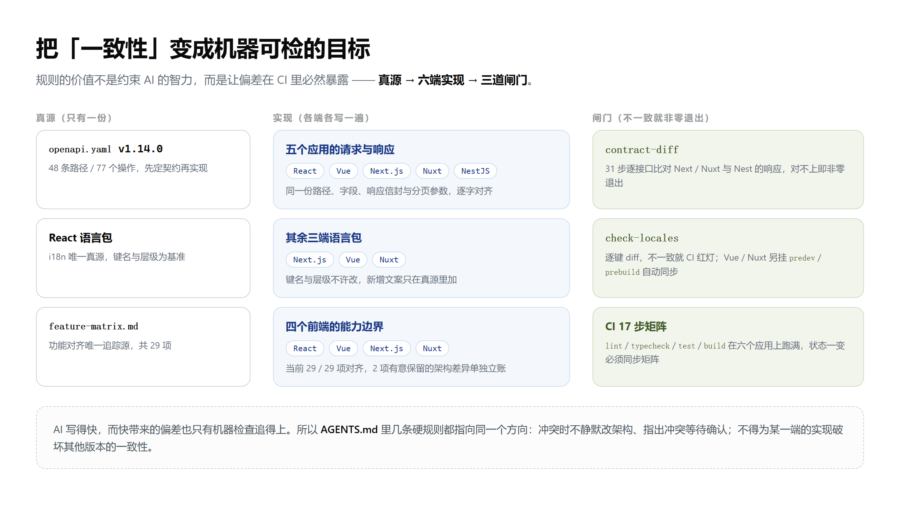

## 五分钟跑起来

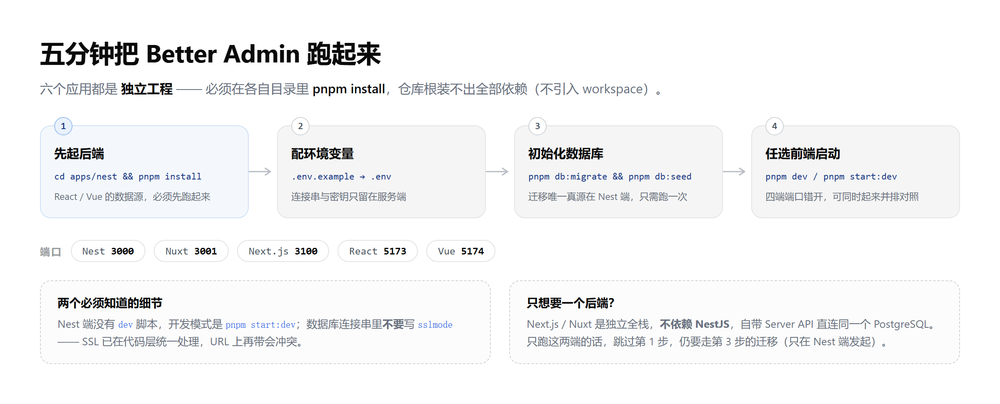

前置只要三样：Node.js、pnpm、一个 PostgreSQL（演示环境用 Supabase 托管，连接端口 6543）。

```bash
cd apps/nest
pnpm install
cp .env.example .env      # 填 DATABASE_URL 等，密钥不入仓库
pnpm db:migrate && pnpm db:seed
pnpm start:dev            # http://localhost:3000/api，Swagger 在 /docs
```

后端起来之后，任意挑一个前端。想同时对照就都起来，端口是错开的：

```bash
cd apps/react && pnpm install && pnpm dev   # 5173
cd apps/vue   && pnpm install && pnpm dev   # 5174
cd apps/next  && pnpm install && pnpm dev   # 3100，独立全栈
cd apps/nuxt  && pnpm install && pnpm dev   # 3001，独立全栈
```

三个容易踩的点：**①** 六个应用各持一份 lockfile，`pnpm install` 必须在各自目录里跑，仓库根装不出全部依赖；**②** Nest 端没有 `dev` 脚本，开发模式是 `pnpm start:dev`；**③** 数据库连接串里不要写 `sslmode`，SSL 已在代码层统一处理，URL 上再带会冲突。另外，**迁移的唯一真源在 Nest 端**（Next 的 `db:pull` 只做内省、Nuxt 完全没有 `db:` 脚本），所以第 3 步只需要跑一次。

## 想用 VibeCoding 写自己的项目？起手式已经备好了

这个仓库还有一个副产品：**它是按「Agent 优先」的姿势组织的**。克隆下来就能直接开工，不必从零搭那套规范。

| 仓库自带                    | 作用                                                                      |
| --------------------------- | ------------------------------------------------------------------------- |
| `AGENTS.md`（21 章）        | 架构约束、UI 一致性口径、命名与依赖规范、给 AI 的硬性规则。第 18 章是核心 |
| `.agents/skills/`（18 个）  | 覆盖全栈的项目级 Skill，清单见下                                          |
| `skills-lock.json`          | 逐个 Skill 记录来源仓库、路径与内容 hash —— Skill 也是供应链              |
| `next/dist/docs/`（421 篇） | Next 16 官方文档，随 `pnpm install` 到位，版本与项目精确匹配              |
| `.github/workflows/`        | CI 17 步矩阵 + 语言包逐键校验，规则落地不靠自觉                           |

这 18 个 Skill 把整条技术栈都盖住了：`nuxt-ui` / `nuxt` / `nitro` / `vue` / `vue-best-practices` / `vue-router-best-practices` / `vue-testing-best-practices` / `pinia` / `vueuse-functions` / `heroui-react` / `drizzle-orm` / `vitest` / `vite` / `pnpm` / `web-design-guidelines`，以及 Vercel 三件套（`vercel-react-best-practices` / `vercel-composition-patterns` / `vercel-react-view-transitions`）。

但真正值得抄的不是这份文件清单，是三条口径：

**① 把需求优先级写进文档，不让 Agent 临场判断。** 用户当前明确需求 → `requirements.md` → `AGENTS.md` → 现有代码与架构 → 框架官方最佳实践。谁优先谁靠后是白纸黑字的，Agent 不需要猜。

**② 冲突时不许静默决策。** 规则原话：不要静默修改架构、不要自行选择方案继续开发，应明确指出冲突、给出可选方案、等待确认。这条堵住的是 Agent 最容易闯的祸——不声不响地重构。

**③ 给框架文档一个确定的位置。** Nuxt 开发必须先读官方 `llms-full.txt`，Next 以包内内置文档为准，HeroUI 查仓库里的 `.heroui-docs/`——一条「禁止凭记忆使用框架 API」，抵得上后面好几轮 review。

如果你手上也有「同一件事要写好几遍」的需求（多端、多框架、多语言 SDK、多地区配置），这套骨架可以整段复用：**先把真源定死，再把规则写成文档，最后让 Agent 去做「翻译」那部分。**

## 当前状态

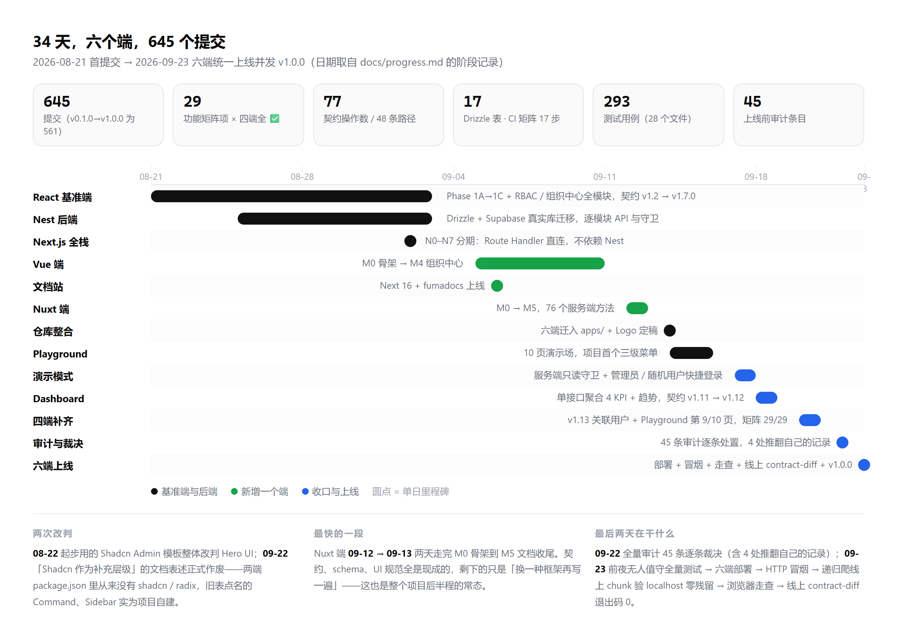

四个前端的功能对齐 **29 / 29**，只剩两处有意保留的架构差异（KeepAlive 路由缓存、localStorage Bearer vs httpOnly Cookie）。六个应用已于 2026-09-23 统一上线，契约、schema、UI 规范与功能矩阵都整理进了文档站。

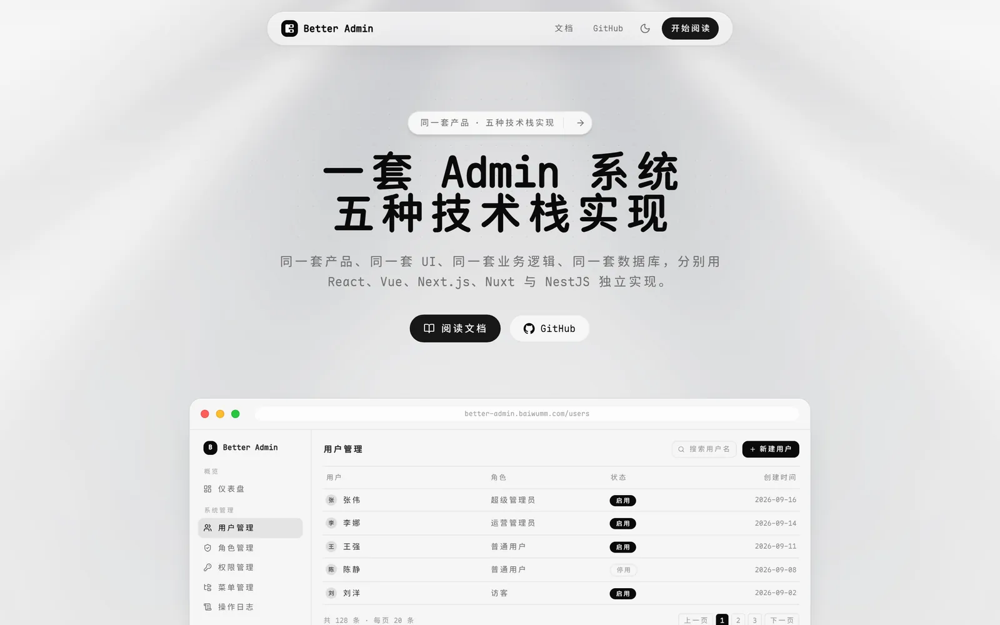

代码在 [github.com/baiwumm/better-admin](https://github.com/baiwumm/better-admin)，MIT 协议，六个端都在线，欢迎拿它当对照实验的素材。

::link-card[https://github.com/baiwumm/better-admin]
