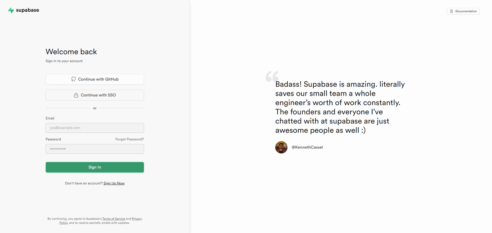
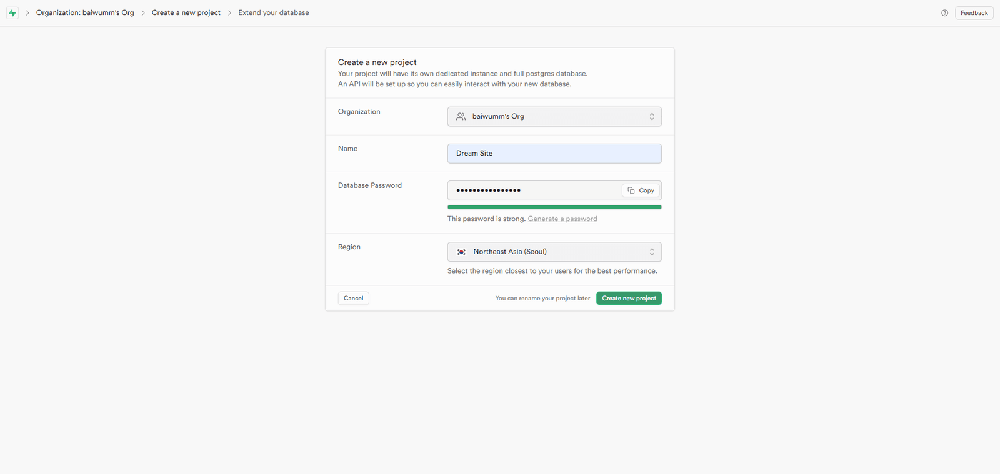
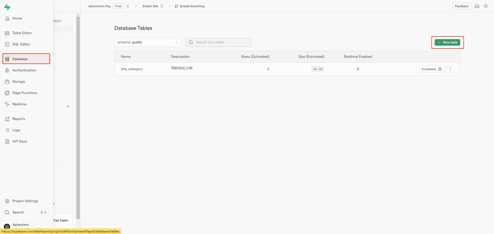
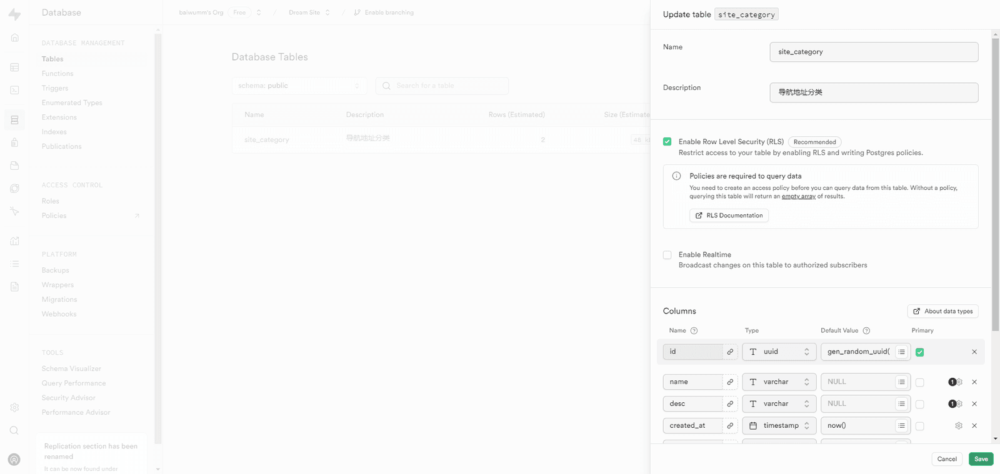
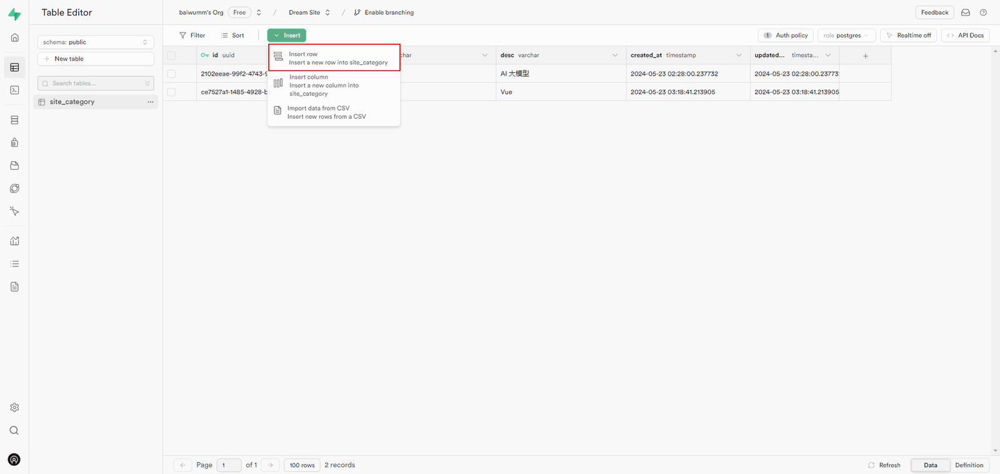
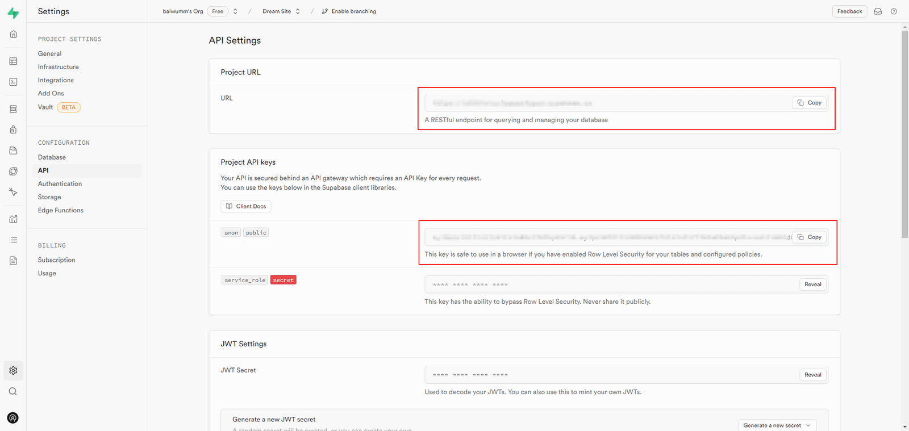
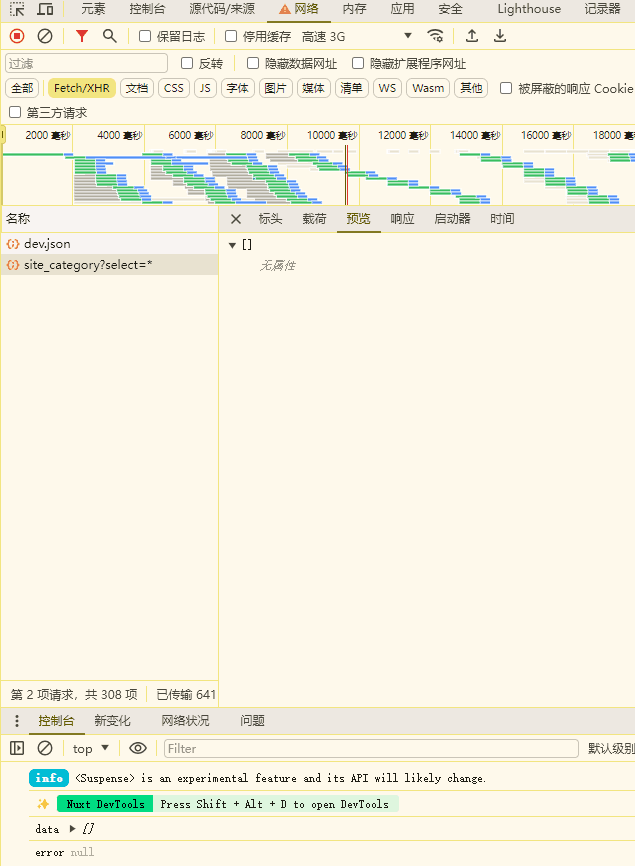
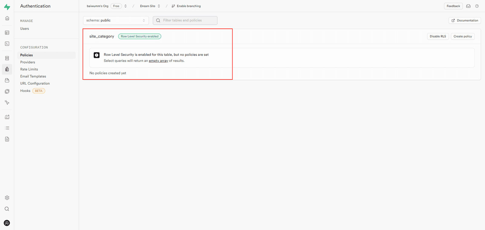
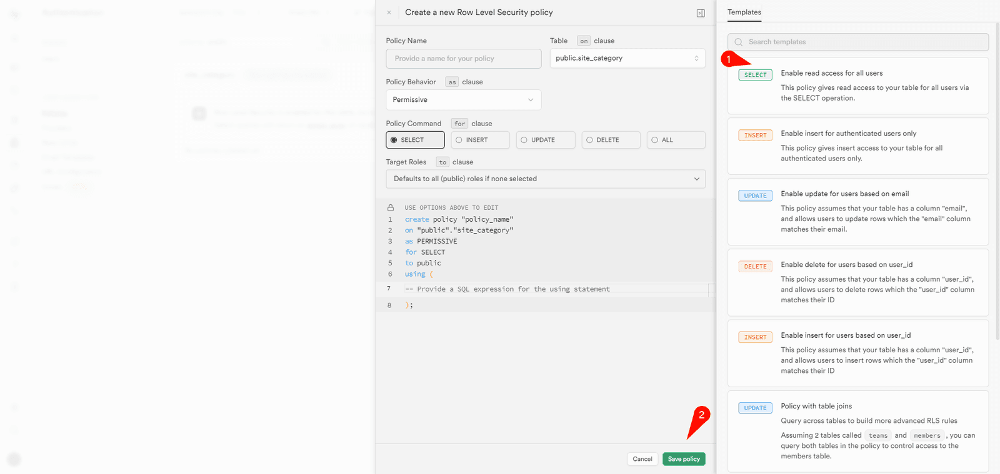
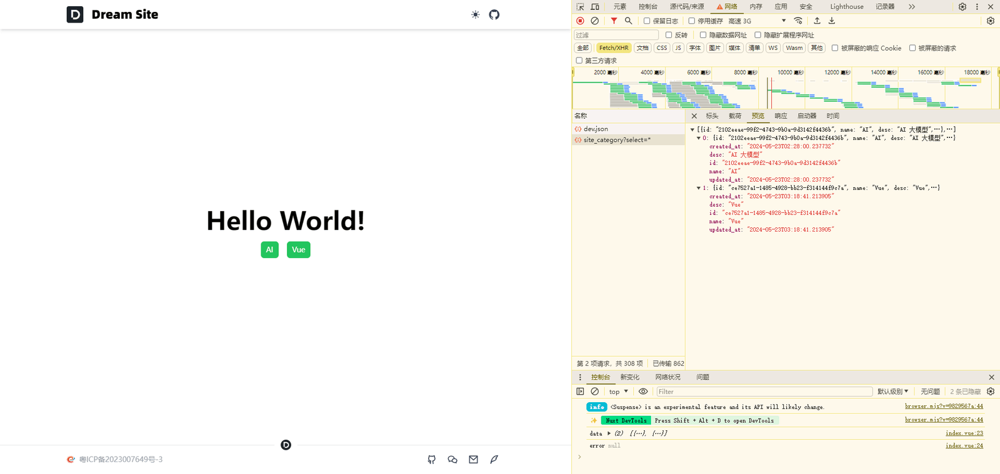

## 前言

这个章节我们要先把数据库的环境配置好，古人云：**工欲善其事，必先利其器**。

这两天我一直在网上寻找最适合 [Nuxt](https://nuxt.com/) 的数据库，之前在做个人项目时经常用的是 [Mysql](https://www.mysql.com/) 和 [MongoDB](https://www.mongodb.com/)，也用过 [ORM](https://baike.baidu.com/item/ORM/3583252) 框架比如：[Sequelize](https://sequelize.org/)、[TypeORM](https://github.com/typeorm/typeorm)，本来计划使用 [Prisma](https://www.prisma.io/)，后来认真看了 [Nuxt](https://nuxt.com/) 集成的[数据库模块](https://nuxt.com/modules?category=Database)后，还是选择了 [Supabase](https://supabase.com/)，在我看来主要原因有3点：

1.  [Supabase](https://supabase.com/) 网上风评比较好，而且 [Nuxt](https://nuxt.com/) 集成了 [Nuxt Supabase](https://supabase.nuxtjs.org/) 模块

2.  用户认证和身份鉴权开箱即用，提供了多种认证类型机制

3.  我没用过，在开发上我喜欢用我没用过的技术或工具

话不多说，直接整活。

## Supabase 介绍

[Supabase](https://supabase.com/) 是一个开源的 [Firebase](https://firebase.google.cn/) 替代品，提供了一系列的后端功能，让你可以更快地构建产品。主要特点有：

- 数据库： `Supabase 使用 PostgreSQL 作为数据库，支持 SQL 和 RESTful API 访问`

- 认证： `Supabase 提供了一个完整的认证系统，支持邮箱、手机号、第三方服务等多种登录方式`

- 实时订阅： `Supabase 允许你通过 WebSocket 实现实时数据同步，无需编写额外的代码`

- 存储： `Supabase 提供了一个对象存储服务，可以方便地上传、下载和管理文件`

- 边缘函数： `Supabase 支持在边缘节点上运行 JavaScript 函数，可以用来处理请求或触发事件`

[Supabase](https://supabase.com/) 有一个免费套餐，可以让你创建最多三个项目，并享受一定的资源限额。如果你需要更多的项目或资源，你可以选择按需付费或者预付费的套餐。

## 创建 Supabase 数据库

1.  打开 [Supabase Dashboard](https://supabase.com/dashboard/sign-in)，选择登录方式，这里我直接选择 **Github** 登录



2.  进入控制台，点击 **New project** 创建项目



3.  进入项目管理界面，点击左侧菜单的 **Database**，再点击右侧的 **New table** 创建一张表





4.  点击右侧菜单的 **Table Editor**，打开新建的表，先插入两条测试数据



5.  点击右侧菜单的 **Project Settings - API**，在右侧可以看到项目连接所需要的密钥



到这里，我们就创建好数据库了，接下来我们在 [Nuxt](https://nuxt.com/) 上测试一下是否能成功连接。

## Nuxt 安装 Supabase

1.  根目录下执行命令

```bash
pnpm add @nuxtjs/supabase -D
pnpm add @supabase/supabase-js
```

2.  在 **.env** 文件中添加 **SUPABASE\_URL** 和 **SUPABASE\_KEY**

```text
SUPABASE_URL="https://example.supabase.co"
SUPABASE_KEY="<your_key>"
```

3.  打开 **nuxt.config.ts** 文件，添加配置：

```ts
export default defineNuxtConfig({
  modules: ["@nuxtjs/supabase"],
  // 自定义配置
  supabase: {
    redirect: false, // https://supabase.nuxtjs.org/get-started#redirect
  },
});
```

> 这里我们先将配置 **redirect** 设置为 **false**，因为 [Supabase](https://supabase.com/) 默认如果未经身份验证的用户试图访问受保护的登录页面，则自动重定向到配置的登录页面。

4.  打开 **pages/index.vue** 文件，尝试访问数据库

```vue
<template>
  <div
    class="flex flex-col items-center justify-center text-5xl font-black"
    style="height: calc(100vh - 8rem)"
  >
    Hello World!
    <div class="mt-4 flex gap-4">
      <UButton v-for="item in data" :key="item.id" :label="item.name" />
    </div>
  </div>
</template>

<script setup lang="ts">
import type { CategoryList } from "~/types";
const supabase = useSupabaseClient<CategoryList>();

const { data, error } = await supabase.from("site_category").select();

console.log("data", data);
console.log("error", error);
</script>
```

在浏览器打开，如果不出意外的话，你能连接到数据库，但是你会得到一个空数组。 `重点来了，这是为什么呢？`



## 配置 RLS 安全策略

之所以会得到空数组，是因为 [Supabase](https://supabase.com/) 为每张表启动 [Row Level Security](https://www.postgresql.org/docs/current/ddl-rowsecurity.html) 策略，我们回到 [Supabase Dashboard](https://supabase.com/dashboard)，打开右侧菜单 **Authentication - Policies**，可以看到在表的安全策略中有个提示：



翻译就是： `已为此表启用行级别安全性，但未设置任何策略，选择查询将返回一个空的结果数组。`

知道原因后，我们需要配置一个安全策略，点击右侧的 **Create policy**，这里我们只需要放开 **Select** 查询的权限就行，它会绕过 [Row Level Security](https://www.postgresql.org/docs/current/ddl-rowsecurity.html) 策略：



刷新浏览器，我们就能看到数据正常访问了：



> 这里我们只是放开了 **Select** 查询的权限，后续的 **INSERT**、**UPDATE** 等操作权限会在身份认证后才可以执行。

## 总结

通过本文，你可以成功使用 Nuxt 连接 [Supabase](https://supabase.com/) 数据库，但其中也有几个点需要注意：

1.  [Supabase](https://supabase.com/) 为每张表启动 [Row Level Security](https://www.postgresql.org/docs/current/ddl-rowsecurity.html) 策略，如果你想在不经过身份认证的情况下执行数据库操作，需要配置 [Policies](https://supabase.com/dashboard/project/athbiwlqrieaoetfapxd/auth/policies) 策略

2.  **Project Settings - API** 有两个 **Project API keys**：

- **anon key**：如果为表和已配置的策略启用了行级安全性，则可以在浏览器中安全使用此键

- **service\_role**：此密钥具有绕过行级安全性的能力，永远不要公开分享

3.  在开发环境中，我们往往需要不用完成身份认证就能执行数据库操作，这时候你就可以把 **SUPABASE\_KEY** 设置成 **service\_role**。

> 但是生产环境中一定要切换成 **anon key**，因为 **SUPABASE\_KEY** 会暴露在浏览器的请求头中

**Github 仓库**：[Better Nav](https://github.com/baiwumm/better-nav)

**线上预览**：[一个把常用网址收拾得干干净净的小站](https://nav.baiwumm.com/)
