## 事情起因

2023年12月20日，还是像往常一样从困意中起床，眯着眼睛睡了会回笼觉，习惯性低看了下手机，打开了一条未读信息：阿里云提示我 **cdn服务** 已欠费并且已停止服务。

What？我啥都没干，怎么就欠费了呢，打开阿里云APP看了下账单，好家伙，欠费4000块，我是真的一脸懵逼

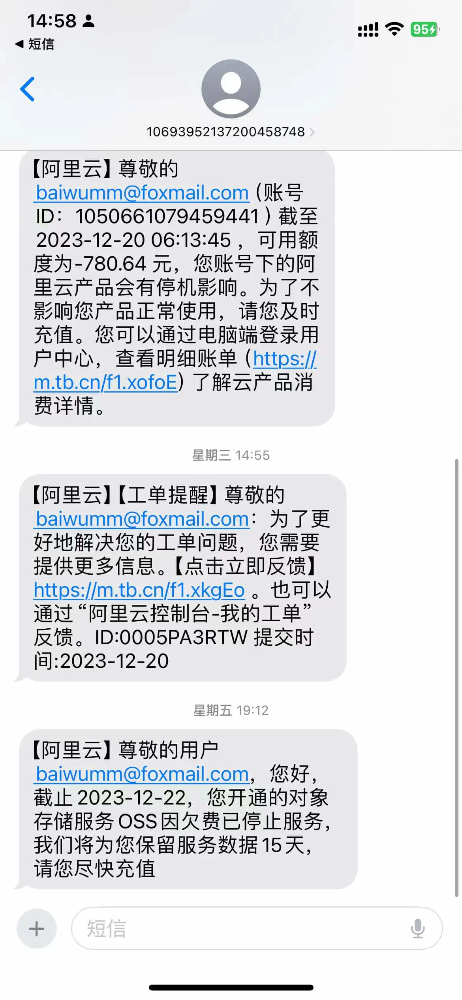

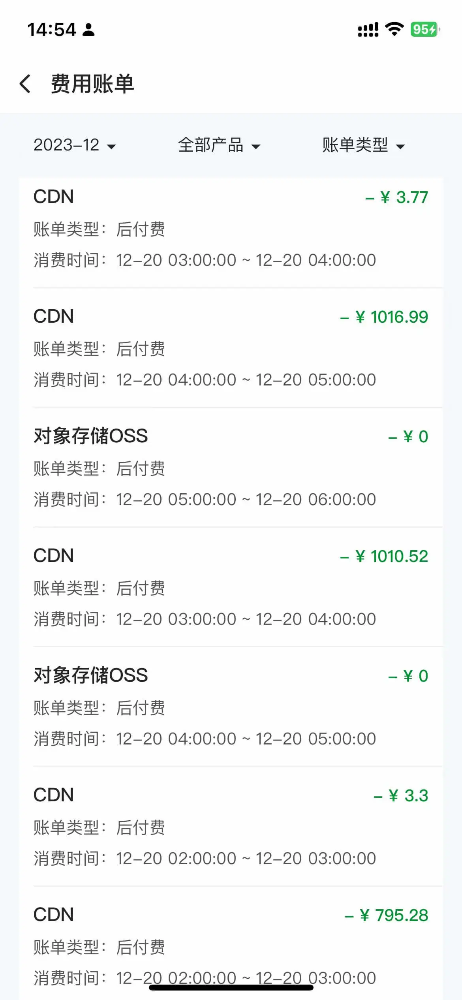

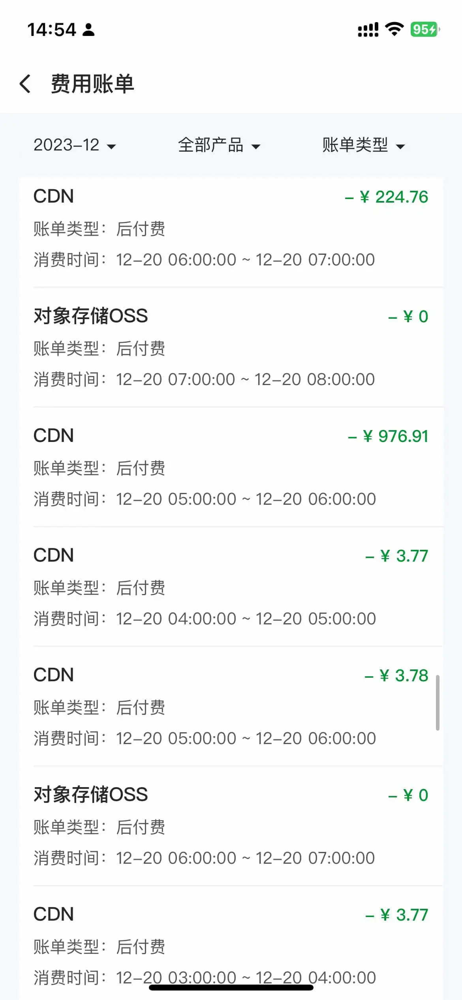

我第一反应是可能阿里云的服务出问题了，导致乱扣费，因为今年很多大厂为了开猿节流，出现了系统程序崩溃的情况：

1. [语雀崩了，这事你怎么看？](https://zhuanlan.zhihu.com/p/663175592)
2. [滴滴崩溃，程维损失的可不止4个亿](https://baijiahao.baidu.com/s?id=1783883635892841974&wfr=spider&for=pc)
3. [罕见！"阿里云崩了"冲上热搜](https://m.thepaper.cn/baijiahao_25276771)

我想着也不是什么大事，着急也没用，到时候再去和阿里云售后了解一下。

## cdn服务被恶意高刷

来到公司，打开电脑，登录了阿里云官方网站，直接联系了售后，而且打开了 **cdn内容分发服务控制台**，看到了流量带宽趋势：

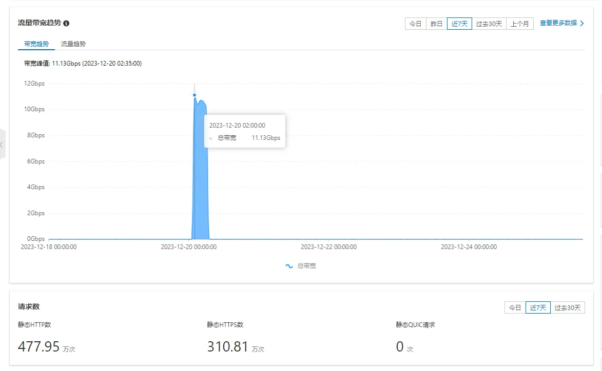

20日凌晨的不同时间点，被人恶意高刷流量，**峰值带宽达到了11Gbps，静态HTTP请求数打到了477.95万次，静态HTTPs请求数打到了310.81万次**，由于cdn按量收费是后付费，账号欠费之后并没有停止服务，导致账单高额欠费。

看到这里我总算是明白了，由于自己只是一个小博主，平时也没啥流量，怎么会被盯上，我真的是百思不得其解。

我急忙联系了阿里云售后，说明了原因，但回答都是：

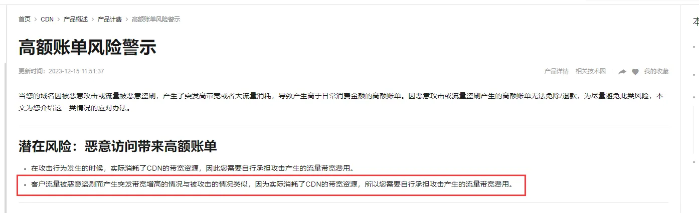

由于自己对cdn服务了解甚少，没有采取相应的措施，导致了高额账单的发生，阿里云文档也有具体的说明：[配置用量封顶](https://help.aliyun.com/zh/cdn/user-guide/configure-bandwidth-caps#task-187634)

奈何事情已经发生，现在要考虑的是怎么解决，我查询了一下欠费账单：

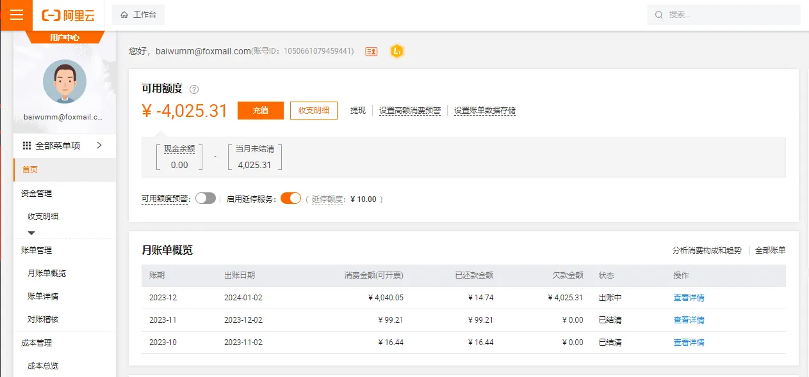

我不禁陷入了沉思，说实在的，我算是阿里云的忠实用户了，从2018年公司技术选型和云平台选型，我第一选择的就是阿里云，乃至我现在搭建网站，域名、服务器、证书、云存储等服务我都优先选择阿里云，现在由于自己的经验不足，导致发生这样的事，好无奈。

## 谁的责任？

这件事情，用户有一定的责任，对 **cdn内容分发服务** 了解不充分，没有考虑到流量被高刷和网络攻击的重要性，但阿里云就没有责任吗？

阿里云作为国内市场份额最大的云服务商，这种事一定是见怪不怪，但是阿里云在这方面并没有给用户比较友好的提示，在cdn控制台界面并没有看到相关的提示：

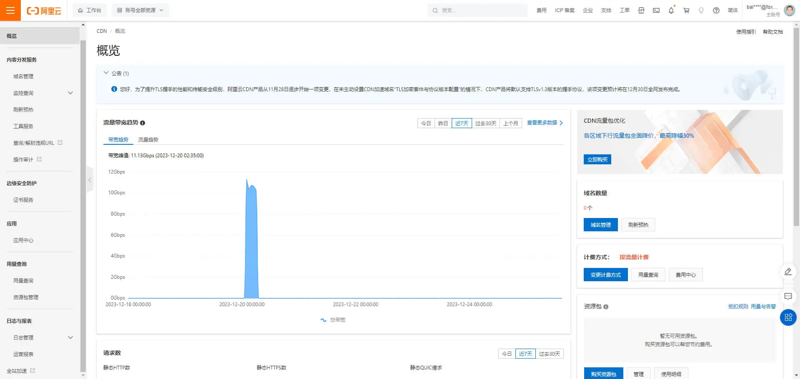

腾讯云cdn控制台：

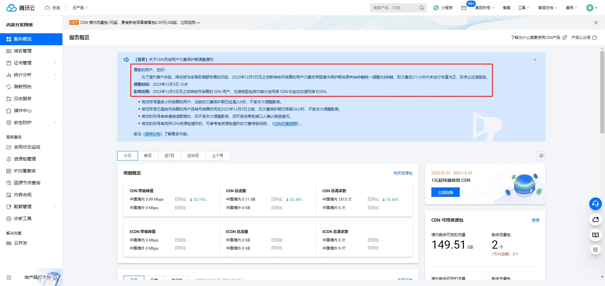

腾讯云COS控制台：

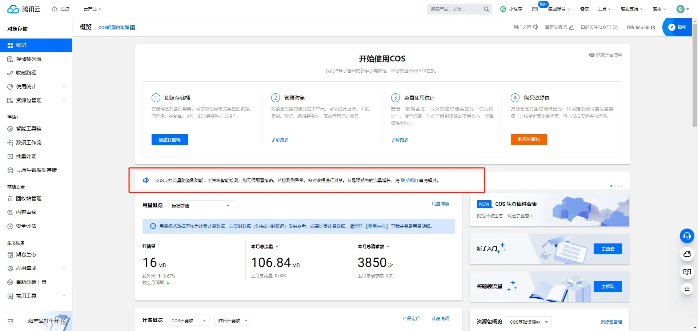

腾讯云在这方面都给了用户友好的提示，我觉得这点还是相对不错的。

## 如何预防

这里我不禁有个疑问：

1. **阿里云作为国内市场份额最大的云服务商，为何在这方面没有相应的措施，导致不知情的用户欠下高额账单**
2. **既然服务有延迟不限制，会不会导致账单欠费几万块，甚至几十万？难道这样的账单也让用户买单？**

我感觉最起码得在用户开通服务的时候给个提示，或者默认设置流量封顶等策略，如果是出于业务或者技术方面的考虑没做限制，我可以理解，就怕很多云厂商想的是反正也是你欠费，我也有钱赚，何乐而不为呢？如果真是这样，我觉得挺悲哀的。

那我们如何防范呢，我们开通 **cdn内容分发服务** 后，一定要做好以下几个设置，这里以腾讯云cdn为例：

1. 开启防盗链配置，最好关闭允许空referer访问：

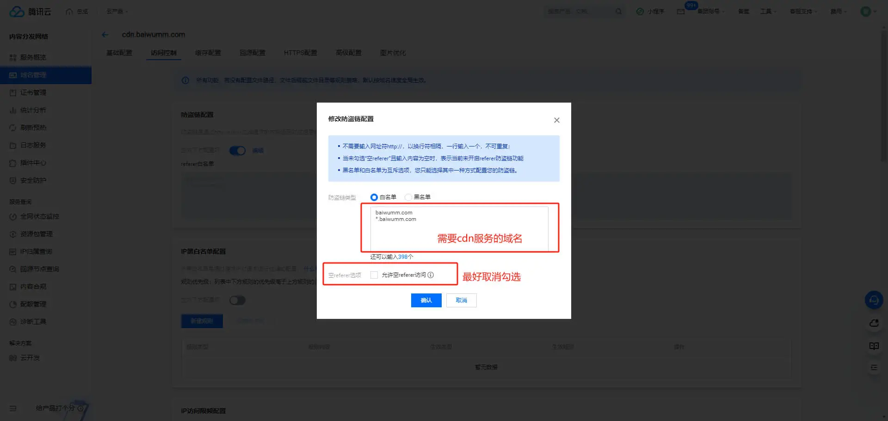

2. 用量封顶配置

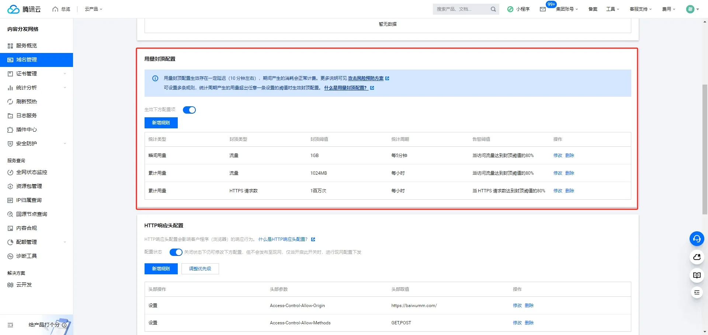

3. IP访问限频配置

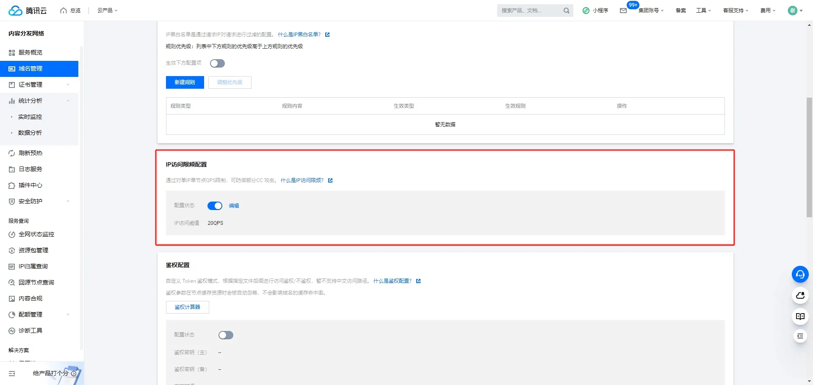

设置好以上几个策略，可在一定程度上抵御 [DDoS攻击](https://baike.baidu.com/item/%E5%88%86%E5%B8%83%E5%BC%8F%E6%8B%92%E7%BB%9D%E6%9C%8D%E5%8A%A1%E6%94%BB%E5%87%BB/3802159?fr=ge_ala)

## 总结

博主最后因无法支付高流量导致的高额账单，被迫迁移到腾讯云，最后希望阿里云越来越好。

希望个人建站的博主使用cdn服务的，要重视网络攻击并做好相应的措施，避免导致无法预料的结果。
