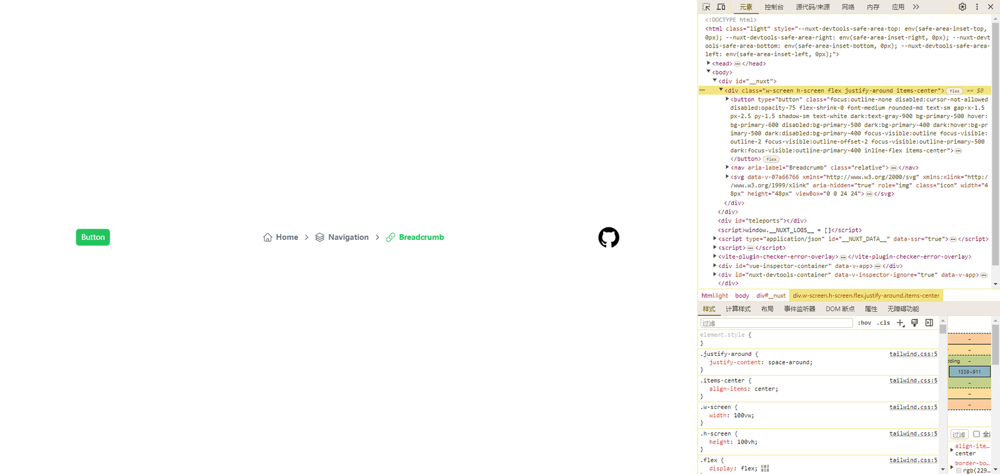

## 前言

对于 **UI** 组件库的选择，我考虑过：[Ant Design Vue](https://www.antdv.com/components/overview)、[Element-Plus](https://element-plus.gitee.io/zh-CN/)，但感觉这两款组件库太偏向业务风格了，现在项目的搭建最好能偏年轻化一点，最后还是选择了：[Nuxt UI](https://ui.nuxt.com/)，主要是 [Nuxt UI](https://ui.nuxt.com/) 是 [Nuxt](https://nuxt.com/) 官方推荐的，而且完美兼容 [Nuxt](https://nuxt.com/)，并且是用 **TypeScript** 编写的，并为所有组件和可组合函数提供类型。

## 安装 Nuxt UI

1.  执行安装命令
```bash
pnpm add @nuxt/ui
```


2.  添加到 **nuxt.config** 模块中
```ts
export default defineNuxtConfig({
   modules: ['@nuxt/ui']
 })
```


3.  需要注意的是，这里 [Nuxt U](https://ui.nuxt.com/)I 会自动安装以下这些模块：
    

-   [@nuxtjs/tailwindcss](https://nuxt.com/modules/tailwindcss)
    
-   [@nuxtjs/color-mode](https://nuxt.com/modules/color-mode)
    
-   [nuxt-icons](https://nuxt.com/modules/icons)
    

> 如果以前安装过它们，则应该将它们从模块和依赖项中删除。

4.  现在，我们可以在 [Nuxt](https://nuxt.com/) 应用中使用所有组件和可组合函数✨，我们在 **app.vue** 中加入代码：
```vue
<template>
  <div class="w-screen h-screen flex justify-around items-center">
    <UButton>Button</UButton>
    <UBreadcrumb :links="links" />
    <Icon
      name="uil:github"
      size="48"
    />
  </div>
</template>
<script setup lang="ts">
const links = [
  {
    label: 'Home',
    icon: 'i-heroicons-home'
  },
  {
    label: 'Navigation',
    icon: 'i-heroicons-square-3-stack-3d'
  },
  {
    label: 'Breadcrumb',
    icon: 'i-heroicons-link'
  }
]
</script>
```


可以看到 [Nuxt UI](https://ui.nuxt.com/) 的组件和 [tailwindcss](https://www.tailwindcss.cn/) 的类名都生效了：



如果你遇到 **icon** 类似的错误，你应该还需要安装 **@iconify-json/heroicons** 这个库
```bash
pnpm add @iconify-json/heroicons
```


## 配置 TypeScript

1.  安装依赖
```bash
pnpm add -D vue-tsc@^1 typescript
```


2.  添加到 **nuxt.config** 配置中
```ts
export default defineNuxtConfig({
   // 构建时启动类型检查
   typescript: {
     typeCheck: true
   }
 })
```


## 总结

到这里，我们的准备工作就完成了，可以在页面组件中使用 [Nuxt UI](https://ui.nuxt.com/) 的组件，后续就可以着手开发页面 **Layout** 布局。
