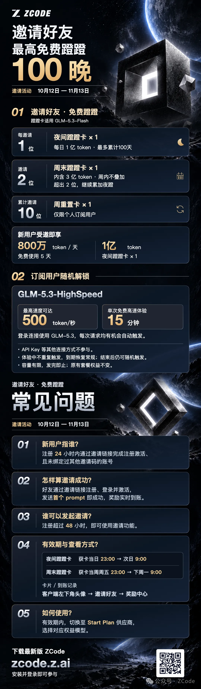
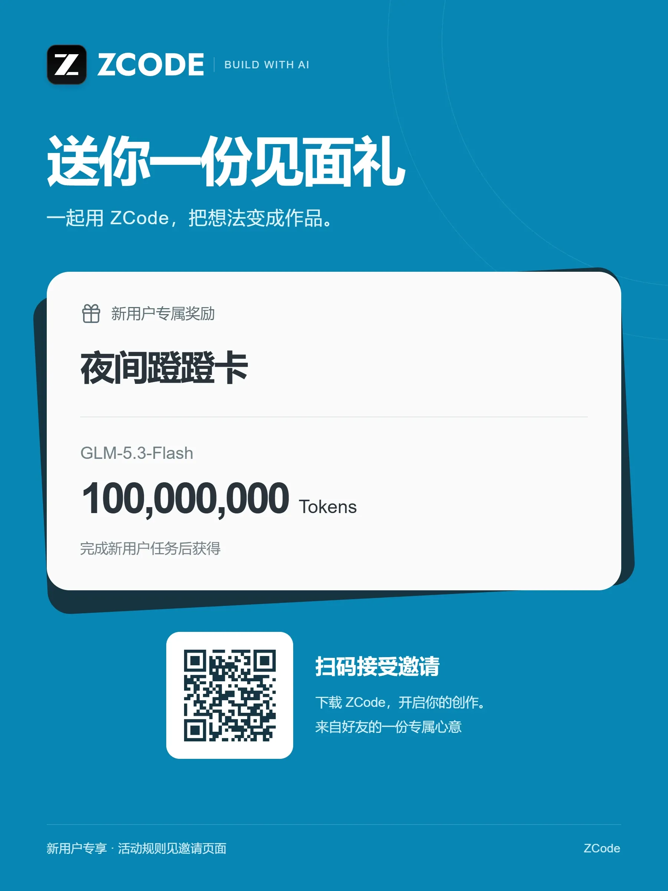

## ✨ 前言

[ZCode](https://zcode.z.ai/) 是智谱 Z.ai 推出的 AI 编程工具，基于 GLM-5.3 大模型，下载安装、登录即用。我平时写代码基本都开着它，这个小站的不少更新也是和它一起完成的。

10 月 12 日到 11 月 13 日，ZCode 开启了「邀请好友，免费蹭蹭」活动：邀请好友注册就能领「蹭蹭卡」，在活动时段内免费用 GLM-5.3-Flash 的额度，最高可以累计 100 晚。下面把活动规则和我的邀请方式一并整理给大家。

## 🎁 邀请奖励

活动期间（10 月 12 日 — 11 月 13 日），每成功邀请一位好友注册，奖励实时到账（蹭蹭卡适用模型为 GLM-5.3-Flash）：

- **每邀请 1 位**：夜间蹭蹭卡 × 1，每日 1 亿 token，最多累计 100 天；
- **邀请满 2 位**：周末蹭蹭卡 × 1，内含 3 亿 token，周内不叠加，超出 2 位继续累加夜蹭；
- **累计邀请 10 位**：周重置卡 × 1（仅限个人订阅用户）。

## 🎉 新用户福利

新用户通过邀请链接注册也有见面礼：

- **800 万 token / 天**，免费使用 5 天；
- 完成新用户任务后，再得 **1 亿 token 夜间蹭蹭卡 × 1**。

## ⚡ 订阅用户彩蛋

活动期间，订阅用户还有随机解锁的 GLM-5.3-HighSpeed：最高速度可达 500 token / 秒，单次免费高速体验 15 分钟。登录链接使用 GLM-5.3 时，每次请求都有机会自动触发（API Key 等其他连接方式不参与）；容量有限，发完即止，原有套餐权益不变。

## ❓ 几个关键问题

- **谁算新用户？** 注册 24 小时内通过邀请链接完成注册激活、且未绑定过其他邀请码的账号。
- **怎样算邀请成功？** 好友通过邀请链接注册、登录并激活，发送首个 prompt 即算成功，奖励实时到账。
- **谁可以发起邀请？** 注册超过 48 小时，即可使用邀请功能。
- **卡片有效期是多久？** 夜间蹭蹭卡：获卡当日 23:00 → 次日 9:00；周末蹭蹭卡：获卡当周周五 23:00 → 下周一 9:00。卡片和到账记录在「客户端左下角头像 → 邀请好友 → 奖励中心」查看。
- **怎么使用？** 有效期内，切换至 Start Plan 供应商，选择对应权益的模型即可。

## 🫶 我的邀请方式

想一起用 ZCode 的朋友，直接通过我的邀请链接注册即可：

👉 [https://zcode.z.ai/invite/Y7C9WZQX](https://zcode.z.ai/invite/Y7C9WZQX)

也可以扫描下方海报中的二维码，下载 ZCode 后登录参与，新用户的见面礼就在等你：

最新版 ZCode 在 [zcode.z.ai](https://zcode.z.ai/) 下载，安装并登录即可参与活动。活动细则以邀请页面为准，邀请前记得确认自己的账号已注册超过 48 小时。
