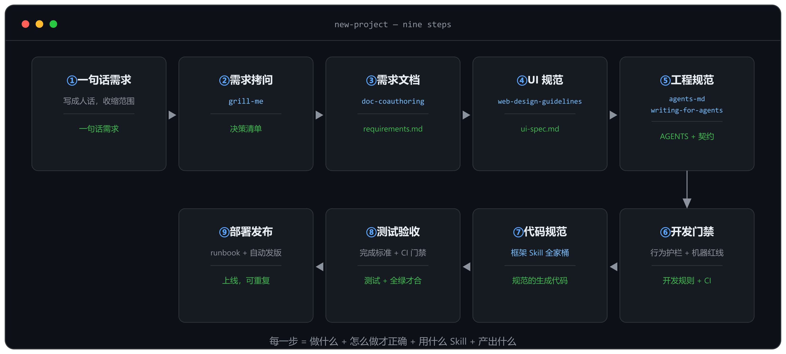
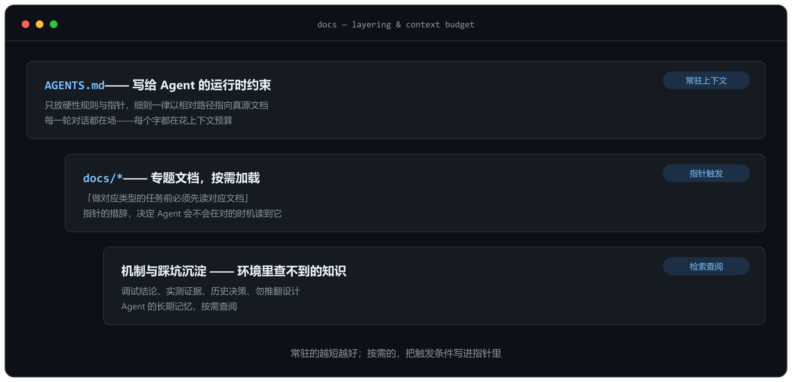
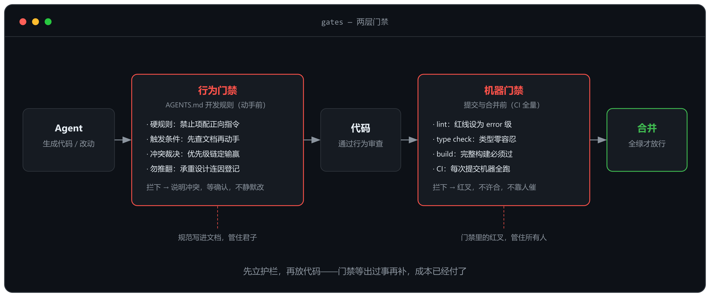
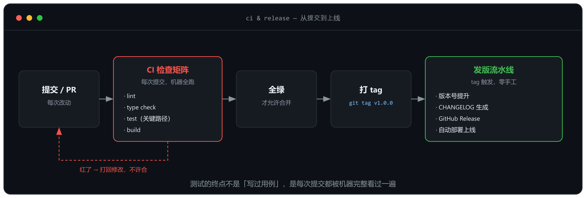

把一句「帮我做个有 RBAC 的全栈后台」丢给 Agent，三个小时后你会拿到一个能跑起来的项目：页面能开、接口能通。然后你开始加需求，发现每加一个都要先跟它解释一遍「为什么运营角色不该看到权限管理页」；改一个组件，它顺手重构了三个文件；第三次会话，它已经不记得你定过的任何规矩。

问题不在模型，在顺序。这篇按一个 VibeCoding 新项目的正确顺序走完全程：一句话需求 → grill-me 拷问 → 需求文档 → UI 设计 → 工程规范 → 开发门禁 → 代码生成规范 → 测试 → 部署。每一步说清四件事：做什么、怎么做才正确、用什么 Skill 规范、产出什么。



## ① 一句话需求：先写成人话

做什么：把要做的东西写成一句任何人能听懂的话——谁用、解决什么、第一版不做什么。

怎么做才对：这句话是人和 Agent 共同的锚。「给公司内部做的全栈后台：React 前端 + NestJS API + PostgreSQL，用户 / 角色 / 权限三件套，菜单和按钮都按权限位控制；第一版不做组织架构、不做消息通知、不做数据导入导出」——每个词都在收缩范围。而「帮我做个后台管理系统」把整个想象空间丢给了模型。

常见错误：跳过这步直接开写。「帮我做个 XX」不是需求，是许愿。

产物：一句话需求，一行就够。

## ② 用 grill-me 把需求拷问清楚

做什么：让 Agent 从「写代码的」变成「问问题的」，把一句话需求逼成一份对齐的决策清单。

grill-me 的机制值得原样照抄：把方案拆成决策树，一轮只问前置条件已确定的问题，每个问题附上它推荐的答案；查资料它自己去（仓库里有什么、缺什么），决策必须你拍板；直到没有遗留的默认假设才收工。

```bash
npx skills add mattpocock/skills@grill-me -g
```

装不上也不影响——这套机制可以直接照抄，手动跑。

用它跑这个后台项目的第一轮（示例对话）：

```text
❓ Q1 - 权限模型：RBAC 用什么实现，关联表还是位掩码？
➡️ 位掩码。一个整数存全部权限位，新增权限位不动表结构

❓ Q2 - 超级管理员：有没有超管，他的权限从哪来？
➡️ 有。权限由登录时实时聚合得出，不写死身份——写死的那天就是后门

❓ Q3 - 菜单和权限：菜单可见性和按钮权限位怎么对应？
➡️ 菜单按权限位过滤，按钮复用同一位——两套口径迟早对不上

❓ Q4 - 边界：第一版明确不做什么？
➡️ 不做组织架构、不做数据导入导出、不上消息通知——写下来，Agent 才不会「顺手」帮你做
```

四个问题拦的全是返工：Q1 不问，权限模型在前后端各写一遍；Q2 不问，某次改权限就把全后台锁死。注意每个问题都带推荐答案——你要做的只是确认或修正，而不是从零答题。

> **这一步让 Agent 这样用 Skill**：使用 grill-me，根据项目实际情况，拷问我这个需求——它自己去环境里查事实，决策点按决策树分轮问我、每个问题附推荐答案，直到没有遗留的默认假设。

常见错误：觉得「需求我很清楚了，直接写」。你以为说清楚了，是 VibeCoding 里最贵的错觉。

产物：对齐的决策清单。Skill：grill-me（mattpocock/skills）。

## ③ 落成需求文档

做什么：把决策清单写成 `docs/requirements.md`——范围、角色与权限、数据模型、边界、验收标准。

怎么做才对：三条。「不做什么」和「做什么」用同样的力气写；一个项目只有一个需求真源，口头变更一律回写文档；每条需求写验收标准，后面每一步的「完成」都拿它对照。

> **这一步让 Agent 这样用 Skill**：使用 to-prd，根据拷问后的决策清单，帮我整理成需求文档；再用 grill-with-docs 拿这份文档拷问我——文档和决策对不上的地方，就是还没想清楚的。

常见错误：需求只留在聊天记录里。会话一长，Agent 记得比你少；新会话第一天，它什么都不记得。

产物：docs/requirements.md。

## ④ UI 设计规范先行

做什么：在生成任何页面之前，先定 Design Tokens 和 UI 基准。

一份 `docs/ui-spec.md`：色彩、间距、圆角、阴影、暗色映射、组件优先级、三态（Loading / Empty / Error）与响应式要求；再指定一个 UI 基准——一个实现作为视觉和行为的事实来源，其他端不得自行创造。规范要写到编码级才有约束力，比如「浮层开合必须用 `useOverlayState()`，禁止裸 `useState` 布尔量」——写进去一次，省得每个端每个 Agent 都踩一遍受控流不匹配、弹窗不显示的坑。

规范定了还要验收的机器：`web-design-guidelines` 审查 UI 代码时实时拉取最新的 Web Interface Guidelines，逐条对照输出 `file:line` 问题清单——审查规则在源头持续更新，本地零维护。

> **这一步让 Agent 这样用 Skill**：使用 frontend-design，根据项目实际情况搭建第一版 UI 结构与 Design Tokens；用 web-design-guidelines 审查生成的页面代码，按最新的 Web Interface Guidelines 逐条对照修改。

常见错误：先生成页面再人工 review。审到第三屏，你已经眼花。

产物：ui-spec.md + 按规范生成的基准页。Skill：web-design-guidelines（vercel-labs）。

## ⑤ 工程规范：第一行代码之前

做什么：AGENTS.md、docs 体系、API 契约，三样在第一个 commit 之前就位。

**AGENTS.md** 是写给 Agent 的运行时约束，三条写法：只存硬性规则和指针，细则一律「相对路径 + 章节号」指向真源文档，禁止复制内容——同一规则出现两处，改了一处忘另一处只是时间问题；章节编号不许重排，被引用得多的编号就是稳定接口；写清优先级链，冲突时 Agent 才知道听谁的：

```md file=AGENTS.md
用户当前明确需求 > docs/requirements.md
> AGENTS.md > 项目现有代码与架构 > 框架官方最佳实践

需求与既有规则冲突时：不静默修改、不自行选方案，
明确指出冲突、给出可选方案、等确认后再动。
```

写完必须接受审查。`agents-md` 的检查清单管结构（60 行以内优先、一条规则一条 bullet、引用而非复制）；`writing-for-agents` 管写法，它有两个很实用的观点：否定式指令（「不要写 console.log」）会把禁止的行为拉进上下文，要改成正向表述（「调试输出走 logger」）；以及识别 no-op 规则——Agent 默认行为本来如此，这条规范就只是在消耗注意力。

**docs 体系**按加载方式分层：AGENTS.md 常驻上下文，越短越好；专题文档靠指针按需加载，「做对应类型的任务前必须先读」这类措辞，决定 Agent 会不会在对的时机读到它；调试结论和踩坑这类环境里查不到的知识，单独沉淀成机制文档，那是 Agent 的长期记忆。

> **这一步让 Agent 这样用 Skill**：使用 agents-md Skill，根据项目实际情况，帮我规范 AGENTS.md；用 writing-for-agents 的标准审查这份 AGENTS.md，看哪些写法会误导 agent；使用 doc-coauthoring，根据项目实际情况，帮我规范 README 和 docs 下面的文档。



**契约先行**：有后端的项目，OpenAPI 先定义再实现，它是接口唯一事实来源，任何一端不得为实现方便自行修改。

文档写完还有一道工序：让一个没有上下文的新 Agent 只读文档回答问题，答错的地方就是文档的 bug——给文档做测试，和给代码做测试一样必要。

常见错误：文档等「项目稳定了再补」。稳定那天不会来；Agent 从第一天就需要规范，不是从你需要评审那天起。

产物：AGENTS.md、docs/ 体系、openapi.yaml。Skill：agents-md（getsentry/skills）、writing-for-agents（mattpocock/skills）、doc-coauthoring（anthropics/skills）。

## ⑥ 开发门禁：先立护栏，再放代码

做什么：在 Agent 碰第一行代码之前，把行为门禁和机器门禁都装好。



**行为门禁**（AGENTS.md 开发规则）四件：硬规则——每条禁止项都配一个正向指令；触发条件——「数据库代码动手前必须查 ORM Skill」「框架 API 以 `node_modules` 内随版本安装的官方文档为准，禁止凭训练记忆」；冲突裁决——直接引用 ⑤ 的优先级链；勿推翻登记——反直觉的承重设计（比如「清空授权等于锁死整个后台」这类保护逻辑）连原因一起写进去，防止某次重构里被 Agent 好心地「优化」掉。

**机器门禁**（提交与合并前的检查）：lint、type check、build 三条红线设为 error 级；能上 CI 就上，不能上也至少固化成一条命令。规范写进文档管住君子，门禁里的红叉管住所有人。

> **这一步让 Agent 这样用 Skill**：使用 setup-pre-commit，根据项目实际情况，把 lint / type check / build 装成提交前钩子——红了提交不了，比「记得先跑一遍」可靠。

常见错误：门禁等出过事再补。出过一次事，成本已经付了。

产物：AGENTS.md 开发规则 + 机器门禁配置。

## ⑦ 代码生成规范：让 Skill 替你管

做什么：用框架级 Skill 约束 Agent 的每一行生成代码。

三层规矩。**框架 Skill 全家桶**：React 三件套（性能 / 组合模式 / View Transitions）、Vue/Nuxt 全套、ORM Skill——全部装在项目级 `.agents/skills/` 随仓库提交，团队每个人和他的 Agent 用同一份规则。**反幻觉**：「先查文档再动手」设为硬规则——版本精确匹配的文档就躺在 `node_modules` 里，没有理由凭训练记忆写框架 API。**接线**：装 Skill 不等于生效——每个关键 Skill 都要一条 AGENTS.md 硬规则绑定，写清什么时候必须查（触发条件）和冲突时谁赢（「与项目实际行为冲突时，以项目既有代码为准」）。

Skill 多了要当依赖管：`skills-lock.json` 记录来源仓库与内容 hash，升级先看 diff。

选 Skill 本身也要规范，这是 find-skills 给的方法：`npx skills find <关键词>` 按需搜索，skills.sh 榜单看安装量与来源——官方源（vercel-labs / anthropics / mattpocock）和百万级安装量优先，安装量低于 1K 的谨慎；本文提到的每个 Skill 都经过这一轮筛选，安装量是 2026 年 10 月的榜单数据。

> **这一步让 Agent 这样用 Skill**：使用 implement-spec，根据需求文档逐项实现——每项动手前先查对应 Skill 和 `node_modules` 内随版本安装的官方文档，不凭训练记忆；每装一个 Skill，同时在 AGENTS.md 里写好它的触发条件与冲突裁决。

| Skill | 来源 | 安装量 | 管什么 |
| --- | --- | --- | --- |
| grill-me | mattpocock/skills | 140 万+ | 需求拷问 |
| grill-with-docs | mattpocock/skills | 120 万+ | 拿文档对齐决策 |
| to-prd | mattpocock/skills | 35 万+ | 决策清单转需求文档 |
| frontend-design | anthropics/skills | 99 万+ | UI 结构与 Design Tokens |
| web-design-guidelines | vercel-labs/agent-skills | 74 万+ | UI 代码审查 |
| agents-md | getsentry/skills | — | AGENTS.md 写法 |
| writing-for-agents | mattpocock/skills | 42 万+ | agent 文档写法 |
| doc-coauthoring | anthropics/skills | 9 万+ | 文档协作流程 |
| setup-pre-commit | mattpocock/skills | 46 万+ | 提交前钩子门禁 |
| tdd | mattpocock/skills | 110 万+ | 测试驱动开发 |
| implement-spec | mattpocock/skills | 24 万+ | 按 spec 实现 |
| vercel-react-best-practices 三件套 | vercel-labs/agent-skills | — | React 代码生成 |
| skill-creator / writing-great-skills | anthropics / mattpocock | — / 30 万+ | 自己写 Skill |

安装格式同一律：`npx skills add <来源>@<skill 名> -g`；项目级 Skill 装进 `.agents/skills/` 随仓库提交，不要只装在个人全局。

产物：符合规范的生成代码 + skills-lock.json。

## ⑧ 测试：从第一个测试到 CI 兜底

做什么：给工作定「可检查的完成条件」，再从关键路径写出第一个测试。



怎么做才对：完成标准要具体到能判错——「完成登录页」是无效指令，「登录页通过 lint、type-check，三态截图与 UI 基准一致」才是。第一个测试写哪？挑一条贯穿主业务的关键路径完整跑一遍，比如权限链路：建用户 → 分配角色 → 用该账号登录 → 访问受控页面 → 越权请求被 403，用端到端测试走通；纯逻辑（权限位聚合、菜单过滤）用单元测试覆盖分支。写到什么程度算够：关键路径走得通、旧行为不被新改动破坏——测试是回归的兜底，不是覆盖率竞赛。个人项目的务实顺序：先关键路径的端到端，再补纯逻辑单元，最后把 ⑥ 的机器门禁挂进 CI，每次提交全跑，红了不许合。

常见错误：把「测试」理解成写用例。先做的是完成标准——Agent 提前宣布胜利，多半是因为你给的完成条件不可检查。

> **这一步让 Agent 这样用 Skill**：使用 tdd 的方式写第一个测试——先写一个会失败的测试（建用户 → 分配角色 → 越权访问被 403），再让 Agent 实现到它通过；测试跑在 ⑥ 的机器门禁里，每次提交都验。

产物：关键路径测试 + CI 全绿才允许合并。

## ⑨ 部署：把发布也写成文档

做什么：一页 `docs/launch-runbook.md` + 一条自动发版流水线。

部署顺序、环境变量清单、每项冒烟验证、回滚步骤，全写进 runbook——版本更新时按手册执行，人不在场也能重复。发版自动化：tag 触发 CI 完成版本号、CHANGELOG、Release，不让任何一步靠手稳。个人轻量项目的降级版：一条命令触发的 workflow，lint / build 预检通过后全自动——发布纪律和项目大小无关，只和出事次数有关。

常见错误：发布靠记忆。第三次部署漏一个环境变量是轻的；回滚步骤只存在心智里，是重的。

产物：launch-runbook.md + 自动发版流水线。

## 单人项目的取舍

九步全前置，对个人项目是另一种许愿。按「防的坑你现在就会不会踩」分三档：

- **第一天就要**：① 一句话需求、② 一轮拷问、⑥ 的两条机器红线（一条命令跑 lint + type check + build）。半天之内，治的是「三次会话后规范全失忆」。
- **第一个能跑的版本之后补**：③ 需求文档、④ ui-spec、⑤ 完整 AGENTS.md、⑧ 关键路径测试、⑨ runbook。这时文档写的是事实，不是想象。
- **场景不存在就跳过**：没有后端就没有 OpenAPI 契约；没有多端就没有 UI 基准；只有一个人维护，skills-lock 的优先级也低。

分档的标准只有一条：这一步防的坑，你现在就会踩吗？会，第一天做；不会，等它露头。

## 速查表

| 步骤 | 做什么 | Skill | 产物 |
| --- | --- | --- | --- |
| ① 需求 | 一句话写成人话 | — | 一句话需求 |
| ② 拷问 | 决策树逼到无默认假设 | grill-me | 决策清单 |
| ③ 需求文档 | 范围 / 权限 / 边界 / 验收 | to-prd / grill-with-docs | requirements.md |
| ④ UI | 规范先行 + 机器审查 | frontend-design / web-design-guidelines | ui-spec.md |
| ⑤ 工程 | AGENTS + docs + 契约 | agents-md / writing-for-agents / doc-coauthoring | 规范三件套 |
| ⑥ 门禁 | 行为护栏 + 机器红线 | setup-pre-commit | 开发规则 + CI |
| ⑦ 开发 | Skill 接线 + 反幻觉 | implement-spec + 框架 Skill 全家桶 | 规范代码 |
| ⑧ 测试 | 完成标准 + CI 全跑 | tdd | 测试与门禁 |
| ⑨ 部署 | runbook + 自动发版 | — | runbook + 流水线 |

顺序本身就是质量：每一步都在把「不确定」换成「写下来的确定」，Agent 才能在不跑偏的前提下快起来。

这篇文章的方向就是按 ② 的方法拷问出来的，成稿经过一轮无上下文读者盲测后重写——文中每个「常见错误」，都是读者替后来者踩过的。
