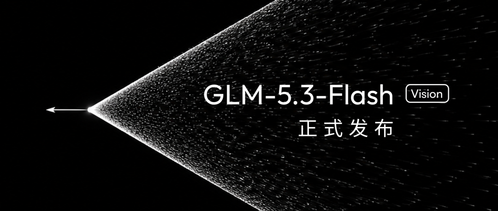
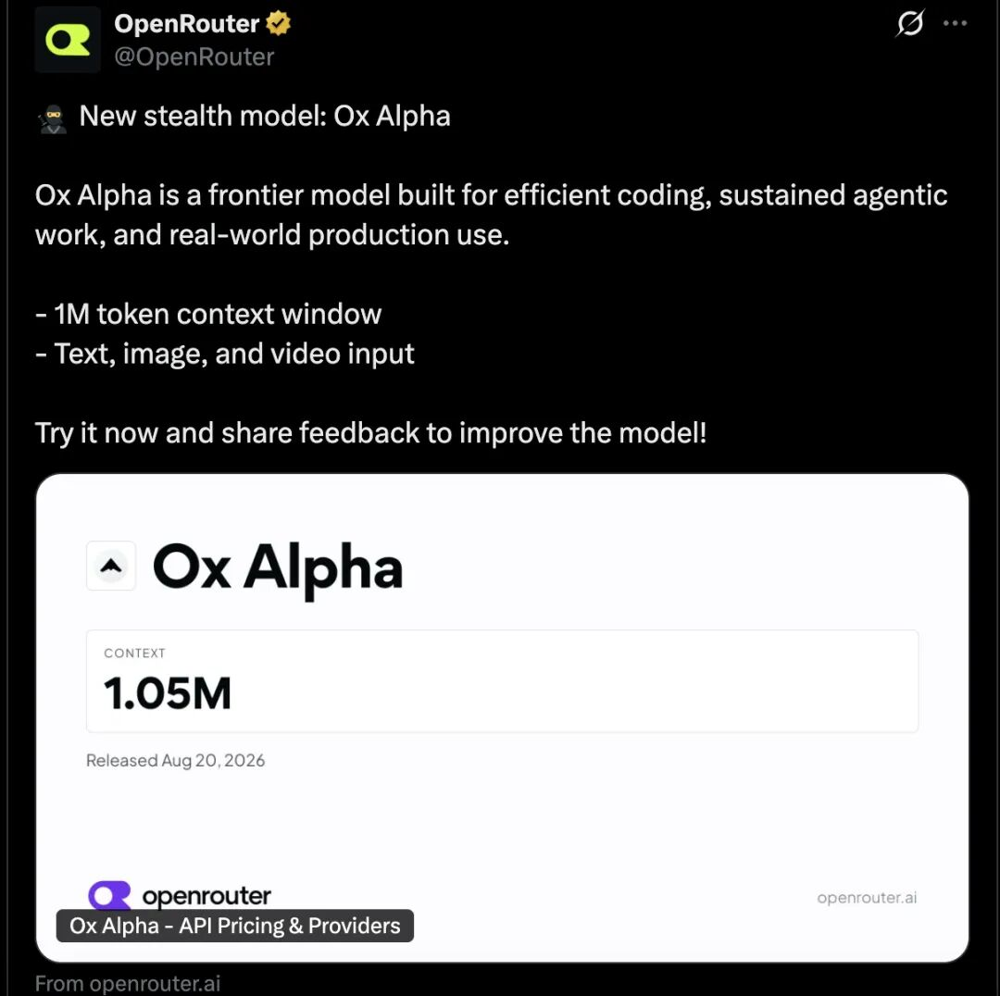
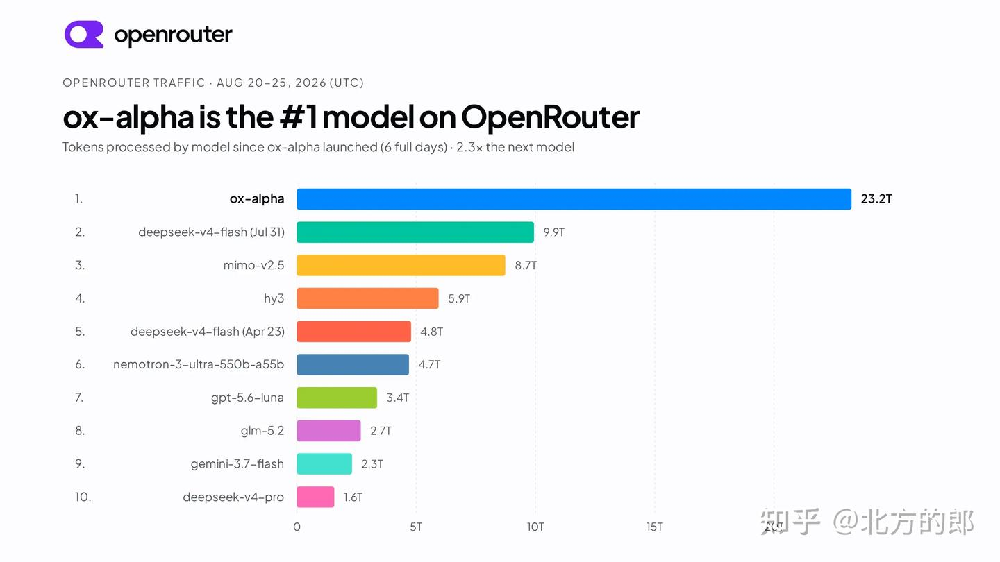
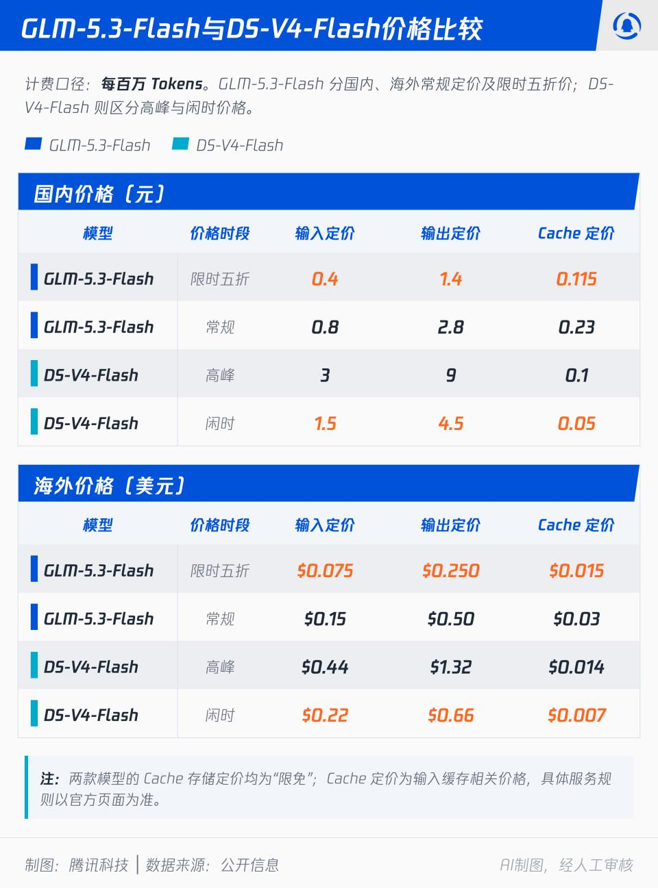
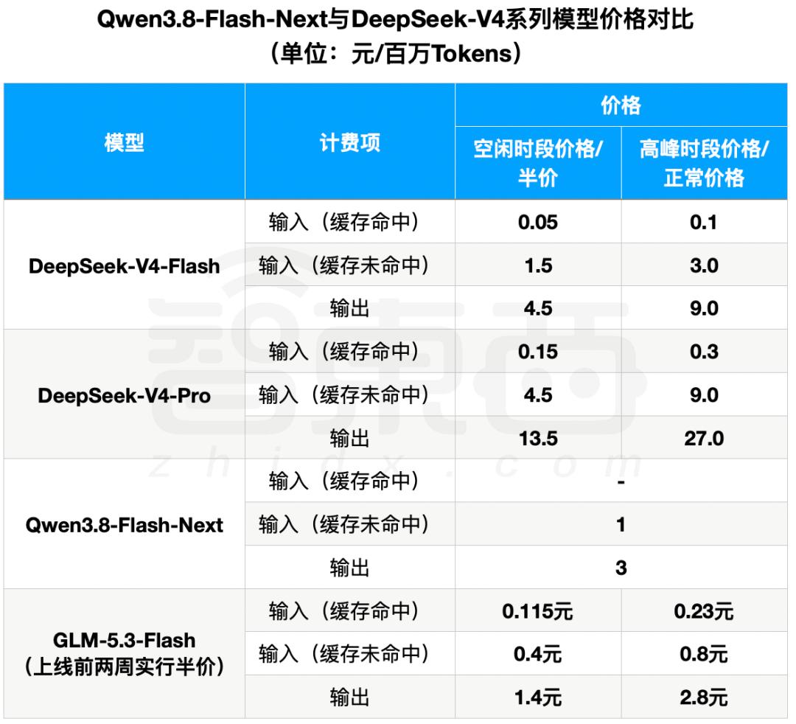

8 月 26 日，智谱（Z.ai）正式发布并开源了 GLM-5.3-Flash——GLM-5 系列的首个原生多模态模型。有趣的是，在正式亮相之前，它已经以一个神秘的代号「牛来」（ox-alpha）在社区里免费刷屏了一周。这篇文章就把整件事的来龙去脉捋一遍：它从哪来、实力如何、架构上有什么新东西、怎么用、以及怎么白嫖。



## 一、从「牛来」免费测试说起

事情要从一个匿名模型说起。前段时间，OpenCode 和 OpenRouter 上出现了一个名为 `stealth/ox-alpha` 的神秘模型，**限时免费**开放测试，支持 1M 上下文、原生多模态。社区给它起了个亲切的外号——「牛来」，取自 "Ox is Coming" 的谐音梗。



这个「牛来」到底是谁？大家纷纷下场实测与推理：

- 有人根据分词器特征、视频 Token 消耗模式这些「指纹」，推断它出自智谱的 GLM 系列；
- 虎嗅实测了 10 道 DeepSWE 任务，通过率 80%，推理能力直逼 GLM-5.3；
- 还有细心的人发现，匿名测试期间的推理负载居然跑在**国产 AI 芯片**上。

免费 + 强劲的实力，让「牛来」迅速成为当周最受欢迎的模型，创下双平台调用量新高——上线仅 6 天就登顶 OpenRouter 流量榜，处理的 token 数是第二名的 2.3 倍：



谜底在 8 月 26 日揭晓：智谱正式「认领」了这个模型——「牛来」就是 GLM-5.3-Flash。这种「先匿名免费实测、再正式发布开源」的打法，既攒足了社区口碑，也顺带完成了一轮真实环境下的大规模压力测试。

## 二、综合实力排名如何

单看纸面参数可能没感觉，直接看成绩单更直观：

- **综合实力**：在 Artificial Analysis 综合智能指数中取得 **57 分**，进入全球前沿模型能力区间，与 Claude Opus 4.8 得分持平，官方 Z.ai Code Bench 的编程体感也与其相当；
- **代际提升**：全面超越参数量高出一倍的 GLM-5.2，而定价只有它的 1/10；
- **工具使用与自动化**：Toolathlon-Verified 拿到 78.40、AutomationBench 拿到 48.80，两项智能体基准均在参与对比的模型中排名第一；
- **多模态理解**：MMVU 80.50、Chartography 78、CharXiv RQ 89.40，图表与视频类理解任务表现突出；
- **工程能力**：Terminal-Bench 2.1 拿到 84.30，DeepSWE 63.40，Agentic Coding 场景能直接观察界面渲染结果并迭代改进；
- **与旗舰的差距**：多数工程类基准与 GLM-5.3 差距在 4 分以内，HLE（55.3 对 62.5）差距最大——考虑到成本差距，这个交换非常划算。

## 三、参数与架构：320B-A18B 的混合注意力

GLM-5.3-Flash 的核心规格：

| 项目       | 规格                      |
| ---------- | ------------------------- |
| 总参数量   | 320B（3200 亿）           |
| 激活参数量 | 18B（180 亿）             |
| 层数       | 45 层                     |
| 上下文长度 | 1M Token（最大输出 128K） |
| 预训练数据 | 约 30T 多模态 tokens      |
| 开源协议   | MIT License，可免费商用   |

架构上是这次最有意思的部分。它是**首个采用稀疏注意力与线性注意力混合架构的开源前沿模型**：

- **线性注意力**通过递归捕获局部依赖，**稀疏注意力**借助轻量级索引器召回全局上下文，两者分工协作；
- 引入 **mHC（流形约束超连接）** 提升模型的 scaling 能力；
- **IndexPool** 通过加权池化把索引器的 4 个缓存向量压缩为 1 个，显著降低 1M 长上下文下的时延与内存开销。

效果是实打实的：相比 GLM-5.3，注意力计算量降低约 **3 倍**，KV Cache 降低约 **4.4 倍**。另外要注意，它不是 GLM-5.3 的蒸馏版，而是在 30T 多模态语料上重新训练的基础模型。

## 四、如何使用

**在线体验**：访问 [Z.ai Chat](https://chat.z.ai/) 或 [智谱清言](https://chatglm.cn/) 即可直接对话试用；想把它当编程助手，则可以在 [ZCode](https://zcode.z.ai/cn) 等编程工具中调用。

**API 调用**：模型 ID 为 `glm-5.3-flash`，兼容 OpenAI 风格接口：

```ts file=glm-5.3-flash-api.ts
const response = await fetch("https://api.z.ai/api/paas/v4/chat/completions", {
  method: "POST",
  headers: {
    "Content-Type": "application/json",
    Authorization: `Bearer ${process.env.ZAI_API_KEY}`,
  },
  body: JSON.stringify({
    model: "glm-5.3-flash",
    messages: [{ role: "user", content: "用一句话介绍你自己" }],
    // 官方推荐参数
    temperature: 1,
    top_p: 0.95,
    reasoning_effort: "max",
    stream: true,
  }),
});
```

几个使用上的要点：

- **思考模式不可关闭**，建议 `thinking.clear_thinking=false`，并开启 `stream` 与 `tool_stream`；
- `reasoning_effort` 支持 `low / high / max` 三档，追求效果推荐 `max`；
- **价格**：国内标准价输入 0.8 元 / 输出 2.8 元（每百万 tokens），缓存命中输入 0.23 元；发布期（至 2026-09-09）全线 5 折，只要 0.4 元 / 1.4 元；海外标准价 $0.15 / $0.50，缓存命中 $0.03。按官方口径，定价约为 GLM-5.3 的 1/10，限时五折后约为其 1/20、Claude Opus 4.8 的 1/40，同级能力里基本是「普惠」水平；
- **GLM Coding Plan 用户**：切换到该模型后，同档套餐可用额度是 GLM-5.3 的 **3 倍**；计费按时段算系数——高峰时段（工作日 14:00–18:00）按 1.2 倍消耗，其余时间（含周末全天）只按 **0.4 倍**消耗。

和主要竞品 DeepSeek-V4-Flash 摆在一起看更直观（左侧为 GLM-5.3-Flash 的限时五折与常规价）：



放在 Qwen、DeepSeek 全系阵列里对比，GLM-5.3-Flash 的半价档也依然是最低的一档：



**本地部署**：模型权重已开源，支持 SGLang、vLLM、KTransformers 等推理框架：

- GitHub：[zai-org/GLM-5](https://github.com/zai-org/GLM-5)
- Hugging Face：[zai-org/GLM-5.3-Flash](https://huggingface.co/zai-org/GLM-5.3-Flash)

不过 FP8 权重约 328GB、62 个分片，普通消费级显卡就别想了，更适合有集群资源的团队。

## 五、体验卡领取

如果你暂时不想付费，有个官方福利可以薅：**新用户可免费领取 7 天体验卡**，每日限量 10,000 张。同时，现有套餐用户账号内的体验卡数量也已重置。

领取方式很简单：

1. 访问 [BigModel 开放平台](https://bigmodel.cn/) 并注册登录；
2. 进入 [GLM Coding Plan 体验卡活动页](https://bigmodel.cn/activity/trial-card/PU9MTWG0PM)，点击「领取体验卡」（每日限量，建议尽早）；
3. 领取后即可在 API 调用和 ZCode 等产品中直接使用，额度可在「用量统计」中查看。

再加上 GLM-5.3-Flash 本身的低价和 Coding Plan 的 3 倍额度加成，普通开发者几乎可以零成本把前沿模型用起来。

## 写在最后

从「牛来」匿名免费测试制造悬念，到正式发布即开源（MIT 协议）、低价 API、体验卡福利，GLM-5.3-Flash 这一波把「前沿智能进入普惠时代」的口号落得相当扎实。320B-A18B 的混合注意力架构证明了长上下文的成本可以被工程手段压下来，而国产芯片承载全球测试流量这件事，或许比榜单名次更值得记住。

> 参考：
>
> - [智谱官方博客：GLM-5.3-Flash](https://z.ai/blog/glm-5.3-flash)
> - [智谱 AI 开放文档：GLM-5.3-Flash](https://docs.bigmodel.cn/cn/guide/models/vlm/glm-5.3-flash)
> - [36氪：神秘「牛来」大模型刷屏，限时免费](https://m.36kr.com/p/3950567958199687)
> - [Datalearner：GLM-5.3-Flash 模型卡](https://www.datalearner.com/ai-models/pretrained-models/glm-5-3-flash)
> - [智谱发布 GLM-5.3-Flash（AIHub）](https://www.aihub.cn/news/glm-5-3-flash-released/)
