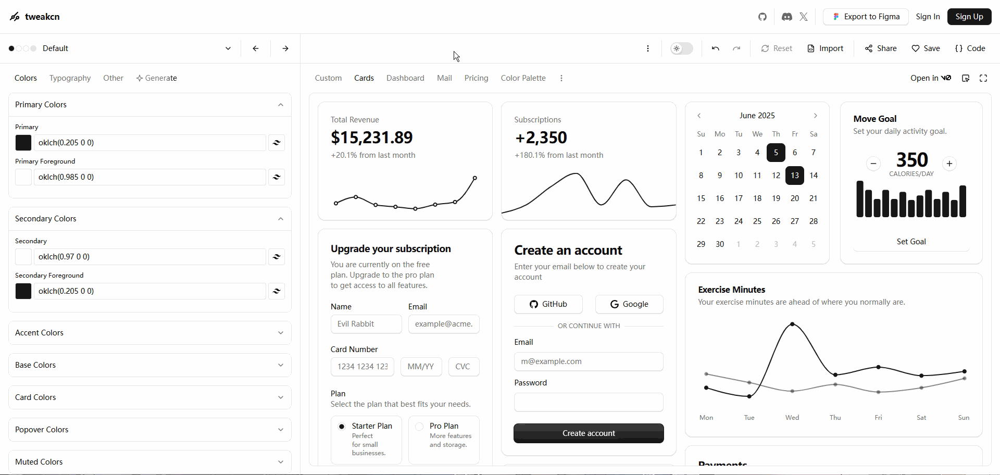
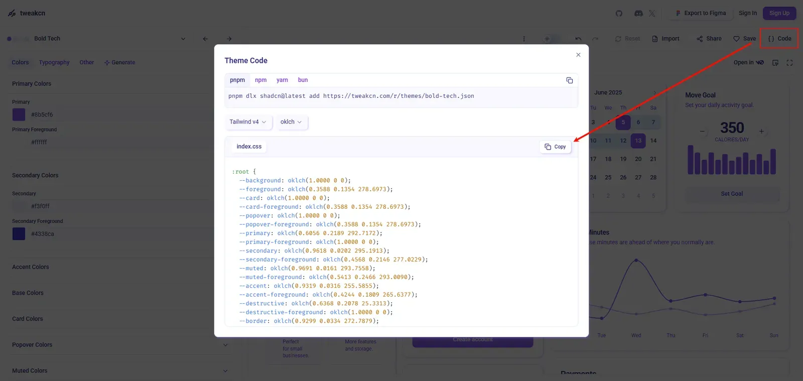
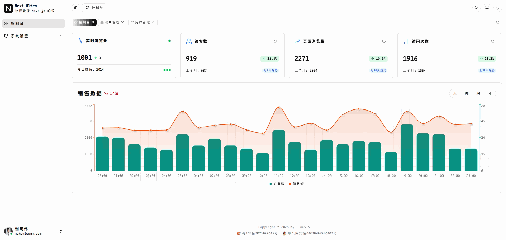

## 前言

**Hi，大家好，我是白雾茫茫丶！**

你是否厌倦了千篇一律的网站配色？想让你的 Next.js 应用拥有像 Figma 那样灵活的主题切换能力？在当今追求个性化和用户体验的时代，单一的配色方案早已无法满足用户多样化的审美需求。无论是适配品牌形象、响应节日氛围，还是提供用户自定义选项，动态主题色切换已成为现代 Web 应用的重要特性。

本文将带你深入探索如何在 Next.js 应用中实现专业级的主题色切换系统。我们将利用 Shadcn UI 的设计系统架构，结合 CSS 自定义属性（CSS Variables）的强大能力，打造一个不仅支持多套预设配色方案，还能保持代码优雅和性能高效的主题切换方案。无论你是想为用户提供“蓝色商务”、“绿色生态”还是“紫色创意”等不同视觉主题，这篇文章都将为你提供完整的实现路径。

告别单调，迎接多彩——让我们一起构建让用户眼前一亮的动态主题系统！

## 开发思路

我的实现思路主要基于 CSS 自定义属性（CSS Variables）。每套主题配色对应一组预定义的变量值，以独立的类型（或类名）标识。在切换主题时，只需为 `<html>` 根元素动态添加对应的类型类名，即可通过 CSS 变量的作用域机制，全局应用相应的配色方案，从而高效、无缝地完成主题切换。

## 主题构建工具

当然，要高效地实现基于 CSS 变量的动态主题系统，离不开一个强大的主题构建工具来生成和管理不同配色方案。在这里，我强烈推荐一款专为 shadcn/ui 打造的主题编辑与生成工具：[Design Your Perfect shadcn/ui Theme](https://tweakcn.com/)

TweakCN 不仅界面简洁直观，更深度集成了 shadcn/ui 的设计规范，支持实时预览、一键导出 Tailwind CSS 配置及 CSS 变量定义。你可以自由调整主色、辅助色、语义色（如成功、警告、错误等），并自动生成适配深色/浅色模式的完整配色方案。更重要的是，它输出的代码可直接用于 Next.js 项目，配合 CSS 变量策略，轻松实现主题切换——无需手动计算颜色值或反复调试样式，极大提升了开发效率与设计一致性。对于希望快速定制品牌化 UI 风格的开发者来说，TweakCN 无疑是一个强大而贴心的助手。

## 定义多套配色方案

1、在[主题编辑页面](https://tweakcn.com/editor/theme)，TweakCN 默认提供了 43 套精心设计的配色方案。你可以逐一浏览并实时预览每种方案在实际 UI 组件中的呈现效果。从中挑选几套符合项目风格或个人审美的配色，也可以基于现有方案进一步微调主色、辅助色或语义色，打造完全属于你自己的定制化主题。



2、在确认主题配色后，点击右上角的 `{} Code` 按钮，点击 `Copy` 复制样式：



3、新建一个 `theme.css` 文件，用来保存不同的主题配色：

```css
:root {
  --background: oklch(1 0 0);
  --foreground: oklch(0.145 0 0);
  --card: oklch(1 0 0);
  --card-foreground: oklch(0.145 0 0);
  --popover: oklch(1 0 0);
  --popover-foreground: oklch(0.145 0 0);
  --primary: oklch(0.205 0 0);
  --primary-foreground: oklch(0.985 0 0);
  --secondary: oklch(0.97 0 0);
  --secondary-foreground: oklch(0.205 0 0);
  --muted: oklch(0.97 0 0);
  --muted-foreground: oklch(0.556 0 0);
  --accent: oklch(0.97 0 0);
  --accent-foreground: oklch(0.205 0 0);
  --destructive: oklch(0.577 0.245 27.325);
  --destructive-foreground: oklch(1 0 0);
  --border: oklch(0.922 0 0);
  --input: oklch(0.922 0 0);
  --ring: oklch(0.708 0 0);
  --chart-1: oklch(0.646 0.222 41.116);
  --chart-2: oklch(0.6 0.118 184.704);
  --chart-3: oklch(0.398 0.07 227.392);
  --chart-4: oklch(0.828 0.189 84.429);
  --chart-5: oklch(0.769 0.188 70.08);
  --sidebar: oklch(0.985 0 0);
  --sidebar-foreground: oklch(0.145 0 0);
  --sidebar-primary: oklch(0.205 0 0);
  --sidebar-primary-foreground: oklch(0.985 0 0);
  --sidebar-accent: oklch(92.2% 0 0);
  --sidebar-accent-foreground: oklch(0.205 0 0);
  --sidebar-border: oklch(0.922 0 0);
  --sidebar-ring: oklch(0.708 0 0);
  --font-sans:
    ui-sans-serif, system-ui, -apple-system, BlinkMacSystemFont, "Segoe UI",
    Roboto, "Helvetica Neue", Arial, "Noto Sans", sans-serif,
    "Apple Color Emoji", "Segoe UI Emoji", "Segoe UI Symbol", "Noto Color Emoji";
  --font-serif: ui-serif, Georgia, Cambria, "Times New Roman", Times, serif;
  --font-mono:
    ui-monospace, SFMono-Regular, Menlo, Monaco, Consolas, "Liberation Mono",
    "Courier New", monospace;
  --radius: 0.625rem;
  --shadow-x: 0;
  --shadow-y: 1px;
  --shadow-blur: 3px;
  --shadow-spread: 0px;
  --shadow-opacity: 0.1;
  --shadow-color: oklch(0 0 0);
  --shadow-2xs: 0 1px 3px 0px hsl(0 0% 0% / 0.05);
  --shadow-xs: 0 1px 3px 0px hsl(0 0% 0% / 0.05);
  --shadow-sm:
    0 1px 3px 0px hsl(0 0% 0% / 0.1), 0 1px 2px -1px hsl(0 0% 0% / 0.1);
  --shadow: 0 1px 3px 0px hsl(0 0% 0% / 0.1), 0 1px 2px -1px hsl(0 0% 0% / 0.1);
  --shadow-md:
    0 1px 3px 0px hsl(0 0% 0% / 0.1), 0 2px 4px -1px hsl(0 0% 0% / 0.1);
  --shadow-lg:
    0 1px 3px 0px hsl(0 0% 0% / 0.1), 0 4px 6px -1px hsl(0 0% 0% / 0.1);
  --shadow-xl:
    0 1px 3px 0px hsl(0 0% 0% / 0.1), 0 8px 10px -1px hsl(0 0% 0% / 0.1);
  --shadow-2xl: 0 1px 3px 0px hsl(0 0% 0% / 0.25);
  --tracking-normal: 0em;
  --spacing: 0.25rem;
}

.dark {
  --background: oklch(0.145 0 0);
  --foreground: oklch(0.985 0 0);
  --card: oklch(0.205 0 0);
  --card-foreground: oklch(0.985 0 0);
  --popover: oklch(0.269 0 0);
  --popover-foreground: oklch(0.985 0 0);
  --primary: oklch(0.922 0 0);
  --primary-foreground: oklch(0.205 0 0);
  --secondary: oklch(0.269 0 0);
  --secondary-foreground: oklch(0.985 0 0);
  --muted: oklch(0.269 0 0);
  --muted-foreground: oklch(0.708 0 0);
  --accent: oklch(0.371 0 0);
  --accent-foreground: oklch(0.985 0 0);
  --destructive: oklch(0.704 0.191 22.216);
  --destructive-foreground: oklch(0.985 0 0);
  --border: oklch(0.275 0 0);
  --input: oklch(0.325 0 0);
  --ring: oklch(0.556 0 0);
  --chart-1: oklch(0.488 0.243 264.376);
  --chart-2: oklch(0.696 0.17 162.48);
  --chart-3: oklch(0.769 0.188 70.08);
  --chart-4: oklch(0.627 0.265 303.9);
  --chart-5: oklch(0.645 0.246 16.439);
  --sidebar: oklch(0.205 0 0);
  --sidebar-foreground: oklch(0.985 0 0);
  --sidebar-primary: oklch(0.488 0.243 264.376);
  --sidebar-primary-foreground: oklch(0.985 0 0);
  --sidebar-accent: oklch(0.269 0 0);
  --sidebar-accent-foreground: oklch(0.985 0 0);
  --sidebar-border: oklch(0.275 0 0);
  --sidebar-ring: oklch(0.439 0 0);
  --font-sans:
    ui-sans-serif, system-ui, -apple-system, BlinkMacSystemFont, "Segoe UI",
    Roboto, "Helvetica Neue", Arial, "Noto Sans", sans-serif,
    "Apple Color Emoji", "Segoe UI Emoji", "Segoe UI Symbol", "Noto Color Emoji";
  --font-serif: ui-serif, Georgia, Cambria, "Times New Roman", Times, serif;
  --font-mono:
    ui-monospace, SFMono-Regular, Menlo, Monaco, Consolas, "Liberation Mono",
    "Courier New", monospace;
  --radius: 0.625rem;
  --shadow-x: 0;
  --shadow-y: 1px;
  --shadow-blur: 3px;
  --shadow-spread: 0px;
  --shadow-opacity: 0.1;
  --shadow-color: oklch(0 0 0);
  --shadow-2xs: 0 1px 3px 0px hsl(0 0% 0% / 0.05);
  --shadow-xs: 0 1px 3px 0px hsl(0 0% 0% / 0.05);
  --shadow-sm:
    0 1px 3px 0px hsl(0 0% 0% / 0.1), 0 1px 2px -1px hsl(0 0% 0% / 0.1);
  --shadow: 0 1px 3px 0px hsl(0 0% 0% / 0.1), 0 1px 2px -1px hsl(0 0% 0% / 0.1);
  --shadow-md:
    0 1px 3px 0px hsl(0 0% 0% / 0.1), 0 2px 4px -1px hsl(0 0% 0% / 0.1);
  --shadow-lg:
    0 1px 3px 0px hsl(0 0% 0% / 0.1), 0 4px 6px -1px hsl(0 0% 0% / 0.1);
  --shadow-xl:
    0 1px 3px 0px hsl(0 0% 0% / 0.1), 0 8px 10px -1px hsl(0 0% 0% / 0.1);
  --shadow-2xl: 0 1px 3px 0px hsl(0 0% 0% / 0.25);
}
```

4、这样我们就默认一个主题，如果是多套配色，我们可以加上主题类名区分，例如：

```css
/* Amber Minimal */
:root.theme-amber-minimal {
}
.dark.theme-amber-minimal {
}

/* Amethyst Haze */
:root.theme-amethyst-haze {
}
.dark.theme-amethyst-haze {
}
```

5、然后把 `theme.css` 导入到全局样式中，Next.js 项目一般是 `global.css` ：

```css
@import "./themes.css";
```

到这里，我们的准备工作就算完成了，接下来我们就完成主题色的切换逻辑！

## 具体实现

1、这里我们需要用到 `zustand` 来保存主题色的状态：

```bash
pnpm add zustand
```

2、创建主题配色枚举：

```ts
/**
 * @description: 主题色
 */
export const THEME_PRIMARY_COLOR = Enum({
  DEFAULT: { value: "default", label: "Default", color: "oklch(0.205 0 0)" },
  AMBER_MINIMAL: {
    value: "amber-minimal",
    label: "Amber",
    color: "oklch(0.7686 0.1647 70.0804)",
  },
  AMETHYST_HAZE: {
    value: "amethyst-haze",
    label: "Amethyst",
    color: "oklch(0.6104 0.0767 299.7335)",
  },
  CANDYLAND: {
    value: "candyland",
    label: "Candyland",
    color: "oklch(0.8677 0.0735 7.0855)",
  },
  DARKMATTER: {
    value: "darkmatter",
    label: "Darkmatter",
    color: "oklch(0.6716 0.1368 48.5130)",
  },
  ELEGANT_LUXURY: {
    value: "elegant-luxury",
    label: "Elegant",
    color: "oklch(0.4650 0.1470 24.9381)",
  },
  SAGE_GARDEN: {
    value: "sage-garden",
    label: "Garden",
    color: "oklch(0.6333 0.0309 154.9039)",
  },
  SUPABASE: {
    value: "supabase",
    label: "Supabase",
    color: "oklch(0.8348 0.1302 160.9080)",
  },
  TWITTER: {
    value: "twitter",
    label: "Twitter",
    color: "oklch(0.6723 0.1606 244.9955)",
  },
});
```

3、新建 `store/useAppStore.ts` 文件：

```ts
"use client";
import { create } from "zustand";
import { createJSONStorage, persist } from "zustand/middleware";

import { THEME_PRIMARY_COLOR } from "@/enums";
import { initializePrimaryColor } from "@/lib/utils";

type AppState = {
  primaryColor: typeof THEME_PRIMARY_COLOR.valueType; // 主题色
  setPrimaryColor: (color: typeof THEME_PRIMARY_COLOR.valueType) => void; // 设置主题色
};

export const useAppStore = create(
  persist<AppState>(
    set => ({
      primaryColor: THEME_PRIMARY_COLOR.DEFAULT, // 默认主题色
      setPrimaryColor: color => {
        set({ primaryColor: color });
        initializePrimaryColor(color);
      },
    }),
    {
      name: "app-theme", // 用于存储在 localStorage 中的键名
      storage: createJSONStorage(() => localStorage), // 指定使用 localStorage 存储
    }
  )
);
```

4、创建主题色初始化函数：

```ts
/**
 * @description: 初始化主题色
 * @param {typeof} color
 */
export const initializePrimaryColor = (
  color: typeof THEME_PRIMARY_COLOR.valueType
) => {
  if (typeof document !== "undefined") {
    // 清空 theme- 开头的类名
    const html = document.documentElement;
    Array.from(html.classList)
      .filter(className => className.startsWith("theme-"))
      .forEach(className => {
        html.classList.remove(className);
      });
    // 如果不是默认主题色，则添加对应的类名
    if (color !== THEME_PRIMARY_COLOR.DEFAULT) {
      html.classList.add(`theme-${color}`);
    }
  }
};
```

5、创建主题切换按钮：

```tsx
import { type FC, useCallback } from "react";

import { getClipKeyframes } from "@/components/animate-ui/primitives/effects/theme-toggler";
import { Button } from "@/components/ui";
import { THEME_PRIMARY_COLOR } from "@/enums";
import { useAppStore } from "@/store/useAppStore";

const PrimaryColorPicker: FC = () => {
  const primaryColor = useAppStore(s => s.primaryColor);
  const setPrimaryColor = useAppStore(s => s.setPrimaryColor);
  const themeModeDirection = useAppStore(s => s.themeModeDirection);

  const [fromClip, toClip] = getClipKeyframes(themeModeDirection);

  // 点击颜色切换
  const onChangeColor = useCallback(
    async (color: typeof THEME_PRIMARY_COLOR.valueType) => {
      if (primaryColor === color) {
        return;
      }
      if (!document.startViewTransition) {
        setPrimaryColor(color);
        return;
      }
      await document.startViewTransition(async () => {
        setPrimaryColor(color);
      }).ready;
      document.documentElement.animate(
        { clipPath: [fromClip, toClip] },
        {
          duration: 700,
          easing: "ease-in-out",
          pseudoElement: "::view-transition-new(root)",
        }
      );
    },
    [primaryColor, setPrimaryColor, fromClip, toClip]
  );
  return (
    <>
      <div className="grid grid-cols-3 gap-2">
        {THEME_PRIMARY_COLOR.items.map(({ value, label, raw }) => (
          <Button
            size="sm"
            aria-label="PrimaryColorPicker"
            variant={primaryColor === value ? "secondary" : "outline"}
            key={value}
            className="justify-start text-xs"
            onClick={() => onChangeColor(value)}
          >
            <span
              className="inline-block size-2 rounded-full"
              style={{ backgroundColor: raw.color }}
            />
            {label}
          </Button>
        ))}
      </div>
      <style>{`::view-transition-old(root), ::view-transition-new(root){animation:none;mix-blend-mode:normal;}`}</style>
    </>
  );
};
export default PrimaryColorPicker;
```

这里我加了切换过渡动画，不需要的可以自行去掉！

6、页面刷新的时候需要同步，在 `Provider.tsx` 中初始化：

```tsx
import { initializePrimaryColor } from "@/lib/utils";
const primaryColor = useAppStore(s => s.primaryColor);

// 初始化主题色
useEffect(() => {
  if (primaryColor) {
    initializePrimaryColor(primaryColor);
  }
}, [primaryColor]);
```

## 效果预览



## 总结

实现动态主题配色的方式多种多样——从 CSS-in-JS、Tailwind 的 class 切换，到运行时注入样式表等，各有优劣。本文分享的是基于 **CSS 自定义属性（CSS Variables）** 与 **HTML 根元素类名切换** 的轻量级方案，配合 TweakCN 这样的可视化工具，能够快速构建出结构清晰、易于维护的主题系统。当然，这仅是我个人在项目中的一种实践思路，如果你有更优雅、更高效的实现方式，欢迎在评论区留言交流！技术因分享而进步，期待看到你的创意方案 🌈。
