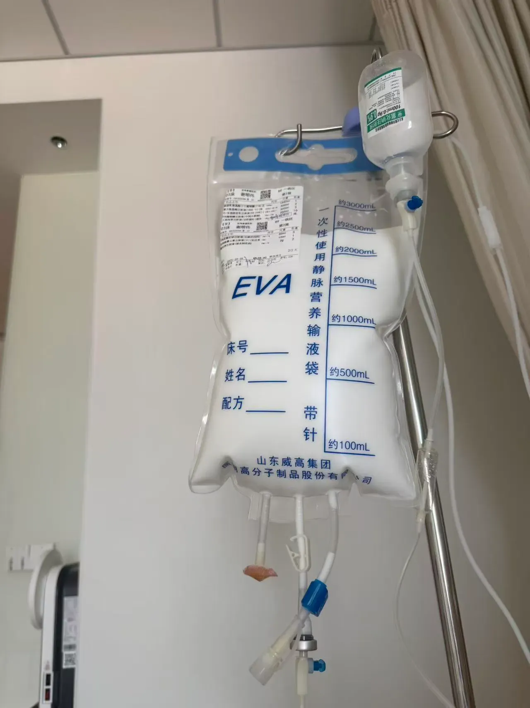
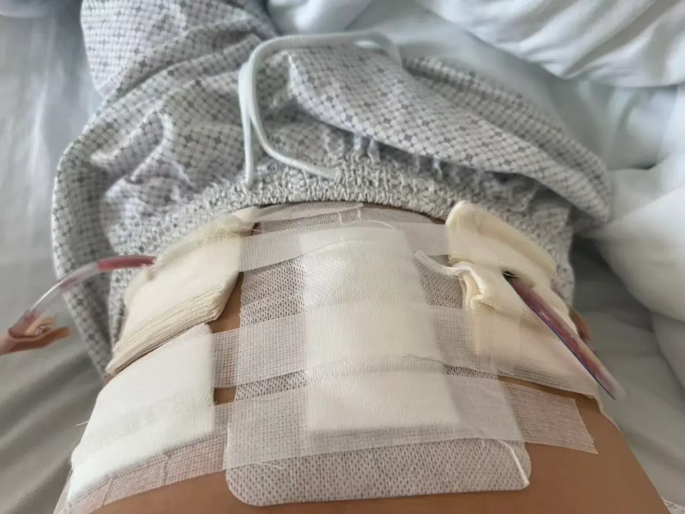

## 前言

**Hi，大家好，我是白雾茫茫丶！**

又到了写年度总结的时候了。每到这时，总忍不住感慨时间飞快。一年来，日子仿佛在上班、下班、睡觉之间循环往复，像一段设定好的轨迹，日复一日。有时觉得，自己好像一台运转不停的机器，在重复的节奏里，渐渐模糊了生活的质感与温度。

今天，我想从几个方面，好好回顾一下这一年。

## 生活

今年，我的生活发生了不小的变化，最主要的原因是——我生病了。很长一段时间，我都在往返医院的路上，在治疗和恢复之间反复辗转。

由于缺乏医疗常识，我在求医路上走了不少弯路。起初自己也没有足够重视，导致耽误了近半年的治疗时间，直到今年六月中旬，才到三甲医院进行全面检查。所幸检查结果很快出来了：“克罗恩病”。

这是一种我之前从未听过的慢性炎症性肠病，患者通常伴随体重下降、腹痛腹泻等症状。而我的情况比较严重，还存在肠狭窄和肠瘘。在医生的建议下，我先接受了三个月的生物制剂（类克）治疗，计划等炎症消退后再进行手术。

九月复查时，情况并不乐观——肠道炎症并未明显好转。由于药物已难以控制病情，医生建议尽快手术。于是在国庆后，我住院接受了《高难度克罗恩病复杂腹腔镜手术》，这是人生中第一次经历手术，心里难免有些没底。

经过充分的术前准备，10月13日我进入了手术室。手术持续了大约三个小时，术后情况稳定。我在医院住了半个月，直到十月底才出院。

术后肠道功能代偿期间，出现了大便次数增多、不成型等症状，一开始确实不太适应。经过一个多月的调理，肠道功能逐渐恢复，体重也增加了十斤，饮食基本恢复正常——终于不用再整天依赖“营养粉”了。

这场病让我改变了许多想法。健康的时候总觉得一切理所当然，生病后才真正体会到“能吃能喝能睡”的珍贵。身体健康才是根本，其余都是浮云。

p]:my-0 [&>p>img]:my-0">

记录一下住院期间每天打的“三升袋”和伤口！

## 感情

自己也到了该成家的年纪。在传统观念里，结婚生子是人生必经的旅程，父母眼中，唯有成家才算“走对了路”。仿佛不结婚，就成了某种异类。

可时代早已不同。父辈那一代，两个人靠真心与努力，携手共建家庭。这十年经济飞速发展，生活条件好了，生活成本却也一路攀升。婚姻如今带给男性的压力是巨大的——房、车、彩礼、三金、婚宴，样样不能少，各种琐碎开支也往往落在男方肩上。经济上的负担不说，结一场婚，常常需要掏空三代积蓄，再背上几十年的贷款。婚后生活，一眼望去，仿佛只剩下重复的还贷与奔波。

更沉重的是，婚后还必须持续保持高收入能力。一旦失业，可能面临家庭破碎、房产被拍卖的绝境。光是想想，就觉得窒息。

不得不说，当下的婚恋观在某些方面已渐趋畸形。资本不断灌输着不切实际的期待，让不少女性逐渐脱离了普通人的生活现实，转而追求身高180、颜值出众、经济优越、情感包容的完美伴侣，并期待在婚姻中只需“貌美如花”。可普通的打工男性，又有几个能真正符合这些标准？更别说还要在婚后数十年保持稳定高收入——光是设想，已让人却步。

如果遇到对的人，婚姻自然仍是美好的选择。但如果遇不到，或许认真工作、好好赚钱、善待自己，也是一种踏实而清醒的活法。

## 工作

目前这份工作，我算是比较满意的。朝九晚六，有半小时弹性，周末双休。领导也没什么架子，氛围相对轻松。工作之余还能摸摸鱼，偶尔更新自己的博客，或者学学新技术栈，整体感觉挺好的。

我的直属领导平时远程办公，小组里只有我和另一位女同事。任务一般通过钉钉安排，只要按时完成就行。因为能力还算够用，任务通常能较快做完，也就多出一些时间做点自己想做的事——这样的节奏，确实让人舒服。

当初找工作的时候，我主动降低了一点薪资预期，目标很明确：就要周末双休、基本不加班。在我看来，能规律上下班、拥有属于自己的生活，远不是那些996节奏可比的。钱可以少挣一些，但工作的压力，不能太大。

## 总结

就这样吧，围绕这几点聊到这里。

如今我最大的愿望，就是身体能尽快恢复到从前的状态。健健康康、快快乐乐的，做喜欢的事，吃想吃的食物。努力存点钱，买一辆心仪的车，去想去的地方走走。把日子过得舒舒服服、自自在在的——只有这样，才真正有底气去考虑婚姻，去规划未来的生活。

差点忘了，今天是平安夜。衷心祝愿大家一生平安，身体健康，无病无灾。

最后，还是想再提醒一句：**身体健康，才是这一切的根本。其余种种，不过是锦上添花。**
