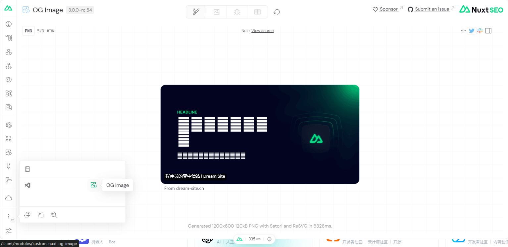

## 添加 favicon 图标和 TDK（标题、描述、关键词）

1.  **nuxt.config.ts** 添加配置：

```ts
export default defineNuxtConfig({
  app: {
    title: "Better Nav",
    meta: [
      { name: "keywords", content: "Nuxt.js,导航,网站" },
      { name: "description", content: "致力于打造程序员的梦中情站" },
    ],
    link: [{ rel: "icon", type: "image/x-icon", href: "favicon.ico" }],
    style: [],
    script: [],
    noscript: [],
  },
});
```

2.  使用 [useHead](https://nuxt.com.cn/docs/getting-started/seo-meta#usehead)

```vue
<script setup lang="ts">
useHead({
  title: "Better Nav",
  link: [{ rel: "icon", type: "image/x-icon", href: "favicon.ico" }],
  meta: [
    { name: "keywords", content: "Nuxt.js,导航,网站" },
    { name: "description", content: "致力于打造程序员的梦中情站" },
  ],
});
</script>
```

3.  使用 [useSeoMeta](https://nuxt.com.cn/docs/getting-started/seo-meta#useseometa) 组合函数

```vue
<script setup lang="ts">
useSeoMeta({
  title: "Better Nav",
  ogTitle: "Better Nav",
  description: "致力于打造程序员的梦中情站",
  ogDescription: "致力于打造程序员的梦中情站",
  ogImage: "https://example.com/image.png",
  twitterCard: "summary_large_image",
});
</script>
```

4.  **/pages/** 目录中可以使用 **definePageMeta** 来根据当前路由设置元数据

```vue
<script setup lang="ts">
definePageMeta({
  title: "Better Nav",
});
</script>
```

5.  动态标题

```vue
<script setup lang="ts">
useHead({
  // 作为字符串，
  // 其中`%s`会被标题替换
  titleTemplate: "%s - Better Nav",
  // ... 或者作为一个函数
  titleTemplate: productCategory => {
    return productCategory ? `${productCategory} - Better Nav` : "Better Nav";
  },
});
</script>
```

官方文档：[SEO和Meta](https://nuxt.com.cn/docs/getting-started/seo-meta)

## 安装 @nuxtjs/seo 模块

我们需要安装 [@nuxtjs/seo](https://nuxt.com.cn/modules/seo) 插件，[@nuxtjs/seo](https://nuxt.com.cn/modules/seo) 是一个模块集合，它覆盖了搜索引擎中常用的模块：

- [@nuxtjs/sitemap](https://github.com/nuxt-modules/sitemap)：网站地图

- [nuxt-simple-robots](https://github.com/harlan-zw/nuxt-simple-robots)：蜘蛛爬虫协议

- [nuxt-schema-org](https://github.com/harlan-zw/nuxt-schema-org)：网页标准

- [nuxt-seo-experiments](https://github.com/harlan-zw/nuxt-seo-experiments)：实验性 SEO 元特征

- [nuxt-og-image](https://github.com/nuxt-modules/og-image)：生成动态的社交分享图片

- [nuxt-link-checker](https://github.com/harlan-zw/nuxt-link-checker)：检查失效链接

具体使用方式：

1.  [@nuxtjs/seo](https://nuxt.com.cn/modules/seo) 插件：

```bash
npx nuxi@latest module add seo
```

2.  **nuxt.config.ts** 中根据实际情况添加配置：

```ts
export default defineNuxtConfig({
  // SEO 配置
  site: {
    url: "https://dream-site.cn",
    name: "Better Nav",
    description: "致力于打造程序员的梦中情站",
    defaultLocale: "zh-cn",
    exclude: ["/admin/_components/**"], // 过滤不需要的 url
    cacheMaxAgeSeconds: 24 * 3600, // 缓存时间一天
    autoLastmod: true, // 自动检测每个 URL 的 lastmod 日期
  },
  routeRules: {
    // Don't add any /secret/** URLs to the sitemap.xml
    "/admin/_components/**": { robots: false },
  },
});
```

现在你就能打开 [sitemap.xml](https://nav.baiwumm.com/sitemap.xml) 和 [robots.txt](https://nav.baiwumm.com/robots.txt) 了，其他更加详细的配置可以参考官方文档：[nuxt-seo](https://nuxtseo.com/)

## Robots

1.  禁用网站索引

```ts
export default defineNuxtConfig({
  site: { indexable: false },
});
```

2.  禁用页面索引

```vue
<script lang="ts" setup>
defineRouteRules({
  robots: false,
});
</script>
```

3.  如果需要更精细的编程控制，可以使用 **nuxt.config.ts** 配置该模块

```ts
export default defineNuxtConfig({
  robots: {
    disallow: ["/secret", "/admin"],
  },
});
```

更加详细的配置可以参考官方文档：[Robots](https://nuxtseo.com/robots)

## Sitemap

1.  禁用 **URL** 模式的索引

```ts
export default defineNuxtConfig({
  routeRules: {
    // Don't add any /secret/** URLs to the sitemap.xml
    "/secret/**": { robots: false },
  },
});
```

2.  对于所有其他情况，您可以使用 **include** 和 **exclude** 模块选项来过滤 **url**

```ts
export default defineNuxtConfig({
  sitemap: {
    // exclude all URLs that start with /secret
    exclude: ["/secret/**"],
    // include all URLs that start with /public
    include: ["/public/**"],
  },
});
```

3.  设置 **Lastmod**、**changefreq**、**priority**

```vue
<script setup>
useSeoMeta({
  // will be inferred as the lastmod value in the sitemap
  articleModifiedTime: "2023-01-01",
});

defineRouteRules({
  sitemap: {
    changefreq: "daily",
    priority: 0.3,
  },
});
</script>
```

4.  缓存时间

```ts
export default defineNuxtConfig({
  sitemap: {
    cacheMaxAgeSeconds: 3600, // 1 hour
  },
});
```

5.  自定义样式

```ts
export default defineNuxtConfig({
  sitemap: {
    xslColumns: [
      { label: "URL", width: "50%" },
      { label: "Last Modified", select: "sitemap:lastmod", width: "25%" },
      { label: "Priority", select: "sitemap:priority", width: "12.5%" },
      {
        label: "Change Frequency",
        select: "sitemap:changefreq",
        width: "12.5%",
      },
    ],
  },
});
```

更加详细的配置可以参考官方文档：[Sitemap](https://nuxtseo.com/sitemap)

## OG Image

1.  使用可组合 **defineOgImageComponent** 来定义主页的 **og:image**

```vue
<script lang="ts" setup>
defineOgImageComponent("NuxtSeo");
</script>
```

2.  在浏览器中访问主页并打开 [Nuxt DevTools](https://devtools.nuxt.com/) (**Shift** + **Alt** + **D**)



3.  自定义模板

```vue
<script lang="ts" setup>
defineOgImageComponent("NuxtSeo", {
  title: "Hello OG Image 👋",
  description: "Look what at me in dark mode",
  theme: "#ff0000",
  colorMode: "dark",
});
</script>
```

更加详细的配置可以参考官方文档：[OG Image](https://nuxtseo.com/og-image)

## Schema.org

1.  配置默认值

```vue
<script lang="ts" setup>
useSchemaOrg([
  defineWebPage({
    name: "My Page",
  }),
  defineWebSite({
    name: "My Site",
  }),
]);
</script>
```

2.  如果你不想使用默认值

```ts
export default defineNuxtConfig({
  schemaOrg: {
    default: false,
  },
});
```

3.  设置身份类型

```ts
export default defineNuxtConfig({
  schemaOrg: {
    identity: {
      type: "Organization", // or 'Person'
      name: "My Company",
      url: "https://example.com",
      logo: "https://example.com/logo.png",
    },
  },
});
```

4.  自定义节点

```vue
<script lang="ts" setup>
useSchemaOrg([
  {
    "@type": "DefinedTerm",
    name: "Nuxt Schema.org",
    description:
      "Nuxt Schema.org is a Nuxt module for adding Schema.org to your Nuxt app.",
    inDefinedTermSet: {
      "@type": "DefinedTermSet",
      name: "Nuxt Modules",
    },
  },
]);
</script>
```

更加详细的配置可以参考官方文档：[Schema.org](https://nuxtseo.com/schema-org)

## 添加 Google Analytics 统计代码

1.  安装 [nuxt-gtag](https://nuxt.com.cn/modules/gtag)

```bash
npx nuxi@latest module add gtag
```

2.  **nuxt.config.ts** 添加配置：

```ts
export default defineNuxtConfig({
  modules: ["nuxt-gtag"],

  gtag: {
    id: "G-XXXXXXXXXX",
  },
});
```

3.  或者在环境变量中添加 **NUXT\_PUBLIC\_GTAG\_ID** ：

```text
NUXT_PUBLIC_GTAG_ID = G-XXXXXXXXXX
```

## 添加 Microsoft Clarity 统计代码

1.  安装 [nuxt-clarity-analytics](https://nuxt.com.cn/modules/clarity-analytics)

```bash
pnpm add -D nuxt-clarity-analytics
```

2.  **nuxt.config.ts** 添加依赖：

```ts
export default defineNuxtConfig({
  modules: ["nuxt-clarity-analytics"],
});
```

3.  在环境变量中添加：

```text
MICROSOFT_CLARITY_ID = 'clarity ID'
```

## 添加 Umami 统计代码

1.  安装 [nuxt-umami](https://nuxt.com.cn/modules/umami)

```bash
pnpm add nuxt-umami
```

2.  **nuxt.config.ts** 添加配置：

```ts
defineNuxtConfig({
  extends: ["github:ijkml/nuxt-umami"],
});
```

3.  **app.config.ts** 添加配置：

```ts
export default defineAppConfig({
  umami: {
    id: "95653e90-7b8b-4541-b6de-ea5e544d8c2d",
    host: "https://umami.baiwumm.com",
    useDirective: true,
    version: 2,
    domains: ["dream-site.cn"],
    ignoreLocalhost: true,
  },
});
```

4.  跟踪事件

```html
<button v-umami="'Event-Name'">Event Button</button>

<button v-umami="{name: 'Event-Name'}">as object</button>

<button v-umami="{name: 'Event-Name', position: 'left', ...others}">
  with event details
</button>
```

详细文档：[nuxt-umami](https://github.com/ijkml/nuxt-umami)

## 总结

[Nuxt3](https://nuxt.com/) 集成了很多 [SEO Modules](https://nuxt.com.cn/modules?category=SEO)，使开发者能够更加高效便捷地做好搜索引擎方面的优化。

好了，这篇文章就到这了，希望对你有所帮助！
