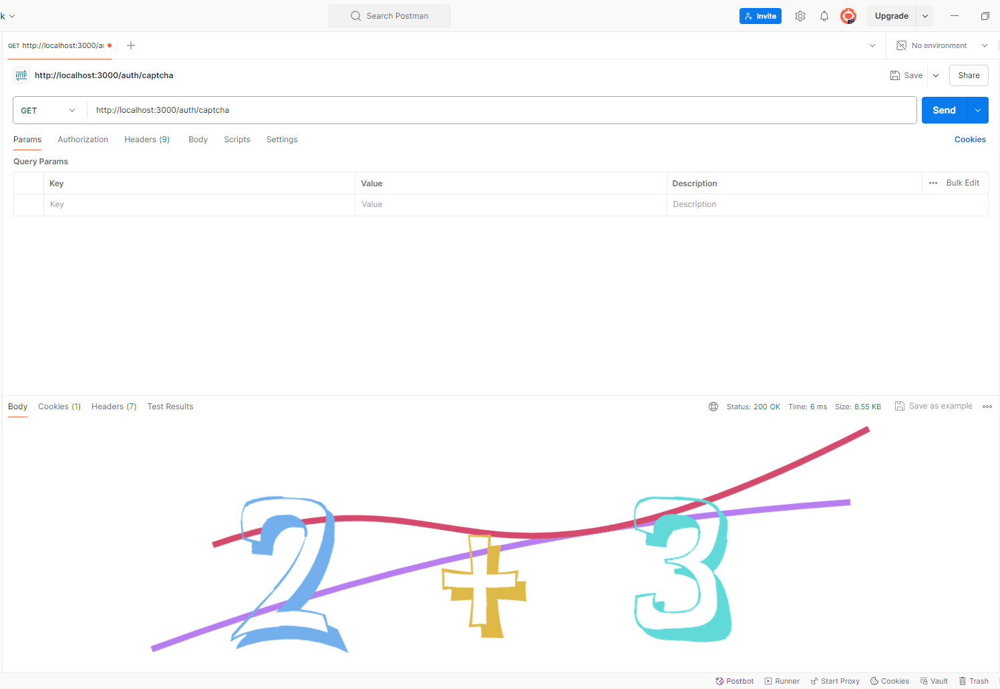

## 具体步骤

1.  安装依赖

```bash
pnpm add svg-captcha
```

2.  在控制器中使用

```ts
import { Controller, Get, Res, Session } from "@nestjs/common";
import { ApiOkResponse, ApiOperation, ApiTags } from "@nestjs/swagger"; // swagger 接口文档
import { Response } from "express";
import svgCaptcha from "svg-captcha";

import { VerifyCodeResponseDto } from "./dto/response-auth.dto";

@ApiTags("身份鉴权")
@Controller("auth")
export class AuthController {
  /**
   * @description: 获取图形验证码
   */
  @Get("captcha") //当请求该接口时，返回一张随机图片验证码
  @ApiOkResponse({ type: VerifyCodeResponseDto })
  @ApiOperation({ summary: "获取图形验证码" })
  async getCaptcha(
    @Session() session: Api.Common.SessionInfo,
    @Res() res: Response
  ) {
    const captcha = svgCaptcha.createMathExpr({
      //可配置返回的图片信息
      size: 4, // 验证码长度
      ignoreChars: "0oO1ilI", // 验证码字符中排除 0oO1ilI
      noise: 2, // 干扰线条的数量
      width: 132,
      height: 40,
      fontSize: 50,
      color: true, // 验证码的字符是否有颜色，默认没有，如果设定了背景，则默认有
      background: "#fff",
    });
    session.captchaCode = captcha.text; //使用session保存验证，用于登陆时验证
    res.type("image/svg+xml"); //指定返回的类型
    return res.send(captcha.data); //给页面返回一张图片
  }
}
```

更多详细文档：

::link-card[https://github.com/produck/svg-captcha]

## Session 验证

在客户端登录的时候，我们就能根据传过来的验证码与 **Session** 中的信息判断是否正确：

```ts
/**
  * @description: 用户登录
  */
 async login(params: LoginParamsDto, session: Api.Common.SessionInfo) {
    // 获取验证码
   const { captchaCode } = params;
   // 判断验证码
   if (captchaCode.toUpperCase() !== session.captchaCode.toUpperCase()) {
     return responseMessage(null, '验证码错误', -1);
   }

   // 验证成功，返回 token
   return responseMessage(tokens);
 }
```

## 效果演示


