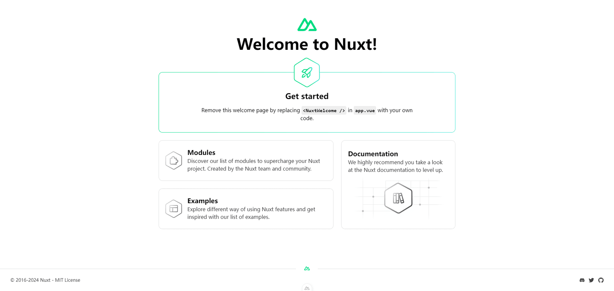
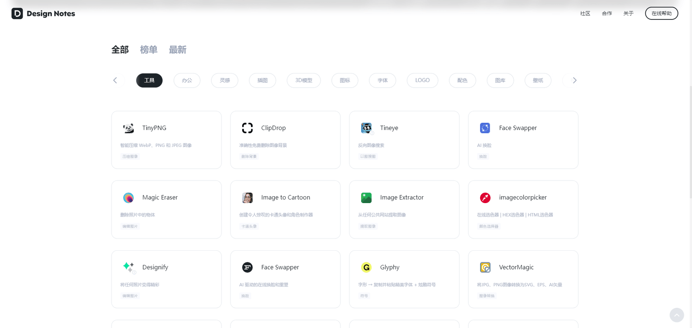

## 什么是 Nuxt

[Nuxt](https://nuxt.com/) 是一个建立在 **Vue.js** 上的服务器端渲染框架。它抽象出了管理异步数据、中间件和路由所涉及的大部分复杂配置。它还有助于使用行业标准架构来构造 **Vue.js** 应用程序，以构建简单或企业级的 **Vue.js** 应用程序。

## Nuxt3 的优点

-   **基于 Vue3 的优势**：**Nuxt3** 充分利用了 **Vue3** 的所有优点，包括性能优化、响应式编程和更好的 **TypeScript** 支持。**Vue3** 的 **Composition API** 使得代码更加灵活和可复用，为大型项目提供了更好的组织和管理方式。
    
-   **服务端渲染（SSR）和静态站点生成（SSG）**：**Nuxt3** 支持服务端渲染和静态站点生成，这有助于解决单页应用（SPA）中的 **SEO** 问题，提高页面加载速度，从而改善用户体验。
    
-   **模块化**：**Nuxt3** 具有丰富的模块化生态系统，使得开发者能够轻松地扩展应用的功能，减少开发工作量。通过模块化的方式，开发者可以更加高效地组织和管理代码，提高开发效率。
    
-   **文件系统路由**：**Nuxt3** 的文件系统路由允许开发者通过简单的文件和目录结构来组织应用路由，使得开发过程更加简洁明了。这有助于减少配置工作量，提高开发效率。
    
-   **开箱即用**：**Nuxt3** 提供了许多开箱即用的功能，如状态管理、中间件、页面过渡动画等，使得开发过程更加简单和高效。这些功能可以帮助开发者快速构建出功能完善的 **Web** 应用程序。
    
-   **性能优化**：**Nuxt3** 通过使用最新的 **Web** 技术和优化技巧，提供了更好的性能和更快的加载速度。无论是服务端渲染还是静态站点生成，**Nuxt3** 都能帮助开发者提高应用的性能表现。
    
-   **灵活的配置和插件系统**：**Nuxt3** 提供了更灵活的配置选项和插件系统，使得开发者能够根据自己的需求进行定制和优化。这使得 **Nuxt3** 具有很高的可扩展性和灵活性，能够满足各种复杂的开发需求。
    

## 环境要求

-   **Node.js**: 确保使用偶数版本号（18、20 等）
    
-   **Nuxtr**: 安装社区开发的 [Nuxtr 扩展](https://marketplace.visualstudio.com/items?itemName=Nuxtr.nuxtr-vscode)
    
-   **Volar**：启用 [接管模式: TakeOver Mode](https://vuejs.org/guide/typescript/overview.html#volar-takeover-mode)（推荐）或添加 [TypeScript Vue 插件](https://marketplace.visualstudio.com/items?itemname=vue.vscode-typescript-vue-plugin)
    

## 项目安装

1.  打开一个终端（如果你使用的是 [Visual Studio Code](https://code.visualstudio.com/)，你可以打开一个[集成终端](https://code.visualstudio.com/docs/editor/integrated-terminal)） 并使用以下命令创建一个新的入门项目：
```bash
pnpm dlx nuxi@latest init <project-name>
```


2.  打开项目文件夹：
```bash
code <project-name>
```


3.  安装依赖项：
```text
# 在运行 pnpm install 之前，确保你在 `.npmrc` 中有 `shamefully-hoist=true`
pnpm install
```


4.  现在您将能够在开发模式下启动您的 **Nuxt** 应用程序：
```bash
pnpm dev -o
```


> 上面步骤完成之后！ [http://localhost:3000](http://localhost:3000) 的浏览器窗口应该会自动打开。



## 目录结构
```text
📁 .nuxt // Nuxt在开发中使用.nuxt/目录来生成你的Vue应用程序。
📁 .output // 当构建你的应用程序用于生产时，Nuxt 会创建 .output/ 目录。
📁 assets // 用于添加所有将由构建工具处理的网站资产。
📁 components // 放置所有 Vue 组件的地方。
📁 composables // 将你的Vue组合式函数自动导入到你的应用程序中。
📁 content // 为你的应用创建一个基于文件的内容管理系统（CMS）。
📁 layouts // Nuxt 提供了一个布局框架，用于将常见的 UI 模式提取为可重用的布局。
📁 middleware // Nuxt 提供了中间件来在导航到特定路由之前运行代码。
📁 modules // 在应用程序中自动注册本地模块。
📁 node_modules // 包管理器会将项目的依赖存储在 node_modules/ 目录中。
📁 pages // Nuxt 提供了基于文件的路由功能，用于在你的 Web 应用中创建路由。
📁 plugins // Nuxt拥有一个插件系统，可以在创建Vue应用程序时使用Vue插件和其他功能。
📁 public // 用于提供网站的静态资源。
📁 server // 用于在应用程序中注册API和服务器处理程序。
📁 utils // 在整个应用程序中自动导入你的工具函数。
📄 .env // 用于指定构建和开发环境变量。
📄 .gitignore // 指定了Git应该忽略的故意未跟踪的文件。
📄 .nuxtignore // 允许 Nuxt 在构建阶段忽略项目根目录下的文件。
📄 app.vue // Nuxt 应用的主要组件，入口文件。
📄 app.config.ts // 使用App Config文件在应用程序中公开响应式配置。
📄 nuxt.config.ts // Nuxt可以通过一个单独的nuxt.config文件进行简单配置。
📄 package.json // 包含了应用程序的所有依赖项和脚本。
📄 tsconfig.json // Nuxt会根据你在Nuxt项目中使用的别名，以及其他合理的默认值，自动生成一个`.nuxt/tsconfig.json`文件。
```


## 总结

后续开发会以 [Nuxt](https://nuxt.com/) 为核心，开发一个类似这样的网址导航页面，为此来探索 [Nuxt](https://nuxt.com/) 其中的奥秘：[Design Notes](https://www.designnotes.cn/)



我会在此基础上加入我的一些设计和想法，致力于提高用户体验。

开发周期可能会有点长，但我会记录在开发中所遇到的问题和解决的办法，后期会使用 [Prisma](https://prisma.yoga/) 数据库存储数据，最终完成一个基于 [Nuxt](https://nuxt.com/) 的全栈项目。
