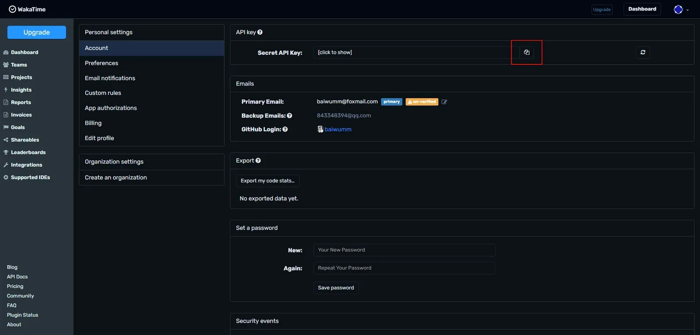
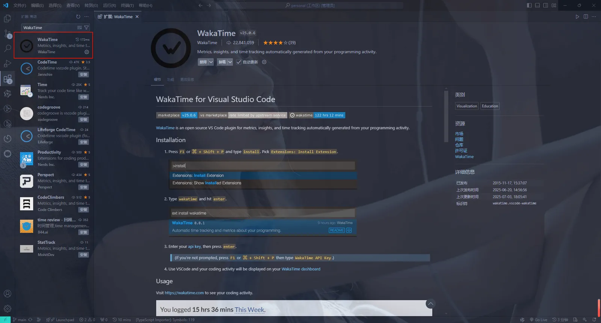
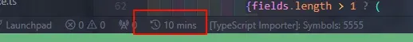
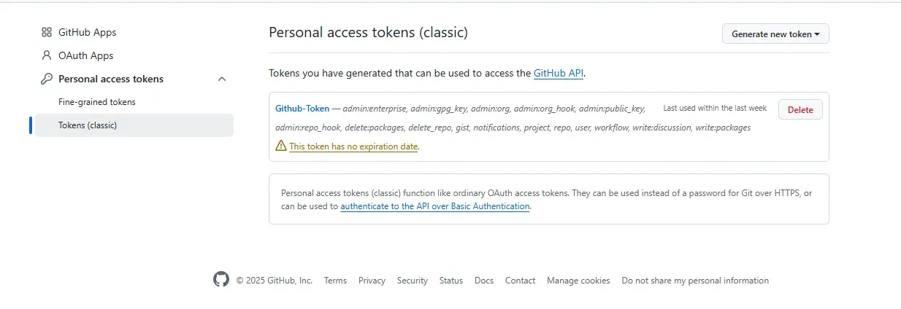
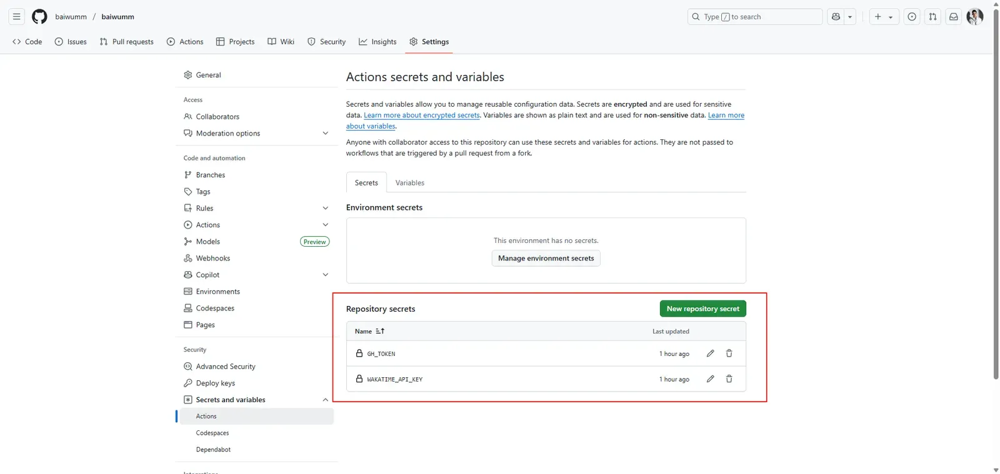
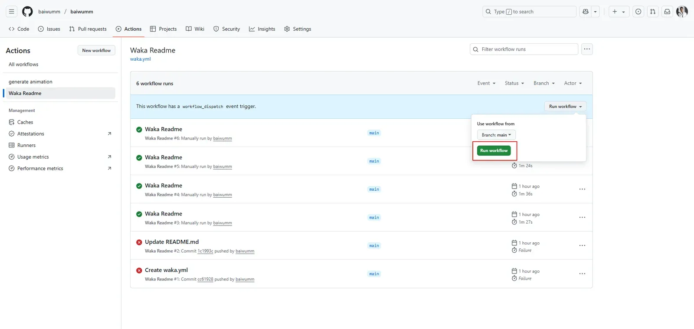
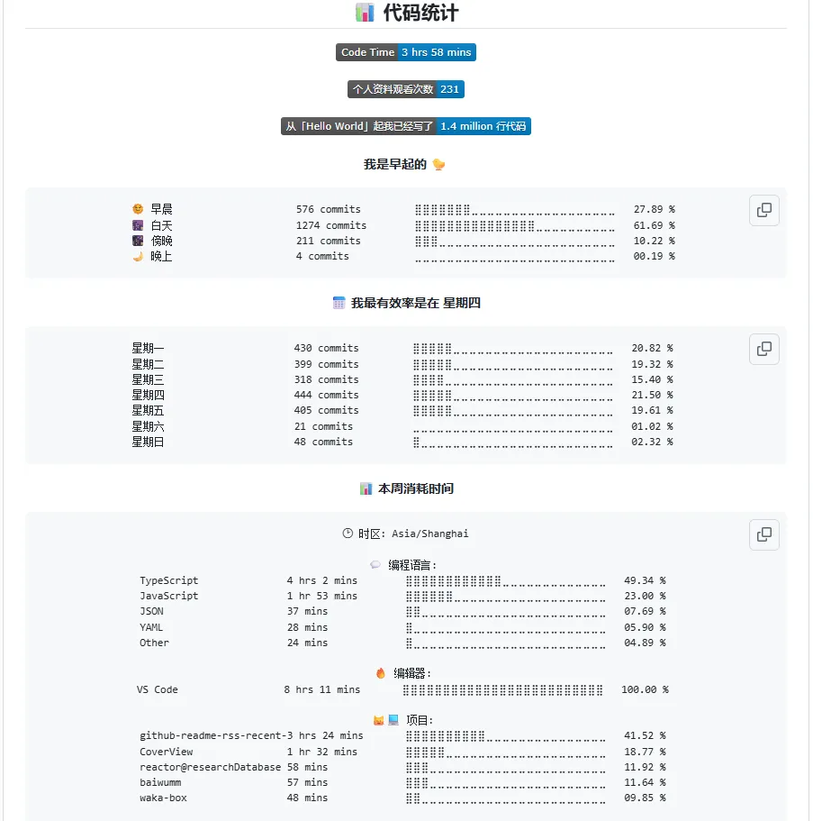

## 📌 为什么要这样做？

- 用动态数据展示你的编码活跃度，让 GitHub 主页更具专业性

- WakaTime 支持 50+ 编程语言的细分统计，比 GitHub 默认统计更全面

- 适合开发者简历/作品集包装

## 🔧 前置准备

1\. 注册 [WakaTime](https://wakatime.com/) 账号

2\. 安装对应IDE插件（VSCode/IntelliJ/PyCharm等）

3\. 确保有一个公开的GitHub仓库（或个人主页`README.md`）

## 🚀 实现步骤

1.  注册登录 `WakaTime` 账号，建议使用 `Github` 登录，点击 `首页` -> `右上角头像settings`\-> `account`\-> `apiKey` ：



2.  在我们日常开发的 `IDE` 上安装，这里以 `VS Code` 为例，应用商店搜索 `WakaTime` ，点击安装



3.  安装成功之后就会弹出输入 `WakaTime Api Key` 的弹窗，复制粘贴回车，然后就能在底部看到时间统计：



4.  回到 `Github` 创建 Token，点击 `头像` - `settings` - `developer settings` - `Personal access tokens` - `Tokens (classic)` ，点击 `Generate new token` ，保存好密钥



5.  创建一个同名仓库，添加令牌：



6.  在你的仓库中创建一个名为 `.github/workflows/waka.yml` 的文件，并添加以下内容：

```yaml
name: Waka Readme

on:
  schedule:
    - cron: "0 0 * * *"
  workflow_dispatch:
jobs:
  update-readme:
    name: Update Readme with Metrics
    runs-on: ubuntu-latest
    steps:
      - uses: anmol098/waka-readme-stats@master
        with:
          WAKATIME_API_KEY: ${{ secrets.WAKATIME_API_KEY }}
          GH_TOKEN: ${{ secrets.GH_TOKEN }}
          LOCALE: zh
          SHOW_LINES_OF_CODE: "True" # 显示截至日期写入的代码行数
          SHOW_LOC_CHART: "False" # 年份不同季度编写的代码行数
          SHOW_SHORT_INFO: "False" # 用户的简短趣闻信息
          SHOW_OS: "True" # 显示系统
          SHOW_PROJECTS: "True" # 显示项目
          SHOW_TOTAL_CODE_TIME: "True" # 显示总编码时间
          SHOW_COMMIT: "True" # 显示提交信息
          SHOW_PROFILE_VIEWS: "True" # 设置为隐藏配置文件视图
          SHOW_DAYS_OF_WEEK: "True" # 一周中不同日期进行的提交
          SHOW_LANGUAGE: "True" # 编码语言
          SHOW_EDITORS: "True" # 编辑器
          SHOW_LANGUAGE_PER_REPO: "True" #
          SYMBOL_VERSION: "2" # 设置为进度条的符
```

7.  在 `README.md` 中添加代码引用占位符：

```html
<!--START_SECTION:waka-->
<!--END_SECTION:waka-->
```

8.  点击 `Actions` ，找到 `waka Readme` ，点击 `run workflow` ：



9.  到这里，所有配置就已经完成， `GitHub Actions` 会在每天00:00点执行并将该段代码替换为 WakaTime 的统计数据

## ⚡ 预览


