## 前言

作为一名前端开发者，了解浏览器的渲染原理是我们的必修课，如果你对这块知识还一头雾水，建议认真看下这篇文章，应该会让你一知半解的状态变得清晰，先看下我之前的文章：[浏览器进程与线程：从进程模型到事件循环](/posts/rsebseyx/)

## 浏览器是如何渲染页面的

当浏览器的网络线程收到 **HTML** 文档后，会产生一个渲染任务，并将其传递给渲染主线程的消息队列。

在事件循环机制的作用下，渲染主线程取出消息队列中的渲染任务，开启渲染流程。

整个渲染流程分为多个阶段，分别是：**HTML 解析**、**样式计算**、**布局**、**分层**、**绘制**、**分块**、**光栅化**、**画**

每个阶段都有明确的输入输出，上一个阶段的输出会成为下一个阶段的输入。

这样，整个渲染流程就形成了一套组织严密的生产流水线。

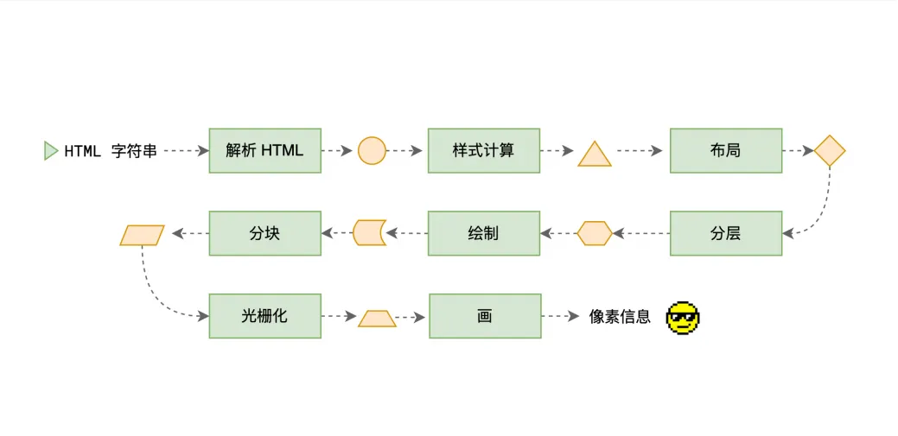

## 解析 HTML - Parse HTML

渲染的第一步是 **解析 HTML**。

解析过程中遇到 **CSS** 解析 **CSS**，遇到 **JS** 执行 **JS**。为了提高解析效率，浏览器在开始解析前，会启动一个预解析的线程，率先下载 **HTML** 中的外部 **CSS** 文件和外部的 **JS** 文件。

如果主线程解析到 **link** 位置，此时外部的 **CSS** 文件还没有下载解析好，主线程不会的等待，继续解析后续的 **HTML**。这是因为下载和解析 **CSS** 的工作是在预解析线程中进行的。这就是 **CSS** 不会阻塞 **HTML** 解析的根本原因。

如果主线程遇到 **script** 位置，会停止解析 **HTML**，转而等待 **JS** 文件下载好，并将全局代码解析执行完成后，才能继续解析 **HTML**。这是因为 **JS** 代码的执行过程可能会修改当前的 **DOM** 树，所以 **DOM** 树的生成必须暂停。这就是 **JS** 会阻塞 **HTML** 解析的根本原因。

第一步完成后，会得到 **DOM** 树和 **CSSOM** 树，浏览器的默认样式、内部样式、外部样式、行内样式均会包含在 **CSSOM** 树中。

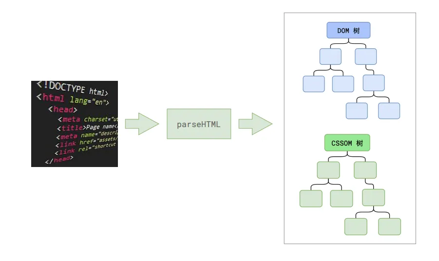

## 样式计算 - Recalculate Style

渲染的下一步是 **样式计算**。

主线程会遍历得到 **DOM** 树，依次为树中的每个节点计算出它最终的样式，称之为 **Computed Style**。

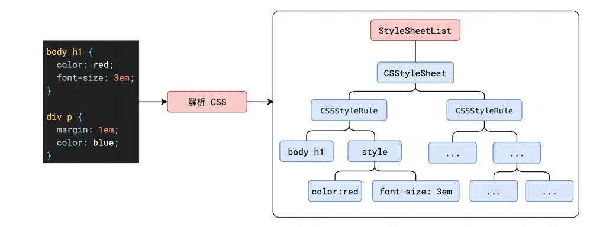

在这一过程中，很多预设值会变成绝对值，比如 **red** 会变成 **rgb(255,0,0)**，相对单位会变成绝对单位，比如 **em** 会变成 **px**。

这一步完成后，会得到一颗带有样式的 **DOM** 树。

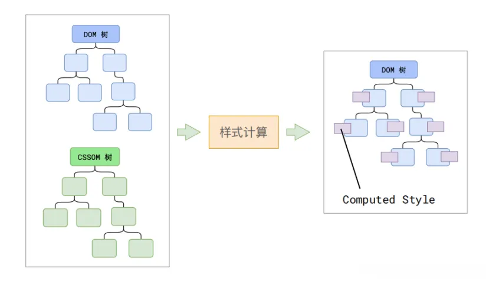

## 布局 - Layout

接下来是 **布局**，布局完成后会得到布局树。

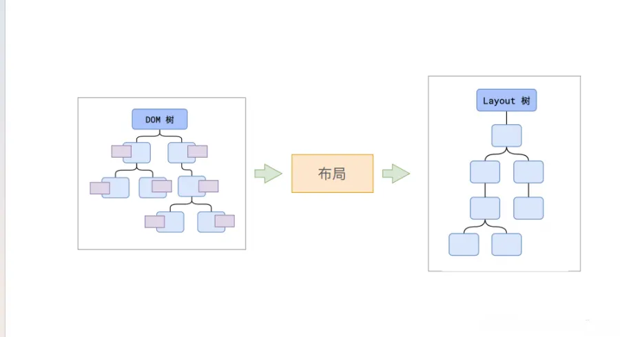

布局阶段会依次遍历 **DOM** 树的每一个节点，计算出每个节点的几何信息，例如节点的宽高、相对包含块的位置。

大部分时候，**DOM** 树和布局树并非一一对应。

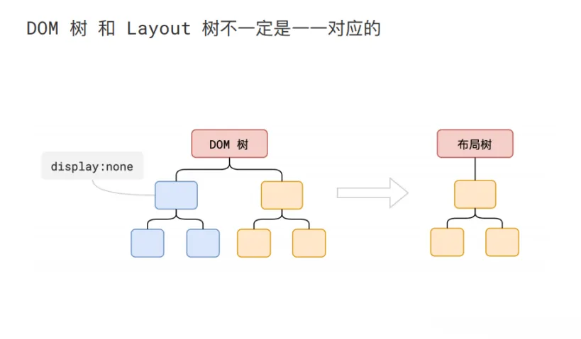

比如 **display:none** 的节点没有几何信息，因此不会生成到布局树；又比如使用了伪元素选择器，虽然 **DOM** 树中不存在这些伪元素节点，但他们拥有几何信息，所以会生成到布局树中。还有匿名行盒、匿名块盒等等都会导致 **DOM** 树和布局树无法一一对应。

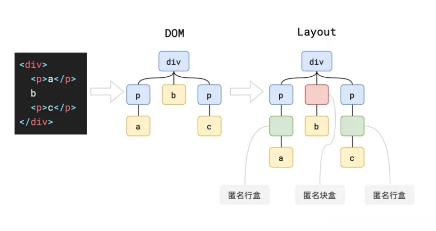

## 分层 - Layer

主线程会使用一套复杂的策略对整个布局树中进行分层。

分层的好处在于，将来某一个层改变后，仅会对该层进行后续处理，从而提升效率。

滚动条、堆叠上下文、transform、opacity 等样式都会或多或少的影响分层结果，也可以通过 **will-change** 属性更大程度的影响分层结果。

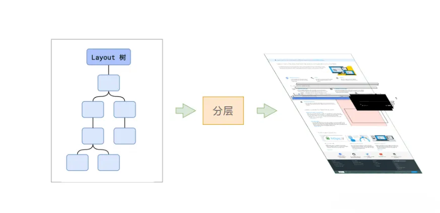

## 绘制 - Paint

再下一步是 **绘制**。

主线程会为每个层单独产生绘制指令集，用于描述这一层的内容该如何画出来。

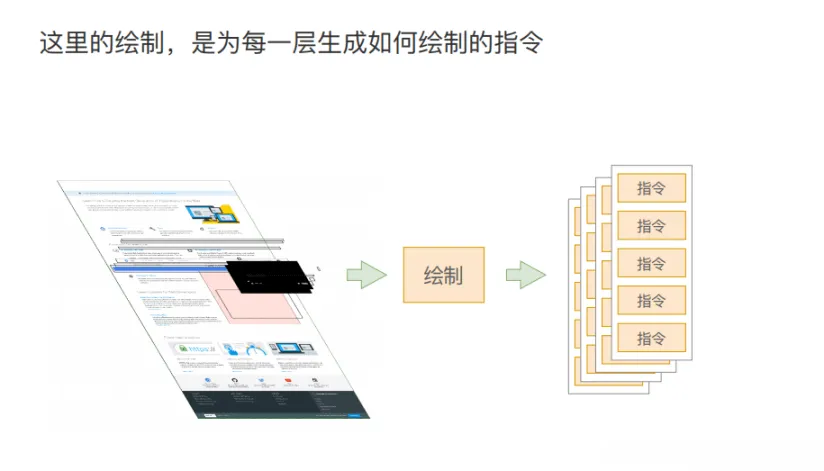

完成绘制后，主线程将每个图层的绘制信息提交给合成线程，剩余工作将由合成线程完成。

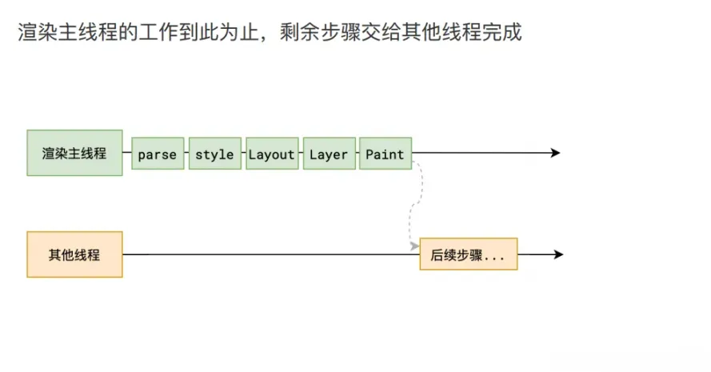

## 分块 - Tiling

合成线程首先对每个图层进行分块，将其划分为更多的小区域。

它会从线程池中拿取多个线程来完成分块工作。

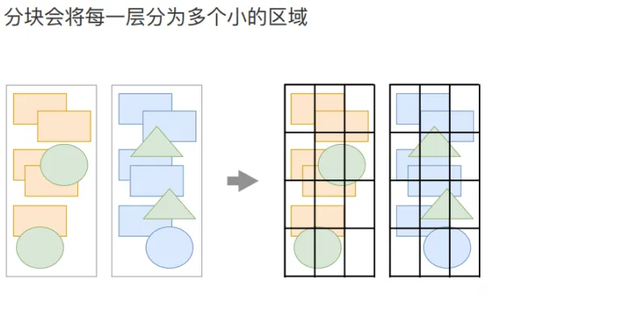

分块工程是交给多个线程同时进行的：

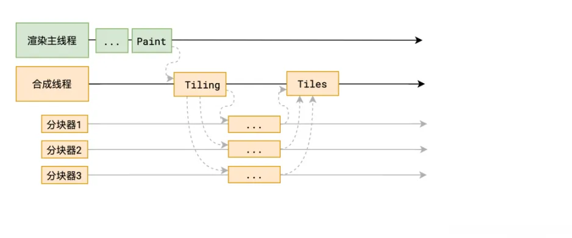

## 光栅化 - Raster

分块完成后，进入光栅化阶段。

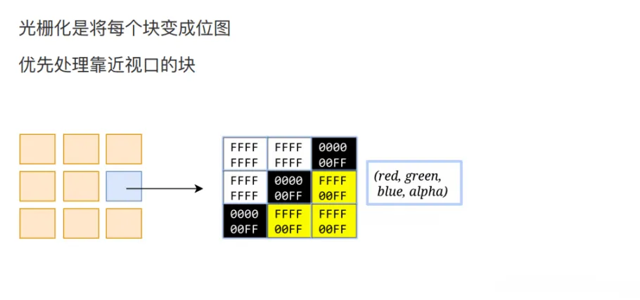

合成线程会将快信息交给 **GPU** 进程，以极高的速度完成光栅化。

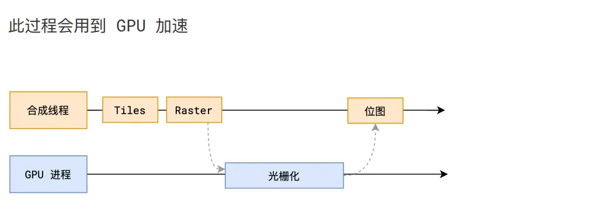

**GPU** 进程会开启多个线程来完成光栅化，并且有限处理靠近视口区域的块。

光栅化的结果，就是一块一块的位图。

## 画

最后一个阶段就是 **画** 了。

合成线程拿到每个层、每个块的位图后，生成一个个 「**指引（quad）**」信息。

指引会标识出每个位图应该画到屏幕的哪个位置，以及会考虑到旋转、缩放等变形。

变形发生在合成线程，与渲染主线程无关，这就是 **transform** 效率高的本质原因。

合成线程会把 **quad** 提交给 **GPU** 进程，由 **GPU** 进程产生系统调用，提交给 **GPU** 硬件，完成最终的屏幕成像。

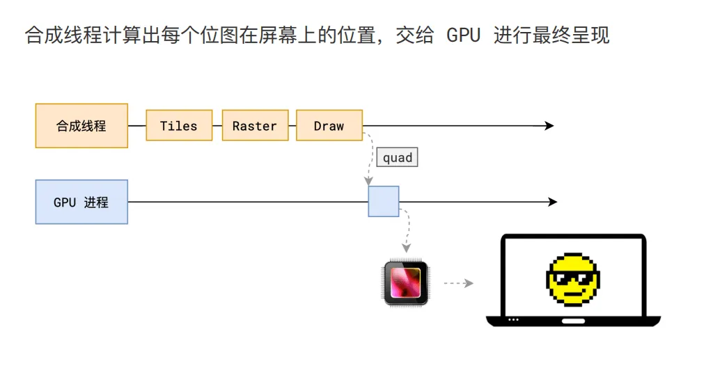

## 重排 - Reflow

**reflow** 的本质就是重新计算 **layout** 树

当进行了会影响布局树的操作后，需要重新计算布局树，会引发 **layout**

为了避免连续的多次操作导致布局树反复计算，浏览器会合并这些操作，当 **JS** 代码全部完成后再进行统一计算。所以，改动属性造成的 **reflow** 是异步完成的。

也同样因为如此，当 **JS** 获取布局属性时，就可能造成无法获取到最新的布局信息。

浏览器在反复权衡下，最终决定获取属性立即 **reflow**。

## 重绘 - Repaint

**repaint** 的本质就是重新计算根据分层信息计算了绘制指令。

当改动了可见样式后，就需要重新计算，会引发 **repaint**。

由于元素的布局信息也属于可见样式，所以 **reflow** 一定会引起 **repaint**。

## 为什么 transform 的效率高？

因为 **transform** 既不会影响布局也不会影响绘制指令，它影响的只是渲染流程的最后一个「**draw**」阶段

由于 **draw** 阶段在合成线程中，所以 **transform** 的变化几乎不会影响渲染主线程。反之，渲染主线程无论如何忙碌，也不会影响 **transform** 的变化。

## 代码演示

我们通过一个小案例了解 **transform** 的效率：

```html
<!DOCTYPE html>
<html lang="en">

<head>
  <meta charset="UTF-8" />
  <meta http-equiv="X-UA-Compatible" content="IE=edge" />
  <meta name="viewport" content="width=device-width, initial-scale=1.0" />
  <title>Document</title>
  <style>
    .ball{
      width:100px;
      height:100px;
      background: #f40;
      border-radius: 50%;
      margin:30px;
    }
    .ball1{
      animation: move1 1s alternate infinite ease-in-out;
    }
    .ball2{
      position: absolute;
      left: 0;
      animation: move2 1s alternate infinite ease-in-out;
    }
    @keyframes move1{
      to{
        transform: translate(100px);
      }
    }
    @keyframes move2{
      to{
        left:100px;
      }
    }
  </style>
</head>

<body>
  <button id="btn">死循环</button>
  <div class="ball ball1"></div>
  <div class="ball ball2"></div>
  <script>
    function delay(duration){
      var start = Date.now();
      while (Date.now() - start < duration){}
    }
    btn.onclick = function (){
      delay(5000)
    }
  </script>
</body>

</html>
```

效果：

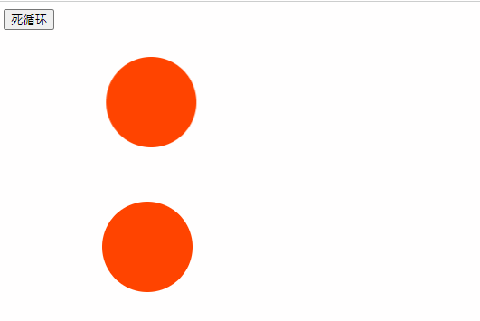

为什么呢？因为用 **left** 动画会引起 **reflow**，会在主线程走这些流程，但是点击按钮过后，主线程会卡死，另外一个小球使用的是 **transform**，而且是跟 **animation** 配合使用的，跟主线程没有关系，这就是浏览器为什么要分一个合成线程出来，类似的还有滚动条的滚动，有兴趣的伙伴可以自行实践。

## 总结

1.  解析 **HTML**，生成 **DOM树** 和 **CSSOM树**
    
2.  计算样式，让每一个 **DOM** 里边，得到最终的样式
    
3.  **布局**，计算每一个 **DOM节点** 的几何信息，**布局树** 和 **DOM树** 不一样，不能对应
    
4.  **Layer分层**，为了提高后续的渲染效率，浏览器会把页面根据一套策略分成几个图层，每个图层可以单独进行绘制
    
5.  下一步产生**绘制指令**，把这个指令交给合成线程的**分块**
    
6.  合成线程对每个图层进行分块，将其划分为更多的小区域
    
7.  分块完成过后，变成很多的小块，对每一个小块，对每一个层进行**光栅化**
    
8.  **光栅化**后就变成一个个像素点，变成位图有限光栅化靠近屏幕的小块
    
9.  最后把那些靠近屏幕的小块发送到 **GPU** 画出来
    

正是因为浏览器做了这么多的优化，才让我们现代如此丰富的页面展示下，页面还能够非常的流畅。
