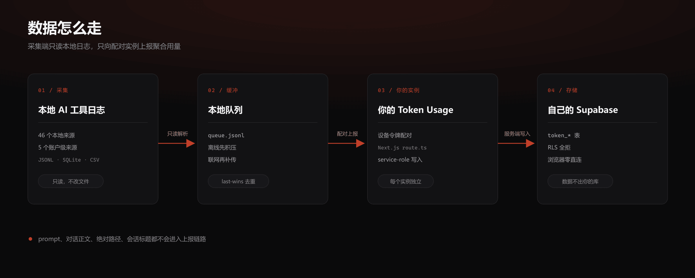
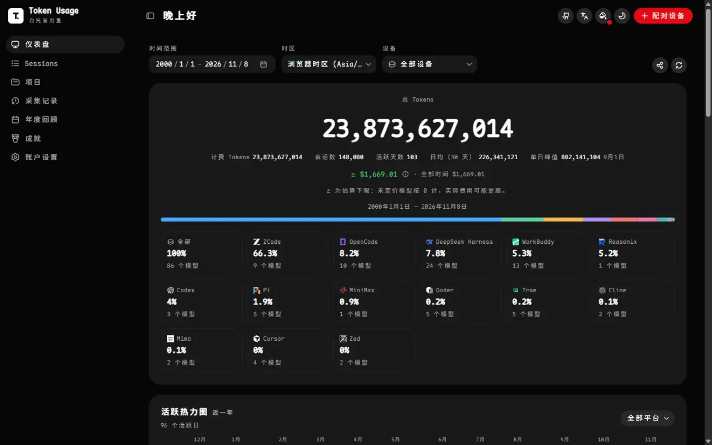
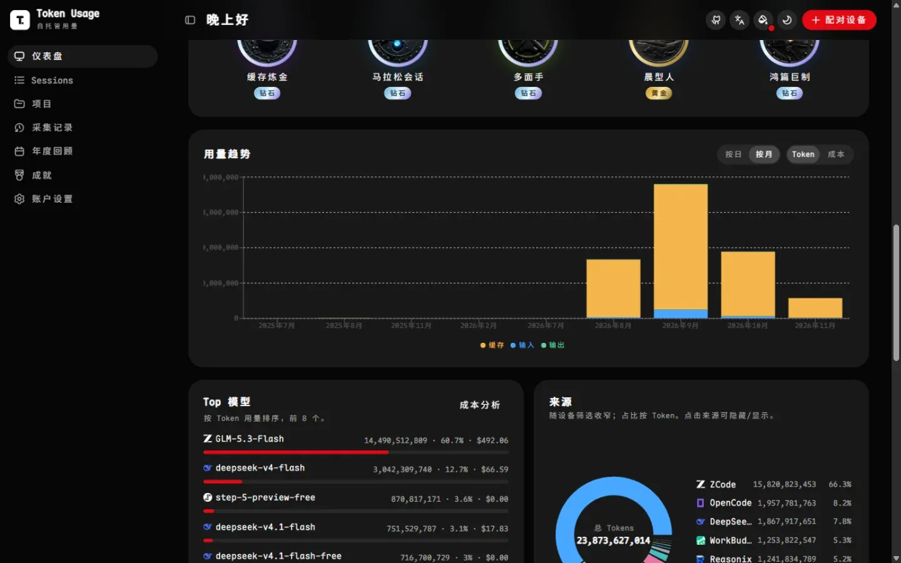
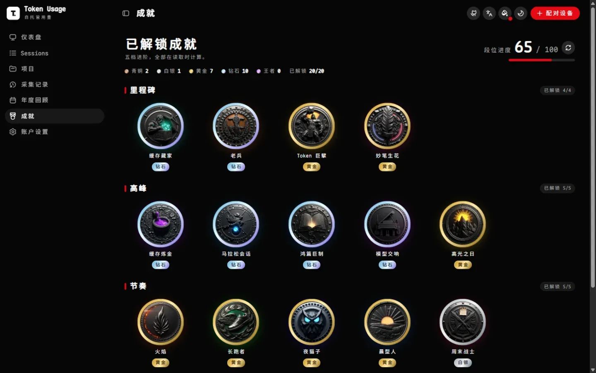
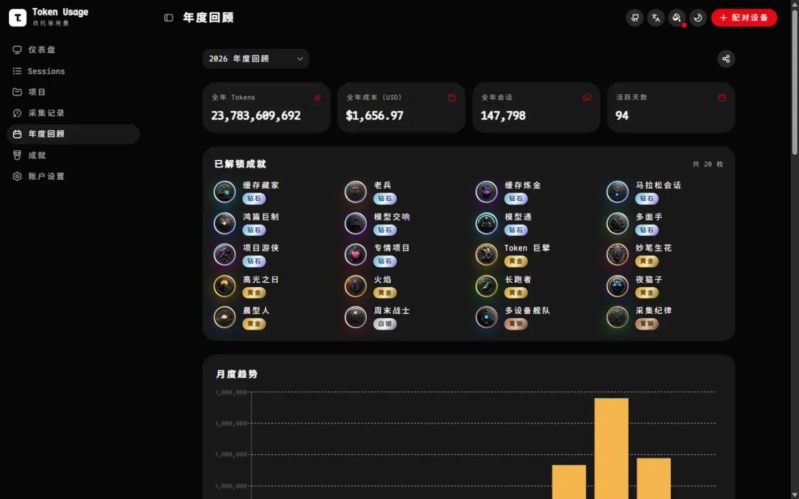

用了挺久的 AI 用量统计工具开始收费了。

倒不是付不起这个钱，而是这件事让我意识到一个更实际的问题：我在几台设备、好几个编辑器和 CLI 上跑出来的用量，一直存在别人的服务里。想合起来看、想换个角度查、想把历史留住，都得看对方给不给。

说白了，我想要的只有一件事：一个地方，能回答「这个月我到底用掉了多少 token、钱花在哪个模型上、有没有哪天突然飙高」。设备可以是多台，工具可以有很多种，但数据得在我自己手里。

于是有了 [Token Usage](https://www.token-usage.cc)：一个可以自己部署的 AI token 用量看板。采集端只读本地日志，一个账号汇总多台设备，数据写进你自己的 Supabase。

::video{src=/videos/token-usage-promo.mp4 poster=/videos/token-usage-promo-poster.jpg title="58 秒看完 Token Usage"}

## 我想解决的问题

我要的东西不复杂。

先是总量。今天、这个月、和历史比，数字要能一眼看到。

然后是归因。token 是哪个模型烧掉的，来自 Claude Code 还是 Codex，落在哪个项目上。

最后是异常。某天用量突然翻倍，是正常加班，还是某个任务陷入了循环。

这三个问题不需要请求级追踪，也不需要看到 prompt 和对话正文。Token Usage 只统计用量本身，不碰内容。

## 三步接入

采集端是一个 npm 包，要求 Node.js 22.19 以上。

```bash
npm install -g tokenusage-cli

tokenusage init          # 扫描本地工具、装采集 hook、注册每小时任务
tokenusage device-login  # 输出配对码，在浏览器里批准
tokenusage sync          # 立即采集并上报一轮
```

`init` 会找出本机已经安装的 AI 工具，装好采集 hook，并注册每小时一次的采集任务。它本身不上报数据，真正的解析发生在 `sync` 里。没有安装的工具不会被扫描，也不会产生任何数据。

`device-login` 会打印一个八位配对码，打开站点上的 `/device` 页面批准即可。配对码十五分钟有效，批准后设备令牌保存在本地。

`sync` 是手动跑一轮。第一次会把历史日志全部解析一遍，所以会慢一些；之后只扫描有变化的文件，增量上传。

还有个挺实用的设计：**没配对也能先采集**。数据会留在本地队列里，等配对完成后再一次性补传，不会因为顺序装错而丢数据。

## 数据怎么走

整条链路上没有代理，也没有 SDK 埋点。



采集端解析本地日志，把结果写进 `queue.jsonl`。这个队列按「小时 + 来源 + 模型」聚合，采用 last-wins 语义，重复上传不会把数据翻倍。联网后，采集端带着设备令牌把队列上报给你配对的实例；实例在服务端用 service-role 写入自己的 Supabase。

每个部署实例只认自己签发的设备令牌，也只写自己的数据库。你部署十份，十份之间也互不相通。

目前支持 46 个本地来源和 5 个账户级来源，覆盖 Claude Code、Codex、Cursor、GitHub Copilot、Gemini、Qoder、Kiro、Zed、TRAE 等常见工具。不同工具写日志的方式差别很大，有的是 JSONL，有的是 SQLite，有的只能从云端接口取。这些差异都留在采集端，仪表盘只看到一套统一口径。

## 做出来的样子

先看仪表盘。总量、会话数、活跃天数、日均和单日峰值在第一屏，下面是模型与来源的占比，再往下可以按时间范围、时区、设备切换。



趋势页能按日或按月看，也能在 Token 和成本之间切换。Top 模型和来源构成放在图表下方，方便直接对账。



成本是按 token 数量和内置的定价表估算出来的，不是厂商账单。未定价的模型会按 0 计，页面上也会标明这是估算下限。订阅制的积分（credits）单独占一个维度，不折算成 token，也不并进成本——这两类数字混在一起，后面很难解释清楚。

仪表盘之外还有几个页面。Sessions 按会话看明细，当前筛选的结果可以直接导出 CSV；Projects 按工作目录归因；采集记录页能看到每一轮 sync 的结果和耗时。年度回顾把一整年收成一张页面，旁边是 20 条成就和五档段位。公开徽章可以嵌进 README，公开用量页不用登录也能打开。





## 三条设计原则

**只读日志，不碰请求。** 不挂代理、不接 SDK，也不需要改你的代码。代理和埋点都能拿到更细的请求数据，但代价是每换一个工具就要重新接一次，还容易漏。日志是现成的，代价是解析器要一个个写。

**只传聚合元数据。** 上报的是 token 计数、模型名、项目目录名和会话的起止时间。prompt、助手正文、工具参数、命令输出、diff、会话标题、本地绝对路径，全都不上传。这条边界不是靠自觉，而是由采集端测试里的字段白名单锁住的。

**数据只进自己的库。** `token_*` 表对 `anon` 和 `authenticated` 角色没有任何 policy，等于全拒；浏览器端不直连数据库，所有读写都走服务端。service-role key 只存在于服务端运行时。

这三条里，第一条决定了它能覆盖多少工具，第二条决定了它敢不敢给你用，第三条决定了它是不是真的「自托管」。

## 自己部署一份

部署需要两个东西：一个 Supabase 项目，一个能跑 Next.js 的地方。Vercel 最省事，仓库里也有一键部署按钮。

流程不复杂：执行 `supabase/migrations/` 下的迁移建表，配置四个环境变量，部署 Web 应用，建管理员账号，最后给每台设备配对一次采集端。仓库里的[部署指南](https://github.com/baiwumm/token-usage/blob/main/docs/deploy-guide.md)写到了可以直接交给编码 Agent 执行的程度：按节执行、每节报告结果，不可逆操作先停下来问人。

如果你只想在本机看板，不部署到公网也可以。Supabase 仍然需要一个，但数据不会离开你的项目。

## 最后

项目是 MIT 开源的。采集端基于 [TokenTracker](https://github.com/xiufengsun/TokenTracker) 的 MIT 代码二次开发，上游署名写在仓库的 `LICENSE` 与 `THIRD_PARTY_NOTICES` 里。

- 源码：[github.com/baiwumm/token-usage](https://github.com/baiwumm/token-usage)
- 官网：[token-usage.cc](https://www.token-usage.cc)
- 在线演示：[demo.token-usage.cc](https://demo.token-usage.cc)

如果你也在几台设备上用 AI 编程，又不想把用量数据交给别人，可以部署一份试试。遇到问题，欢迎到 GitHub 提 Issue。
