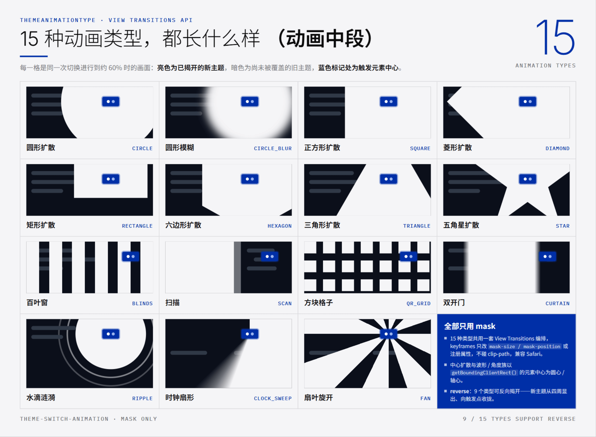
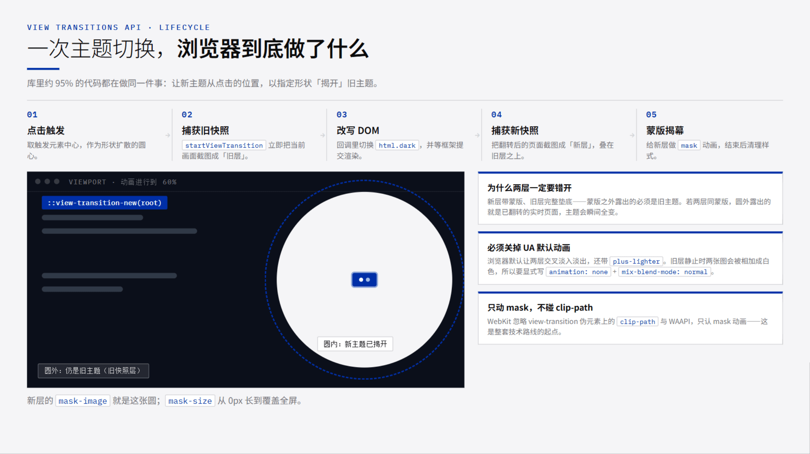
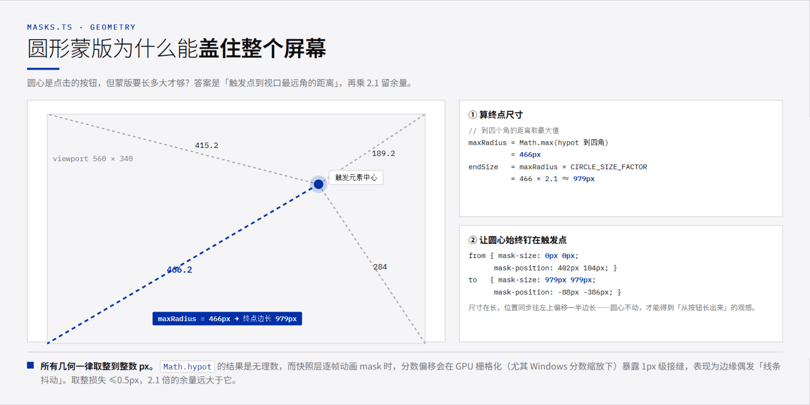
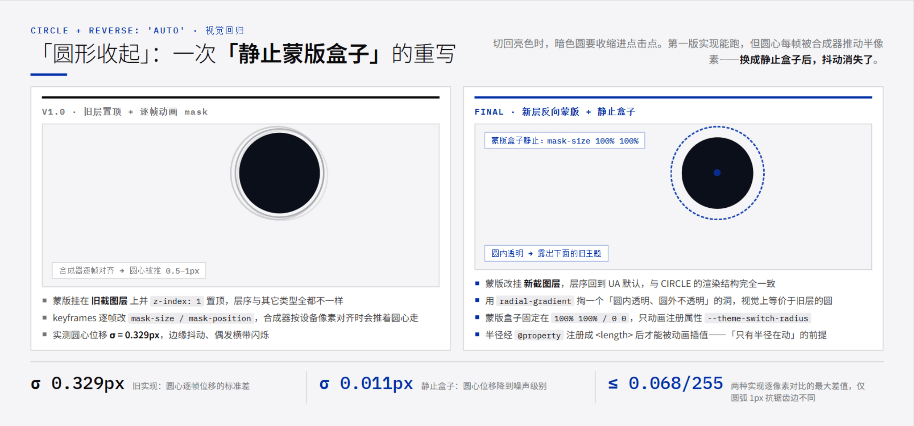
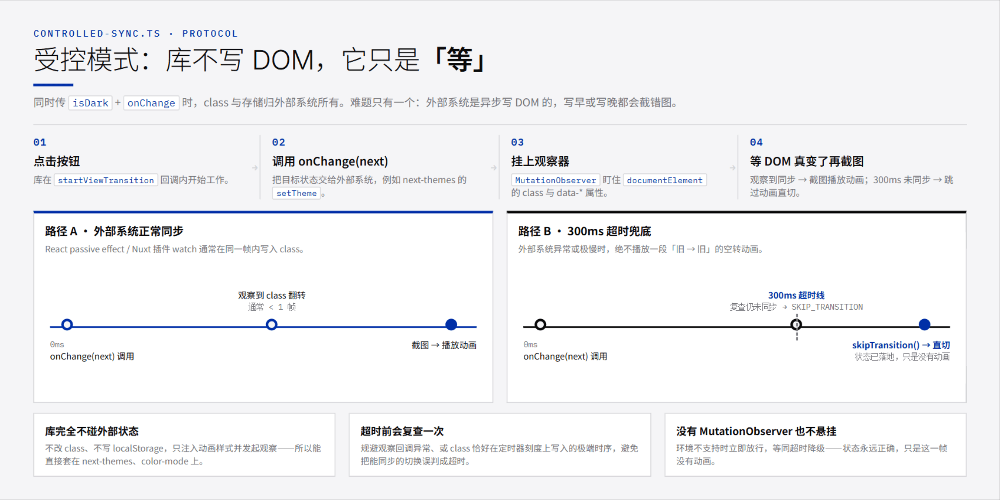
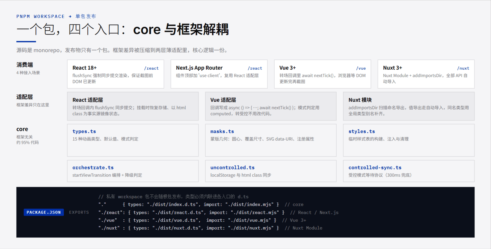

几乎每个站点都有明暗主题切换。点击按钮，页面瞬间从白变黑——功能上是完成了，但体验上像被硬生生拽了一下。

有一天我在想：如果新主题不是「替换」旧主题，而是从你点击的位置「长」出来、扩散着把旧主题揭开，会不会好很多？

于是有了 [theme-switch-animation](https://www.npmjs.com/package/theme-switch-animation)：一个基于 View Transitions API 的主题切换动画库，支持 React 18+、Vue 3+、Next.js App Router 与 Nuxt 3+，内置 15 种动画类型与 `direction` / `waveWidth` / `bladeCount` / `reverse` 等参数化选项，可受控也可非受控，浏览器不支持时自动降级。

这个项目是我用 vibecoding 的方式做出来的：需求、技术选型、行为契约和验收标准由我定，代码主要由 AI 写。但下面这几个坑——半像素抖动、受控模式的 DOM 同步、Nuxt 的自动导入——都是靠真机实测和逐像素对比才收敛的，AI 的第一版同样会翻车。

这篇文章把它拆开讲讲：**为什么只能用 mask、蒙版要算多大、15 种类型怎么共用一套代码、以及两个真正花了时间的坑**。

## 15 种类型都是什么效果

先看结果。下面每一格都是同一次切换进行到约 60% 时的画面：亮色是已经揭开的新主题，暗色是尚未被覆盖的旧主题，蓝色标记处就是触发元素的中心。



按实现归类其实只有三族：

| 族 | 类型 | 蒙版形制 |
| --- | --- | --- |
| 中心扩散形状族 | `CIRCLE` `CIRCLE_BLUR` `SQUARE` `DIAMOND` `RECTANGLE` `HEXAGON` `TRIANGLE` `STAR` | SVG data-URI 形状，从触发点 0 尺寸长到覆盖视口 |
| 条带与格子族 | `BLINDS`（百叶窗）`SCAN`（扫描）`QR_GRID`（方块格子）`CURTAIN`（双开门） | `@property` 注册属性 + 静止蒙版盒子，无触发点，`direction` 控制方向 |
| 波形与角度族 | `RIPPLE`（水滴涟漪）`CLOCK_SWEEP`（时钟扇形）`FAN`（扇叶旋开） | 同一机制，把触发点写进渐变串作波源 / 轴心 |

其中 9 个类型还支持 `reverse` 选项把「揭开」整个反过来：新主题从四周显出、向触发点收拢。各类型逐个的动态观感与参数档位，文档站上有完整画廊。

```bash
pnpm add theme-switch-animation
```

## 浏览器已经帮我们拍了三张图

这类效果看起来像「同一个页面在变形」，但实现上并不是真的在变形——View Transitions API 的做法朴素得多：**把变化前后的页面各拍一张静态快照，然后在两层快照之间演动画**。



对应到代码，一次切换的编排大约就是这样：

```ts file=orchestrate.ts
export function runThemeTransition(params: RunThemeTransitionParams): RunThemeTransitionResult {
  const doc = resolveDocument(params.doc)
  const resolved = resolveAnimationOptions(params.options)

  // 降级路径：不支持 View Transitions 或用户关了动效，直接改状态，没有动画
  if (!supportsViewTransition(doc) || prefersReducedMotion(doc.defaultView)) {
    return { animated: false, finished: Promise.resolve(domUpdate()).then(() => undefined) }
  }

  const viewport = getViewportSize(doc)
  const center = getTriggerCenter(trigger, viewport)
  const toDark = nextIsDark ?? !hasThemeClass(doc, resolved.darkClassName)  // reverse: 'auto' 判方向用
  const geometry = getMaskGeometry(resolved.animationType, center, viewport, resolved.blurAmount)
  //  ^ 形状族走 mask-size / mask-position 路径；条带 / 格子 / 波形 / 角度族与各反向形态
  //    走「静止蒙版盒子 + 注册属性」的 reveal 分支，最终都汇进同一次 buildAnimationCSS
  const css = buildAnimationCSS({ animationType: resolved.animationType, geometry, ... })
  const node = injectAnimationStyle(doc, css)   // 向 <head> 注入一份临时样式

  const transition = doc.startViewTransition(wrapped)  // wrapped 内部调用 domUpdate()
  const finished = transition.finished.then(
    () => scheduleCleanup(doc, resolved.duration, node),
    (error) => { /* 只清自己注入的节点，AbortError 视为正常跳过 */ },
  )
  return { animated: true, finished }
}
```

三个细节值得单独说：

**第一，降级路径也调用 `domUpdate`。** 不支持 View Transitions 的浏览器、`prefers-reduced-motion: reduce`、SSR 阶段——这三种情况都会跳过动画，但状态照常翻转。这是我给自己的硬约束：**动画是增强，状态正确是底线**，任何环境下 `isDark` 与 `<html>` 的类名都不能不一致。

**第二，样式要自己收。** 注进去的 `<style>` 不会自己消失，转场结束后延迟 `duration` 再移除，并且按 document 记账、用节点引用判定身份——否则多文档（iframe）场景下，B 文档的转场会把 A 文档的清理定时器取消掉，A 的转场样式就永久残留了。

**第三，快速连点不制造噪音。** 连点时浏览器会中止未完成的转场，`finished` 以 `AbortError` 结算。这类 rejection 在库内被消化掉，消费方拿到的 `finished` 不会变成全局 `unhandledrejection`。

## 为什么只能用 mask

这是整套技术路线的起点，也是从参考实现里踩出来的结论：**WebKit 会忽略 view-transition 伪元素上的 `clip-path` 和 WAAPI**。

也就是说，那些「用 `clip-path` 画个圆做动画」的写法在 Safari 上会直接失效。能稳定跨浏览器工作的只剩 mask——而且因为 `view-transition` 伪元素是浏览器生成的，我们还必须先把它的默认行为关掉：

```css
/* UA 默认让两层交叉淡入淡出，混合模式还是 plus-lighter */
::view-transition-old(root),
::view-transition-new(root) {
  animation: none;
  mix-blend-mode: normal;
}
```

`plus-lighter` 是为「两层同时淡出淡入」设计的加色混合。旧层静止不动时，两张图会被相加，屏幕直接发白。所以这两行不是优化，是必须。

另外还有一条同样重要的原则：**蒙版只挂新层，旧层完整垫底**。蒙版之外露出的必须是旧主题；如果两层挂同一份蒙版，透明区露出的就是已经翻转的实时页面，主题会在动画开始的瞬间全变。

## 蒙版要长多大：一次几何推导

圆心好办，`getBoundingClientRect()` 取触发元素中心即可。麻烦的是**终点尺寸**：蒙版要长到多大，才能保证动画结束时刚好盖满整个视口？

答案是「触发点到视口四个角中最远的那个距离」，再乘一个余量系数。



```ts file=masks.ts
/** 触发点到视口四角的最大距离 */
export function getMaxRadiusToCorners(center: Point, viewport: Size): number {
  const { x, y } = center
  const { width, height } = viewport
  return Math.max(
    Math.hypot(x, y),
    Math.hypot(width - x, y),
    Math.hypot(x, height - y),
    Math.hypot(width - x, height - y),
  )
}

export function getCircleMaskGeometry(center: Point, viewport: Size): MaskGeometry {
  const endSize = getMaxRadiusToCorners(center, viewport) * CIRCLE_SIZE_FACTOR  // 2.1
  return {
    maskImage: CIRCLE_MASK_IMAGE,
    startSize: '0px 0px',
    startPosition: `${px(center.x)} ${px(center.y)}`,
    endSize: `${px(endSize)} ${px(endSize)}`,
    // 尺寸在长，位置同步往左上偏移一半边长 —— 圆心始终钉在触发点
    endPosition: `${px(center.x - endSize / 2)} ${px(center.y - endSize / 2)}`,
  }
}
```

这里有两个容易被忽略的点：

- **`mask-position` 必须跟着动。** CSS 的 mask 尺寸变化是以左上角为原点的，只改 `mask-size` 会让圆从左上角「长大」，而不是从按钮长出来。终态的 `mask-position` 取「圆心坐标减去一半边长」，圆心就钉住了。
- **所有几何值一律取整到整数 px。** `Math.hypot` 的结果是无理数，而快照层逐帧动画 mask 时，分数像素偏移会在 GPU 栅格化（尤其在 Windows 分数缩放下）暴露 1px 级接缝，表现为边缘偶发的「线条抖动」。取整损失 ≤0.5px，而 2.1 倍的余量远大于它，安全性无虞。

## 15 种类型怎么共用一套实现

搞懂圆形之后，形状族的其余 6 个几何形状基本都是同一个套路：**换蒙版图形，几何计算按形状的内切半径重新推**。中心扩散的形状族全部走同一个函数：

```ts
function pinCenterGeometry(maskImage: string, center: Point, endSize: Size): MaskGeometry {
  return {
    maskImage,
    startSize: '0px 0px',
    startPosition: `${px(center.x)} ${px(center.y)}`,
    endSize: `${px(endSize.width)} ${px(endSize.height)}`,
    endPosition: `${px(center.x - endSize.width / 2)} ${px(center.y - endSize.height / 2)}`,
  }
}
```

区别只在 `endSize` 怎么算。判断依据是**「蒙版的内切半径必须盖住视口最远角」**，各形状的内切半径与外接半径比例不同，于是系数也不同：

| 类型 | 终点边长 | 依据 |
| --- | --- | --- |
| `CIRCLE` / `SQUARE` | `maxRadius × 2.1` / `max(halfW, halfH) × 2 × 1.05` | 5% 余量防末帧缝隙 |
| `RECTANGLE` | `halfW × 2 × 1.05` 与 `halfH × 2 × 1.05` | 贴合视口宽高比 |
| `DIAMOND` / `HEXAGON` | `maxRadius × √2 × 1.05 × 2` | 内切半径 = 外接半径 × √2/2（六边形另有 cos30° 富余） |
| `TRIANGLE` | `maxRadius × 2.2 × 2` | 内切半径 = 外接半径 / 2，自带 10% 余量 |
| `STAR` | `maxRadius × 2.5 × 2` | 最差方向是内凹谷，半径比 0.42，故 1/0.42 × 1.05 ≈ 2.5 |

这里有一个**故意偏离参考实现**的决定：五角星的外接圆我取了 `2.5 × maxRadius`，而常见实现只取约 `1.45 ×`。原因是它们的蒙版走 `clip-path`，会随转场组一起销毁，末帧角落透出旧主题无所谓；而 mask 在样式移除前是**持续生效**的（`animation-fill-mode: both`），一旦盖不满，用户就会看到四个角残留旧主题。形状好不好看是次要的，盖得住是硬要求。

至于 `CIRCLE_BLUR`，模糊是用 `feGaussianBlur` **烘焙进 SVG 蒙版本身**的（不是 CSS `filter`，那样 Safari 会有兼容问题），并且**只挂新层**：旧层完整垫底，蒙版外是旧主题，直到模糊圆扫过。如果两层同蒙版，模糊区外露出的会是已翻转的实时页面——主题瞬间全变，糊的只是边缘。

剩下的条带与格子族、波形与角度族走的是另一条路线，而那条路线恰好来自下文那次「静止盒子」重写——先按下不表。

## 「圆形收起」：方向感知，与一次「静止盒子」重写

「圆形收起」（首发时叫 `CIRCLE_REVERT`，今天是 `CIRCLE + reverse: 'auto'`）想表达的语义是：切到暗色时，暗色圆从点击处扩散；切回亮色时，暗色圆**收回**点击处。同一个按钮，来回切换自然产生一次扩散、一次收起，没有额外的隐藏状态。

方向怎么判断？在非受控模式下，转场前 `<html>` 的类名就是「当前旧主题」，toggle 之后必为取反；受控模式下外部系统可能写的是 `data-theme` 而不是 class，从类名反推会永远判成「扩散」，所以 `runThemeTransition` 提供了一个显式参数：

```ts
const toDark = nextIsDark ?? !hasThemeClass(doc, resolved.darkClassName)
```

但在「收起」这个方向上，第一版实现翻了车。



第一版是把蒙版挂到**旧截图层**上并 `z-index: 1` 置顶，然后逐帧动画 `mask-size` / `mask-position`，让暗色圆收缩。功能上能跑，但合成器会按设备像素对齐蒙版盒子，逐帧推着圆心走——实测圆心位移的标准差 `σ = 0.329px`，视觉上就是边缘抖动、偶尔闪过一条横带。

修法是把「动」的部分从盒子上挪走：**蒙版盒子完全静止，只动画一个半径**。

```css
/* 半径注册成 <length> 后才能被动画插值 */
@property --theme-switch-radius {
  syntax: "<length>";
  inherits: false;
  initial-value: 0px;
}

/* 圆内透明、圆外不透明 —— 视觉上等价于「旧层的暗色圆」，但层序回到 UA 默认 */
::view-transition-new(root) {
  mask-image: radial-gradient(circle at 402px 104px,
    transparent calc(var(--theme-switch-radius) - 0.5px),
    #000      calc(var(--theme-switch-radius) + 0.5px));
  mask-size: 100% 100%;
  mask-position: 0 0;
  mask-repeat: no-repeat;
  animation: theme-switch-circle var(--theme-switch-duration, 750ms)
    var(--theme-switch-easing, ease-in-out) both;
}
@keyframes theme-switch-circle {
  from { --theme-switch-radius: 490px; }
  to   { --theme-switch-radius: 0px; }
}
```

改动之后：圆心位移降到 `σ = 0.011px`（噪声级别），而新旧两种实现的渲染结果逐像素比对，最大差值 `≤ 0.068/255`，只出现在圆弧那 1px 抗锯齿边上——**视觉等价，但不再抖**。

顺带一个冷知识：`@property` 注册的自定义属性是全局的、无法注销，所以变量名加了 `--theme-switch-` 前缀避免撞名。这个冷知识后来还二次生效——角度族想复用同一个变量注册 `<angle>` 时被规范拦下（syntax 一经注册不可改），只好另开了一个 `--theme-switch-sweep`。

## 一次重写，长成了半个库

「`@property` 注册属性 + 静止蒙版盒子」这个修法没有停留在圆形收起上，它后来成了半个库的地基：

- **0.2.0**：新增 `BLINDS` / `SCAN` / `QR_GRID` 三种类型，全部走这套机制，同时把「四个方向」从动画类型降级成普通选项 `direction`——`LTR` / `RTL` / `TTB` / `BTT` 四个类型删除，由 `SCAN + direction` 承接，观感差异只有前缘多一条 12px 半透明光束带；
- **0.3.0**：`RIPPLE` 把渐变换成 `radial-gradient`、把波源中心写进串里，`CLOCK_SWEEP` / `FAN` 用 `conic-gradient` 从角度维度揭开——角度覆盖的是方向而非面积，所以它们连「终半径要够到视口最远角」的系数都省了；
- **0.4.0**：`CIRCLE_REVERT` 作为类型被删除，「切暗扩散、切亮收起」的语义并入三态选项 `reverse: 'auto'`，还想无论切哪个方向都收拢可以写 `reverse: true`（这是当年没有的形态）。`reverse` 目前已接入 9 个类型；`HEXAGON` / `TRIANGLE` / `STAR` 维持不接入——它们的反向必须动 `mask-size`，会重新引入刚修完的像素对齐抖动，做不到无副作用。

```tsx
// 0.3.x
useThemeAnimation({ animationType: ThemeAnimationType.CIRCLE_REVERT })

// 0.4.0
useThemeAnimation({ animationType: ThemeAnimationType.CIRCLE, reverse: 'auto' })
```

```tsx
// 0.1.x
useThemeAnimation({ animationType: ThemeAnimationType.RTL })

// 0.2.0
useThemeAnimation({ animationType: ThemeAnimationType.SCAN, direction: 'rtl' })
```

回头看相当有意思：为了消灭半像素抖动发明的一个小机制，最后反过来收纳了新增类型的全部复杂度——`CURTAIN`（双开门）落进现成 dispatcher 时，编排层一行都没改。

## 受控模式：不抢状态管理，只是「等」

如果用户已经在用 `next-themes` 或 `@nuxtjs/color-mode`，再塞一个库去管主题状态就是灾难。所以库提供了受控模式：**同时传 `isDark` + `onChange` 就进入受控**，此后库不碰 `localStorage`、不自己改 class，只做两件事——注入动画样式，以及**等外部系统把 DOM 真正改写后再让浏览器截图**。

难点在于外部系统是异步写 DOM 的（React 用 passive effect，Nuxt 用插件 watch）。`onChange` 调用后立刻返回，截到的还是旧主题。



```ts file=controlled-sync.ts
export function waitForThemeSync({ doc, darkClassName, nextIsDark, timeoutMs = 300 }): Promise<boolean> {
  const synced = () => hasThemeClass(doc, darkClassName) === nextIsDark
  if (synced()) return Promise.resolve(true)              // 同步写入的系统，直接放行
  if (typeof MutationObserver === 'undefined') return Promise.resolve(false)

  return new Promise<boolean>((resolve) => {
    let settled = false
    const observer = new MutationObserver((mutations) => {
      for (const m of mutations) {
        if (m.attributeName === 'class' && synced()) return settle(true)
        if (m.attributeName?.startsWith('data-')) return settle(true)  // 兼容 data-theme 型系统
      }
    })
    const timer = setTimeout(() => settle(synced()), timeoutMs)  // 超时前复查一次
    ...
    observer.observe(doc.documentElement, { attributes: true })
  })
}
```

超时之后不播放动画，而是直接跳过转场：

```ts
domUpdate: () => {
  onChange(next)
  return waitForThemeSync({ doc: document, darkClassName, nextIsDark: next })
    .then((synced) => (synced ? undefined : SKIP_TRANSITION))
}
```

`SKIP_TRANSITION` 是个哨兵值，`runThemeTransition` 收到它会立刻调用 `transition.skipTransition()`。原因很直白：**此刻新截图必然还是旧主题，继续演动画只会得到一段「旧 → 旧」的空转**，不如直接切换。状态已经由 `onChange` 落地了，跳过的只是视觉效果。

顺带一提，超时值从最早的 150ms 调到 300ms，是因为 `MutationObserver` 虽快但并非绝对，低性能设备上要留余量。

## 跨框架：一份 core，两层薄适配

整个仓库是 pnpm workspace，但**只发布一个包**，四个入口由 `exports` 分出。



core 是完全框架无关的（约 95% 代码），框架差异被压缩到两处渲染时机：

- **React** 的转场回调里需要用 `flushSync` 强制同步提交。React 的 `setState` 是异步批处理的，不强制同步的话，浏览器截图时 DOM 还没更新，会截到旧主题。

```tsx
domUpdate: () => {
  const next = !hasThemeClass(document, resolved.darkClassName)
  applyThemeClass(document, next, resolved.darkClassName)
  writeStoredTheme(document, next)
  flushSync(() => setUncontrolledIsDark(next))   // 截图前必须已提交
}
```

- **Vue** 更省事：`startViewTransition` 的回调允许返回 Promise，所以写成 `async () => { …; await nextTick() }` 就行，浏览器会等 DOM 更新完再截图。

```ts
domUpdate: async () => {
  const next = !hasThemeClass(document, resolved.darkClassName)
  applyThemeClass(document, next, resolved.darkClassName)
  uncontrolledIsDark.value = next
  await nextTick()   // 等组件树渲染完成
}
```

Nuxt 模块本身很短，但有个不太显眼的坑：`addImportsDir` 扫描的是目录下文件的**命名导出**，而 `ThemeAnimationType` 既是值（`ThemeAnimationType.LTR`）又是同名类型（`animationType: ThemeAnimationType`）。自动导入只会给出值含义，用 `addImports()` 补类型又会变成「仅类型含义」，值用法直接报 TS1362。最后的解法是利用 TS 的值/类型命名空间相互独立——用 `addTypeTemplate` 额外补一个**全局类型别名**，与自动导入的全局 `const` 自然合并，两种用法同时可用。

## 打包：单包多入口的几个坑

构建用 tsup，配置不长但每一条都对应一个真实问题：

```ts file=tsup.config.ts
export default defineConfig({
  entry,                                   // index / react / vue / nuxt 四个入口
  format: ['esm'],
  outExtension: () => ({ js: '.mjs' }),
  // 私有 workspace 包不会随根包发布，类型必须内联进各入口的 d.ts
  dts: { resolve: [/^@theme-switch-animation\//, /^\.\.?\//] },
  splitting: false,
  // 关掉 rollup 的二次摇树：它会剥掉入口顶部的 'use client' 指令（React / Next 客户端边界必需）
  treeshake: false,
  external: ['react', 'react-dom', 'vue', '@nuxt/kit', '@nuxt/schema'],
  noExternal: [/^@theme-switch-animation\//],  // core 被打进各入口
})
```

- `dts.resolve` 里要同时放包名和相对路径的正则。它本质是 `resolveOnly` 过滤器，如果只写包名，`core/index.ts` 内部的相对导入会被留成 `from './types'` 这种指向不存在文件的引用。
- `treeshake: false` 是刻意的：rollup 的二次摇树会把入口顶部的 `'use client'` 当成无用代码剥掉，而这是 Next.js 客户端组件的边界声明。esbuild 自身的摇树仍然生效，配合 `sideEffects: false`，最终由消费方的打包器做最后一步。
- `peerDependencies` 里 React、Vue、`@nuxt/kit` 全部标成 optional——用一个包覆盖四个框架，不能逼着 Vue 用户装 React。`react-dom` 也要显式声明，因为 `/react` 入口用了它的 `flushSync`；在 pnpm 的严格隔离布局（`hoist=false`）下漏声明会导致子路径解析失败。

## 状态永远正确：降级策略

最后把降级行为汇总一下，这也是我在 README 里最想强调的部分：

| 场景 | 行为 |
| --- | --- |
| 浏览器不支持 View Transitions（Safari < 18、Firefox < 144 等） | 直接切换，无动画，状态正确 |
| `prefers-reduced-motion: reduce` | 直接切换，无动画 |
| SSR 渲染阶段 | 不触碰 `window` / `document` / `localStorage`，无 hydration 报错 |
| `@property` 不可用（极旧引擎） | 属性驱动类型退化为直切，状态正确 |
| 引擎不支持 `mask-composite: intersect` | `QR_GRID` 方块格自动降级为推进轴单层条带（观感同百叶窗），状态正确 |
| 受控模式外部系统 300ms 未同步 | 跳过转场直切，不播放「旧 → 旧」空转 |
| 快速连点 | 浏览器中止前一轮转场，状态不受影响，无 `unhandledrejection` |
| `localStorage` 不可用（隐私模式 / 跨域 iframe） | 静默跳过持久化，状态仍以 `<html>` 类名为准 |

非受控模式下还有一个我比较满意的设计：**以 `<html>` 上的暗色类名作为事实源**。同页多个实例的 `isDark` 都镜像它，其它标签页的切换经 `storage` 事件同步。这样「多个按钮状态不一致」这类问题从结构上就不存在。

## 用法速览

React / Next.js（App Router 的组件记得加 `'use client'`）：

```tsx
import { useState } from 'react'
import { useThemeAnimation, ThemeAnimationType } from 'theme-switch-animation/react'

function ThemeButton() {
  const { ref, toggleTheme, isDark, finished } = useThemeAnimation({
    animationType: ThemeAnimationType.CIRCLE,
    duration: 750,
    easing: 'ease-in-out',
  })
  const [animating, setAnimating] = useState(false)
  return (
    <button
      ref={ref}
      disabled={animating}
      onClick={async () => {
        setAnimating(true)
        toggleTheme()
        await finished     // 动画期间禁用，降级时立即结算
        setAnimating(false)
      }}
    >
      {isDark ? '🌙' : '☀️'}
    </button>
  )
}
```

除了类型与时长，还有一组按类型消费的参数化选项：`direction`（`BLINDS` / `SCAN` / `QR_GRID` 控扫开方向与锚定，`CURTAIN` 控开合轴）、`slatWidth`（百叶窗叶宽）、`cellSize` / `cellShape`（格子格距与方块 / 圆点形状）、`waveWidth`（涟漪波长）、`bladeCount`（扇叶数）、`reverse`（反向揭开，9 个类型已接入）——越界或非法值一律静默回落默认，不抛错。

Vue 3：

```vue
<script setup lang="ts">
const { triggerRef, toggleTheme, isDark } = useThemeAnimation<HTMLButtonElement>({
  animationType: ThemeAnimationType.CIRCLE,
})
</script>

<template>
  <button ref="triggerRef" @click="toggleTheme">{{ isDark ? '🌙' : '☀️' }}</button>
</template>
```

Nuxt 3：

```ts
export default defineNuxtConfig({
  modules: ['theme-switch-animation/nuxt'],
})
```

`useThemeAnimation` / `ThemeAnimationType` 等全部自动导入，无需 import。

接入 `next-themes` 时切到受控模式即可——库不碰存储、不改 class，只负责把动画演出来：

```tsx
const { resolvedTheme, setTheme } = useNextThemes()
const { ref, toggleTheme } = useThemeAnimation({
  isDark: resolvedTheme === 'dark',
  onChange: (next) => setTheme(next ? 'dark' : 'light'),
  animationType: ThemeAnimationType.CIRCLE,
  reverse: 'auto',   // 切暗向外扩散、切亮向触发点收起
})
```

## 小结

回头看，这个库真正的难点其实不在动画本身，而在几件容易被当成「边角料」的事：

- **蒙版几何**：从触发点算到视口最远角，圆心靠 `mask-position` 钉住，所有值取整到整数 px；
- **层序**：蒙版只挂新层、旧层完整垫底；收起方向用「新层上的洞」替代「旧层置顶」，顺手消掉了半像素抖动——这次重写后来还长成了属性驱动族与 `reverse` 选项；
- **等，而不是替**：受控模式下让外部主题系统自己写 DOM，库只观察、只兜底；
- **状态优先于动画**：任何环境、任何超时、任何连点，`isDark` 与类名都必须是对的。

包已经发布在 npm（`theme-switch-animation`），源码与每种动画的在线 demo 都在文档站上：

- npm：

::link-card[https://www.npmjs.com/package/theme-switch-animation]

- 文档站：

::link-card[https://theme-switch-animation.baiwumm.com]

- 仓库：

::link-card[https://github.com/baiwumm/theme-switch-animation]

如果你也在做主题切换，希望它能帮你省掉推导蒙版尺寸的那几个晚上。
