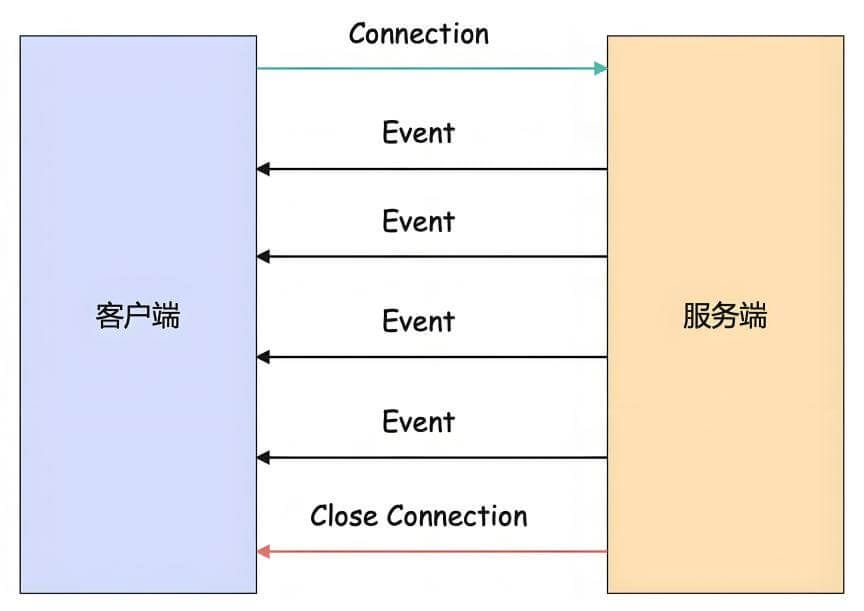
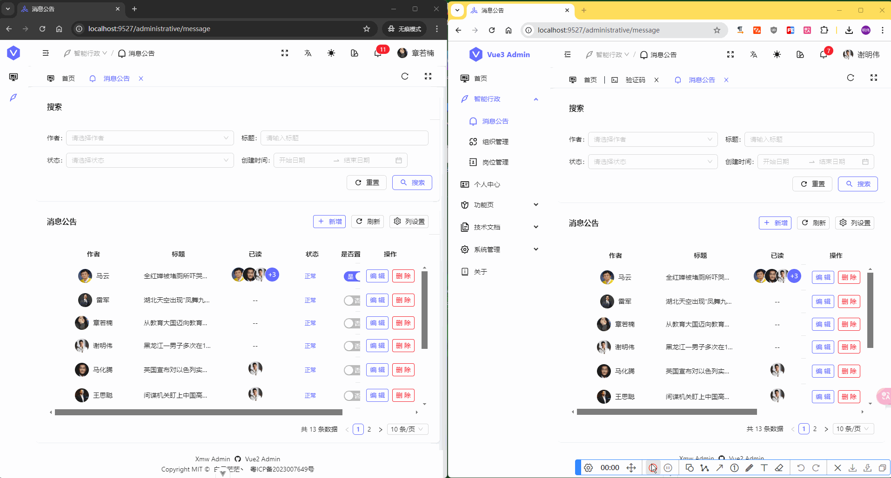
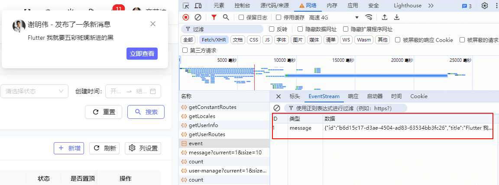

## 前言

假如系统又一个这样的业务场景： `已登录的用户发起流程或者发布消息之后，需要弹窗通知其他已登录的用户，我们应该如何实现？`

在设计实时通信场景时，我们面临的主要挑战是如何有效地通知所有已登录的用户有关新流程的启动或新消息的发布。为了实现这一目标，我们需要一个既能高效推送信息又能保证低延迟的技术方案。在评估了 [WebSocket](https://baike.baidu.com/item/WebSocket/1953845) 和 [Server-Sent Events (SSE)](https://developer.mozilla.org/zh-CN/docs/Web/API/EventSource) 两种技术之后，我们选择了 [SSE](https://developer.mozilla.org/zh-CN/docs/Web/API/EventSource) 作为实时通信系统的实现方式。

尽管 [WebSocket](https://baike.baidu.com/item/WebSocket/1953845) 提供了全双工通信的能力，使得客户端和服务器可以在任何时候互相发送数据，但在我们的应用场景中，主要的需求是由服务器向客户端发送更新通知，而客户端不需要向服务器发送相关的数据。因此，我们不需要 [WebSocket](https://baike.baidu.com/item/WebSocket/1953845) 提供的全双工特性。

本篇文章将详细介绍如何在 [Nest.js](https://nestjs.com/) 应用中使用 [Server-Sent Events (SSE)](https://developer.mozilla.org/zh-CN/docs/Web/API/EventSource)。

## 什么是 Server-Sent Events？

[Server-Sent Events (SSE)](https://developer.mozilla.org/zh-CN/docs/Web/API/EventSource) 是一种让服务器能够实时地向客户端发送数据的技术。传统的 **Web** 应用程序都是基于客户端发起请求，服务器响应这一模式的。然而，在某些应用场景下，比如股票行情、聊天应用或实时更新的数据展示等，需要服务器主动向客户端推送信息。

[SSE](https://developer.mozilla.org/zh-CN/docs/Web/API/EventSource) 提供了一个简单的单向事件流，使得服务器能够在客户端请求保持打开的状态下推送更新。这样做的好处是减少了轮询请求所带来的网络开销，并且能够让客户端即时接收到新的数据更新。



## SSE 优点

- `单向通信`：[SSE](https://developer.mozilla.org/zh-CN/docs/Web/API/EventSource) 默认只支持从服务器到客户端的单向数据传输。

- `格式简单`：[SSE](https://developer.mozilla.org/zh-CN/docs/Web/API/EventSource) 的消息格式非常简单，易于理解和解析。

- `持久连接`：客户端与服务器之间的连接保持打开状态，直到一方关闭为止。

- `断线重连`：当连接中断后，客户端可以尝试重新建立连接以继续接收事件。

## @Sse 装饰器

在需要消息推送的 **Controller** 方法中使用 **@Sse 装饰器**

```ts
import { Sse } from '@nestjs/common';

@Sse('sse/event')
sse(): Observable<MessageEvent> {
  return new Observable<any>((observer) => {
    // 监听事件
    this.eventEmitter.on(EVENTBUS_TYPE.MESSAGE_CREATE, (data: Message) => {
      observer.next({ data });
    });
  });
}
```

因为我这里是别的方法执行成功后，才需要向客户端执行消息推送，所以这里使用了 **Event Emitter**

## 客户端实现

```ts
onMounted(() => {
  const eventSource = new EventSource(
    "http://localhost:3000/sse/event",
   ;
  eventSource.onmessage = ({ data }) => {
    console.log("New message", JSON.parse(data));
  };
});
```

原生 [EventSource](https://developer.mozilla.org/zh-CN/docs/Web/API/EventSource) 是不支持设置请求等信息的，详情可以查看[MDN 文档](https://developer.mozilla.org/zh-CN/docs/Web/API/EventSource)

如果你的接口设置了访问权限，比如需要请求头携带 **token** 才能访问，那么你需要使用别的连接方式，比如：[event-source-polyfill](https://github.com/mattkrick/event-source-polyfill)

## EventSourcePolyfill

[event-source-polyfill](https://github.com/mattkrick/event-source-polyfill) 是 [EventSource](https://developer.mozilla.org/zh-CN/docs/Web/API/EventSource) 封装的一个方法，可以配置请求头

1.  安装依赖

```bash
pnpm add event-source-polyfill
```

2.  示例代码

```ts
import { EventSourcePolyfill } from "event-source-polyfill";

// 创建 EventSource 实例
const eventSource = new EventSourcePolyfill(`${baseURL}/sse/event`, {
  headers: {
    Authorization: `Bearer ${authStore.token}`,
  },
  heartbeatTimeout: 60 * 60 * 1000, // 这是自定义配置请求超时时间  默认是45000ms
});

// 接收消息
eventSource.onmessage = ({ data }: MessageEvent) => {
  console.log("New message", JSON.parse(data));
};

onBeforeUnmount(() => {
  // 组件卸载前关闭连接
  eventSource.close();
});
```

## 效果演示

同时登陆两个用户，其中一个发布消息时，服务器会向所有客户端推送消息：



浏览器查看接口接收消息：



## 总结

关注我，我们一起领略 [Nest.js](https://nestjs.com/) 的魅力
