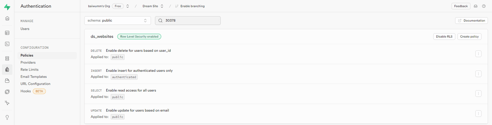
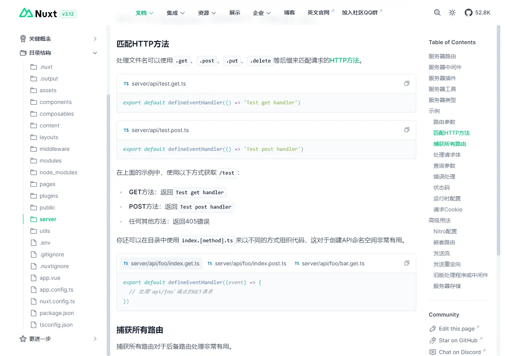
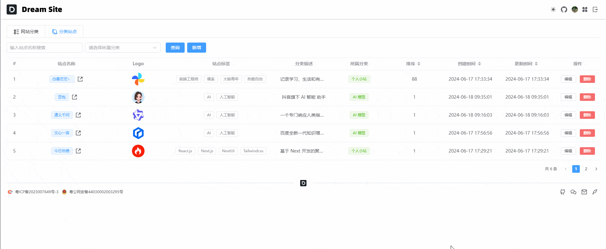

## 前言

本篇文章我们来使用 [Supabase](https://supabase.com/) 实现 **RESTful** 风格的 **API** 接口，以此来实现网站分类和子站点的 **CURD** 功能。

## 表设计

这里需要用到两张表：

1.  **ds\_categorys**：存储网站分类
    

| 列名  | 类型  | 备注  |
| --- | --- | --- |
| id  | uuid | 主键，分类 id |
| name | text | 分类名称 |
| desc | text | 分类描述 |
| sort | int2 | 排序  |

2.  **ds\_websites**：存储网站分类子站点
    

| 列名  | 类型  | 备注  |
| --- | --- | --- |
| id  | uuid | 主键，分类 id |
| name | text | 站点名称 |
| desc | text | 站点描述 |
| category\_id | uuid | 所属分类 id |
| url | text | 站点 url |
| logo | text | 站点 logo |
| tags | text | 站点标签 |
| sort | int2 | 排序  |

这里需要注意的是，因为 [Supabase](https://supabase.com/) 使用的是 [postgresql](https://www.postgresql.org/) 的 [Row Level Security (RLS)](https://www.postgresql.org/docs/current/ddl-rowsecurity.html)，一些数据库的操作对应不同的策略，这里我们还应该为每张表加上两个字段：

| 列名  | 类型  | 备注  |
| --- | --- | --- |
| user\_id | auth.uid() | 登录用户的 uuid |
| email | text | 登录用户的 email |



> 数据录入的时候 **user\_id** 会自动填充，但是 **email** 需要在前台带入

## 接口设计

这里以 **ds\_websites** 表为例，前台需要实现 **CURD** 功能，为此我们把接口设计成 **RESTful** 风格：

| 接口  | Methods | 备注  |
| --- | --- | --- |
| /api/websites | Get | 读取  |
| /api/websites | Post | 新增  |
| /api/websites | Put | 更新  |
| /api/websites | Delete | 删除  |

## 前端实现

阅读 [Nuxt3 中文文档](https://nuxt.com.cn/docs/guide/directory-structure/server#%E5%8C%B9%E9%85%8Dhttp%E6%96%B9%E6%B3%95)，我们可以在 **server/api** 目录下新增接口。



1.  **Get 接口**：**server/api** 目录下新建 **index.get.ts** 文件：
```ts
import type { Response, PageResponse, WebsiteList, WebsiteParams } from '~/types'
import { serverSupabaseClient } from '#supabase/server'
import { RESPONSE_STATUS_CODE } from '~/enum'

export default defineEventHandler(async (event): Promise<Response<PageResponse<WebsiteList>>> => {
  const client = await serverSupabaseClient(event)
  // 获取请求参数
  const { current, pageSize, name = '', category_id = '' } = getQuery(event) as WebsiteParams
  // 判断参数
  if (!current || !pageSize) {
    return { code: RESPONSE_STATUS_CODE.FAIL, msg: '参数错误' }
  }

  // 计算分页
  const start = (current - 1) * pageSize
  const end = current * pageSize - 1

  // 查询 sql
  let sqlQuery = client
    .from('ds_websites')
    .select('*,ds_categorys(*)', { count: 'exact' })
    .range(start, end)
    .order('sort', {
      ascending: false
    })
    .order('created_at', {
      ascending: false
    })

  // 判断查询参数
  if (name) {
    sqlQuery = sqlQuery.like('name', `%${name}%`)
  }
  if (category_id) {
    sqlQuery = sqlQuery.eq('category_id', category_id)
  }

  // 请求列表
  const { data, error, count } = await sqlQuery

  // 判断请求结果
  if (error) {
    throw createError({
      statusCode: RESPONSE_STATUS_CODE.FAIL,
      statusMessage: error.message
    })
  }

  // 请求成功
  return {
    code: RESPONSE_STATUS_CODE.SUCCESS,
    msg: '请求成功',
    data: {
      list: data,
      total: count
    }
  }
})
```


2.  **Post 接口**：**server/api** 目录下新建 **index.post.ts** 文件：
```ts
import type { Response, WebsiteEdit, WebsiteList } from '~/types'
import { serverSupabaseClient, serverSupabaseUser } from '#supabase/server'
import { RESPONSE_STATUS_CODE } from '~/enum'

export default defineEventHandler(async (event): Promise<Response<WebsiteList[]>> => {
  const client = await serverSupabaseClient<WebsiteList>(event)
  const user = await serverSupabaseUser(event)
  // 得到请求体
  const body: WebsiteEdit = await readBody(event)

  // 插入数据
  const { data, error } = await client
    .from('ds_websites')
    .insert({ ...body, email: user?.email })
    .select()

  // 判断请求结果
  if (error) {
    // 23505 是 PostgreSQL 的唯一性违反错误码
    if (error.code === '23505') {
      return {
        code: RESPONSE_STATUS_CODE.FAIL,
        msg: '站点名称已存在!'
      }
    } else {
      throw createError({
        statusCode: RESPONSE_STATUS_CODE.FAIL,
        statusMessage: error.message
      })
    }
  }

  // 请求成功
  return {
    code: RESPONSE_STATUS_CODE.SUCCESS,
    msg: '请求成功',
    data: data
  }
})
```


3.  **Put 接口**：**server/api** 目录下新建 **index.put.ts** 文件：
```ts
import type { Response, WebsiteEdit, WebsiteList } from '~/types'
import { serverSupabaseClient } from '#supabase/server'
import { RESPONSE_STATUS_CODE } from '~/enum'

export default defineEventHandler(async (event): Promise<Response<WebsiteList[]>> => {
  const client = await serverSupabaseClient<WebsiteList>(event)
  // 得到请求体
  const { id, ...body }: WebsiteEdit = await readBody(event)

  if (!id) {
    return {
      code: RESPONSE_STATUS_CODE.FAIL,
      msg: 'id不能为空!'
    }
  }

  // 插入数据
  const { data, error } = await client
    .from('ds_websites')
    .update({ ...body, updated_at: new Date() })
    .eq('id', id)
    .select()

  // 判断请求结果
  if (error) {
    // 23505 是 PostgreSQL 的唯一性违反错误码
    if (error.code === '23505') {
      return {
        code: RESPONSE_STATUS_CODE.FAIL,
        msg: '站点名称已存在!'
      }
    } else {
      throw createError({
        statusCode: RESPONSE_STATUS_CODE.FAIL,
        statusMessage: error.message
      })
    }
  }

  // 请求成功
  return {
    code: RESPONSE_STATUS_CODE.SUCCESS,
    msg: '请求成功',
    data: data
  }
})
```


4.  **Delete 接口**：**server/api** 目录下新建 **index.delete.ts** 文件：
```ts
import type { Response, WebsiteEdit, WebsiteList } from '~/types'
import { serverSupabaseClient } from '#supabase/server'
import { RESPONSE_STATUS_CODE } from '~/enum'

export default defineEventHandler(async (event): Promise<Response<WebsiteList[]>> => {
  const client = await serverSupabaseClient<WebsiteList>(event)
  // 得到请求体
  const { id }: WebsiteEdit = await readBody(event)

  if (!id) {
    return {
      code: RESPONSE_STATUS_CODE.FAIL,
      msg: 'id不能为空!'
    }
  }

  // 删除数据
  const { error } = await client.from('ds_websites').delete().eq('id', id)

  // 判断请求结果
  if (error) {
    throw createError({
      statusCode: RESPONSE_STATUS_CODE.FAIL,
      statusMessage: error.message
    })
  }

  // 请求成功
  return {
    code: RESPONSE_STATUS_CODE.SUCCESS,
    msg: '请求成功'
  }
})
```


5.  前端调用方式
```vue
<script setup lang="ts">
const { data } = await useFetch('/api/websites')
</script>

<template>
  <pre>{{ data }}</pre>
</template>
```


接口的相关逻辑，自己可以根据实际情况修改，具体的数据库操作文档可参考： [Supabase API DOCS](https://supabase.com/docs/reference/javascript/select)

## 效果预览



## 总结

本篇文章我们学到了以下知识：

1.  [Nuxt3](https://nuxt.com/) 如何创建接口并调用
    
2.  [Supabase](https://supabase.com/) 数据库的基本操作和表的创建
    

到这里，项目的整体框架就已经出来了，后续我们要做的就是添加数据和完善优化，并根据自己爱好添加一些自己喜欢的功能。

**Github 仓库**：[Better Nav](https://github.com/baiwumm/better-nav)

**线上预览**：[一个把常用网址收拾得干干净净的小站](https://nav.baiwumm.com/)
