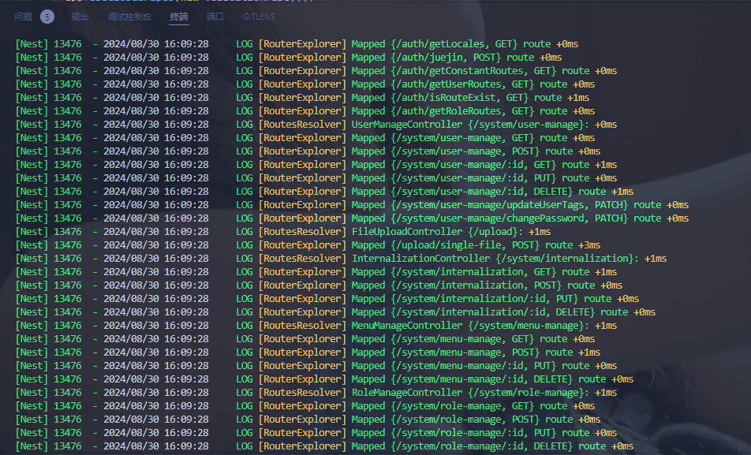
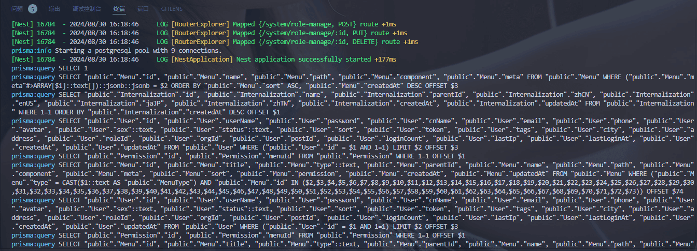
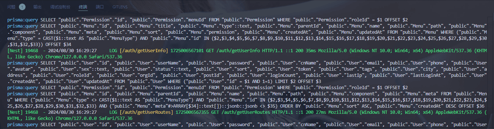
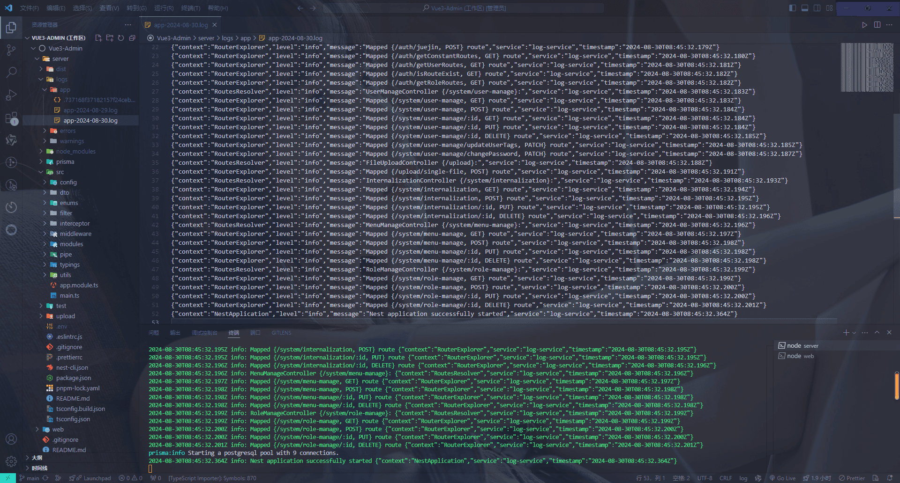

## 前言

日志记录在后台服务的重要性不言而喻，它可以帮助开发者 `调试和故障排查`、 `性能监控`、 `审计和安全`、 `监控和警报`等。

[Nest](https://nestjs.com/) 附带一个默认的内部日志记录器实现，它在实例化过程中以及在一些不同的情况下使用，比如发生异常等等（例如系统记录）。这由 **@nestjs/common** 包中的 **Logger** 类实现。你可以全面控制如下的日志系统的行为：

1.  完全禁用日志

2.  指定日志系统详细水平（例如，展示错误，警告，调试信息等）

3.  覆盖默认日志记录器的时间戳（例如使用 ISO8601 标准作为日期格式）

4.  完全覆盖默认日志记录器

5.  通过扩展自定义默认日志记录器

6.  使用依赖注入来简化编写和测试你的应用

更多高级的日志功能，可以使用任何 **Node.js** 日志包，比如[Winston](https://github.com/winstonjs/winston)，来生成一个完全自定义的生产环境水平的日志系统。

今天我们就看看在 [Nest](https://nestjs.com/) 服务中应该如何使用 [Winston](https://github.com/winstonjs/winston) 记录日志。

## Nest 控制台

我们先看一下 [Nest](https://nestjs.com/) 服务原生的控制台输出：



在接口请求和执行 **SQL** 的时候，控制台并没有相应的输出信息，这不方便我们排查和调试。

我们需要在服务执行操作的时候，控制台应该输出信息：

1.  执行 **SQL** 时，打印 **SQL** 日志

2.  调用接口时，打印接口请求日志

3.  将接口调用时的日志生成保存到指定文件夹中

## 打印 Prisma 日志

由于我的项目是使用 [Prisma](https://prisma.yoga/) 客户端，按照官网文档[配置日志记录](https://prisma.yoga/concepts/components/prisma-client/working-with-prismaclient/logging)。

在 **PrismaService** 中配置：

```ts
import { Injectable, OnModuleDestroy, OnModuleInit } from "@nestjs/common";
import { PrismaClient } from "@prisma/client";

@Injectable()
export class PrismaService
  extends PrismaClient
  implements OnModuleInit, OnModuleDestroy
{
  constructor() {
    super({
      log: ["query", "info", "warn", "error"], // 这里设置日志级别
    });
  }
  async onModuleInit() {
    await this.$connect(); // 在模块初始化时连接到数据库
  }

  async onModuleDestroy() {
    await this.$disconnect(); // 在应用程序关闭时断开与数据库的连
  }
}
```

在执行 **SQL** 时，控制台就会输出信息：



## 接口请求日志

[Nest](https://nestjs.com/) 内部自带了 **Logger** 类，我们创建一个日志中间件：

```ts
import { Injectable, Logger, NestMiddleware } from "@nestjs/common";
import dayjs from "dayjs";
import { NextFunction, Request, Response } from "express";

@Injectable()
export class LoggerMiddleware implements NestMiddleware {
  private logger = new Logger();
  use(req: Request, res: Response, next: NextFunction) {
    // 记录开始时间
    const start = Date.now();
    // 获取请求信息
    const { method, originalUrl, ip, httpVersion, headers } = req;

    // 获取响应信息
    const { statusCode } = res;

    res.on("finish", () => {
      // 记录结束时间
      const end = Date.now();
      // 计算时间差
      const duration = end - start;

      // 这里可以根据自己需要组装日志信息：[timestamp] [method] [url] HTTP/[httpVersion] [client IP] [status code] [response time]ms [user-agent]
      const logFormat = `${dayjs().valueOf()} ${method} ${originalUrl} HTTP/${httpVersion} ${ip} ${statusCode} ${duration}ms ${headers["user-agent"]}`;

      // 根据状态码，进行日志类型区分
      if (statusCode >= 500) {
        this.logger.error(logFormat, originalUrl);
      } else if (statusCode >= 400) {
        this.logger.warn(logFormat, originalUrl);
      } else {
        this.logger.log(logFormat, originalUrl);
      }
    });

    next();
  }
}
```

在 **AppModule** 中全局注册：

```ts
import { MiddlewareConsumer, Module, NestModule } from "@nestjs/common";

import { LoggerMiddleware } from "@/middleware/logger.middleware"; // 全局日志中间件

@Module({
  imports: [],
})
export class AppModule implements NestModule {
  configure(consumer: MiddlewareConsumer) {
    consumer.apply(LoggerMiddleware).forRoutes("*");
  }
}
```

在接口调用时，控制台就会输出信息：



## Winston 生成日志

我们需要安装几个依赖：

1.  [winston](https://github.com/winstonjs/winston)：一个通用的日志记录库，为 **Node.js** 应用提供灵活的日志记录功能

2.  [nest-winston](https://github.com/gremo/nest-winston): 一个用于 [winston](https://github.com/winstonjs/winston) 的 [Nest](https://nestjs.com/) 模块包装器

3.  [winston-daily-rotate-file](https://github.com/winstonjs/winston-daily-rotate-file): 用于将日志文件按天轮换保存

4.  [chalk](https://github.com/chalk/chalk): 用于在终端中输出带有颜色的文本

终端执行命令：

```bash
pnpm add winston nest-winston winston-daily-rotate-file chalk@4
```

新建 [winston](https://github.com/winstonjs/winston) 配置文件：

```ts
import chalk from "chalk"; // 用于颜色化输出
import { createLogger, format, transports } from "winston";
import DailyRotateFile from "winston-daily-rotate-file";

// 定义日志级别颜色
const levelsColors = {
  error: "red",
  warn: "yellow",
  info: "green",
  debug: "blue",
  verbose: "cyan",
};

const winstonLogger = createLogger({
  format: format.combine(
    format.timestamp(),
    format.errors({ stack: true }),
    format.splat(),
    format.json()
  ),
  defaultMeta: { service: "log-service" },
  transports: [
    new DailyRotateFile({
      filename: "logs/errors/error-%DATE%.log", // 日志名称，占位符 %DATE% 取值为 datePattern 值。
      datePattern: "YYYY-MM-DD", // 日志轮换的频率，此处表示每天。
      zippedArchive: true, // 是否通过压缩的方式归档被轮换的日志文件。
      maxSize: "20m", // 设置日志文件的最大大小，m 表示 mb 。
      maxFiles: "14d", // 保留日志文件的最大天数，此处表示自动删除超过 14 天的日志文件。
      level: "error", // 日志类型，此处表示只记录错误日志。
    }),
    new DailyRotateFile({
      filename: "logs/warnings/warning-%DATE%.log",
      datePattern: "YYYY-MM-DD",
      zippedArchive: true,
      maxSize: "20m",
      maxFiles: "14d",
      level: "warn",
    }),
    new DailyRotateFile({
      filename: "logs/app/app-%DATE%.log",
      datePattern: "YYYY-MM-DD",
      zippedArchive: true,
      maxSize: "20m",
      maxFiles: "14d",
    }),
    new transports.Console({
      format: format.combine(
        format.colorize({
          colors: levelsColors,
        }),
        format.simple(),
        format.printf(info => {
          // 获取 Info Symbols key
          const symbols = Object.getOwnPropertySymbols(info);
          const color = levelsColors[info[symbols[0]]]; // 获取日志级别的颜色
          const chalkColor = chalk[color];
          const message = `${chalkColor(info.timestamp)} ${chalkColor(info[symbols[2]])}`;
          return message;
        })
      ),
      level: "debug",
    }),
  ],
});

export default winstonLogger;
```

这里我们按照日志不同级别区分，在 **AppModule** 配置服务：

```ts
import { MiddlewareConsumer, Module, NestModule } from "@nestjs/common";
import { WinstonModule } from "nest-winston";

import { LoggerMiddleware } from "@/middleware/logger.middleware"; // 全局日志中间件

import winstonLogger from "./config/winston.config";

@Module({
  imports: [
    WinstonModule.forRoot({
      transports: winstonLogger.transports,
      format: winstonLogger.format,
      defaultMeta: winstonLogger.defaultMeta,
      exitOnError: false, // 防止意外退出
    }),
  ],
})
export class AppModule implements NestModule {
  configure(consumer: MiddlewareConsumer) {
    consumer.apply(LoggerMiddleware).forRoutes("*");
  }
}
```

在 **main.ts** 中更换日志记录器：

```ts
import { WINSTON_MODULE_NEST_PROVIDER } from "nest-winston";

async function bootstrap() {
  const app = await NestFactory.create(AppModule);
  app.useLogger(app.get(WINSTON_MODULE_NEST_PROVIDER));
  await app.listen(3000);
}
bootstrap();
```

## 最终效果



## 总结

这里只是简单的日志记录示例，更加高级自定义的日志功能需要自己去探索。
