## 起因

**2024年国庆后，我的身体开始“抗议”**  
国庆假期结束，回归工作岗位不久，我的身体突然拉响警报——**持续腹痛、频繁呕吐、大便不成形、食欲骤降**。起初，我以为是普通的肠胃炎或饮食问题，并未太在意。然而，一个月后，**我的体重竟暴跌十几斤**，这让我瞬间慌了神。暴瘦背后，往往隐藏着更严重的健康隐患，我意识到：必须尽快就医。

**第一次就诊：被草草打发的“肠道功能紊乱”**  
我立刻前往**深圳市人民医院消化内科**就诊，向医生详细描述了症状。由于情况特殊，医生安排了**加急肠镜**。检查报告显示**升结肠溃疡伴狭窄**，但医生的诊断却是**肠道功能紊乱**，只开了一个月的肠胃药便让我回家观察。

服药后，症状有所缓解，但并未根治。一个月后复查，医生又开了类似的药物，这让我开始怀疑——**如果是对症下药，为何迟迟不见好转？**

**漫长的求医路：中医调理、病情反复**  
接下来的几个月，我的体重虽未继续下降，但也无法恢复。由于始终找不到病因，我尝试了**中医调理**，喝了不少苦药，却依然不见起色。

直到今年五一前夕，在朋友的推荐下，我前往**广州中山大学附属第一医院**求诊。

## 全面检查

2025年5月27日，我踏进了**广州中山大学附属第一医院**的大门。由于专家号一号难求，我咬牙挂了**600元的特需门诊**——此刻，钱已经不是问题，我只想得到一个确切的答案。

接诊的主任医师仔细翻看我带来的外院肠镜报告，目光停留在**升结肠溃疡伴狭窄**的结论上，眉头微皱：**“这个溃疡不太对劲，建议住院做个全面检查。”**  
短短一句话，让我的心猛地一沉——**原来问题比我想象的更复杂。**

第二天，我办理了住院手续。躺在病床上时，还有些恍惚：**从小到大连感冒都少有的我，竟然住院了？**

接下来的两天，我像被送进**检测流水线**：

-   **心电图**、**胸部CT**——排查心肺问题
    
-   **肠道彩超**、**增强肠镜**——精准观察溃疡细节
    
-   **MRE（磁共振肠道造影）**——无创评估全消化道
    
-   **血常规+炎症指标**——寻找免疫异常的蛛丝马迹
    

苦中作乐地想：**这倒是个“免费全身体检”的机会。**

最重要的**肠镜病理报告**需要3-5个工作日。5月30日，医生安排我先出院等待。  
收拾行李时，护士开玩笑：“希望下次见你是来取报告，不是回来住院。”  
我勉强笑了笑，心里却像压了块石头——**这一次，能等到真相吗？**

p]:my-0 [&>p>img]:my-0">

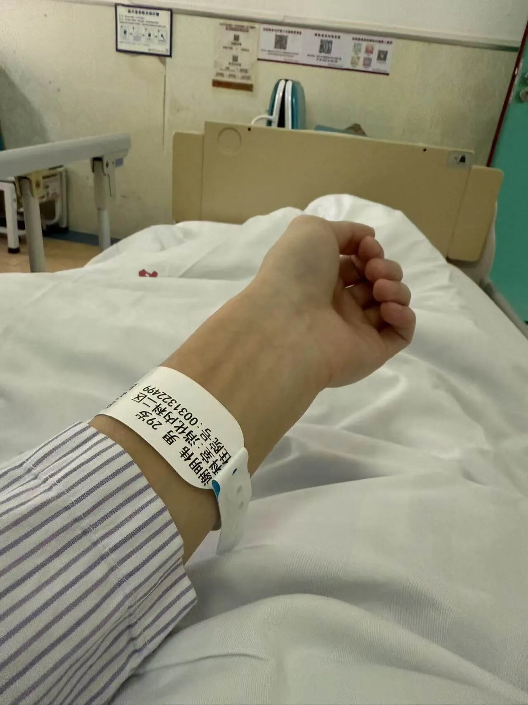

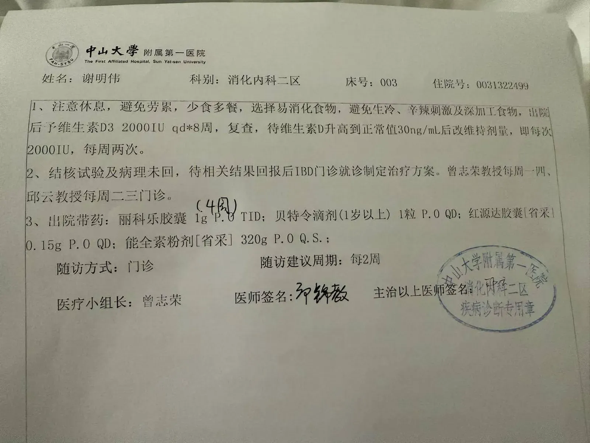

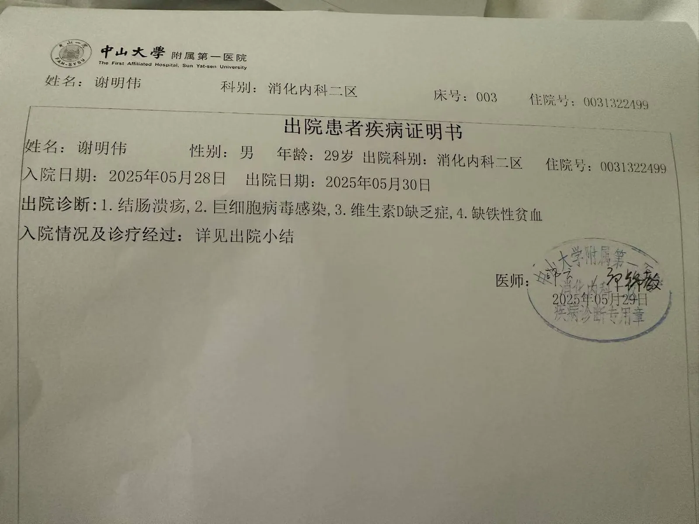

## 诊断结果

2025年6月12日，我再次来到中山一院。当主任医师展开我的病理报告时，诊室里的空气似乎都凝固了。

"结肠溃疡伴狭窄，回肠多发肠瘘、肠周脓肿形成..."医生指着影像片子解释道，"这符合克罗恩病的典型表现，但你的情况比较特殊。"

特殊之处在于：

-   **多发性肠瘘**：肠道已形成异常通道
    
-   **肠周脓肿**：感染风险升高
    
-   **广泛病变**：累及多个肠段
    

由于病情复杂，医生决定启动**多学科会诊（MDT）**，需要消化内科、外科、影像科专家共同讨论。临走前，医生特别嘱咐："你现在营养吸收很差，要改用全肠内营养粉补充。"

等待会诊期间，我通过Deepseek分析了检查报告。AI给出的判断很明确：  
✓ 肠瘘+脓肿=**手术绝对指征**  
✓ 预测治疗方案：**先微创手术，后生物制剂**

p]:my-0 [&>p>img]:my-0">

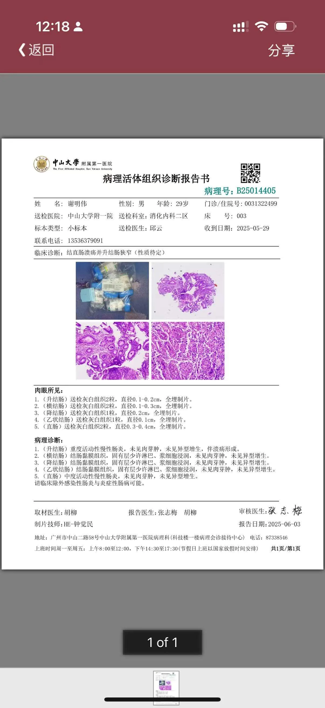

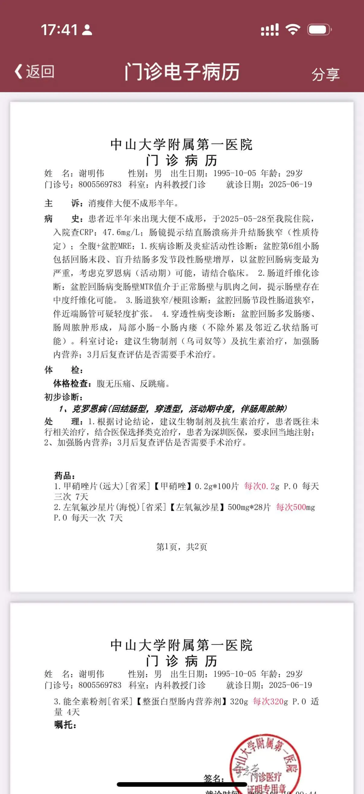

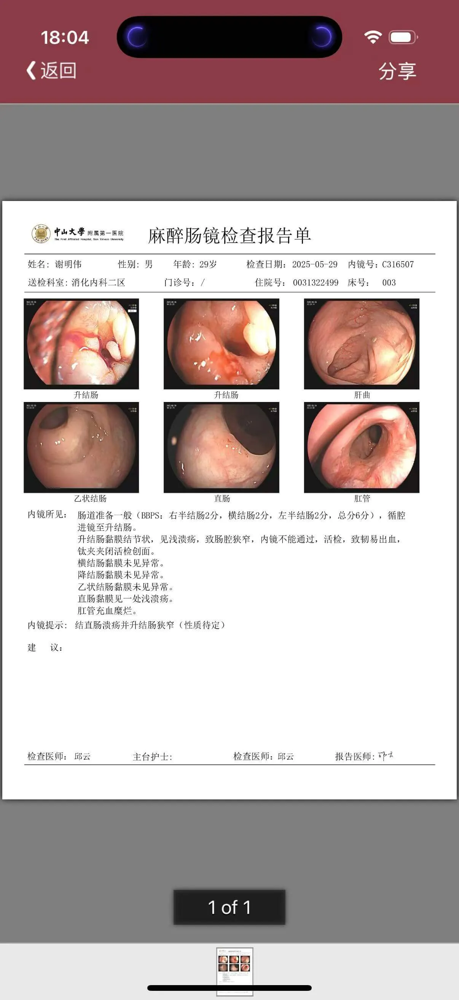

这让我暗自做好了手术的心理准备。

一周后复诊，MDT团队给出了谨慎的治疗方案：

1.  **暂缓手术**：因病变范围广，手术效果可能不佳
    
2.  **首选治疗**：注射类克（英夫利昔单抗）生物制剂
    
    -   原因：乌司奴单抗尚未进入医保
        
3.  **辅助治疗**：配合免疫抑制剂
    
4.  **复查节点**：3个月后评估手术必要性
    

医生在病历本上写下"CD（克罗恩病）活动期"时，我反而松了一口气——**至少，迷雾中终于有了明确的作战路线。**

## 第一针类克

拿到治疗方案后，一个意外情况出现了——中山一院总部暂时无法进行类克注射。"你可以回深圳打，"医生建议道，"记得第一次注射要住院观察。"

返程的高铁上，我立刻掏出手机查询深圳具备类克注射资质的医院，并成功预约了第二天的住院治疗。

### 人生最贵的输液：4小时6800元

办理住院时，护士笑着提醒："类克可是我们这最贵的'点滴'哦！"确实，账单显示：

-   **类克药物**：3瓶×2006.8元=6019.8元
    
-   **住院杂费**：约800元
    
-   **医保报销后**：自费仅1000出头
    

下午2点，护士推来了带着专用保温箱的生物制剂。连接心电监护仪后，透明的药液开始缓缓滴入静脉。

-   **全程监护**：床边机器实时显示心率、血氧
    
-   **耗时漫长**：从配药到结束整整4小时
    
-   **意外顺利**：除了手臂微凉，没有任何不适
    

### 医保福利时间：60元的营养粉只要6元

次日出院前，我特意让医生多开了几罐营养粉。结账时简直惊喜：

-   **市价**：68元/罐（网购价）
    
-   **医保价**：6.5元/罐
    
-   **果断囤货**：直接带走一周用量
    

看着缴费单，不禁感慨：**生病是不幸的，但生在深圳是幸运的。**

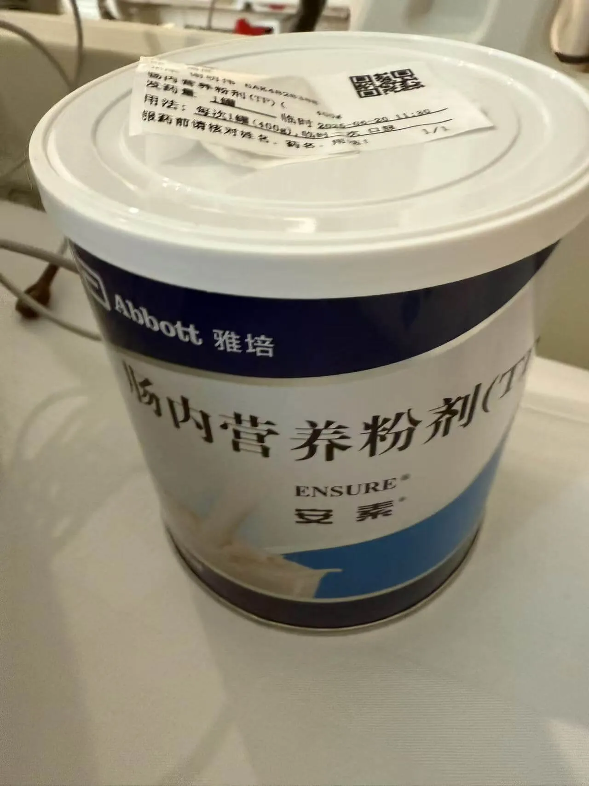

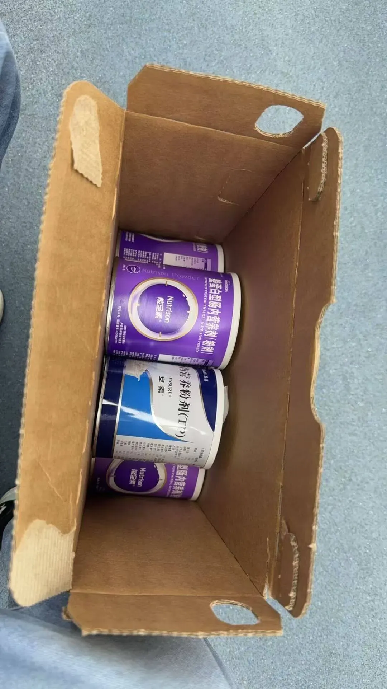

### 长期抗战的开始：类克接种时间表

护士递来的注意事项写着：

-   **强化期**：第0、2、6周各一针
    
-   **维持期**：每8周一次
    
-   **每次流程**：住院1天+3瓶类克
    

算下来，**年均治疗费约4万元**，经医保报销后自付不到1万。这个数字，让原本沉重的治疗计划突然变得可以承受。

p]:my-0 [&>p>img]:my-0">

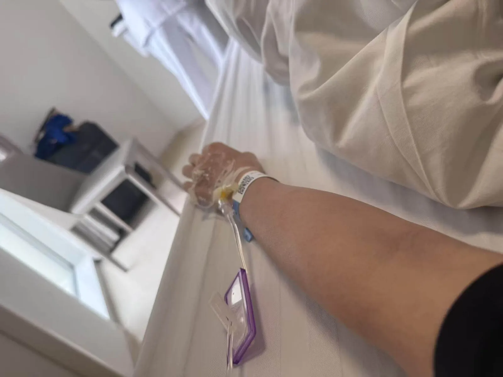

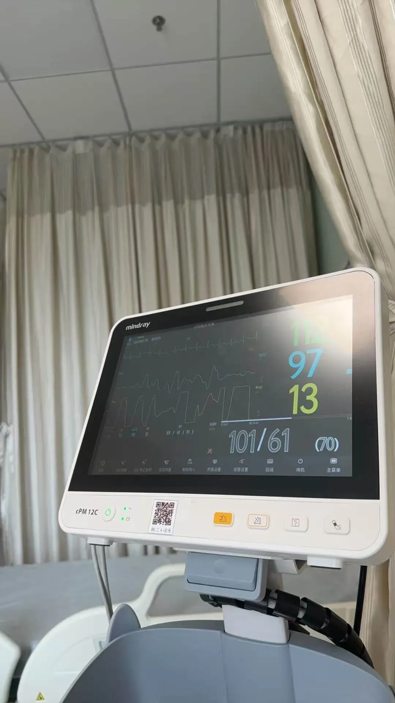

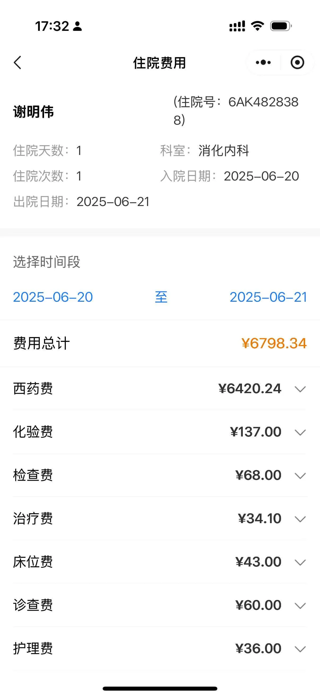

## 这半年的迷途与曙光

回望这半年：

-   从**国庆后的莫名腹痛**到**春节时的暴瘦惊魂**
    
-   从**深圳医院的误诊曲折**到**广州专家的火眼金睛**
    
-   从**面对肠镜报告的茫然**到**病理确诊时的释然**
    

### 治疗刚开始，心已安定

虽然：  
✓ 每日仍要面对**腹痛纠缠**  
✓ 体重计的数字**顽固不升**  
✓ 营养粉的味道**实在难以下咽**

但至少：  
✓ 不用再被**"我到底得了什么病"**的念头折磨  
✓ 类克的输液瓶里**流淌着确切希望**  
✓ 医保报销单上的数字**证明着制度温度**

### 写在治疗长征的起点

我知道：

-   生物制剂**不会立即创造奇迹**
    
-   增重之路**必然缓慢艰难**
    
-   未来可能还有**手术关卡要闯**
    

但站在这个治疗起点上，我反而想对半年前那个惶恐的自己说：  
**"别怕，我们找到方向了。"**
