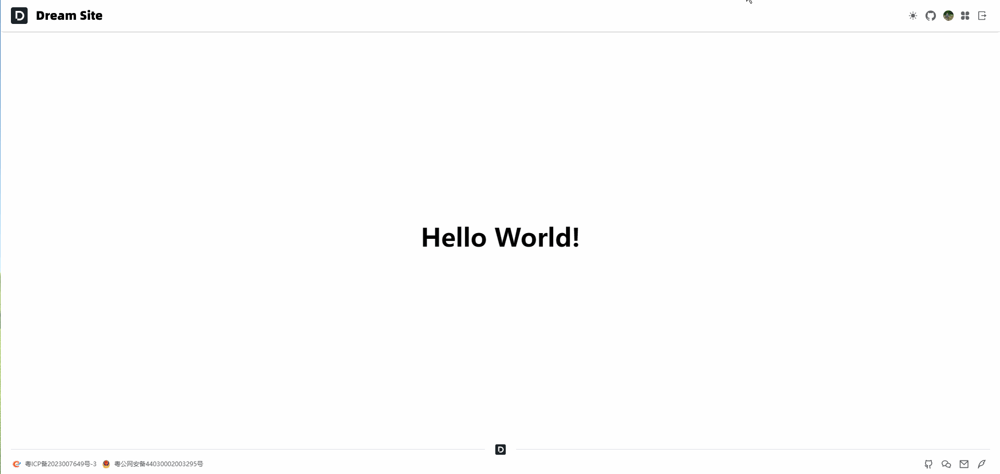

## 前言

在 [Nuxt3](https://nuxt.com/) 中要实现暗黑模式，需要用到一个库：[color-mode](https://nuxt.com.cn/modules/color-mode)，它可以帮助我们很轻易地实现暗黑模式切换。

## 具体使用

1.  安装 **@nuxtjs/color-mode** 依赖：
```bash
pnpm add @nuxtjs/color-mode -D
```


2.  打开 **nuxt.config.ts** 配置文件注入依赖：
```ts
export default defineNuxtConfig({
   modules: ['@nuxtjs/color-mode']
 })
```


3.  你也可以根据项目实际情况自定义配置，以下是一些默认配置：
```ts
import { defineNuxtConfig } from 'nuxt'

export default defineNuxtConfig({
   modules: ['@nuxtjs/color-mode'],
   colorMode: {
     preference: 'system', // default value of $colorMode.preference
     fallback: 'light', // fallback value if not system preference found
     hid: 'nuxt-color-mode-script',
     globalName: '__NUXT_COLOR_MODE__',
     componentName: 'ColorScheme',
     classPrefix: '',
     classSuffix: '-mode',
     storageKey: 'nuxt-color-mode'
   }
})
```


具体的使用文档：[NuxtColorMode](https://color-mode.nuxtjs.org/)

## 按钮模式

1.  在 **src/components** 中新建 **ColorMode/index.vue** 文件：
```vue
<script setup lang="ts">
const colorMode = useColorMode()

// 切换模式
const setColorMode = () => {
  colorMode.value = colorMode.value === 'dark' ? 'light' : 'dark'
}

// 判断是否支持 startViewTransition API
const enableTransitions = () =>
  'startViewTransition' in document &&
  window.matchMedia('(prefers-reduced-motion: no-preference)').matches

// 切换动画
async function toggleDark({ clientX: x, clientY: y }: MouseEvent) {
  const isDark = colorMode.value === 'dark'

  if (!enableTransitions()) {
    setColorMode()
    return
  }

  const clipPath = [
    `circle(0px at ${x}px ${y}px)`,
    `circle(${Math.hypot(
      Math.max(x, innerWidth - x),
      Math.max(y, innerHeight - y)
    )}px at ${x}px ${y}px)`
  ]

  await document.startViewTransition(async () => {
    setColorMode()
    await nextTick()
  }).ready

  document.documentElement.animate(
    { clipPath: !isDark ? clipPath.reverse() : clipPath },
    {
      duration: 300,
      easing: 'ease-in',
      pseudoElement: `::view-transition-${!isDark ? 'old' : 'new'}(root)`
    }
  )
}
</script>

<template>
  <el-tooltip
    :content="`切换${$colorMode.value === 'dark' ? '白天' : '黑夜'}模式`"
    placement="bottom"
  >
    <el-button
      circle
      text
      @click="toggleDark"
    >
      <Icon
        :name="$colorMode.value === 'dark' ? 'i-heroicons-moon-solid' : 'i-heroicons-sun-solid'"
        class="h-5 w-5"
      />
    </el-button>
  </el-tooltip>
</template>

<style>
::view-transition-old(root),
::view-transition-new(root) {
  animation: none;
  mix-blend-mode: normal;
}

::view-transition-old(root),
.dark::view-transition-new(root) {
  z-index: 1;
}

::view-transition-new(root),
.dark::view-transition-old(root) {
  z-index: 9999;
}
</style>
```


2.  在需要的地方加载组件：
```text
<ColorMode />
```


## 最终效果


