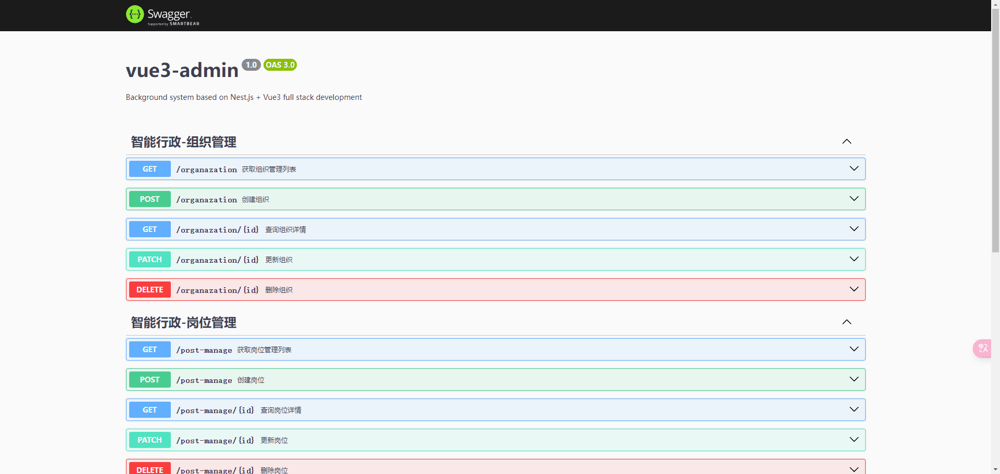
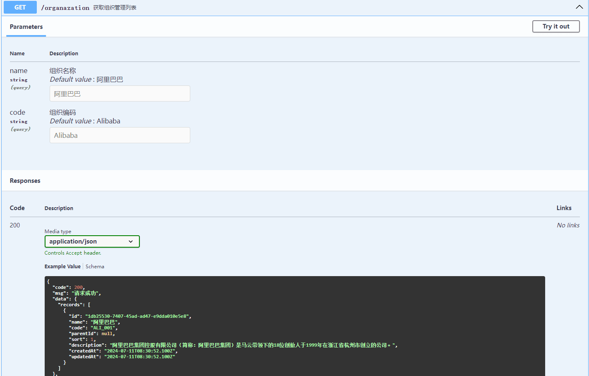
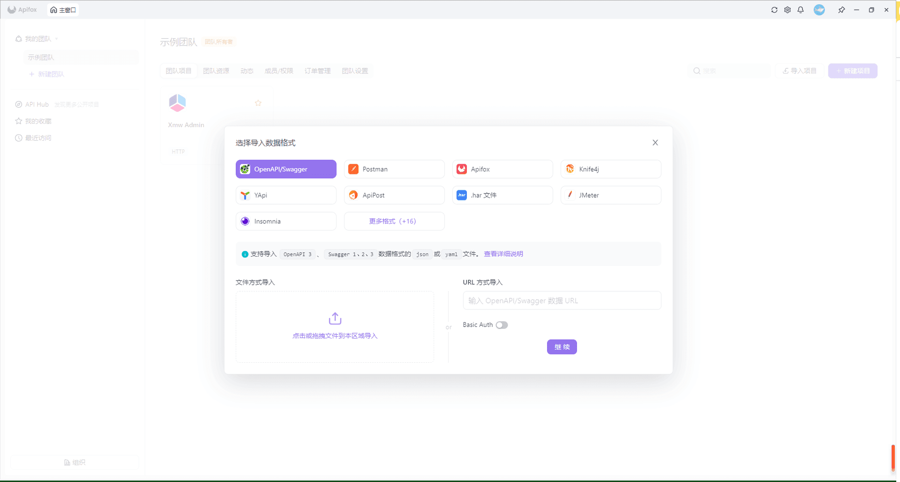

## 什么是 Swagger ?

[Swagger](https://swagger.io/) 是一组围绕 [OpenAPI](https://github.com/OAI/OpenAPI-Specification) 规范构建的开源工具，可以帮助您设计、构建、记录和使用 **REST API**。主要的 [Swagger](https://swagger.io/) 工具 包括：

- [Swagger Editor](https://editor.swagger.io/)：基于浏览器的编辑器，您可以在其中编写 [OpenAPI](https://github.com/OAI/OpenAPI-Specification) 定义

- [Swagger UI](https://github.com/swagger-api/swagger-ui)：将 [OpenAPI](https://github.com/OAI/OpenAPI-Specification) 定义呈现为交互式文档

- [Swagger Codegen](https://github.com/swagger-api/swagger-codegen)：从 [OpenAPI](https://github.com/OAI/OpenAPI-Specification) 定义中生成服务器存根和客户端库

- [Swagger Editor Next（beta）](https://editor-next.swagger.io/)：基于浏览器的编辑器，您可以在其中编写和查看 [OpenAPI](https://github.com/OAI/OpenAPI-Specification) 和 [AsyncAPI](https://github.com/asyncapi) 定义

- [Swagger Core](https://github.com/swagger-api/swagger-core)：用于创建、使用和处理 [OpenAPI](https://github.com/OAI/OpenAPI-Specification) 定义的 [Java](https://www.java.com/) 相关库

- [Swagger Parser](https://github.com/swagger-api/swagger-parser)：用于解析 [OpenAPI](https://github.com/OAI/OpenAPI-Specification) 定义的独立库

- [Swagger APIDom](https://github.com/swagger-api/apidom)：提供了一个单一的、统一的结构，用于跨各种描述语言和序列化格式描述 **API**

## Nest 集成 Swagger

1.  安装依赖

```bash
pnpm add @nestjs/swagger swagger-ui-express
```

2.  在 **main.ts** 文件中定义并初始化 **SwaggerModule** 类

```ts
import { NestFactory } from "@nestjs/core";
import { DocumentBuilder, SwaggerModule } from "@nestjs/swagger";

import { AppModule } from "./app.module";
async function bootstrap() {
  const app = await NestFactory.create(AppModule);

  // 构建swagger文档
  const options = new DocumentBuilder()
    .setTitle("vue3-admin")
    .setDescription(
      "Background system based on Nest.js + Vue3 full stack development"
    )
    .setVersion("1.0")
    .build();
  const document = SwaggerModule.createDocument(app, options);
  SwaggerModule.setup("docs", app, document);

  await app.listen(3000);
}
bootstrap();
```

3.  启动服务，访问 [http://localhost:3000/docs](http://localhost:3000/docs)，你会看到 [Swagger](https://swagger.io/) 页面：



## DocumentBuilder 属性

| 方法                    | 描述                   |
| ----------------------- | ---------------------- |
| setTitle                | 文档标题               |
| setDescription          | 文档描述               |
| setVersion              | 文档版本               |
| setTermsOfService       | 文档服务条款           |
| setContact              | 文档联系信息           |
| setLicense              | 文档许可证信息         |
| addServer               | 文档服务地址           |
| setExternalDoc          | 文档外部链接           |
| setBasePath             | 设置文档基础路径       |
| addTag                  | 添加文档标签           |
| addExtension            | 添加扩展               |
| addSecurity             | 添加安全方案           |
| addGlobalParameters     | 添加全局参数           |
| addSecurityRequirements | 添加安全需求           |
| addBearerAuth           | 添加 Bearer Token 认证 |
| addOAuth2               | 添加 OAuth2 认证       |
| addApiKey               | 添加 ApiKey            |
| addBasicAuth            | 添加基础认证           |
| addCookieAuth           | 添加 Cookie 认证       |
| build                   | 构建服务               |

## 在 Nest 中使用

1.  在 **DTO(响应数据传输对象)** 文件中使用装饰器

```ts
import { ApiProperty } from "@nestjs/swagger";
import { IsNumberString, IsOptional, IsUUID } from "class-validator";

export class PostParamsDto {
  @ApiProperty({
    type: String,
    description: "岗位名称",
    required: false,
    default: "前端工程师",
  })
  name?: string;

  @ApiProperty({
    type: String,
    description: "所属组织",
    default: "f45cd48b-e703-49db-91be-ae7f594e73e0",
    required: false,
  })
  @IsOptional()
  @IsUUID("all", { message: "orgId 参数不正确" })
  orgId?: string;

  @ApiProperty({
    type: Number,
    description: "开始日期",
    default: 1721145600000,
    required: false,
  })
  @IsOptional()
  @IsNumberString({}, { message: "开始日期必须是时间戳格式" })
  startTime?: number;

  @ApiProperty({
    type: Number,
    description: "结束日期",
    default: 1721318399999,
    required: false,
  })
  @IsOptional()
  @IsNumberString({}, { message: "结束日期必须是时间戳格式" })
  endTime?: number;
}
```

2.  在 **Controller 控制器** 中使用装饰器

```ts
import { Controller, Get, Query } from "@nestjs/common";
import { ApiOkResponse, ApiOperation, ApiTags } from "@nestjs/swagger"; // swagger 接口文档

import { PostParamsDto } from "./dto/params-post.dto";
import { ResponsePostDto } from "./dto/response-post.dto";
import { PostManageService } from "./post-manage.service";

@ApiTags("智能行政-岗位管理")
@Controller("post-manage")
export class PostManageController {
  constructor(private readonly postManageService: PostManageService) {}

  /**
   * @description: 查询岗位列表
   */
  @Get()
  @ApiOkResponse({ type: ResponsePostDto })
  @ApiOperation({ summary: "获取岗位管理列表" })
  findAll(@Query() params: PostParamsDto) {
    return this.postManageService.findAll(params);
  }
}
```

## 常用 Swagger 装饰器

| 装饰器              | 描述                                                     |
| ------------------- | -------------------------------------------------------- |
| @ApiTags            | 为控制器或方法添加标签，用于组织 Swagger UI 文档         |
| @ApiOperation       | 为控制器方法添加操作描述，包括摘要和详细描述             |
| @ApiParam           | 描述路径参数、请求参数或响应参数，包括名称、类型、描述等 |
| @ApiBody            | 指定请求体的 DTO 类型，用于描述请求体的结构              |
| @ApiResponse        | 描述 API 的响应，包括状态码、描述等                      |
| @ApiBearerAuth      | 指定请求需要携带 Bearer Token，用于身份验证              |
| @ApiProperty        | 为 DTO 类型的属性添加元数据，如描述、默认值等            |
| @ApiQuery           | 描述查询参数，包括名称、类型、描述等                     |
| @ApiHeader          | 描述请求头信息，包括名称、类型、描述等                   |
| @ApiExcludeEndpoint | 标记一个控制器方法不在 Swagger UI 中显示                 |

## 效果图



## 总结

在 [Nest](https://nestjs.com/) 中集成 [Swagger](https://swagger.io/) 文档可以帮助开发者自动生成和维护 **API** 文档，[Swagger](https://swagger.io/) 的集成提供了在线生成、‌自动生成、‌可操作数据库等优点，规范了 **API** 的标准化和一致性，后期还可以把 [Swagger](https://swagger.io/) 文档导入到其他平台，例如 [ApiFox](https://apifox.com/)



不足之处就是会增加开发者的工作量，每一个接口都需要保持注释和装饰器的准确性和完整性，仍然需要一定的维护工作。
