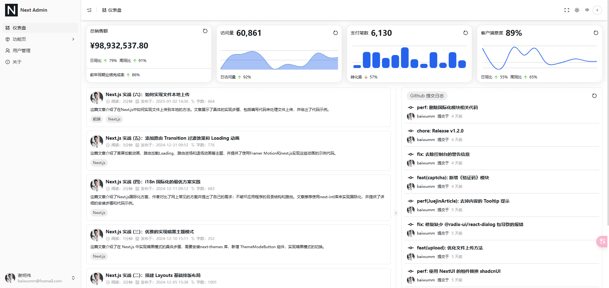
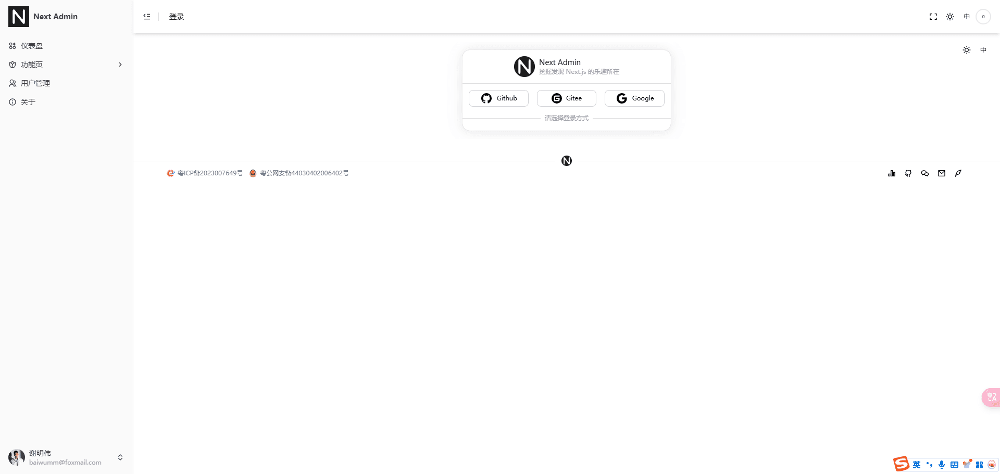

## 业务场景

在目前常见的中后台管理系统中，比较常见的是固定的布局方式包裹页面，但一些特殊页面，比如： `登录页面`、 `注册页面`、 `忘记密码页面`这些页面是不需要布局包裹的。

但在 [Next.js AppRouter](https://nextjs.org/docs/app) 中，必须包含一个根布局文件(**RootLayout**)，默认情况下，文件夹层次结构中的布局也是嵌套的，这意味着它们通过其子布局的属性来包装子布局。这是 [Next.js](https://nextjs.org/) 框架的设计理念，目的是允许你创建复杂的页面结构，同时保持代码的整洁和可维护性。

以官网 [Nesting layouts](https://nextjs.org/docs/app/getting-started/layouts-and-pages#nesting-layouts) 为例，最后 **app/blog/\[slug\]/page.js** 生成的结果为：

```tsx
<RootLayout>
  <BlogLayout>{children}</BlogLayout>
</RootLayout>
```

正常页面是这样的：



但登录页面如果不处理就会变成这样：



很明显，这不是我们想要的，我们希望这些特殊页面不需要父级 **layout** 包裹，那这个问题该怎么去解决呢？

## 解决方案

我在网上几乎找不到关于 [Next.js](https://nextjs.org/) **layout 嵌套布局** 的资料，但我觉得这个问题挺有意思的，所以特地写篇文章讨论一下。

这个问题归根结底就是你要不要在 **RootLayout** 里面写入布局代码，这时候就会分两种情况：

1.  如果你不嫌麻烦，**RootLayout** 根布局留空，然后在需要的页面下都新建一个 **layout.tsx** 文件：

```ts
export default async function RootLayout({
  children,
}: Readonly<{
  children: React.ReactNode;
}>) {
  return (
    <html lang={locale} suppressHydrationWarning>
      <body>
        {children}
      </body>
    </html>
  );
}
```

我看一些 [Next.js](https://nextjs.org/) 教程的源码就是这样布局的，感觉有点麻烦。

2.  还有一种就是默认 **RootLayout** 是常规布局，我们需要想个办法在一些特殊页面把 **RootLayout** 包裹去掉。

我采用的是后者，确定方案后，决定结合 [zustand](https://github.com/pmndrs/zustand) 来定义一个变量用来是否显示根布局。

## 具体步骤

1.  新建 **/store/layoutStore.ts** 文件：

```ts
import { create } from "zustand";

type LayoutState = {
  skipGlobalLayout: boolean;
  setSkipGlobalLayout: (skip: boolean) => void;
};

export const useLayoutStore = create<LayoutState>(set => ({
  skipGlobalLayout: false,
  setSkipGlobalLayout: skip => set({ skipGlobalLayout: skip }),
}));
```

2.  新建 **/components/GlobalLayout** 文件：

```ts
'use client';
import { SessionProvider } from 'next-auth/react';

import AppSideBar from '@/components/AppSideBar';
import GlobalFooter from '@/components/GlobalFooter'; // 底部版权
import GlobalHeader from '@/components/GlobalHeader'; // 头部布局
import PageAnimatePresence from '@/components/PageAnimatePresence';
import { SidebarInset, SidebarProvider } from '@/components/ui/sidebar';
import { useLayoutStore } from '@/store/layoutStore';

type GlobalLayoutProps = {
  children: React.ReactNode;
};

export default function GlobalLayout({ children }: GlobalLayoutProps) {
  // 是否跳过全局布局
  const skipGlobalLayout = useLayoutStore((state) => state.skipGlobalLayout);

  return skipGlobalLayout ? (
    <>{children}</>
  ) : (
    <SessionProvider>
      <SidebarProvider>
        <AppSideBar />
        <SidebarInset>
          {/* 头部布局 */}
          <GlobalHeader />
          <PageAnimatePresence>{children}</PageAnimatePresence>
          {/* 底部版权 */}
          <GlobalFooter />
        </SidebarInset>
      </SidebarProvider>
    </SessionProvider>
  );
}
```

3.  修改根目录 **layout.tsx** 文件：

```ts
import GlobalLayout from '@/components/GlobalLayout'; // 全局布局

export default async function RootLayout({
  children,
}: Readonly<{
  children: React.ReactNode;
}>) {
  return (
    <html lang={locale} suppressHydrationWarning>
      <body>
        <GlobalLayout>{children}</GlobalLayout>
      </body>
    </html>
  );
}
```

4.  在不需要 **RootLayout** 的页面 **layout.tsx** 文件中：

```ts
'use client';

import { useMount, useUnmount } from 'ahooks';

import LangSwitch from '@/components/LangSwitch';
import ThemeModeButton from '@/components/ThemeModeButton';
import { useLayoutStore } from '@/store/layoutStore';

export default function LoginLayout({ children }: { children: React.ReactNode }) {
  useMount(() => {
    useLayoutStore.setState({ skipGlobalLayout: true });
  });

  useUnmount(() => {
    // 如果需要在离开页面时重置状态
    useLayoutStore.setState({ skipGlobalLayout: false });
  });
  return (
    <div className="relative flex h-[calc(100vh_-_2rem)] w-[calc(100vw_-_2rem)] overflow-hidden justify-center items-center">
      {children}
      <div className="flex absolute top-0 right-0">
        <ThemeModeButton />
        <LangSwitch />
      </div>
    </div>
  );
}
```

我们根据 **skipGlobalLayout** 属性来判断是否显示 **RootLayout** 布局，这样就能达到我们的目的了。
